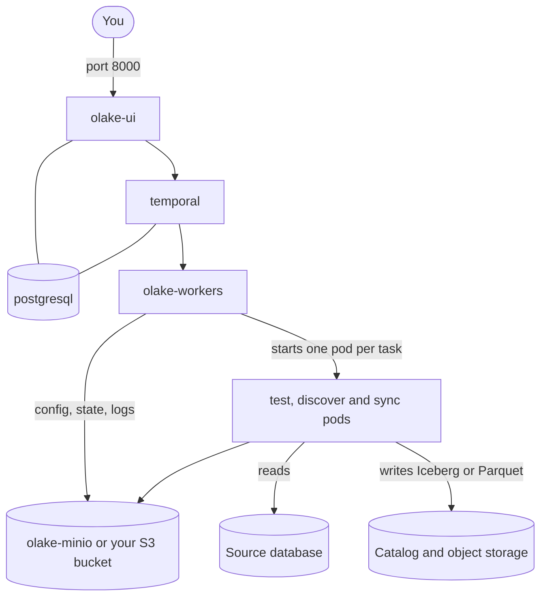

import CodeBlock from '@theme/CodeBlock';


The official OLake Helm chart installs the OLake UI, the OLake Go workers, Temporal and PostgreSQL in one `helm install`. Every connection test, schema discovery and sync then runs in its own short-lived Kubernetes pod. This guide installs the chart, runs a first Postgres to Apache Iceberg sync, defines the same kind of pipeline from Git with GitOps, and covers the values that matter before production.

**Updated 27 November 2026.** Everything below was run on that date with Helm chart `olake` 0.0.37 (app version 0.3.11) and OLake Go v1.2.2 connectors, on a local [kind](https://kind.sigs.k8s.io/) cluster running Kubernetes 1.27.3. The numbers in this post come from that run.

<TLDR title='Key takeaways'>

- One command installs the whole stack. On kind it took 1 minute 42 seconds, image pulls included, and the first 10,000-row sync into Iceberg ran in 10 seconds.
- Each test, discovery and sync runs as its own pod with the connector image, so a heavy sync never shares a container with the UI or the scheduler.
- Job profiles send any job to the nodes, tolerations and CPU and memory you choose, and the workers pick up a change without a restart.

</TLDR>

## What the chart deploys

With S3 log storage switched on (recommended, see below), the default install runs these workloads:

| Workload | What it does |
|---|---|
| `olake-ui` | Web UI and API on port 8000, where you create sources, destinations and jobs |
| `olake-workers` | Picks up work from Temporal and starts a pod for every test, discovery and sync |
| `temporal` | Workflow orchestrator: schedules jobs, retries failed runs, keeps run history |
| `postgresql` | Stores OLake's job metadata and Temporal's data, including workflow visibility |
| `olake-minio` | In-cluster S3-compatible storage for job config, state and log files (S3 mode only) |
| `olake-signup-init` | One-time job that creates the first admin user |

Two components from earlier versions of this guide are no longer part of a default install:

- **Elasticsearch** has been off by default since chart 0.0.11. Temporal keeps its visibility data in PostgreSQL instead. Existing installs that relied on it can keep it with `elasticsearch.enabled=true` (see [Upgrading](#upgrading-an-older-install)).
- **The NFS server** is still the default storage mode, but it is deprecated and will be removed at the end of 2026. Use S3 mode for new installs.



## Prerequisites

- Kubernetes 1.19 or later and Helm 3.2.0 or later, per the [chart README](https://github.com/datazip-inc/olake-helm/blob/master/helm/olake/README.md)
- `kubectl` pointed at the cluster
- A default StorageClass for the PostgreSQL and MinIO volumes (`kubectl get storageclass`)

A laptop cluster is enough to try it. For real workloads, the [Kubernetes install guide](/docs/install/kubernetes/) lists sizing per component, starting at 4 GB of memory and 2 vCPUs each for the UI, workers, Temporal and PostgreSQL, and 8 GB and 4 vCPUs for a sync pod.

## Step 1: Install the chart

Add the repository and install with S3 log storage:

```bash
helm repo add olake https://datazip-inc.github.io/olake-helm
helm repo update
helm install olake olake/olake --set global.logFileStorageMode=s3
```

`global.logFileStorageMode=s3` stores job config, state and logs in an in-cluster MinIO bucket named `olake`. Without the flag, the chart still uses the deprecated NFS mode.

On our kind cluster, `helm install --wait` returned after 1 minute 42 seconds. This is what `kubectl get pods` showed:

```text
NAME                             READY   STATUS      RESTARTS   AGE
olake-minio-0                    1/1     Running     0          105s
olake-signup-init-zqwrw          0/1     Completed   0          105s
olake-ui-5b8b8684fd-cxrkm        1/1     Running     0          105s
olake-workers-7c6996d645-dvsxt   1/1     Running     0          105s
postgresql-0                     1/1     Running     0          105s
temporal-c6f6c455c-ljcw7         1/1     Running     0          105s
```

On Amazon EKS, also pass `--set global.storageClass="gp2"` (or your StorageClass) if the cluster has no default.

## Step 2: Log in

Forward the UI port and open `http://localhost:8000`:

```bash
kubectl port-forward svc/olake-ui 8000:8000
```

The default login is `admin` / `password`. Change it before anyone else can reach the UI: create a Secret and point `olakeUI.initUser.existingSecret` at it, as shown in the [install guide](/docs/install/kubernetes/#initial-user-setup). With `olakeUI.ingress.enabled=true` you can reach the UI through your ingress controller instead of a port-forward.

## Step 3: Run a first sync

For the test we created a PostgreSQL 16 pod inside the cluster with a 10,000-row `customers` table. The destination was Iceberg with a JDBC catalog in a second Postgres database and data files in a MinIO bucket. Any [source](/docs/connectors/overview/) and [catalog](/docs/writers/iceberg/catalog/jdbc/) OLake Go supports works the same way.

When you click **Test connection** on a source, the worker starts a pod for it. Ours was named `test-connection-123-b48fe701...` and ran the image `olakego/source-postgres:v1.2.2`. It reported `Connected to Postgres server_version_num=160016` and was removed once the test finished. Schema discovery for the job works the same way.

The job used **Full Refresh + Incremental** with `updated_at` as the cursor and Upsert as the ingestion mode. Check the cursor field: the UI proposed `city` for our table, which would miss updates.


Each run starts a pod named `sync-<project>-<job ID>-<timestamp>`. These are the results of two runs:

| Run | What changed in Postgres | Runtime | Iceberg snapshot |
|---|---|---|---|
| 1, full load | 10,000 rows | 10 s | `append`: 1 data file, 10,000 records, 47,495 bytes |
| 2, incremental | 100 rows updated, 50 inserted | 10 s | `overwrite`: 150 records plus 150 equality deletes |

The table landed as `postgres_to_iceberg_demo_shop_public.customers` in Iceberg format version 2, with OLake's `_olake_id`, `_op_type` and `_olake_timestamp` columns next to the source columns. After the second run it holds 10,050 live rows, the same as the source.


Logs for every run are under **Job Logs & History**. In S3 mode the sync pod uploads its state and stream files to the `olake` bucket, then the worker cleans up the pod:


## How the work is spread across pods

The workers never run a sync inside their own container. For each task they create a pod with the connector image for that source, and remove it when the task ends. That keeps the long-running pods small: the chart's defaults request 512Mi for the UI and 256Mi for the workers.

If no profile applies, a sync pod gets the built-in default of 100m CPU and 256Mi memory requests with no limits. Our run logged exactly that: `requests cpu=100m mem=256Mi, limits cpu=none mem=none`. Real tables need more, which is what job profiles are for.

## Route jobs to the right nodes with job profiles

`global.jobProfiles` maps a job ID to a node selector, tolerations, affinity and resources. The job ID is shown in the Jobs list. Profile `0` is the default for every unmapped sync and for all test, discovery and spec pods.

```yaml
# values.yaml
global:
  jobProfiles:
    0:                      # default for unmapped jobs, tests and discovery
      nodeSelector:
        olake.io/workload-type: "general"
      resources:
        requests:
          cpu: "500m"
          memory: "1Gi"
        limits:
          memory: "2Gi"
    123:                    # a heavy job, pinned to memory-optimized nodes
      nodeSelector:
        olake.io/workload-type: "memory-optimized"
      tolerations:
        - key: "dedicated"
          operator: "Equal"
          value: "olake"
          effect: "NoSchedule"
      resources:
        requests:
          cpu: "2"
          memory: "8Gi"
        limits:
          memory: "8Gi"
```

We applied profile `0` above with `helm upgrade olake olake/olake -f values.yaml`. The next sync pod came up with the `olake.io/workload-type: general` node selector, `500m` and `1Gi` requests and a `2Gi` memory limit, with no restart of the workers.

A few rules from the chart's values file:

- A job's own profile wins, then profile `0`, then the built-in default. Resources are replaced as a whole, not merged field by field.
- `global.jobMapping`, the older setting that only took node labels, is deprecated. Move its entries to `jobProfiles`.
- The workers do not spread sync pods across nodes by themselves. To keep two heavy jobs apart, give them profiles that point at different node pools, or add your own affinity rules.

## Storage for job config and logs

OLake needs one shared place for each job's config, state and log files. In S3 mode the in-cluster MinIO is fine for trying it out. For anything longer-lived, use your own bucket:

```yaml
# values.yaml
global:
  logFileStorageMode: s3
s3LogFileStorage:
  bucket: "my-olake-logs"
  region: "us-east-1"
  minio:
    enabled: false
  external:
    role:
      enabled: true          # use an IAM role (EKS IRSA) instead of keys
      annotations:
        eks.amazonaws.com/role-arn: "arn:aws:iam::123456789012:role/olake-log-storage"
```

For keys instead of a role, set `s3LogFileStorage.external.existingSecret`. For Google Cloud Storage or another S3-compatible store, also set `external.endpoint`; Google Cloud Storage needs HMAC keys. The full option list is in the [S3 log file storage section](/docs/install/kubernetes/#s3-log-file-storage-configuration) of the install guide.

If you still run NFS mode, two things to know before the end-of-2026 removal:

- The NFS components are created once and are not deleted by `helm uninstall` or changed by `helm upgrade`.
- The built-in NFS server does not work on Bottlerocket nodes on EKS; those clusters need Amazon EFS with `nfsServer.enabled=false`.

## Manage pipelines from Git with GitOps

Every source, destination, job and stream selection can also live in Git as a labelled Kubernetes ConfigMap. A GitOps tool such as Argo CD or Flux applies the manifests, and the OLake UI creates or updates the matching objects. Changes then go through a pull request instead of the UI.

Turn it on with one value, at install time or in a later upgrade. It needs chart 0.0.34, OLake UI 0.9.0 and OLake Go 1.0.0 or later ([GitOps prerequisites](/docs/install/gitops/kubernetes/#prerequisites)):

```yaml
# values.yaml
gitops:
  enabled: true
```

The chart then sets `OLAKE_GITOPS_MODE=kubernetes` on the UI and creates a Role, `olake-gitops`, that can read and update only ConfigMaps, Secrets and Events in the release's namespace. The UI never gets cluster-wide access.

A pipeline is four manifests. Each one carries two labels, `olake.io/managed: "true"` and `olake.io/kind`, plus `projectId` (`123` in a default install) and, except for streams, `userId`. This is the source from our test run; the password comes from a Kubernetes Secret instead of Git:

```yaml
# source.yaml
apiVersion: v1
kind: ConfigMap
metadata:
  name: demo-postgres
  labels:
    olake.io/managed: "true"
    olake.io/kind: source
data:
  projectId: "123"
  userId: "1"
  config: |
    {
      "name": "demo_postgres",
      "type": "postgres",
      "version": "v1.2.2",
      "config": {
        "host": "demo-pg.demo.svc.cluster.local",
        "port": 5432,
        "database": "shop",
        "username": "postgres",
        "password": "${secrets:demo-pg-creds#password}",
        "ssl": { "mode": "disable" }
      }
    }
```

The destination has the same shape, with `"type": "iceberg"` and the writer settings under `config`. The job and its streams connect them:

```yaml
# job.yaml
apiVersion: v1
kind: ConfigMap
metadata:
  name: customers-sync
  labels:
    olake.io/managed: "true"
    olake.io/kind: job
data:
  projectId: "123"
  userId: "1"
  config: |
    {
      "name": "customers_sync",
      "source": "demo_postgres",
      "destination": "lake",
      "frequency": "*/5 * * * *",
      "activate": true
    }
---
# streams.yaml
apiVersion: v1
kind: ConfigMap
metadata:
  name: customers-sync-streams
  labels:
    olake.io/managed: "true"
    olake.io/kind: streams
data:
  projectId: "123"
  job: customers-sync
  config: |
    {
      "selected_streams": {
        "public": [
          { "stream_name": "customers", "sync_mode": "incremental", "cursor_field": "updated_at", "normalization": true }
        ]
      }
    }
```

Two references trip people up:

- The job's `source` and `destination` use the `name` inside each config (`demo_postgres`, `lake`), not the ConfigMap name.
- The streams object's `job` uses the job's ConfigMap name (`customers-sync`), not `customers_sync`. With the wrong one, the job waits forever with `waiting for Streams referencing job`.

A `${secrets:...}` reference only reads Secrets labelled `olake.io/managed=true`, so label the Secret after creating it. AWS Secrets Manager, GCP Secret Manager and Azure Key Vault references work too, through the same cloud identity as `global.jobServiceAccount` ([secret references](/docs/install/gitops/kubernetes/#1-secret-references)).

### What happened in our run

We applied the four manifests with `kubectl apply`, which is what a GitOps tool does after a push. OLake writes its progress back onto each ConfigMap as annotations:

```bash
kubectl get cm -l olake.io/managed=true \
  -o custom-columns='NAME:.metadata.name,PHASE:.metadata.annotations.olake\.io/phase,MESSAGE:.metadata.annotations.olake\.io/message'
```

- The job first showed `Pending` with `waiting for source "demo_postgres"` while the UI ran the source and destination connection tests in their own pods.
- All four objects were `Ready` 67 seconds after the apply, and the job appeared in the UI with its five-minute schedule.
- The first scheduled run read all 10,000 rows into Iceberg in 15 seconds.

To check the failure path, we applied a second source with a wrong password. It went to `Failed` with the database error in `olake.io/message` (`password authentication failed for user "postgres" (SQLSTATE 28P01)`).

The worker also started a pod named `olake-failed-source-bad-postgres`, labelled `olake.io/indicator=true`, so an existing alert on failed pods catches it. Fixing the password in the manifest turned the source `Ready`, and OLake deleted the indicator pod by itself.

Before you rely on it, know three rules from the [GitOps guide](/docs/install/gitops/kubernetes/#important-behavior):

- Deleting a manifest from Git does not delete the object in OLake.
- Renaming a source, destination or job creates a new one.
- Changing a stream's sync mode or settings clears that stream's data in the destination and syncs it again.

## Before production

- **Change the admin login** with `olakeUI.initUser.existingSecret`.
- **Encrypt job metadata** by setting `global.env.OLAKE_SECRET_KEY` to a random string or an AWS KMS key ARN. It is empty, meaning no encryption, by default.
- **Use managed services where you have them.** `postgresql.enabled=false` and `temporal.enabled=false` switch to an external PostgreSQL or Temporal through a Kubernetes Secret, and `s3LogFileStorage.minio.enabled=false` moves logs to your own bucket.
- **Give sync pods a cloud identity** instead of keys. `global.jobServiceAccount.annotations` takes the AWS IRSA role, the GCP Workload Identity account or the Azure Workload Identity client ID.
- **Size the sync pods** with job profiles, and keep the UI, workers, Temporal and PostgreSQL on on-demand nodes rather than spot nodes.
- **Plan index volumes** if you write Iceberg positional deletes or deletion vectors. Each such job gets its own `olake-index-<JobID>` volume, 20Gi by default, set under `jobIndexes`. It must be block storage, never NFS or EFS.

The [install guide](/docs/install/kubernetes/) has the exact values for each of these.

## Add table maintenance with OLake Fusion

The default install covers ingestion only. [OLake Fusion](/docs/fusion/install/kubernetes-compaction/) adds compaction and other Iceberg table maintenance in the same release:

```bash
helm upgrade olake olake/olake --reuse-values --set fusion.enabled=true
```

Fusion uses the same admin login as the OLake UI and follows the same `global.logFileStorageMode`.

## Upgrading an older install

```bash
helm repo update
helm upgrade olake olake/olake -f values.yaml
```

If your install predates chart 0.0.11 and used Elasticsearch, an upgrade without changes keeps working but loses the task history stored there. To keep it, upgrade with `--set elasticsearch.enabled=true`, then run `kubectl rollout restart deployment/olake-workers`. To pull newer UI and worker images on the same chart version, restart `deployment/olake-ui` and `deployment/olake-workers`.

## Uninstall

```bash
helm uninstall olake
```

This keeps every resource marked `helm.sh/resource-policy: keep`, so an accidental uninstall does not lose data. After ours, the PostgreSQL and MinIO PersistentVolumeClaims were still there; in NFS mode the NFS server and its StorageClass stay too.

To remove everything, run `uninstall.sh` from `helm/olake` in the [olake-helm repository](https://github.com/datazip-inc/olake-helm). Add `--keep-pvcs` to keep the data volumes, and `-n` with your namespace, since the script defaults to `olake`. The [uninstall guide](https://github.com/datazip-inc/olake-helm/blob/master/helm/olake/UNINSTALL_GUIDE.md) lists every option.

## FAQs
<Faq showHeading={false} data={[
  {
    question: "Q1. How do I deploy OLake Go on Kubernetes using Helm?",
    answer: <div>
      <p>Add the OLake Helm repository and install the chart with S3 log storage:</p>
      <CodeBlock language="bash">{`helm repo add olake https://datazip-inc.github.io/olake-helm
helm repo update
helm install olake olake/olake --set global.logFileStorageMode=s3`}</CodeBlock>
      <p>Then forward the UI port with <code>kubectl port-forward svc/olake-ui 8000:8000</code>, open <code>http://localhost:8000</code> and log in with <code>admin</code> / <code>password</code>. Change that login before production.</p>
    </div>
  },
  {
    question: "Q2. What does the OLake Helm chart deploy?",
    answer: <div>
      <p>The OLake UI, the OLake workers, Temporal, PostgreSQL and a one-time job that creates the admin user. In S3 mode it also runs an in-cluster MinIO for job config, state and logs. The workers start a separate pod for every connection test, schema discovery and sync. Elasticsearch is off by default since chart 0.0.11, and the NFS server is only used in the deprecated NFS mode.</p>
    </div>
  },
  {
    question: "Q3. Do I still need NFS or Elasticsearch?",
    answer: <div>
      <p>No. Set <code>global.logFileStorageMode: s3</code> and OLake stores job files in MinIO or your own S3-compatible bucket. NFS mode is deprecated and will be removed at the end of 2026. Temporal keeps its visibility data in PostgreSQL; turn Elasticsearch on only to keep task history from an older install that used it.</p>
    </div>
  },
  {
    question: "Q4. How do I give a large sync more memory or its own nodes?",
    answer: <div>
      <p>Add a job profile under <code>global.jobProfiles</code> with the job ID as the key. A profile can set a node selector, tolerations, affinity and CPU and memory requests and limits. Profile <code>0</code> is the default for all other jobs. The workers pick up changes after <code>helm upgrade</code> without a restart. The older <code>global.jobMapping</code> setting is deprecated.</p>
    </div>
  },
  {
    question: "Q5. What should change before running the chart in production?",
    answer: <div>
      <ul>
        <li>Replace the default admin login with an existing Secret</li>
        <li>Set <code>OLAKE_SECRET_KEY</code> to encrypt job metadata</li>
        <li>Store job files in your own S3 bucket instead of the in-cluster MinIO</li>
        <li>Consider an external PostgreSQL and Temporal</li>
        <li>Size sync pods with job profiles and use cloud identities for them instead of keys</li>
      </ul>
    </div>
  },
  {
    question: "Q6. Can I manage OLake pipelines from Git instead of the UI?",
    answer: <div>
      <p>Yes. Set <code>gitops.enabled: true</code> in the Helm values, then keep each source, destination, job and stream selection in Git as a ConfigMap labelled <code>olake.io/managed: "true"</code> and <code>olake.io/kind</code>. Argo CD, Flux or a plain <code>kubectl apply</code> puts them in the cluster, and the OLake UI creates the pipeline. In our run all four objects were ready 67 seconds after the apply. Progress shows in the <code>olake.io/phase</code> annotation, and a failed object also gets an <code>olake-failed-*</code> pod for alerting. See <a href="/docs/install/gitops/kubernetes/">GitOps with Kubernetes</a>.</p>
    </div>
  }
]} />

<BlogCTA/>
