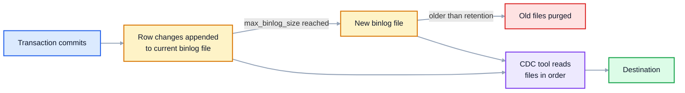
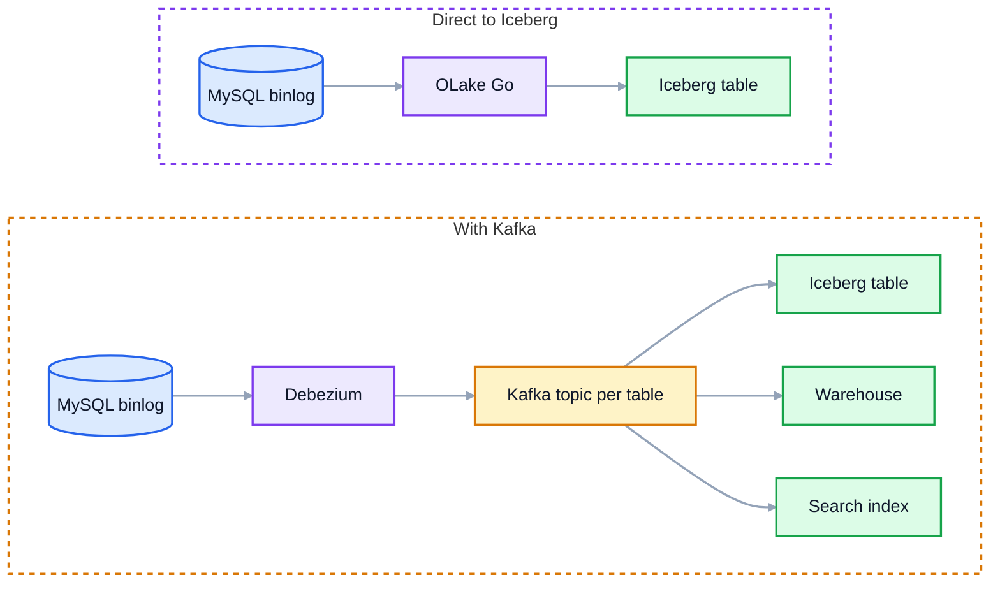

import BlogCTA from '@site/src/components/BlogCTA';


Imagine a data analyst sets up a nightly export; it works for a few months, and then the table grows to 200 million rows, and the export starts running past sunrise, so when the analytics team opens its dashboards at 9 AM, they are still missing yesterday's orders. Running the job more often only moves the pain onto the production database, which now has to serve customers and full-table scans at the same time.

Change Data Capture (CDC) is how most teams solve this problem. Instead of copying tables over and over again, a CDC pipeline picks up each insert, update and delete as the database commits it and passes only those changes downstream. This blog covers how MySQL CDC works, the main ways to implement it, how to configure the binlog, and the problems that usually show up.

## What Is Change Data Capture (CDC) in MySQL?

Change Data Capture in MySQL means tracking row-level changes in a database so that they can be shipped somewhere else: an Apache Iceberg lakehouse, a warehouse like Snowflake, a search index, or a cache. If a customer updates their shipping address, the pipeline doesn't reload the customers table from scratch; instead, it sends one record that says "row 48213 changed, and here is the new address".

Nearly every MySQL CDC setup reads from the binary log, also called the "binlog". MySQL already writes this log so replicas can stay in sync with the primary, so every committed change is already recorded before a CDC tool connects. The tool simply reads the same stream and passes the changes on to the destination.

Each change event that comes out of the binlog tells you what kind of operation happened (insert, update, or delete), what the row looked like before and after, and where the event sits in the log. The position, either a binlog file and offset or a GTID, lets a pipeline stop, restart, and pick up where it left off.

## Why Use Change Data Capture in MySQL?

Batch exports make teams choose between fresh data and a healthy database, while a pipeline that reads the binlog can keep a destination a few seconds behind production without running recurring full-table `SELECT *` queries against the busiest tables.

There are a few other reasons why teams make the switch, and some of them only become obvious after something goes wrong with a batch job:

- **Deletes show up:** A query that looks for recently updated rows has no way of noticing a row that no longer exists, so batch pipelines quietly keep records the source deleted weeks ago. The binlog records every delete, so deleted rows disappear from the destination too.
- **Nothing gets skipped between runs:** If an order moves from pending to paid to refunded within an hour, an hourly export sees only the last state, while CDC delivers all three changes, and finance and audit teams usually need all three.
- **Less data changes:** On a large table where maybe 1% of rows change each day, shipping only those rows is far cheaper than re-copying the whole thing.

The most common destinations are an Apache Iceberg lakehouse or a warehouse for analytics, Elasticsearch or OpenSearch for search, and caches or microservices that need to react to changes as they happen.

## How Does MySQL Change Data Capture Work?

Every time a transaction commits, MySQL appends its row changes to the current binlog file. When that file hits `max_binlog_size`, MySQL starts a new one, and once files are older than the retention setting, it deletes them. A CDC tool sits at the end of this chain and reads the files in order, much like a replica does.



Most pipelines run in two phases. The first is the initial snapshot, where the tool copies the rows that already exist, usually in parallel chunks split by primary key so a billion-row table doesn't become one enormous query. Before it starts copying, it notes the current binlog position, so nothing written during the snapshot is lost.

The second phase is streaming. The tool registers with MySQL using its own `server_id`, asks for binlog events from the position it saved, and turns each `WRITE_ROWS`, `UPDATE_ROWS`, or `DELETE_ROWS` event into a change record for the destination. Along the way it keeps checkpointing the last file and position (or GTID set) it has handled. If the pipeline crashes, it restarts from that checkpoint, provided MySQL hasn't purged the binlog files it needs in the meantime.

In most production designs, those change records don't go straight to the destination. The CDC tool writes them to Apache Kafka first, usually one topic per table, which is how Debezium works by default. Kafka does two jobs here. It decouples the source from the destinations, so a slow warehouse load or a sink outage doesn't stall the binlog reader. It also lets one change stream feed several destinations at once, so the same orders topic can update an Iceberg table, a warehouse, and a search index through separate consumers. The tradeoff is another distributed system to run and monitor, which is why some tools, [OLake Go](/docs/) among them, read the binlog and write to Iceberg directly when Iceberg is the only destination.



### Binlog formats and why ROW matters

MySQL can write the binlog in three formats, and only one of them is usable for CDC:

| Format | What it records | Fit for CDC |
| --- | --- | --- |
| STATEMENT | The SQL statements that changed data | No: replaying a statement doesn't always produce the same rows, and the row values aren't stored |
| MIXED | Statements by default, rows for statements MySQL considers unsafe | No: some changes still arrive as statements |
| ROW | The before and after image of every changed row | Yes: what every log-based CDC tool expects |

Two more settings decide how much each row event carries. With `binlog_row_image = FULL`, an update includes every column, not only the ones that changed, so the destination never ends up with half a row. And `binlog_row_metadata = FULL`, available from MySQL 8.0.1, writes column names and types into the log, which saves the CDC tool from guessing after someone runs an `ALTER TABLE`.

## Different Methods of MySQL Change Data Capture

There are four ways to capture changes from MySQL, and they differ mainly in where they look for changes: in the table data, in triggers, in repeated full copies, or in the transaction log.

### 1. Timestamp or query-based CDC

This is the approach most teams try first, because it needs nothing from the DBA. As long as a table has a column that moves forward whenever a row changes, usually `updated_at` or an auto-increment ID, a scheduled job can ask for everything newer than the last value it saw:

```sql
SELECT * FROM orders
WHERE updated_at > '2026-11-10 08:00:00';
```

It works on any MySQL version and is easy to debug. The problem is what it misses: hard deletes never appear, a row updated five times between polls shows up once, and the whole thing quietly breaks if one code path forgets to touch `updated_at`. On a big table without an index on that column, frequent polling also starts to hurt.

### 2. Trigger-based CDC

Triggers move the capture into the database itself. An `AFTER INSERT`, `AFTER UPDATE`, or `AFTER DELETE` trigger writes each change into a changelog table, and a separate process reads from there:

```sql
CREATE TRIGGER orders_after_update
AFTER UPDATE ON orders
FOR EACH ROW
  INSERT INTO orders_changelog (order_id, op, changed_at)
  VALUES (NEW.id, 'U', NOW());
```

This catches deletes and every intermediate change, and it doesn't need binlog access, which is sometimes the deciding factor on a locked-down server. The downside is the extra write. Each trigger runs inside the original transaction, so a busy orders table now does twice the writing. Somebody also has to keep the triggers in step with schema changes and clean out the changelog table before it grows larger than the data it tracks.

### 3. Snapshot or table-diff CDC

The simplest option is to copy the whole table on a schedule and compare it with the last copy. It is easy to reason about and it does catch deletes, but the cost of every run grows with the size of the table rather than the number of changes. That makes it a reasonable fit for a 5,000-row country lookup table and a poor one for anything transactional.

### 4. Log-based CDC (binlog)

Log-based CDC reads row events straight from the binlog, as described above. It sees every insert, update, and delete in commit order, adds very little load because MySQL is writing that log anyway, and gets changes downstream within seconds. Debezium, Flink CDC, and OLake Go all use this method for MySQL.

Most of the work here is in setup and operations rather than code. Binary logging has to be on and in ROW format, the CDC user needs replication privileges, and retention has to be long enough to survive a pipeline outage. On Amazon RDS, Aurora, Cloud SQL, and Azure Database for MySQL, those settings live in parameter groups or server flags rather than in `my.cnf`, so the steps look a little different on each.

## Comparing MySQL CDC Methods

For production replication, log-based CDC comes out ahead on almost every row of the table below, although query-based CDC is still useful when binlog access isn't available.

| Criteria | Query-based | Trigger-based | Snapshot / diff | Log-based (binlog) |
| --- | --- | --- | --- | --- |
| Captures deletes | No (soft deletes only) | Yes | Yes | Yes |
| Captures every intermediate change | No | Yes | No | Yes |
| Load on source | Medium (repeated queries) | High (extra write per change) | High (full scans) | Low (reads the log) |
| Latency | Minutes, set by poll interval | Near real time | Hours, set by scan interval | Seconds |
| Schema changes needed | Cursor column such as `updated_at` | Triggers and changelog tables | None | None |
| Server configuration needed | None | Trigger privileges | None | Binlog in ROW format, replication privileges |
| Best for | Small tables, no binlog access | Low-write tables needing audit trails | Small reference tables | Production replication at scale |

In real systems the methods often coexist. A team might stream its high-volume transactional tables through the binlog while a handful of tables on a restricted replica keep syncing by `updated_at` until access gets sorted out.

## How to Set Up Change Data Capture in MySQL

Getting a self-managed MySQL 5.7 or 8.0 server ready for binlog-based CDC usually takes less than an hour, and most of that time goes into waiting for a maintenance window to restart the server. Managed services expose the same settings in their own consoles, which are covered at the end of this section.

### Step 1: Check what is already configured

MySQL 8.0 turns binary logging on by default, and ROW has been the default format since 5.7.7, so a recent server may already be most of the way there. It is worth checking before editing anything:

```sql
SHOW VARIABLES WHERE Variable_name IN
  ('log_bin', 'binlog_format', 'binlog_row_image',
   'binlog_row_metadata', 'server_id');
```

Compare the output with these values:

| Variable | Expected value | What it means |
| --- | --- | --- |
| `log_bin` | ON | Binary logging is enabled |
| `binlog_format` | ROW | Each change is logged as full row data, not as SQL statements |
| `binlog_row_image` | FULL | Updates include every column, not only the changed ones |
| `binlog_row_metadata` | FULL | Column names and types are written to the log (MySQL 8.0.1 and later) |
| `server_id` | Any non-zero number | Must be unique across replicas and CDC tools |

If any value doesn't match, Step 2 shows how to change it.

### Step 2: Enable binary logging in ROW format

If anything is off, edit the MySQL config file (typically `/etc/my.cnf` or `/etc/mysql/my.cnf`) and restart the server:

```ini title="my.cnf"
[mysqld]
server_id                  = 1
log_bin                    = mysql-bin
binlog_format              = ROW
binlog_row_image           = FULL
binlog_row_metadata        = FULL      # MySQL 8.0+
binlog_expire_logs_seconds = 604800    # 7 days, MySQL 8.0+

# Optional: GTID-based replication
gtid_mode                  = ON
enforce_gtid_consistency   = ON
```

On MySQL 5.7, swap `binlog_expire_logs_seconds` for `expire_logs_days = 7` and drop `binlog_row_metadata`, which only arrived in 8.0.1. MySQL reads `my.cnf` only at startup, so these changes take effect after a restart. On a server where binary logging is already on, the other settings can also be changed at runtime with `SET GLOBAL` (or `SET PERSIST` on MySQL 8.0), but enabling `log_bin` itself always needs a restart, so this is the step to schedule.

### Step 3: Create a dedicated CDC user

We will create a dedicated user that will be used by the CDC tool to capture the changes from the database. The CDC tool needs `SELECT` to read the initial snapshot, plus `REPLICATION SLAVE` and `REPLICATION CLIENT` to read the binlog, and nothing more:

```sql
CREATE USER 'cdc_user'@'%' IDENTIFIED BY '<strong_password>';
GRANT SELECT, REPLICATION SLAVE, REPLICATION CLIENT ON *.* TO 'cdc_user'@'%';
FLUSH PRIVILEGES;
```

In a real deployment, it is better to replace `%` with the CDC tool's IP range and to limit `SELECT` to the databases being replicated. For example, if the CDC tool runs in the `10.0.4.0/24` subnet and only the `shop` and `billing` databases need replicating:

```sql
CREATE USER 'cdc_user'@'10.0.4.%' IDENTIFIED BY '<strong_password>';
GRANT REPLICATION SLAVE, REPLICATION CLIENT ON *.* TO 'cdc_user'@'10.0.4.%';
GRANT SELECT ON shop.* TO 'cdc_user'@'10.0.4.%';
GRANT SELECT ON billing.* TO 'cdc_user'@'10.0.4.%';
```

For a single host, use its exact address instead, such as `'cdc_user'@'10.0.4.25'`.

### Step 4: Verify the setup

After the restart, a quick check confirms the settings took effect and that the server is actually writing binlog files:

```sql
SHOW VARIABLES LIKE 'log_bin';          -- ON
SHOW VARIABLES LIKE 'binlog_format';    -- ROW
SHOW VARIABLES LIKE 'binlog_row_image'; -- FULL
SHOW BINARY LOGS;
SHOW GRANTS FOR 'cdc_user'@'%';
```

On MySQL 8.4 and later, `SHOW BINARY LOG STATUS` replaces `SHOW MASTER STATUS` for checking the current file and position.

### Step 5: Size binlog retention

Retention is a single setting, but getting it wrong is expensive. It decides how long a pipeline can be down and still resume, because once MySQL purges the files a pipeline needs, the only way back is a fresh snapshot. Seven days is a common starting point, which covers a long weekend plus some slack, but the right number depends on how long an outage the team is willing to plan for and how much disk the binlog can use.

### Setup on managed MySQL services

| Service | Where to change binlog settings | Notes |
| --- | --- | --- |
| Amazon RDS for MySQL | DB parameter group | Binlog is enabled only when automated backups are on; set retention with `CALL mysql.rds_set_configuration('binlog retention hours', 168);` |
| Amazon Aurora MySQL | DB cluster parameter group | Set `binlog_format` on the cluster parameter group and reboot the writer instance |
| Google Cloud SQL for MySQL | Database flags | Enable point-in-time recovery to turn on binary logging |
| Azure Database for MySQL | Server parameters | Binary logging is on by default on Flexible Server; adjust `binlog_expire_logs_seconds` as needed |

## OLake Go for MySQL CDC

A typical MySQL-to-lakehouse pipeline built from open-source parts has Debezium reading the binlog, Kafka holding the events, and Spark or Flink writing them into Iceberg. Each piece works, but together they add up to three systems to deploy, monitor, and maintain. [OLake Go](/docs/) is an open-source ingestion engine that reads the MySQL binlog itself and writes Apache Iceberg tables (or plain Parquet) directly, with no Kafka, Debezium, Spark, or Flink in between.

For the initial load, OLake Go splits large tables into chunks and reads them in parallel. It checkpoints as it goes, so if a full load fails halfway through a 2 TB table, it resumes the load instead of starting over. Once the snapshot is done, it switches to the binlog and keeps the binlog file, position, and server ID in its state, or the GTID (global transaction identifier) set when GTID mode is on, which is how each sync knows where the previous one stopped.

Each table can run in one of four sync modes: Full Refresh, Full Refresh + CDC, CDC Only, or Full Refresh + Incremental. This helps in mixed setups, where a few lookup tables only need an occasional refresh while the core transactional tables stream continuously.

A few details make day-to-day operations easier:

- **The connection test checks the CDC prerequisites before the first sync runs.** It confirms binlog access, `log_bin`, `binlog_format`, and `binlog_row_image`, flags optional settings such as `binlog_row_metadata` and retention, and shows the current and recommended value for anything that fails, so configuration problems surface before a job fails.
- **The Iceberg schema evolves at write time,** so a new column on the source shows up in the Iceberg schema automatically, and dropped or renamed columns don't break the pipeline. Since v0.10.1, a sync re-runs schema discovery only when the `--discover-schema` flag is passed.
- **Every row carries an `_op_type` column** (`r` for snapshot, `c` for insert, `u` for update, `d` for delete) along with `_cdc_timestamp`, so it is easy to see how and when a row last changed.
- **Tables can be registered in AWS Glue, REST, Hive, or JDBC catalogs,** including Polaris, Lakekeeper, Snowflake Horizon, Unity, Google BigLake, Amazon S3 Tables, and Nessie.

The [MySQL connector](/docs/connectors/mysql) supports MySQL 5.7 and later and MariaDB, on self-managed servers as well as Amazon RDS, Aurora, Google Cloud SQL, and Azure Database for MySQL. It can run from the OLake UI, where setup means creating a MySQL source, an Iceberg destination, and a job that picks tables and sync modes, or from the CLI as a Docker container. Throughput numbers for MySQL full loads and CDC are on the [OLake benchmarks page](/docs/benchmarks/ingestion), and the [MySQL to Iceberg integration guide](/docs/integrations/mysql-to-iceberg) walks through a complete pipeline from start to finish.

## Challenges in MySQL CDC Implementation

Once a binlog pipeline is running it tends to stay running, and most of the incidents teams hit come from the same short list of causes.

- **Binlog retention runs out.** It is also the hardest problem to recover from. Say a pipeline is paused for a week-long migration, retention is set to three days, and by the time it restarts, the files it needs are gone, which means a full resnapshot of every table. Retention should comfortably exceed the longest outage anyone expects, and binlog disk usage deserves an alert of its own so long retention doesn't fill the volume.
- **Schema changes land mid-stream.** An `ALTER TABLE` that adds, drops, or retypes a column can confuse a pipeline that cached the old schema. Setting `binlog_row_metadata = FULL` and using a tool that handles [schema evolution](/blog/schema-evolution-without-breaking-pipelines) takes most of the risk out of this.
- **Tables have no primary key.** CDC tools rely on primary keys to split snapshots into chunks and to apply updates and deletes to the right row downstream. Keyless tables still replicate, but they snapshot slowly and merge poorly, so they are worth fixing at the source when possible.
- **The initial snapshot is huge.** Copying billions of rows takes hours, and a long-running read can affect the source. Chunked, parallel snapshots with checkpoints mean a failure only costs the chunk that was in progress.
- **Two readers share a `server_id`.** Every binlog client needs a unique ID. When a CDC tool and a replica collide, they keep disconnecting each other, and the symptoms look like random network errors until someone checks the IDs.
- **Managed services set their own limits.** Some managed plans restrict replication privileges, ship with binlog off, or keep binlog files for only a few hours by default. It is worth checking these before designing around them.
- **Failover moves the position.** A file-and-offset position belongs to one server, so after a primary failover the pipeline may not find its place on the new primary. GTID mode makes positions portable across the replication topology, and OLake Go [resumes from saved GTIDs](/docs/connectors/mysql/#migrate-an-existing-job-to-gtid) after a switchover.
- **Updates and deletes need merging downstream.** An append-only destination has to turn a stream of change events into the current state of each row. Iceberg handles this with [row-level deletes](/blog/iceberg-delete-formats-cdc-equality-vs-positional-vs-deletion-vectors), but those leave behind small data files and delete files that need regular compaction to keep queries fast.
- **Data types don't map one to one.** `DECIMAL` precision, `JSON`, `ENUM`, and zero dates like `0000-00-00` all have quirks in the destination. Running a sample table through the pipeline before a full migration catches most of them early.

## Conclusion

With CDC, MySQL stops being a database that gets copied once a night and becomes a live feed that analytics, search, and downstream services can rely on, without anyone running full-table scans against production. Query-based, trigger-based, and snapshot methods still make sense for small tables or locked-down servers, but at scale, reading the binlog is the most reliable way to capture every change in order without loading the source.

The setup is short: ROW-format binlogs with full row images, a dedicated user with replication privileges, a unique server ID, and enough retention to ride out an outage. How much work the pipeline needs after that depends on the tool. For teams landing MySQL data in Apache Iceberg, OLake Go handles the snapshot, the binlog stream, and schema changes in a single tool, so there is no separate streaming stack to run alongside it.

<BlogCTA />