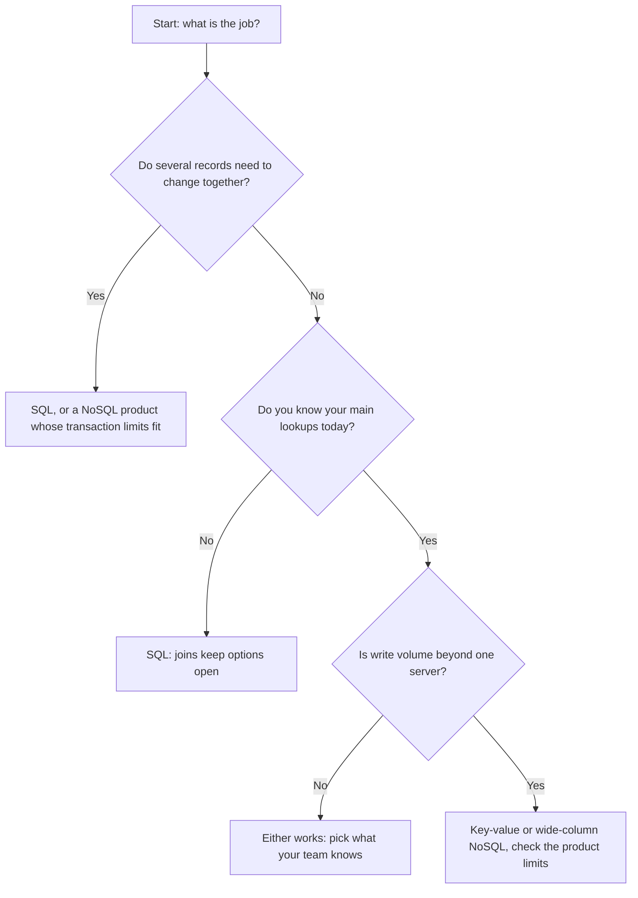

import BlogCTA from '@site/src/components/BlogCTA';
import quiz from '@site/src/data/quizzes/sql-vs-nosql.json';


<TLDR title='Key takeaways'>

Start with SQL (a relational database such as PostgreSQL or MySQL) when your data has clear relationships, when several records must change together, or when you don't yet know every question you'll ask. Reach for NoSQL (such as MongoDB, DynamoDB or Cassandra) when you know your lookups in advance, your data shape varies, or you need to spread a huge write load across many servers. The two camps overlap more than you'd think, because [PostgreSQL and MySQL](/compare/postgres-vs-mysql/) store JSON, and MongoDB and DynamoDB run multi-record transactions.

Our read: if you're unsure, pick SQL, and move a workload to NoSQL only when you can name the limit you hit. Whichever you pick, OLake Go copies PostgreSQL, MySQL and MariaDB, MongoDB and SQL Server changes into Apache Iceberg so reports stay off the live database.

- **SQL and NoSQL aren't the same kind of thing.** MongoDB says SQL is a query language, while NoSQL is an approach to building a database (checked Oct 2026).
- **Design starts in a different place.** Relational design starts from the data. AWS says DynamoDB design should start from the questions your application must answer (checked Oct 2026).
- **"NoSQL has no transactions" is out of date.** [MongoDB](https://www.mongodb.com/docs/manual/core/transactions/) and [DynamoDB](https://docs.aws.amazon.com/amazondynamodb/latest/developerguide/transaction-apis.html) both document multi-record ACID transactions, with limits we list below (checked Oct 2026).
- **"SQL can't scale out" is too simple.** [PostgreSQL](https://www.postgresql.org/docs/current/high-availability.html) documents standby servers that answer read-only queries, and the price is extra setup and some stale reads (checked Oct 2026).
- **Plenty of systems use more than one store.** [Microsoft](https://learn.microsoft.com/en-us/azure/architecture/data-guide/technology-choices/understand-data-store-models) says a single data store rarely suits every access pattern, so a mix is common (checked Oct 2026).

</TLDR>

Every fact below comes from a vendor's documentation or a named reference page, with the link right next to the claim and the check date (Oct 2026). We did not benchmark the databases named here. The online shop example is invented to show the idea, and we label it as an illustration.

## SQL vs NoSQL at a glance

The sections after it name the limits and link the sources, so you can check us. For a wider view of database families, see our [types of databases](/learn/types-of-databases/) explainer.

| Question | SQL (relational) | NoSQL |
|---|---|---|
| How is data stored? | Tables of rows and columns that relate to each other | Documents, key-value pairs, wide columns or graphs |
| Is the structure fixed? | Usually defined first, as a schema | Flexible schemas, or none |
| How do you design it? | Model the data, then ask any question | List the questions, then shape the data |
| Multi-record transactions? | Core feature | Depends on the product (MongoDB and DynamoDB: yes, with limits) |
| Scaling out? | Possible, with more work | Designed in for many products, from their own docs |
| Ad hoc questions? | Strong | Limited to the patterns you planned |

Sources: AWS on relational databases, MongoDB sharding, Cassandra (checked Oct 2026). The sections below link each claim.


## What is the difference between SQL and NoSQL?

SQL stands for Structured Query Language, the standard language for asking a relational database questions. A relational database, in AWS's words, is a collection of data points with pre-defined relationships, organised into tables of rows and columns. PostgreSQL, MySQL and SQL Server are common examples.

NoSQL means "not only SQL" or "non-SQL". International Business Machines defines it as an approach to database design that stores and queries data outside the traditional structures of relational databases. Think of it as a broad label, not one product type.

MongoDB names four main types. Document databases (MongoDB, Couchbase) store JSON-like documents. Key-value databases (DynamoDB, Redis) store one value per unique key.

Wide-column databases (Cassandra, HBase) keep flexible columns per row. Graph databases (Neo4j, Amazon Neptune) store connected points and the links between them.

Each type's fit, as MongoDB's page describes it (checked Oct 2026):

| NoSQL type | Examples | Best fit (from MongoDB's page) | Where it is weaker (our reading) |
|---|---|---|---|
| Document | MongoDB, Couchbase | Semi-structured data, nested structures and hierarchical data | Many cross-collection joins |
| Key-value | DynamoDB, Redis | Caching and session management, with high performance in reads and writes | Questions other than "get by key" |
| Wide-column | Cassandra, HBase | Large data with predictable query patterns | Ad hoc questions |
| Graph | Neo4j, Amazon Neptune | Highly connected data, where relationships may not be obvious initially | Simple tabular reports |

## Data model and schema

A schema is the agreed shape of your data: which fields exist and what type each one is. SQL databases usually ask you to set this up first. NoSQL databases let each record look different.

That gap is real, but it's smaller than it sounds. [PostgreSQL stores JSON](https://www.postgresql.org/docs/current/datatype-json.html) in a type called jsonb, which can be indexed, and its docs say most applications should prefer jsonb. The [MySQL 8.4 manual](https://dev.mysql.com/doc/refman/8.4/en/json.html) describes a native JSON type that checks each document on insert (checked Oct 2026).

PostgreSQL's own docs add a warning worth keeping. They say that even when you want maximum flexibility, JSON documents should still have a somewhat fixed structure. So flexible data doesn't have to mean leaving SQL.

**Where SQL falls short here:** you have to plan the tables first, and changing them later takes care. MongoDB's own comparison calls a fixed schema difficult to modify (checked Oct 2026). That's a vendor's view.

**Where NoSQL falls short here:** with no enforced shape, mistakes move into your code. The database will accept a misspelled field, and you find out later.

## Queries and design

The biggest practical difference: a relational database lets you ask almost any question later by joining tables. A join combines rows from two tables that share a key.

AWS describes the trade-off in its DynamoDB design guide. Relational data can be queried flexibly, but AWS says those queries can be expensive at high traffic. In DynamoDB, data can be queried efficiently in a limited number of ways, and other queries can be expensive and slow.

The same guide says not to start designing a DynamoDB schema until you know the questions it must answer, and to keep as few tables as possible. That's a very different way of working. If your questions change every month, you'll be repeating the NoSQL design work.

**Where SQL falls short here:** busy, complex joins can slow down as data grows, and you may need to tune them. **Where NoSQL falls short here:** a new question that your design didn't plan for can be slow or costly.

### The same question in both worlds (illustration)

Say you want each order with its customer. In SQL, you join two tables. In MongoDB you can either nest the customer inside the order, or join with a stage called `$lookup`.

```sql
SELECT o.id, c.name
FROM orders o
JOIN customers c ON c.id = o.customer_id;
```

```js
db.orders.aggregate([
  { $lookup: { from: "customers", localField: "customer_id",
               foreignField: "_id", as: "customer" } }
])
```

The code is our own sketch, not copied from a vendor. MongoDB's `$lookup` page says it performs a left outer join to a collection in the same database. It also warns that unindexed `$lookup` on large collections can slow queries, and it suggests an embedded data model to rely on it less (checked Oct 2026).

So NoSQL products can join. A document design tries hard to avoid needing to, and that's the same trade-off as before, seen in code.

## Transactions and consistency

A transaction groups several changes so they all succeed or all fail.

ACID is the standard promise for this: atomicity (all or nothing), consistency (rules stay true), isolation (parallel work doesn't collide) and durability (saved changes stay saved). Relational databases are built around it.

Lots of pages say NoSQL has no ACID. The vendor docs disagree. MongoDB documents multi-document ACID transactions on replica sets and sharded clusters, and says operations on a single document are atomic.

The same page names a cost: it says a distributed transaction usually costs more than a single-document write, and that transactions should not replace good schema design (checked Oct 2026).

DynamoDB has limits too. Its docs say one write transaction groups up to 100 actions on up to 100 distinct items, within one AWS account and one Region, with a 4 MB total size cap. They also say ACID holds only inside the Region where the write was made, and *not* across Regions in global tables (checked Oct 2026).

Other NoSQL products let you tune the trade-off instead. Cassandra's docs describe consistency levels that set how many copies must answer, from one copy up to a majority or all of them.

Rule of thumb: if the copies you write to plus the copies you read from add up to more than the total, a read sees the latest acknowledged write. Eventual consistency, the weaker setting, means copies may briefly disagree.

**Where SQL falls short here:** strict guarantees cost speed when you spread them over several servers. PostgreSQL's docs say synchronous replication can cut performance, while asynchronous replication can return slightly stale results (checked Oct 2026).

## Scaling: vertical and horizontal

Sooner or later, one server stops being enough. Vertical scaling means a bigger single server. Horizontal scaling means more servers sharing the work.

MongoDB's docs say vertical scaling has a practical maximum. They add that horizontal scaling is cheaper than top-end hardware but brings more infrastructure and maintenance.

You'll see many pages turn this into a rule: SQL scales up, NoSQL scales out. It's a tendency, not a law. PostgreSQL's high availability docs describe hot standby servers that serve read-only queries, and the work of keeping servers in step is, in its words, the fundamental difficulty.

NoSQL products are often designed for scale-out from the start, and we did not benchmark any of them. Cassandra's docs say you scale by adding nodes to the ring. MongoDB documents sharding too, which it says adds infrastructure and maintenance work (checked Oct 2026).

**Where SQL falls short here:** in a basic setup one primary server takes the writes (our reading), so a very high write rate pushes you toward harder setups. **Where NoSQL falls short here:** you take on a distributed system, with its tuning and failure cases.

## Three myths, checked against vendor docs

Each row is a common claim next to what the vendors document.

| Myth | What the docs say |
|---|---|
| NoSQL cannot store related data | MongoDB says it stores relationship data differently, for example nested in one document |
| NoSQL has no ACID transactions | MongoDB and DynamoDB document them, with limits |
| SQL cannot hold JSON or flexible data | PostgreSQL and MySQL both ship JSON types |

Vendors word one point differently. International Business Machines says NoSQL does not require a schema, while AWS and MongoDB say flexible schemas. We use "flexible" because it covers both.

## What practitioners say

We read Hacker News threads and PeerSpot reviews and kept one praise and one complaint for each database where we found both, on the trade-offs above. Each quote is one person's view, with its date and link, and none is a survey or a test.

| Database | Praise | Complaint |
|---|---|---|
| MySQL | A [PeerSpot reviewer](https://www.peerspot.com/products/mysql-reviews) (MySQL reviews, December 2025): "It is easy to set up and allows you to focus on your business logic initially without going for more complicated databases." | The same site (August 2026): "Changing the database schema on large tables can also be challenging and may require careful planning to minimize downtime." |
| MongoDB | A [Hacker News commenter](https://news.ycombinator.com/item?id=46303011) (a December 2025 thread about 30 years of br tags): "as a Dev I liked a lot about Mongo" | The same comment: "I'd never want to admin it again." |

- **Reports don't have to run on the live database.** OLake Go copies changes from PostgreSQL, MySQL and MariaDB, MongoDB and SQL Server into Apache Iceberg (see [What happens after you choose](#what-happens-after-you-choose)).

## Where each fits

**Choose SQL** if:

- your data has clear relationships and several records must change together;
- you don't yet know which questions you'll ask, so you want freedom to join anything later;
- your team knows SQL, or you want one system for transactions and basic reports.

**Choose NoSQL** if:

- you know your main lookups ahead of time, or your records vary a lot in shape;
- you need to spread a very large write load over many servers;
- a graph of links is the point of the data.

Each NoSQL choice comes with the limits above: planned queries, bounded transactions and distributed-system work.

## How to choose: a decision table




This flow is our own simplification of the trade-offs above, not a vendor rule.

| Your situation | Lean toward | Why | Watch out for |
|---|---|---|---|
| Orders, payments, accounts | SQL | Several records change together | Scaling writes later |
| Reports and dashboards on live data | SQL | Questions keep changing | Heavy reports can slow the main database |
| Early product, unclear needs | SQL | Joins keep options open | Schema changes need care |
| Look up a record by key, very fast, at huge scale | NoSQL (key-value or document) | Lookups are planned | New query types cost more |
| Records with very different fields | Document database, or SQL with jsonb | Shape varies | Mistakes slip in without a schema |
| Links between things are the point | Graph database | Built for connections | Fits link-heavy questions only |
| Heavy reports slow a PostgreSQL, MySQL, MongoDB or SQL Server database | Copy the changes to Iceberg with OLake Go | Reports run on a copy | One more system to run |
| Large write stream across regions | Wide-column or key-value | Built to add nodes | You run, or pay for, a distributed system |

Want a quicker answer? Try this short quiz.

<Quiz {...quiz} />

## A worked example: an online shop (illustration)

This example is our own illustration, not a case study. Imagine a small shop with customers, orders, payments and product pages.

Orders and payments are a clean fit for SQL. An order, its items and its payment should save together or not at all, and finance will ask new questions every quarter. A relational database handles both without a redesign.

The shopping cart is a different job. Every request looks up one cart by one user ID, and the cart is read and written constantly. A key-value store such as DynamoDB fits that lookup, because AWS's guide says DynamoDB queries are efficient for the access patterns you plan in advance (checked Oct 2026).

Product pages vary: a shirt has sizes, a laptop has ports. A document database, or a jsonb column in PostgreSQL, can hold those differing fields.

So the shop ends up with two or three stores, and that's normal. Microsoft's guidance is that a single data store rarely suits every access pattern.

## Five questions to ask before you pick

These questions come from the trade-offs above. They're our checklist, not a vendor rule.

1. **Do I know my main queries today?** If yes and they're few, NoSQL gets easier. If they'll change, lean SQL.
2. **Must several records change together?** If yes, check the transaction limits of the exact product, not the category.
3. **How big could writes get?** Write down the rate you expect before you plan a distributed system, because MongoDB's docs list extra infrastructure and upkeep as the cost. Ask the vendor for its published limits too, since we did not benchmark.
4. **Who will run it?** Distributed systems add operating work, which MongoDB's docs call out as a trade-off of scaling out.
5. **Where will reports run?** Plan the copy to an analytics system early, so heavy reports stay off the live database.

## What happens after you choose

Whichever you pick, reports usually end up running somewhere else. AWS says most companies use transaction systems and analytics systems together. In our view, heavy reports on your live database can slow the app, so teams often copy the data out.

Copying changes as they happen is called change data capture (CDC). It reads a database's change log instead of re-reading whole tables.

[OLake Go](https://github.com/datazip-inc/olake) copies data from databases such as PostgreSQL, MySQL, MongoDB and SQL Server (change capture for those four) into Apache Iceberg or Parquet files. It is open source under Apache 2.0.

For the background, see our explainers on [transactions versus analytics](/learn/oltp-vs-olap/) and [change data capture](/learn/what-is-change-data-capture/). Snowflake, BigQuery and Redshift can query the Iceberg tables it writes (see the [compatibility page](/docs/understanding/compatibility-engines/) in our docs).

## Conclusion

SQL vs NoSQL depends on your questions, your writes and your team. Many NoSQL products now offer transactions, and PostgreSQL and MySQL both hold JSON. For a new project with unclear needs, our opinion: start with SQL, and move a workload only when you can name the limit you hit. Either way, copy the changes to Iceberg with OLake Go so reports run off the live database.

## FAQ

<Faq showHeading={false} data={[
  {question: "Q1. What is the main difference between SQL and NoSQL?", answer: <>SQL databases store data in related tables and usually start from a defined schema. NoSQL is a broad label for databases that store data as documents, key-value pairs, wide columns or graphs, often with flexible schemas. MongoDB notes that SQL is a query language while NoSQL is an approach to database design (checked Oct 2026).</>},
  {question: "Q2. Is NoSQL faster than SQL?", answer: <>Not as a rule. AWS says DynamoDB queries are efficient for the access patterns you planned and can be expensive and slow outside them (checked Oct 2026). A relational database can answer many questions flexibly. Speed depends on the product, the design and the query, so test your own workload.</>},
  {question: "Q3. Does NoSQL support ACID transactions?", answer: <>Some products do. MongoDB documents multi-document ACID transactions, and DynamoDB offers transactions of up to 100 actions within one Region (checked Oct 2026). Both docs describe limits, and MongoDB says transactions cost more than single-document writes. So check the specific product before you assume either way.</>},
  {question: "Q4. Can PostgreSQL or MySQL replace a NoSQL database?", answer: <>Sometimes, yes. PostgreSQL has an indexed <code>jsonb</code> type and MySQL has a native JSON type, so flexible data can live in a SQL database. They are not built the same way as DynamoDB or Cassandra for spreading data over many servers, though, so very large scale-out workloads may still suit NoSQL.</>},
  {question: "Q5. Which should a startup choose?", answer: <>There is no sourced rule here, so this is our opinion. Start with SQL if your needs are unclear, because joins keep your options open. Then move a specific workload to NoSQL when you can name the limit you hit, such as a lookup volume or write rate.</>},
  {question: "Q6. Can I use SQL and NoSQL together?", answer: <>Yes, and many teams do. Microsoft says a single data store rarely suits every access pattern (checked Oct 2026). A common split is a relational database for orders and money, plus a key-value or document store for carts or content.</>},
  {question: "Q7. Can NoSQL databases do joins?", answer: <>Some can. MongoDB has a <code>$lookup</code> stage that performs a left outer join to another collection in the same database. Its docs warn that unindexed lookups on large collections can slow queries, and they suggest embedding related data instead (checked Oct 2026).</>},
  {question: "Q8. How do I get data out of either one for reporting?", answer: <>Teams usually copy data to an analytics system so reports do not slow the live app. Change data capture reads the change log of a database to do this, as in our <a href={"/learn/what-is-change-data-capture/"}>change data capture explainer</a>. See the section above on what happens after you choose.</>}
]} />

<BlogCTA/>
