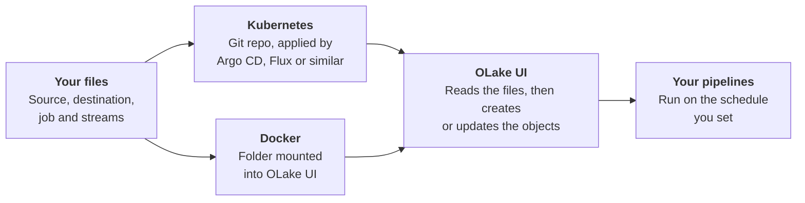

# GitOps for OLake Go
 
GitOps for OLake Go lets you manage your data pipelines entirely as code. Instead of manually configuring sources, destinations, jobs, and streams in the UI, you write your pipeline definitions into configuration files, either stored in a Git repository or stored locally. OLake Go watches these files and automatically updates your live pipelines whenever they change, eliminating manual UI setup.
 
You write the pipeline once, as code. OLake Go does the rest:

## Why use GitOps
 
| Benefit | What it means |
|---------|---------------|
| **Version history** | Every pipeline change is a Git commit. See who changed what, and when. |
| **Review before change** | Use pull requests to review changes before they reach production. |
| **Repeatable environments** | Copy the same files to dev, staging and prod. Change only the connection details. |
| **Easy rollback** | Revert an edit and OLake Go re-applies the earlier config. Reverting a streams change also clears and re-syncs those streams. Reverting an added file does not remove the object from OLake Go, because GitOps does not delete. |
| **Fewer manual steps** | No UI clicks to rebuild a pipeline after a migration or disaster recovery. |
| **No passwords in Git** | Credentials can stay in a secret manager. The files only hold a reference to them. |
| **Visible failures** | When something is wrong, OLake Go tells you where, and you can alert on it. |
 
:::note The UI still works
GitOps does not lock the OLake UI, and you can still use it. But for objects defined in Git, Git is the source of truth: make changes in the files, not in the UI.
:::

## What GitOps does and does not do
 
GitOps for OLake Go does:
 
- Creates and updates sources, destinations, jobs and stream selections from your files.
- Runs a connection test and stream discovery for you, as the UI does.
- Reads credentials from AWS Secrets Manager, GCP Secret Manager, Azure Key Vault, Kubernetes Secrets or environment variables, and picks up rotated values by itself.
- Reports a clear status (`Pending`, `Ready` or `Failed`) for every object.
- Lets you resync any object on demand.

GitOps for OLake Go does not:
 
- **Delete.** If you remove a file from Git, the source, destination or job stays in OLake Go. Delete it from the OLake UI if you no longer need it.
- **Support renaming.** Treat the `name` of a source, destination or job as fixed. Changing it creates a new object.

## The four building blocks
 
Every GitOps setup is made of four kinds of object. 
 
| Object | What it is |
|--------|------------|
| **Source** | The database you read from, for example PostgreSQL, MySQL or MongoDB. |
| **Destination** | Where data is written, for example Iceberg on S3/Glue, or Parquet. |
| **Job** | A scheduled sync from one source to one destination. |
| **Streams** | Streams the job syncs and the per-stream configuration in `selected_streams.json`. See [Stream Properties](/docs/understanding/terminologies/olake/) for more details about stream level configuration. |

:::tip Order does not matter
You can add the files in any order, or all at once. A job waits (status `Pending`) until its source, destination and streams exist and are ready, then starts by itself. 
:::

## Set it up
 
You can run GitOps with either deployment of OLake:
 
- **[Docker Compose](/docs/install/gitops/docker.mdx).** Each object is a plain JSON file in a folder that you mount into OLake UI. OLake UI watches the folder, so there is nothing to push anywhere. The folder can also be a Git checkout.
- **[Kubernetes (Helm)](/docs/install/gitops/kubernetes.mdx).** Each object is a labelled ConfigMap (or a Secret, for sources and destinations). Any Gitops tool applies them from your Git repository, and OLake Go keeps them in sync.

