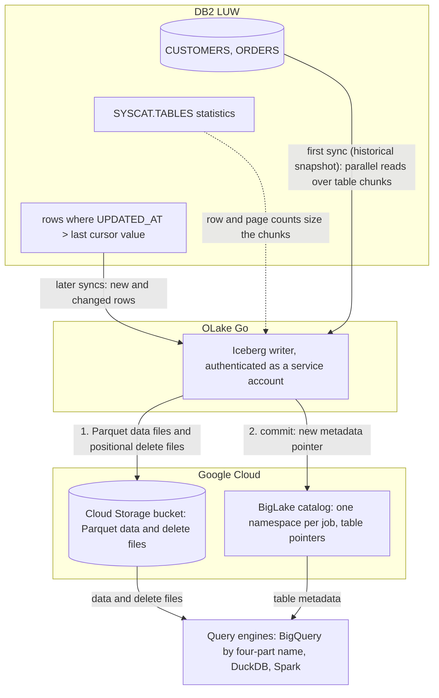

import * as I from '@site/src/components/integrations';

Moving IBM DB2 LUW (Linux, UNIX and Windows) data to BigQuery usually means a licensed replication product feeding Kafka, or a nightly `EXPORT` and `bq load`. This guide does it with OLake Go.

It reads the DB2 tables with a read-only user and writes them once as Apache Iceberg tables into a BigLake catalog. BigLake is Google Cloud's Iceberg representational state transfer (REST) catalog, and a cursor column keeps the tables fresh.

The files stay in your own Cloud Storage bucket. BigQuery queries the tables through the catalog with a four-part name, with no dataset to create and no external table to declare, and DuckDB and Spark read the same tables.

<I.IntegrationByline />

<TLDR title='Key takeaways'>

- OLake Go replicates DB2 LUW into Iceberg tables in a BigLake catalog: a full historical snapshot first, then incremental syncs on a cursor column such as `UPDATED_AT`, with no replication license or load job in between.
- BigQuery reads the catalog as a data source. Every change a sync commits is visible on the next `SELECT`, with no refresh.
- The same tables, written once by OLake Go, are also queryable from DuckDB and Spark. In the run on this page all three engines returned identical rows.

</TLDR>

**The short answer.** To replicate DB2 to BigQuery, run OLake Go with a read-only DB2 user as the source and a BigLake catalog with a Cloud Storage bucket as the Iceberg destination, with BigQuery as the target query engine. The first sync copies each table in full (the historical snapshot); every later sync fetches the rows whose cursor column moved and upserts them. BigQuery, DuckDB and Spark then query the same Iceberg tables, with no second copy.

## How DB2 data reaches BigQuery here



The first sync reads the row and page counts DB2 keeps for each table, splits the table into chunks, and reads the chunks in parallel. It writes Parquet data files and records the highest cursor value it saw. Every later sync selects rows above that value, writes them as new data files, and adds a delete file that retires the old version of each updated row.

Each sync ends with one commit to BigLake. OLake Go uploads the data and delete files to the bucket with the service account's own credentials, then updates the table's metadata pointer in the catalog. BigQuery, DuckDB and Spark see the new snapshot on their next query; none of them keeps a copy.

The cursor is the whole contract. A row that changes without its `UPDATED_AT` moving is never picked up, and a deleted row stays in the Iceberg table. Set the column in every write path, and soft-delete if deletes matter.

## What you need

- **DB2 LUW 11.5.3 or later**, with a read-only user, statistics on each table and a cursor column. The tables on this page ran on DB2 12.1.5 Community Edition in Docker.
- **An amd64 host for the DB2 connector.** IBM's driver has no Linux arm64 build. On an Apple silicon Mac, turn on Rosetta in Docker Desktop.
- **A Google Cloud project** with the BigLake API enabled, a Cloud Storage bucket for the files, and a service account for OLake Go with the BigLake Editor role on the project and Storage Object User on the bucket. The run on this page used a bucket in `us-central1`.
- **BigQuery** in the same project. Queries run in the bucket's region, and the account running them needs the BigQuery Job User role plus read access to the catalog.
- **OLake UI** from the [Docker Compose install](/docs/install/olake-ui/). The run on this page used OLake Go v1.1.0.

## Step 1: Prepare DB2 for incremental sync

Most readers point OLake Go at tables they already have. To follow along with the exact data from this page, create these two tables first:

<details>
<summary>The two sample tables used on this page</summary>

```sql title="Sample schema, in schema DB2INST1 of database SHOP"
CREATE TABLE customers (
  id INT GENERATED BY DEFAULT AS IDENTITY PRIMARY KEY,
  name VARCHAR(100), email VARCHAR(200), city VARCHAR(100), tier VARCHAR(20),
  created_at TIMESTAMP DEFAULT CURRENT TIMESTAMP,
  updated_at TIMESTAMP DEFAULT CURRENT TIMESTAMP);

CREATE TABLE orders (
  id INT GENERATED BY DEFAULT AS IDENTITY PRIMARY KEY,
  customer_id INT REFERENCES customers(id),
  product VARCHAR(100), amount DECIMAL(10,2), status VARCHAR(20),
  created_at TIMESTAMP DEFAULT CURRENT TIMESTAMP,
  updated_at TIMESTAMP DEFAULT CURRENT TIMESTAMP);

-- Then insert whatever you like. This page started with 8 customers and 40 orders.
```

</details>

<I.Partial id="sources/db2/prereqs" />

## Step 2: Set up the BigLake catalog

BigQuery reads Iceberg tables through a catalog. **BigLake** is the one this page uses: Google Cloud's Iceberg REST catalog, with one namespace per job and the files in your Cloud Storage bucket.

DuckDB and Spark read from the same catalog. To BigQuery it is a data source in the project, so a table OLake Go commits is queryable on the next statement.

<I.CatalogStrip />

<I.CatalogTabs>
<TabItem value="biglake">

<I.Partial id="catalogs/biglake/setup" />

<Figure src='/img/docs/integrations/db2-to-bigquery/gcp-service-account-key-json.webp' alt='Google Cloud console Create private key dialog for the OLake service account with the JSON key type selected' caption='The JSON key for the service account. The console downloads it once; its contents go into the OLake Go destination form.' />

</TabItem>
</I.CatalogTabs>

## Step 3: Connect DB2 to OLake Go

<I.Partial id="sources/db2/connect">

Here is the source form from the run on this page. DB2 ran in another container, so the host is `host.docker.internal`, with database `shop` on port `50000`. The change data capture (CDC) switch is greyed out with **Not supported**, which is expected for DB2.

<Figure src='/img/docs/integrations/db2-to-bigquery/olake-source-db2.webp' alt='OLake UI Edit source form for DB2 LUW on OLake Go v1.1.0 with CDC marked not supported, host host.docker.internal, port 50000, database shop and user db2inst1' caption='The DB2 source in OLake UI: database shop on port 50000, with CDC not supported for this connector.' width='760px' />

</I.Partial>

## Step 4: Configure the Iceberg destination

<I.CatalogTabs>
<TabItem value="biglake">

<I.Partial id="catalogs/biglake/writer">

Here is the destination form from the run on this page. It holds the BigLake endpoint, the bucket as the catalog path, the service account JSON and the project ID.

<Figure src='/img/docs/integrations/db2-to-bigquery/olake-destination-biglake.webp' alt='OLake UI Edit destination form for Apache Iceberg with catalog type Big Lake, REST catalog URI https://biglake.googleapis.com/iceberg/v1/restcatalog, BigLake catalog path gs://olake-x2y-lab-bq, authentication type GCP and the project ID oauth-361809' caption='The BigLake destination in OLake UI: the endpoint, the bucket as catalog path, GCP authentication and the project ID.' width='760px' />

</I.Partial>

</TabItem>
</I.CatalogTabs>

## Step 5: Create the job and run the first sync

This job lists **BigQuery**, **Spark** and **DuckDB** as target query engines. OLake Go then offers only the delete formats all three read, and the run on this page used **Positional Deletes**. Because the DB2 connector has no CDC mode, each stream runs as **Full Refresh + Incremental** with `UPDATED_AT` as the cursor.

<I.Partial id="jobs/create" engines="Google BigQuery, Apache Spark and DuckDB" upsert="Positional Deletes" updateType="pos" image="olakego/source-db2:latest" platform="linux/amd64" cliSyncMode="incremental" syncMode="Full Refresh + Incremental" cursor="UPDATED_AT" namespace="DB2INST1" stream="CUSTOMERS">

DB2 reports unquoted names in upper case, so the streams and columns appear that way.

<Figure src='/img/docs/integrations/db2-to-bigquery/olake-streams-positional-deletes.webp' alt='OLake UI Streams Selection page with the DB2INST1 schema, CUSTOMERS and ORDERS selected, sync mode Full Refresh + Incremental, CDC options disabled, cursor field UPDATED_AT, ingestion mode Upsert and upsert type Positional Deletes on Iceberg format version V2' caption='Each stream: Full Refresh + Incremental on UPDATED_AT, Upsert, and Positional Deletes as the upsert type.' />

<Figure src='/img/docs/integrations/db2-to-bigquery/olake-job-history-two-syncs.webp' alt='OLake UI Job Logs and History for db2_to_bigquery showing two completed syncs, the first in 40 seconds and the second in 39 seconds' caption='Job history: the 40 s historical snapshot, then the 39 s incremental sync.' />

</I.Partial>

On this page the first run copied 8 customers and 40 orders (48 records, 2.38 KB) and finished in **40 seconds**, container start included. OLake Go names the BigLake namespace after the job, the database and the DB2 schema, lower-cased: `db2_to_bigquery` on `SHOP.DB2INST1` produced `db2_to_bigquery_shop_db2inst1`. The **Iceberg DB** field at the top of the Streams page changes it before the first sync.

## Step 6: Query the tables in BigQuery

<I.CatalogTabs>
<TabItem value="biglake">

<I.Partial id="engines/bigquery/query-biglake" schema="db2_to_bigquery_shop_db2inst1" />

<Figure src='/img/docs/integrations/db2-to-bigquery/bigquery-biglake-customers.webp' alt='BigQuery SQL editor in the Google Cloud console running the customers query on oauth-361809.olake-x2y-lab-bq.db2_to_bigquery_shop_db2inst1.customers and returning 10 rows with id, name, city and tier' caption='BigQuery reading the customers table through the BigLake catalog after the incremental sync: 10 rows, one per key.' />

</TabItem>
</I.CatalogTabs>

<I.Cta />

## Step 7: Change rows in DB2 and sync again

To see the incremental path work, the run on this page made 12 changes in DB2 after the first sync. Every update also sets `updated_at`, which is what the cursor sees:

```sql title="Changes made in DB2 between the two syncs"
INSERT INTO customers (name, email, city, tier) VALUES ('Maya Patel', 'maya@example.com', 'Pune', 'silver');
INSERT INTO customers (name, email, city, tier) VALUES ('Lucas Silva', 'lucas@example.com', 'São Paulo', 'bronze');
INSERT INTO orders (customer_id, product, amount, status) VALUES (9, 'Laptop', 1299.00, 'placed');
INSERT INTO orders (customer_id, product, amount, status) VALUES (9, 'Mouse', 25.50, 'placed');
INSERT INTO orders (customer_id, product, amount, status) VALUES (10, 'Monitor', 349.99, 'placed');
INSERT INTO orders (customer_id, product, amount, status) VALUES (3, 'Keyboard', 89.00, 'placed');
INSERT INTO orders (customer_id, product, amount, status) VALUES (7, 'Webcam', 79.90, 'placed');
UPDATE customers SET tier = 'gold',      updated_at = CURRENT TIMESTAMP WHERE name = 'Liam Carter';
UPDATE customers SET city = 'Abu Dhabi', updated_at = CURRENT TIMESTAMP WHERE name = 'Zara Ali';
UPDATE orders    SET status = 'delivered', updated_at = CURRENT TIMESTAMP WHERE id IN (1, 4, 7);
```

The second sync fetched **12 rows (635 bytes)** above the saved cursor and finished in **39 seconds** end to end. For `customers` that meant one new data file with 4 rows and one positional delete file retiring the 2 old versions. OLake Go's commit report in the sync log shows `addedDataFiles=1`, `addedRecords=4`, `addedPositionalDeleteFiles=1`, `addedPositionalDeletes=2`, and `orders` the same shape with 8 rows and 3 deletes.

<Figure src='/img/docs/integrations/db2-to-bigquery/olake-sync-log-positional-delete-commit.webp' alt='OLake UI sync log filtered to the Iceberg commit reports for customers and orders, showing addedDataFiles 1, addedPositionalDeleteFiles 1, addedRecords 4 and 8, and addedPositionalDeletes 2 and 3' caption='The incremental sync in the OLake UI log: one data file and one positional delete file per table.' />

BigQuery shows the result on the next query, with no refresh and no `ALTER TABLE`. Liam Carter is `gold`, Zara Ali moved to Abu Dhabi, and the two new customers are there. In incremental mode OLake Go cannot tell an insert from an update, so the 4 rows the second sync brought carry `_op_type = u` and the snapshot rows keep `r`.

**Schema changes.** When a column is added in DB2, OLake Go adds it to the Iceberg table on the next sync and commits the new schema to BigLake. BigQuery shows the column on the next query.

DB2 itself may put the table in `REORG PENDING` after an `ALTER TABLE`; see troubleshooting below. Full rules are on the [schema evolution page](/docs/features/schema/).

## Query the same tables from DuckDB and Spark

Nothing is exported, copied or refreshed: both engines read the files OLake Go wrote, through the same BigLake catalog.

<Tabs groupId="engine" queryString="engine">
<TabItem value="duckdb" label="DuckDB" default>

<I.Partial id="engines/duckdb/connect-biglake" schema="db2_to_bigquery_shop_db2inst1" />

<Figure src='/img/docs/integrations/db2-to-bigquery/gcp-hmac-key-service-account.webp' alt='Google Cloud console Cloud Storage Interoperability settings with the Select a service account dialog, the OLake service account selected and the Create key button' caption='The key for DuckDB: Cloud Storage, Settings, Interoperability, then a key for the same service account OLake Go uses.' />

DuckDB 1.5.5 returned the same 10 customers and the same `orders` roll-up as BigQuery in the run on this page. Its types were `INTEGER` for `id`, `DOUBLE` for `amount` and `TIMESTAMP WITH TIME ZONE` for the timestamps. The data files came through the hash-based message authentication code (HMAC) key.

</TabItem>
<TabItem value="spark" label="Apache Spark">

<I.Partial id="engines/spark/connect-biglake" schema="db2_to_bigquery_shop_db2inst1" />

Spark 4.0.1 with Iceberg 1.10.0 returned the same rows in the run on this page, running on a laptop against the same catalog and bucket.

</TabItem>
</Tabs>

An `orders` roll-up matched DB2 to the cent in all three engines. It gave 16 delivered orders for 8659.68, 18 placed for 10522.26, 11 shipped for 6397.25.

## Data types: DB2 to Iceberg to BigQuery

OLake Go maps DB2 types to Iceberg types, and BigQuery maps Iceberg types to its own when it reads the catalog. Decimals and times are the ones to watch.

| DB2 | Iceberg (written by OLake Go) | BigQuery shows | Notes |
| --- | --- | --- | --- |
| `SMALLINT`, `INTEGER` | `int` | `INT64` | The identity keys on this page arrived as `INT64`. |
| `BIGINT` | `long` | `INT64` | |
| `DECIMAL`, `NUMERIC`, `DECFLOAT`, `FLOAT`, `DOUBLE` | `double` | `FLOAT64` | The `orders.amount` sums on this page matched DB2 to the cent; round at query time when you need exact decimal arithmetic. |
| `REAL` | `float` | `FLOAT64` | |
| `BOOLEAN` | `boolean` | `BOOL` | |
| `DATE`, `TIMESTAMP` | `timestamptz` (UTC) | `TIMESTAMP` | OLake Go writes every timestamp in UTC, whatever the server time zone. |
| `TIME` | `string` | `STRING` | |
| `CHAR`, `VARCHAR`, `CLOB`, `GRAPHIC`, `VARGRAPHIC`, `DBCLOB`, `XML` | `string` | `STRING` | |
| `BLOB` | `string` | `STRING` | Binary values arrive as text; keep large binaries out of the sync. |

DB2 types in the table come from the [DB2 connector reference](/docs/connectors/db2/#data-type-mapping). The BigQuery side comes from the [BigQuery Iceberg tables page](https://docs.cloud.google.com/bigquery/docs/iceberg-external-tables) (checked 2026-10-30) and from the table schemas of this run.

## Cost and maintenance

- **Storage** is your bucket: you pay Cloud Storage rates for the Parquet and delete files. The BigLake catalog itself has no per-table charge.
- **Compute.** OLake Go runs wherever you run Docker, on an amd64 host for the DB2 connector. BigQuery bills on-demand queries by bytes scanned, or by slot time on an edition; a query over the catalog reads the Parquet files in the bucket.
- **DB2 load.** Each incremental sync is one range scan per table on the cursor column; index `UPDATED_AT` so it stays cheap as the table grows. Keep `RUNSTATS` in your regular maintenance window so snapshot chunks stay even.
- **Maintenance.** BigLake keeps every snapshot OLake Go commits in the table's `metadata.json` and rejects one above 1 MB, which a busy table reaches after a few thousand syncs. Expire old snapshots and compact on a schedule with [OLake Fusion](/docs/fusion/getting-started/overview/) or with Spark's `expire_snapshots` and `rewrite_data_files` procedures through the same catalog.
- **Key rotation.** The service account key is what OLake Go writes with. Rotate it from the service account's **Keys** tab and paste the new JSON into the destination.

## Troubleshooting

### 1. The source test fails on an Apple silicon Mac

```text
image pull registry-1.docker.io/olakego/source-db2:v1.1.0: Error response from daemon: no matching manifest for linux/arm64/v8 in the manifest list entries
```

The OLake UI worker pulls connector images for the host's platform, and the DB2 image exists for amd64 only. Turn on **Use Rosetta for x86_64/amd64 emulation** in Docker Desktop, then pull the image yourself and tag it with the name the worker asks for:

```bash
docker pull --platform linux/amd64 olakego/source-db2:v1.1.0
docker tag olakego/source-db2:v1.1.0 registry-1.docker.io/olakego/source-db2:v1.1.0
```

On an amd64 Linux host, such as a Compute Engine VM, the error does not occur.

### 2. The first sync stops with "stats not populated"

```text
stats not populated for table[DB2INST1.CUSTOMERS]. Please run CLP command: RUNSTATS ON TABLE DB2INST1.CUSTOMERS AND INDEXES ALL
```

DB2 has never collected statistics for the table, and OLake Go needs them to size the snapshot chunks. Run the `RUNSTATS` call from step 1 for every table in the job, then sync again.

### 3. A sync fails with SQL0668N after an ALTER TABLE

Adding, dropping or retyping a column can leave a DB2 table in `REORG PENDING`, and reads fail until it is reorganized. Run `CALL SYSPROC.ADMIN_CMD('REORG TABLE db2inst1.customers')`, then sync again. The [DB2 connector page](/docs/connectors/db2/#troubleshooting) lists the operations that cause it.

### 4. The CLI picked the wrong cursor column

`discover` fills `cursor_field` in `selected_streams.json` with the first column in alphabetical order, for example `CITY` for `CUSTOMERS`. Set it to `UPDATED_AT` for every stream before the first sync; the OLake UI asks for it on the Streams page instead.

### 5. BigQuery cannot find the dataset

```text
Not found: Dataset <project>:<bucket>.db2_to_bigquery_shop_db2inst1 was not found in location US
```

The query ran in a location other than the bucket's region. Set the query location to the bucket's region in the editor's **More**, **Query settings** panel, or pass `--location=<region>` to `bq`.

<details>
<summary>How this compares with other ways to move DB2 data to BigQuery</summary>

| Method | Freshness | Updates and deletes | Where the data lands | What you run |
| --- | --- | --- | --- | --- |
| [Debezium's Db2 connector](https://debezium.io/documentation/reference/stable/connectors/db2.html), Kafka and a BigQuery sink | Seconds, from SQL Replication capture tables | Yes | Kafka topics, then BigQuery tables | Kafka, Kafka Connect, Debezium, tables in capture mode and, per Debezium's docs, an IBM InfoSphere Data Replication license (checked Oct 2026) |
| Export (`EXPORT TO ... OF DEL`), then `bq load` | Hours to daily | No; full reloads only | Native BigQuery tables | A script, a scheduler and a staging bucket |
| **OLake Go to Iceberg on BigLake (this guide)** | Incremental on a schedule down to one minute | Inserts and updates that move the cursor; deletes need a soft-delete column | Apache Iceberg tables that BigQuery, Spark, DuckDB, Trino and Flink all read | One Docker Compose stack, open source; your bucket plus your own compute |

Log-based replication is the choice when you need hard deletes and already hold the license. Writing Iceberg once avoids paying for a second copy as soon as Spark, DuckDB or a notebook needs the same rows.

</details>

## When not to use this

- **You need hard deletes replicated.** Incremental sync cannot see a deleted row. Soft-delete in DB2, or use a log-based tool.
- **Your DB2 runs on z/OS or IBM i.** The connector covers DB2 LUW only.
- **Every query must hit native BigQuery speed.** A catalog table is read from Parquet in the bucket on every query. Keep the Iceberg tables as the source and load the hot slice into a native table on a schedule.

## FAQs

<I.IntegrationFaq />

<I.HowWeTested />

## Related guides

<I.RelatedIntegrations />

Deeper reading on this site:

- [DB2 LUW connector reference](/docs/connectors/db2/)
- [IBM DB2 LUW to a lakehouse with Apache Iceberg](/blog/ibm-db2-luw-to-lakehouse-sync-apache-iceberg-olake/)
- [Equality vs positional deletes vs deletion vectors](/blog/iceberg-delete-formats-cdc-equality-vs-positional-vs-deletion-vectors/)
- [OLake Go ingestion benchmarks](/docs/benchmarks/ingestion/)

<I.IntegrationJsonLd />

<I.Cta title='Start with your own DB2' body='The quickstart runs OLake UI with Docker Compose. Create the source, the BigLake destination and the job as above, and the first sync lands your tables where BigQuery can read them.' />
