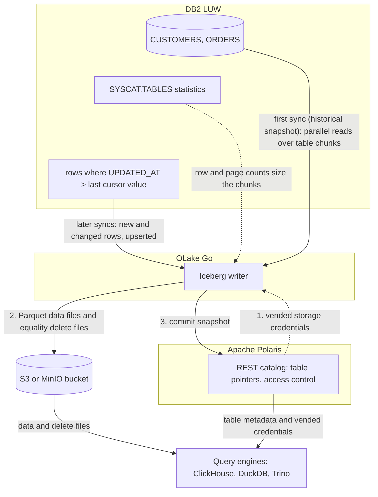

import * as I from '@site/src/components/integrations';

Getting IBM DB2 LUW (Linux, UNIX and Windows) data into ClickHouse usually means a CSV export on a schedule or a licensed replication product feeding Kafka. This guide takes a different route. OLake Go reads the DB2 tables with a read-only user and commits them as Apache Iceberg tables into an Apache Polaris catalog. ClickHouse then attaches that catalog as a database.

Polaris is an open source Iceberg REST (Representational State Transfer) catalog you run yourself, with the files in your own bucket. DuckDB and Trino read the same tables through the same endpoint, and a cursor column keeps them fresh.

<I.IntegrationByline />

<TLDR title='Key takeaways'>

- OLake Go replicates DB2 LUW into Iceberg tables in Polaris: a full historical snapshot first, then incremental syncs on a cursor column such as `UPDATED_AT`, with no Kafka or replication license in between.
- ClickHouse attaches the whole Polaris catalog as one database with `DataLakeCatalog`, reads the files with the credentials Polaris vends, and sees each sync the moment it commits.
- The same tables, written once by OLake Go, are also queryable from DuckDB and Trino through the same catalog. In the run on this page all three engines returned identical rows.

</TLDR>

**The short answer.** To replicate DB2 to ClickHouse, run OLake Go with a read-only DB2 user as the source and an Apache Polaris catalog as the Iceberg destination. The first sync copies each table in full (the historical snapshot); every later sync fetches the rows whose cursor column moved and upserts them. ClickHouse, DuckDB and Trino then query the same Iceberg tables, with no second copy.

## How DB2 data reaches ClickHouse here



The first sync reads the row and page counts DB2 keeps for each table, splits the table into chunks, and reads the chunks in parallel. It writes Parquet data files and records the highest cursor value it saw. Every later sync selects rows above that value, writes them as a new data file, and adds an equality delete file that retires the old version of each key.

Each sync ends with one commit to Polaris. OLake Go asks Polaris for short-lived storage credentials, uploads the data and delete files, then posts the new snapshot. ClickHouse, DuckDB and Trino see it on their next query; none of them keeps a copy.

The cursor is the whole contract. A row that changes without its `UPDATED_AT` moving is never picked up, and a deleted row stays in the Iceberg table. Set the column in every write path, and soft-delete if deletes matter.

## What you need

- **DB2 LUW 11.5.3 or later**, with a read-only user, statistics on each table and a cursor column. The tables on this page ran on DB2 12.1.5 Community Edition in Docker.
- **An amd64 host for the DB2 connector.** IBM's driver has no Linux arm64 build. On an Apple silicon Mac, turn on Rosetta in Docker Desktop.
- **An Apache Polaris server and a bucket**, both reachable from OLake Go and from ClickHouse. The run on this page used Polaris 1.8.0 and MinIO in Docker; on AWS, use an S3 bucket and an IAM role instead.
- **ClickHouse 26.1 or later**, where the `DataLakeCatalog` engine reads REST catalogs. The run on this page used the 26.8 LTS release in Docker.
- **OLake UI** from the [Docker Compose install](/docs/install/olake-ui/). The run on this page used OLake Go v1.1.0.

## Step 1: Prepare DB2 for incremental sync

Most readers point OLake Go at tables they already have. To follow along with the exact data from this page, create these two tables first:

<details>
<summary>The two sample tables used on this page</summary>

```sql title="Sample schema, in schema DB2INST1 of database SHOP"
CREATE TABLE customers (
  id INT GENERATED BY DEFAULT AS IDENTITY PRIMARY KEY,
  name VARCHAR(100), email VARCHAR(200), city VARCHAR(100), tier VARCHAR(20),
  created_at TIMESTAMP DEFAULT CURRENT TIMESTAMP,
  updated_at TIMESTAMP DEFAULT CURRENT TIMESTAMP);

CREATE TABLE orders (
  id INT GENERATED BY DEFAULT AS IDENTITY PRIMARY KEY,
  customer_id INT REFERENCES customers(id),
  product VARCHAR(100), amount DECIMAL(10,2), status VARCHAR(20),
  created_at TIMESTAMP DEFAULT CURRENT TIMESTAMP,
  updated_at TIMESTAMP DEFAULT CURRENT TIMESTAMP);

-- Then insert whatever you like. This page started with 8 customers and 40 orders.
```

</details>

<I.Partial id="sources/db2/prereqs" />

## Step 2: Set up the Polaris catalog

ClickHouse reads Iceberg tables through a catalog. **Apache Polaris** is the one this page uses: an open source REST catalog that you run next to your bucket. OLake Go writes into it, and ClickHouse, DuckDB and Trino read from it with the credentials Polaris hands out. The Iceberg files sit in your own S3 or MinIO bucket; Polaris holds only the pointers and the permissions.

<I.CatalogStrip />

<I.CatalogTabs>
<TabItem value="polaris">

<I.Partial id="catalogs/polaris/setup" />

</TabItem>
</I.CatalogTabs>

## Step 3: Connect DB2 to OLake Go

<I.Partial id="sources/db2/connect">

Here is the source form from the run on this page. DB2 ran in another container, so the host is `host.docker.internal`, with database `shop` on port `50000`. The change data capture (CDC) switch is greyed out with **Not supported**, which is expected for DB2.

<Figure src='/img/docs/integrations/db2-to-clickhouse/olake-source-db2.webp' alt='OLake UI Edit source form for DB2 LUW on OLake Go v1.1.0 with CDC marked not supported, host host.docker.internal, port 50000, database shop and user db2inst1' caption='The DB2 source in OLake UI: database shop on port 50000, with CDC not supported for this connector.' width='760px' />

</I.Partial>

## Step 4: Configure the Iceberg destination

<I.CatalogTabs>
<TabItem value="polaris">

<I.Partial id="catalogs/polaris/writer">

Here is the destination form from the run on this page. Polaris and MinIO ran in other containers, so both addresses use `host.docker.internal`; the credential is the `olake` principal from step 2.

<Figure src='/img/docs/integrations/db2-to-clickhouse/olake-destination-polaris.webp' alt='OLake UI Edit destination form for Apache Iceberg with catalog type Polaris, authentication type OAuth2, REST catalog URI http://host.docker.internal:8181/api/catalog, Polaris catalog name olake, S3 endpoint http://host.docker.internal:9000, REST scope PRINCIPAL_ROLE:ALL and region us-east-1' caption='The Polaris destination in OLake UI: OAuth2 with the principal from step 2, and the MinIO endpoint for the files.' width='760px' />

</I.Partial>

</TabItem>
</I.CatalogTabs>

## Step 5: Create the job and run the first sync

<I.Partial id="jobs/create" engines="ClickHouse, plus DuckDB and Trino if they will read the tables too" upsert="Equality Deletes" updateType="eq" image="olakego/source-db2:latest" platform="linux/amd64" cliSyncMode="incremental" syncMode="Full Refresh + Incremental" cursor="UPDATED_AT" namespace="DB2INST1" stream="CUSTOMERS">

Three target query engines were set on this job, and OLake Go resolved the delete format all three read: equality deletes, which need no index between runs. Because the DB2 connector has no CDC mode, each stream runs as **Full Refresh + Incremental** with `UPDATED_AT` as the cursor. DB2 reports unquoted names in upper case, so the streams and columns appear that way.

<Figure src='/img/docs/integrations/db2-to-clickhouse/olake-streams-equality-deletes.webp' alt='OLake UI Streams Selection page with the DB2INST1 schema, CUSTOMERS and ORDERS selected, sync mode Full Refresh + Incremental, CDC options disabled, cursor field UPDATED_AT, ingestion mode Upsert and upsert type Equality Deletes on Iceberg format version V2' caption='Each stream: Full Refresh + Incremental on UPDATED_AT, Upsert, and the upsert type OLake Go resolved (Equality Deletes in this run).' />

<Figure src='/img/docs/integrations/db2-to-clickhouse/olake-job-history-two-syncs.webp' alt='OLake UI Job Logs and History for db2_to_clickhouse showing two completed syncs, the first in 14 seconds and the second in 12 seconds' caption='Job history: the 14 s historical snapshot, then the 12 s incremental sync.' />

</I.Partial>

On this page the first run copied 8 customers and 40 orders (48 records, 2.38 KB) and finished in **14 seconds**, container start included. OLake Go names the destination namespace after the job, the database and the DB2 schema, lower-cased: `db2_to_clickhouse` on `SHOP.DB2INST1` produced `db2_to_clickhouse_shop_db2inst1`. The **Iceberg DB** field at the top of the Streams page changes it before the first sync.

## Step 6: Query the tables in ClickHouse

<I.CatalogTabs>
<TabItem value="polaris">

<I.Partial id="engines/clickhouse/query-polaris" schema="db2_to_clickhouse_shop_db2inst1" />

<Figure src='/img/docs/integrations/db2-to-clickhouse/clickhouse-polaris-customers.webp' alt='clickhouse-client querying polaris.db2_to_clickhouse_shop_db2inst1.customers through the DataLakeCatalog engine and returning 10 rows with id, name, city and tier' caption='ClickHouse 26.8 reading the customers table through Polaris after the incremental sync: 10 rows, one per key.' />

</TabItem>
</I.CatalogTabs>

<I.Cta />

## Step 7: Change rows in DB2 and sync again

To see the incremental path work, the run on this page made 12 changes in DB2 after the first sync. Every update also sets `updated_at`, which is what the cursor sees:

```sql title="Changes made in DB2 between the two syncs"
INSERT INTO customers (name, email, city, tier) VALUES ('Maya Patel', 'maya@example.com', 'Pune', 'silver');
INSERT INTO customers (name, email, city, tier) VALUES ('Lucas Silva', 'lucas@example.com', 'São Paulo', 'bronze');
INSERT INTO orders (customer_id, product, amount, status) VALUES (9, 'Laptop', 1299.00, 'placed');
INSERT INTO orders (customer_id, product, amount, status) VALUES (9, 'Mouse', 25.50, 'placed');
INSERT INTO orders (customer_id, product, amount, status) VALUES (10, 'Monitor', 349.99, 'placed');
INSERT INTO orders (customer_id, product, amount, status) VALUES (3, 'Keyboard', 89.00, 'placed');
INSERT INTO orders (customer_id, product, amount, status) VALUES (7, 'Webcam', 79.90, 'placed');
UPDATE customers SET tier = 'gold',      updated_at = CURRENT TIMESTAMP WHERE name = 'Liam Carter';
UPDATE customers SET city = 'Abu Dhabi', updated_at = CURRENT TIMESTAMP WHERE name = 'Zara Ali';
UPDATE orders    SET status = 'delivered', updated_at = CURRENT TIMESTAMP WHERE id IN (1, 4, 7);
```

The second sync fetched **12 rows (635 bytes)** above the saved cursor and finished in **12 seconds** end to end. For `customers` that meant one new data file with 4 rows and one equality delete file with a delete for each of those 4 keys. The 2 inserts get one too, because an equality delete costs nothing when no older row matches. The commit report in the sync log shows `addedDataFiles=1`, `addedRecords=4`, `addedEqualityDeleteFiles=1`, `addedEqualityDeletes=4`, and `orders` the same shape with 8 rows and 8 deletes.

<Figure src='/img/docs/integrations/db2-to-clickhouse/olake-sync-log-equality-delete-commit.webp' alt='OLake UI sync log filtered to the Iceberg commit reports for customers and orders, showing addedDataFiles 1, addedEqualityDeleteFiles 1, addedRecords 4 and 8, and addedEqualityDeletes 4 and 8' caption='The incremental sync in the OLake UI log: one data file and one equality delete file per table.' />

ClickHouse shows the result on the next query, with no refresh. Liam Carter is `gold`, Zara Ali moved to Abu Dhabi, and the two new customers are there; the two retired versions are gone. In incremental mode OLake Go cannot tell an insert from an update, so the 4 rows the second sync brought carry `_op_type = u` and the snapshot rows keep `r`.

**Schema changes.** When a column is added in DB2, OLake Go adds it to the Iceberg table on the next sync, and ClickHouse shows it the next time the table is opened. DB2 itself may put the table in `REORG PENDING` after an `ALTER TABLE`; see troubleshooting below. Full rules are on the [schema evolution page](/docs/features/schema/).

## Query the same tables from DuckDB and Trino

Nothing is exported, copied or refreshed: both engines read the files OLake Go wrote, through the same Polaris endpoint.

<Tabs groupId="engine" queryString="engine">
<TabItem value="duckdb" label="DuckDB" default>

<I.Partial id="engines/duckdb/connect-polaris" schema="db2_to_clickhouse_shop_db2inst1" />

<Figure src='/img/docs/integrations/db2-to-clickhouse/duckdb-polaris-customers.webp' alt='DuckDB 1.5.5 querying polaris.db2_to_clickhouse_shop_db2inst1.customers and returning the same 10 rows as ClickHouse' caption='DuckDB 1.5.5 reading the same table through Polaris: the same 10 rows.' />

</TabItem>
<TabItem value="trino" label="Trino">

<I.Partial id="engines/trino/connect-polaris" schema="db2_to_clickhouse_shop_db2inst1" />

<Figure src='/img/docs/integrations/db2-to-clickhouse/trino-polaris-customers.webp' alt='Trino 484 CLI querying customers in the polaris catalog and returning the same 10 rows as ClickHouse' caption='Trino 484 reading the same table through Polaris with vended credentials: the same 10 rows.' />

</TabItem>
</Tabs>

An `orders` roll-up matched DB2 to the cent in all three engines. It gave 16 delivered orders for 8659.68, 18 placed for 10522.26, 11 shipped for 6397.25.

## Data types: DB2 to Iceberg to ClickHouse

OLake Go maps DB2 types to Iceberg types, and ClickHouse maps Iceberg types to its own. Decimals and times are the ones to watch.

| DB2 | Iceberg (written by OLake Go) | ClickHouse shows | Notes |
| --- | --- | --- | --- |
| `SMALLINT`, `INTEGER` | `int` | `Nullable(Int32)` | The identity keys on this page arrived as `Int32`. |
| `BIGINT` | `long` | `Nullable(Int64)` | |
| `DECIMAL`, `NUMERIC`, `DECFLOAT`, `FLOAT`, `DOUBLE` | `double` | `Nullable(Float64)` | The `orders.amount` sums on this page matched DB2 to the cent; round at query time when you need exact decimal arithmetic. |
| `REAL` | `float` | `Nullable(Float32)` | |
| `BOOLEAN` | `boolean` | `Nullable(Bool)` | |
| `DATE`, `TIMESTAMP` | `timestamptz` (UTC) | `Nullable(DateTime64(6, 'UTC'))` | OLake Go writes every timestamp in UTC, whatever the server time zone. |
| `TIME` | `string` | `Nullable(String)` | |
| `CHAR`, `VARCHAR`, `CLOB`, `GRAPHIC`, `VARGRAPHIC`, `DBCLOB`, `XML` | `string` | `Nullable(String)` | |
| `BLOB` | `string` | `Nullable(String)` | Binary values arrive as text; keep large binaries out of the sync. |

DB2 types in the table come from the [DB2 connector reference](/docs/connectors/db2/#data-type-mapping). The ClickHouse side comes from the [ClickHouse Iceberg table engine page](https://clickhouse.com/docs/engines/table-engines/integrations/iceberg) (checked 2026-10-30) and from `DESCRIBE` on the tables of this run.

## Cost and maintenance

- **Storage** is your bucket: you pay S3 or MinIO rates for the Parquet and delete files, and nothing to Polaris or ClickHouse for holding them.
- **Compute.** OLake Go runs wherever you run Docker, on an amd64 host for the DB2 connector. ClickHouse spends CPU only when you query; a `DataLakeCatalog` query reads Parquet over the network with no MergeTree index, so load a hot slice into a MergeTree table when a dashboard needs sub-second answers.
- **DB2 load.** Each incremental sync is one range scan per table on the cursor column; index `UPDATED_AT` so it stays cheap as the table grows. Keep `RUNSTATS` in your regular maintenance window so snapshot chunks stay even.
- **Maintenance.** Nothing compacts the tables for you. A table that gets a new small file and delete file per sync wants compaction; [OLake Fusion](/docs/fusion/getting-started/overview/) does this for the catalogs OLake Go writes to, and Spark's `rewrite_data_files` works through the same Polaris endpoint.
- **Credential rotation.** Polaris principals do not expire by default. Rotate the `olake` principal's secret on your own schedule; a rotated secret fails the next sync at the token exchange, before any data moves.

## Troubleshooting

### 1. The source test fails on an Apple silicon Mac

```text
image pull registry-1.docker.io/olakego/source-db2:v1.1.0: Error response from daemon: no matching manifest for linux/arm64/v8 in the manifest list entries
```

The OLake UI worker pulls connector images for the host's platform, and the DB2 image exists for amd64 only. Turn on **Use Rosetta for x86_64/amd64 emulation** in Docker Desktop, then pull the image yourself and tag it with the name the worker asks for:

```bash
docker pull --platform linux/amd64 olakego/source-db2:v1.1.0
docker tag olakego/source-db2:v1.1.0 registry-1.docker.io/olakego/source-db2:v1.1.0
```

The run on this page hit this first and passed after these two commands. On an amd64 Linux host the error does not occur.

### 2. The first sync stops with "stats not populated"

```text
stats not populated for table[DB2INST1.CUSTOMERS]. Please run CLP command: RUNSTATS ON TABLE DB2INST1.CUSTOMERS AND INDEXES ALL
```

DB2 has never collected statistics for the table, and OLake Go needs them to size the snapshot chunks. Run the `RUNSTATS` call from step 1 for every table in the job, then sync again.

### 3. A sync fails with SQL0668N after an ALTER TABLE

Adding, dropping or retyping a column can leave a DB2 table in `REORG PENDING`, and reads fail until it is reorganized. Run `CALL SYSPROC.ADMIN_CMD('REORG TABLE db2inst1.customers')`, then sync again. The [DB2 connector page](/docs/connectors/db2/#troubleshooting) lists the operations that cause it.

### 4. The CLI picked the wrong cursor column

`discover` fills `cursor_field` in `selected_streams.json` with the first column in alphabetical order. In the run on this page that was `CITY` for `CUSTOMERS` and `AMOUNT` for `ORDERS`. Set it to `UPDATED_AT` for every stream before the first sync; the OLake UI asks for it on the Streams page instead.

### 5. ClickHouse lists the tables but every query returns a 404

```text
Code: 499. DB::Exception: Failed to get object info for key olake/.../metadata/00003-....metadata.json in bucket lakehouse: No response body.. HTTP response code: 404
```

The object key is doubled. ClickHouse 26.8 and 26.10 join the table location onto the storage endpoint, then fail to strip it again when the endpoint has no trailing slash. Set the Polaris catalog's `endpoint` to a value ending in `/`, for example `http://minio:9000/`.

### 6. Updated rows are missing after an incremental sync

The update did not move the cursor column. OLake Go only fetches rows whose cursor value is above the last one it saw. Set `UPDATED_AT` in every write path, or add a trigger that sets it on `UPDATE`.

<details>
<summary>How this compares with other ways to move DB2 data to ClickHouse</summary>

| Method | Freshness | Updates and deletes | Where the data lands | What you run |
| --- | --- | --- | --- | --- |
| [Debezium's Db2 connector](https://debezium.io/documentation/reference/stable/connectors/db2.html), Kafka and the ClickHouse Kafka engine | Seconds, from SQL Replication capture tables | Yes, with your own merge logic | Kafka topics, then ClickHouse tables | Kafka, Kafka Connect, Debezium, tables in capture mode and, per Debezium's docs, an IBM InfoSphere Data Replication license (checked Oct 2026) |
| [ClickHouse ODBC table function](https://clickhouse.com/docs/reference/functions/table-functions/odbc) against DB2 | Live, per query | Reads the current row | Nothing is copied; every query hits DB2 | IBM's ODBC driver and a DSN on every ClickHouse server |
| Export (`EXPORT TO ... OF DEL`), then `INSERT ... SELECT FROM s3(...)` | Hours to daily | No; full reloads only | Native ClickHouse tables | A script, a scheduler and a staging bucket |
| **OLake Go to Iceberg on Polaris (this guide)** | Incremental on a schedule down to one minute | Inserts and updates that move the cursor; deletes need a soft-delete column | Apache Iceberg tables that ClickHouse, DuckDB, Trino and Spark all read | One Docker Compose stack, open source; your bucket plus your own compute |

Log-based replication through Kafka is the choice when you need seconds of latency and hard deletes. Writing Iceberg once avoids paying for a second copy as soon as another engine needs the same rows.

</details>

## When not to use this

- **Every query must hit MergeTree speed.** A `DataLakeCatalog` query reads Parquet with no primary index. Keep the Iceberg tables as the source and load the hot slice into a MergeTree table on a schedule.
- **You need hard deletes replicated.** Incremental sync cannot see a deleted row. Soft-delete in DB2, or use a log-based tool.
- **Your DB2 runs on z/OS or IBM i.** The connector covers DB2 LUW only.

## FAQs

<I.IntegrationFaq />

<I.HowWeTested />

## Related guides

<I.RelatedIntegrations />

Deeper reading on this site:

- [DB2 LUW connector reference](/docs/connectors/db2/)
- [IBM DB2 LUW to a lakehouse with Apache Iceberg](/blog/ibm-db2-luw-to-lakehouse-sync-apache-iceberg-olake/)
- [Equality vs positional deletes vs deletion vectors](/blog/iceberg-delete-formats-cdc-equality-vs-positional-vs-deletion-vectors/)
- [OLake Go ingestion benchmarks](/docs/benchmarks/ingestion/)

<I.IntegrationJsonLd />

<I.Cta title='Start with your own DB2' body='The quickstart runs OLake UI with Docker Compose. Create the source, the Polaris destination and the job as above, and the first sync lands your tables where ClickHouse can read them.' />
