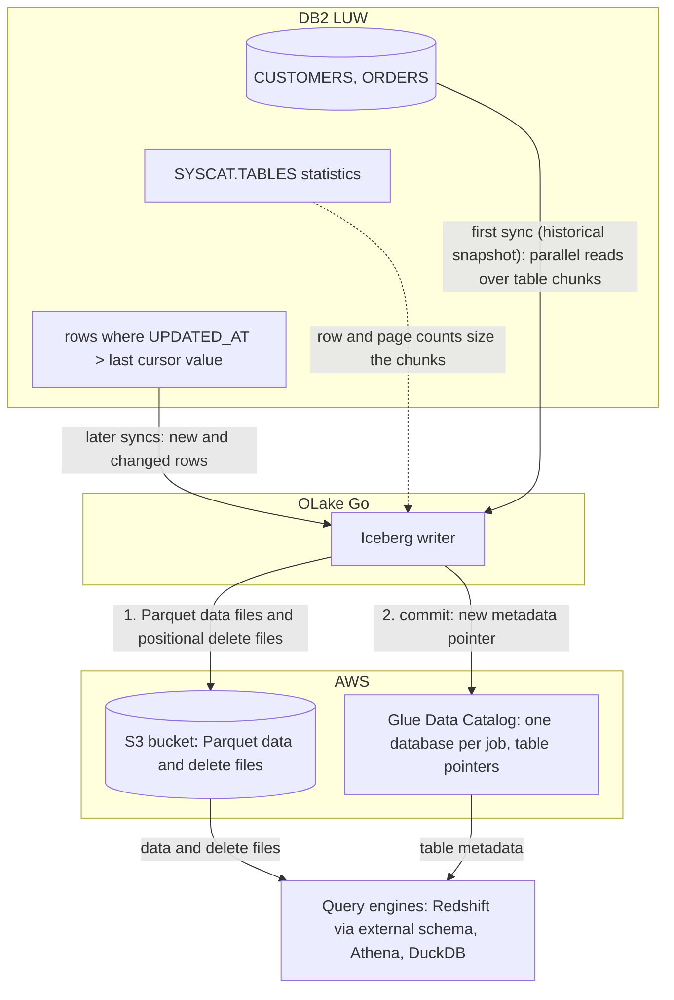

import * as I from '@site/src/components/integrations';

Moving IBM DB2 LUW (Linux, UNIX and Windows) data to Redshift usually means an AWS Database Migration Service (DMS) task, a licensed replication product, or a nightly `EXPORT` and `COPY`. This guide does it with OLake Go. It reads the DB2 tables with a read-only user, writes them once as Apache Iceberg tables into the AWS Glue Data Catalog, and keeps them fresh on a cursor column.

The files stay in your own S3 bucket. Redshift maps the Glue database onto an external schema and queries the tables in place, and Athena and DuckDB read the same tables through the same catalog.

<I.IntegrationByline />

<TLDR title='Key takeaways'>

- OLake Go replicates DB2 LUW into Iceberg tables in the Glue Data Catalog: a full historical snapshot first, then incremental syncs on a cursor column such as `UPDATED_AT`, with no DMS or replication license in between.
- Redshift reads the Glue database through one `CREATE EXTERNAL SCHEMA` statement, with no refresh. Every change a sync commits is visible on the next query, on Serverless and RA3 alike.
- The same tables, written once by OLake Go, are also queryable from Athena and DuckDB. In the run on this page all three engines returned identical rows.

</TLDR>

**The short answer.** To replicate DB2 to Redshift, run OLake Go with a read-only DB2 user as the source and the AWS Glue Data Catalog as the Iceberg destination, with Positional Deletes as the upsert type, the format Redshift reads. The first sync copies each table in full (the historical snapshot); every later sync fetches the rows whose cursor column moved and upserts them. Redshift, Athena and DuckDB then query the same Iceberg tables, with no second copy.

## How DB2 data reaches Redshift here



The first sync reads the row and page counts DB2 keeps for each table, splits the table into chunks, and reads the chunks in parallel. It writes Parquet data files and records the highest cursor value it saw. Every later sync selects rows above that value, writes them as new data files, and adds a delete file that retires the old version of each updated row.

Each sync ends with one commit to Glue. OLake Go uploads the data and delete files to the bucket, then updates the table's metadata pointer in the Glue database. Redshift, Athena and DuckDB see the new snapshot on their next query; none of them keeps a copy.

The cursor is the whole contract. A row that changes without its `UPDATED_AT` moving is never picked up, and a deleted row stays in the Iceberg table. Set the column in every write path, and soft-delete if deletes matter.

## What you need

- **DB2 LUW 11.5.3 or later**, with a read-only user, statistics on each table and a cursor column. The tables on this page ran on DB2 12.1.5 Community Edition in Docker.
- **An amd64 host for the DB2 connector.** IBM's driver has no Linux arm64 build. On an Apple silicon Mac, turn on Rosetta in Docker Desktop.
- **An AWS account** with an S3 bucket for the files and an IAM user or role for OLake Go with Glue and S3 permissions. The run on this page used a bucket and a scoped IAM user in `ap-southeast-1`.
- **Amazon Redshift**, Serverless or an RA3 cluster, with an IAM role attached that can read Glue and the bucket. The run on this page used a Serverless workgroup at 8 RPU.
- **OLake UI** from the [Docker Compose install](/docs/install/olake-ui/). The run on this page used OLake Go v1.1.0.

## Step 1: Prepare DB2 for incremental sync

Most readers point OLake Go at tables they already have. To follow along with the exact data from this page, create these two tables first:

<details>
<summary>The two sample tables used on this page</summary>

```sql title="Sample schema, in schema DB2INST1 of database SHOP"
CREATE TABLE customers (
  id INT GENERATED BY DEFAULT AS IDENTITY PRIMARY KEY,
  name VARCHAR(100), email VARCHAR(200), city VARCHAR(100), tier VARCHAR(20),
  created_at TIMESTAMP DEFAULT CURRENT TIMESTAMP,
  updated_at TIMESTAMP DEFAULT CURRENT TIMESTAMP);

CREATE TABLE orders (
  id INT GENERATED BY DEFAULT AS IDENTITY PRIMARY KEY,
  customer_id INT REFERENCES customers(id),
  product VARCHAR(100), amount DECIMAL(10,2), status VARCHAR(20),
  created_at TIMESTAMP DEFAULT CURRENT TIMESTAMP,
  updated_at TIMESTAMP DEFAULT CURRENT TIMESTAMP);

-- Then insert whatever you like. This page started with 8 customers and 40 orders.
```

</details>

<I.Partial id="sources/db2/prereqs" />

## Step 2: Set up the Glue catalog

Redshift reads Iceberg tables through a catalog. **AWS Glue Data Catalog** is the one this page uses: OLake Go creates a Glue database per job and registers each table there. The files sit in your S3 bucket. Redshift, Athena, Amazon Elastic MapReduce (EMR) and DuckDB all read from the same catalog. Redshift reaches it through an external schema, with the IAM role attached to the workgroup or cluster.

<I.CatalogStrip />

<I.CatalogTabs>
<TabItem value="glue">

<I.Partial id="catalogs/glue/setup" />

The run on this page gave OLake Go a scoped IAM user with this inline policy. Redshift got a role with `AmazonS3ReadOnlyAccess` and read access to Glue:

```json title="IAM policy for the OLake Go user (replace the bucket, region and account)"
{
  "Version": "2012-10-17",
  "Statement": [
    { "Effect": "Allow", "Action": ["s3:ListBucket", "s3:GetBucketLocation"], "Resource": "arn:aws:s3:::<bucket>" },
    { "Effect": "Allow", "Action": ["s3:GetObject", "s3:PutObject", "s3:DeleteObject", "s3:AbortMultipartUpload", "s3:ListMultipartUploadParts"], "Resource": "arn:aws:s3:::<bucket>/*" },
    { "Effect": "Allow",
      "Action": ["glue:GetDatabase", "glue:GetDatabases", "glue:CreateDatabase", "glue:GetTable", "glue:GetTables", "glue:CreateTable", "glue:UpdateTable", "glue:DeleteTable"],
      "Resource": ["arn:aws:glue:<region>:<account>:catalog", "arn:aws:glue:<region>:<account>:database/*", "arn:aws:glue:<region>:<account>:table/*/*"] }
  ]
}
```

</TabItem>
</I.CatalogTabs>

## Step 3: Connect DB2 to OLake Go

<I.Partial id="sources/db2/connect">

Here is the source form from the run on this page. DB2 ran in another container, so the host is `host.docker.internal`, with database `shop` on port `50000`. The change data capture (CDC) switch is greyed out with **Not supported**, which is expected for DB2.

<Figure src='/img/docs/integrations/db2-to-redshift/olake-source-db2.webp' alt='OLake UI Edit source form for DB2 LUW on OLake Go v1.1.0 with CDC marked not supported, host host.docker.internal, port 50000, database shop and user db2inst1' caption='The DB2 source in OLake UI: database shop on port 50000, with CDC not supported for this connector.' width='760px' />

</I.Partial>

## Step 4: Configure the Iceberg destination

<I.CatalogTabs>
<TabItem value="glue">

<I.Partial id="catalogs/glue/writer" />

Here is the destination form from the run on this page. It holds the bucket path OLake Go writes under, the region of the bucket and the Glue catalog, and the access key pair of the IAM user from step 2.

<Figure src='/img/docs/integrations/db2-to-redshift/olake-destination-glue.webp' alt='OLake UI Edit destination form for Apache Iceberg with catalog type AWS Glue, an S3 path under the lab bucket, region ap-southeast-1 and an access key pair' caption='The Glue destination in OLake UI: the S3 path, the region and the keys of the scoped IAM user.' width='760px' />

</TabItem>
</I.CatalogTabs>

## Step 5: Create the job and run the first sync

Redshift is not in OLake Go's target engine picker yet. This job therefore lists **Athena** and **DuckDB** as target engines, with **Positional Deletes** as the upsert type. That is the format Redshift reads, and both listed engines read it too. Because the DB2 connector has no CDC mode, each stream runs as **Full Refresh + Incremental** with `UPDATED_AT` as the cursor.

<I.Partial id="jobs/create" engines="AWS Athena and DuckDB (Redshift is not in the list yet; it reads what Athena reads)" upsert="Positional Deletes" updateType="pos" image="olakego/source-db2:latest" platform="linux/amd64" cliSyncMode="incremental" syncMode="Full Refresh + Incremental" cursor="UPDATED_AT" namespace="DB2INST1" stream="CUSTOMERS">

DB2 reports unquoted names in upper case, so the streams and columns appear that way.

<Figure src='/img/docs/integrations/db2-to-redshift/olake-streams-positional-deletes.webp' alt='OLake UI Streams Selection page with the DB2INST1 schema, CUSTOMERS and ORDERS selected, sync mode Full Refresh + Incremental, CDC options disabled, cursor field UPDATED_AT, ingestion mode Upsert and upsert type Positional Deletes on Iceberg format version V2' caption='Each stream: Full Refresh + Incremental on UPDATED_AT, Upsert, and Positional Deletes as the upsert type.' />

<Figure src='/img/docs/integrations/db2-to-redshift/olake-job-history-two-syncs.webp' alt='OLake UI Job Logs and History for db2_to_redshift showing two completed syncs of 16 seconds each' caption='Job history: the 16 s historical snapshot, then the 16 s incremental sync.' />

</I.Partial>

On this page the first run copied 8 customers and 40 orders (48 records, 2.38 KB) and finished in **16 seconds**, container start included. OLake Go names the Glue database after the job, the database and the DB2 schema, lower-cased: `db2_to_redshift` on `SHOP.DB2INST1` produced `db2_to_redshift_shop_db2inst1`. The **Iceberg DB** field at the top of the Streams page changes it before the first sync.

## Step 6: Query the tables in Redshift

<I.CatalogTabs>
<TabItem value="glue">

<I.Partial id="engines/redshift/query-glue" schema="db2_to_redshift_shop_db2inst1" />

<Figure src='/img/docs/integrations/db2-to-redshift/redshift-glue-customers.webp' alt='Redshift query editor v2 in the AWS console running the customers query on the Serverless workgroup and returning 10 rows with id, name, city and tier' caption='Redshift Serverless reading the customers table through the external schema after the incremental sync in query editor v2: 10 rows, one per key.' />

</TabItem>
</I.CatalogTabs>

<I.Cta />

## Step 7: Change rows in DB2 and sync again

To see the incremental path work, the run on this page made 12 changes in DB2 after the first sync. Every update also sets `updated_at`, which is what the cursor sees:

```sql title="Changes made in DB2 between the two syncs"
INSERT INTO customers (name, email, city, tier) VALUES ('Maya Patel', 'maya@example.com', 'Pune', 'silver');
INSERT INTO customers (name, email, city, tier) VALUES ('Lucas Silva', 'lucas@example.com', 'São Paulo', 'bronze');
INSERT INTO orders (customer_id, product, amount, status) VALUES (9, 'Laptop', 1299.00, 'placed');
INSERT INTO orders (customer_id, product, amount, status) VALUES (9, 'Mouse', 25.50, 'placed');
INSERT INTO orders (customer_id, product, amount, status) VALUES (10, 'Monitor', 349.99, 'placed');
INSERT INTO orders (customer_id, product, amount, status) VALUES (3, 'Keyboard', 89.00, 'placed');
INSERT INTO orders (customer_id, product, amount, status) VALUES (7, 'Webcam', 79.90, 'placed');
UPDATE customers SET tier = 'gold',      updated_at = CURRENT TIMESTAMP WHERE name = 'Liam Carter';
UPDATE customers SET city = 'Abu Dhabi', updated_at = CURRENT TIMESTAMP WHERE name = 'Zara Ali';
UPDATE orders    SET status = 'delivered', updated_at = CURRENT TIMESTAMP WHERE id IN (1, 4, 7);
```

The second sync fetched **12 rows (635 bytes)** above the saved cursor and finished in **16 seconds** end to end. For `customers` that meant one new data file with 4 rows and one positional delete file retiring the 2 old versions. The commit report in the sync log shows `addedDataFiles=1`, `addedRecords=4`, `addedPositionalDeleteFiles=1`, `addedPositionalDeletes=2`, and `orders` the same shape with 8 rows and 3 deletes.

<Figure src='/img/docs/integrations/db2-to-redshift/olake-sync-log-positional-delete-commit.webp' alt='OLake UI sync log filtered to the Iceberg commit reports for customers and orders, showing addedDataFiles 1, addedPositionalDeleteFiles 1, addedRecords 4 and 8, and addedPositionalDeletes 2 and 3' caption='The incremental sync in the OLake UI log: one data file and one positional delete file per table.' />

Redshift shows the result on the next query, with no refresh and no `ALTER TABLE`. Liam Carter is `gold`, Zara Ali moved to Abu Dhabi, and the two new customers are there. In incremental mode OLake Go cannot tell an insert from an update, so the 4 rows the second sync brought carry `_op_type = u` and the snapshot rows keep `r`.

**Schema changes.** When a column is added in DB2, OLake Go adds it to the Iceberg table and its Glue definition on the next sync, and Redshift shows it on the next query. DB2 itself may put the table in `REORG PENDING` after an `ALTER TABLE`; see troubleshooting below. Full rules are on the [schema evolution page](/docs/features/schema/).

## Query the same tables from Athena and DuckDB

Nothing is exported, copied or refreshed: both engines read the files OLake Go wrote, through the same Glue database.

<Tabs groupId="engine" queryString="engine">
<TabItem value="athena" label="Amazon Athena" default>

<I.Partial id="engines/athena/connect-glue" schema="db2_to_redshift_shop_db2inst1" />

<Figure src='/img/docs/integrations/db2-to-redshift/athena-glue-customers.webp' alt='Athena query editor in the AWS console showing the customers query on db2_to_redshift_shop_db2inst1.customers completed with 10 rows' caption='Athena reading the same table through Glue: the same 10 rows.' />

</TabItem>
<TabItem value="duckdb" label="DuckDB">

<I.Partial id="engines/duckdb/connect-glue" schema="db2_to_redshift_shop_db2inst1" />

DuckDB 1.5.5 returned the same 10 customers and the same `orders` roll-up as Redshift and Athena in the run on this page. It read the current metadata file of each table.

</TabItem>
</Tabs>

An `orders` roll-up matched DB2 to the cent in all three engines. It gave 16 delivered orders for 8659.68, 18 placed for 10522.26, 11 shipped for 6397.25.

## Data types: DB2 to Iceberg to Redshift

OLake Go maps DB2 types to Iceberg types, and Redshift maps Iceberg types to its own through the external schema. Decimals and times are the ones to watch.

| DB2 | Iceberg (written by OLake Go) | Redshift shows | Notes |
| --- | --- | --- | --- |
| `SMALLINT`, `INTEGER` | `int` | `INTEGER` | |
| `BIGINT` | `long` | `BIGINT` | |
| `DECIMAL`, `NUMERIC`, `DECFLOAT`, `FLOAT`, `DOUBLE` | `double` | `DOUBLE PRECISION` | The `orders.amount` sums on this page matched DB2 to the cent; round at query time when you need exact decimal arithmetic. |
| `REAL` | `float` | `REAL` | |
| `BOOLEAN` | `boolean` | `BOOLEAN` | |
| `DATE`, `TIMESTAMP` | `timestamptz` (UTC) | `TIMESTAMP` | OLake Go writes every timestamp in UTC; Redshift shows it without a zone. |
| `TIME` | `string` | `VARCHAR` | |
| `CHAR`, `VARCHAR`, `CLOB`, `GRAPHIC`, `VARGRAPHIC`, `DBCLOB`, `XML` | `string` | `VARCHAR` | |
| `BLOB` | `string` | `VARCHAR` | Binary values arrive as text; keep large binaries out of the sync. |

DB2 types in the table come from the [DB2 connector reference](/docs/connectors/db2/#data-type-mapping). The Redshift side comes from the [Redshift Iceberg page](https://docs.aws.amazon.com/redshift/latest/dg/querying-iceberg.html) (checked 2026-10-30) and from `svv_external_columns` on the tables of this run.

## Cost and maintenance

- **Storage** is your bucket: you pay S3 rates for the Parquet and delete files, and nothing to Glue beyond its per-object pricing for the table entries.
- **Compute.** OLake Go runs wherever you run Docker, on an amd64 host for the DB2 connector. Redshift Serverless bills RPU-hours only while queries run; a query over the external schema scans the Parquet files in S3 through Redshift Spectrum. Athena bills per terabyte scanned.
- **DB2 load.** Each incremental sync is one range scan per table on the cursor column; index `UPDATED_AT` so it stays cheap as the table grows. Keep `RUNSTATS` in your regular maintenance window so snapshot chunks stay even.
- **Maintenance.** Glue has no built-in compaction for tables written by external engines. A table that gets a new small file and delete file per sync wants compaction; [OLake Fusion](/docs/fusion/getting-started/overview/) does this for the catalogs OLake Go writes to, and Spark on EMR's `rewrite_data_files` works through the same Glue catalog.
- **Key rotation.** The IAM user's access key is what OLake Go writes with. Rotate it on your schedule, or run OLake Go on an instance with a role and leave the key fields empty.

## Troubleshooting

### 1. The source test fails on an Apple silicon Mac

```text
image pull registry-1.docker.io/olakego/source-db2:v1.1.0: Error response from daemon: no matching manifest for linux/arm64/v8 in the manifest list entries
```

The OLake UI worker pulls connector images for the host's platform, and the DB2 image exists for amd64 only. Turn on **Use Rosetta for x86_64/amd64 emulation** in Docker Desktop, then pull the image yourself and tag it with the name the worker asks for:

```bash
docker pull --platform linux/amd64 olakego/source-db2:v1.1.0
docker tag olakego/source-db2:v1.1.0 registry-1.docker.io/olakego/source-db2:v1.1.0
```

On an amd64 Linux host, such as an EC2 instance, the error does not occur.

### 2. The first sync stops with "stats not populated"

```text
stats not populated for table[DB2INST1.CUSTOMERS]. Please run CLP command: RUNSTATS ON TABLE DB2INST1.CUSTOMERS AND INDEXES ALL
```

DB2 has never collected statistics for the table, and OLake Go needs them to size the snapshot chunks. Run the `RUNSTATS` call from step 1 for every table in the job, then sync again.

### 3. A sync fails with SQL0668N after an ALTER TABLE

Adding, dropping or retyping a column can leave a DB2 table in `REORG PENDING`, and reads fail until it is reorganized. Run `CALL SYSPROC.ADMIN_CMD('REORG TABLE db2inst1.customers')`, then sync again. The [DB2 connector page](/docs/connectors/db2/#troubleshooting) lists the operations that cause it.

### 4. The CLI picked the wrong cursor column

`discover` fills `cursor_field` in `selected_streams.json` with the first column in alphabetical order, for example `CITY` for `CUSTOMERS`. Set it to `UPDATED_AT` for every stream before the first sync; the OLake UI asks for it on the Streams page instead.

### 5. The destination test fails on a table OLake Go did not create

```text
User: arn:aws:iam::<account>:user/<olake user> is not authorized to perform: s3:GetObject on resource: "arn:aws:s3:::<another bucket>/.../test_olake.db/test_olake/metadata/00000-....metadata.json"
```

OLake Go's destination test opens a probe table called `test_olake.test_olake` in the Glue database `test_olake`. An earlier run in the same account and region may have left that table behind, pointing at a bucket your user cannot read. Delete the stale table from Glue, or run OLake Go against a region whose Glue catalog does not have it.

### 6. Redshift cannot see the external schema's tables

```text
ERROR: Database 'db2_to_redshift_shop_db2inst1' does not exist in the Glue Data Catalog
```

The external schema was created before the first sync, or in a different region from the Glue database. OLake Go creates the Glue database on the first sync; create the external schema after it, in the workgroup's region.

<details>
<summary>How this compares with other ways to move DB2 data to Redshift</summary>

| Method | Freshness | Updates and deletes | Where the data lands | What you run |
| --- | --- | --- | --- | --- |
| [AWS DMS with a Db2 LUW source](https://docs.aws.amazon.com/dms/latest/userguide/CHAP_Source.DB2.html) | CDC from the DB2 log | Yes | Native Redshift tables | A DMS replication instance and task, a recoverable (archive-logging) database and a `DBADM` user |
| [Debezium's Db2 connector](https://debezium.io/documentation/reference/stable/connectors/db2.html), Kafka and the Redshift sink | Seconds, from SQL Replication capture tables | Yes | Kafka topics, then Redshift tables | Kafka, Kafka Connect, Debezium, tables in capture mode and, per Debezium's docs, an IBM InfoSphere Data Replication license (checked Oct 2026) |
| Export (`EXPORT TO ... OF DEL`), then `COPY` into Redshift | Hours to daily | No; full reloads only | Native Redshift tables | A script, a scheduler and a staging bucket |
| **OLake Go to Iceberg on Glue (this guide)** | Incremental on a schedule down to one minute | Inserts and updates that move the cursor; deletes need a soft-delete column | Apache Iceberg tables that Redshift, Athena, EMR, Spark and DuckDB all read | One Docker Compose stack, open source; your bucket plus your own compute |

DMS is the simpler choice when you need deletes replicated and native Redshift tables are the only goal. Writing Iceberg once avoids paying to move and store a second copy as soon as Athena, EMR or a notebook needs the same rows.

</details>

## When not to use this

- **You need hard deletes replicated.** Incremental sync cannot see a deleted row. Soft-delete in DB2, or use a log-based tool.
- **Your DB2 runs on z/OS or IBM i.** The connector covers DB2 LUW only.
- **Every query must hit native Redshift speed.** Spectrum reads Parquet from S3 on every query. Keep the Iceberg tables as the source and load the hot slice into a native table on a schedule.

## FAQs

<I.IntegrationFaq />

<I.HowWeTested />

## Related guides

<I.RelatedIntegrations />

Deeper reading on this site:

- [DB2 LUW connector reference](/docs/connectors/db2/)
- [IBM DB2 LUW to a lakehouse with Apache Iceberg](/blog/ibm-db2-luw-to-lakehouse-sync-apache-iceberg-olake/)
- [Equality vs positional deletes vs deletion vectors](/blog/iceberg-delete-formats-cdc-equality-vs-positional-vs-deletion-vectors/)
- [OLake Go ingestion benchmarks](/docs/benchmarks/ingestion/)

<I.IntegrationJsonLd />

<I.Cta title='Start with your own DB2' body='The quickstart runs OLake UI with Docker Compose. Create the source, the Glue destination and the job as above, and the first sync lands your tables where Redshift can read them.' />
