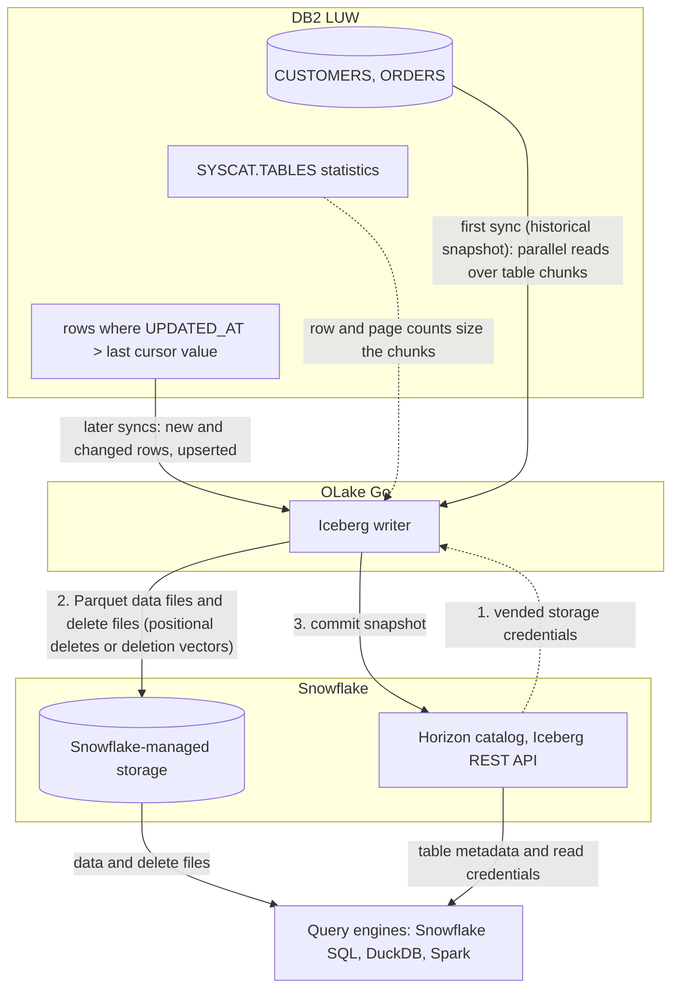

import * as I from '@site/src/components/integrations';

Moving IBM DB2 LUW (Linux, UNIX and Windows) data to Snowflake usually means a licensed replication product or a nightly `EXPORT` and `COPY INTO`. This guide does it with OLake Go. It reads the DB2 tables with a read-only user, writes them once as Apache Iceberg tables into a catalog Snowflake reads, and keeps them fresh on a cursor column.

With Snowflake's own Horizon catalog, the default on this page, the files sit on Snowflake-managed storage. With AWS Glue, the files sit in your S3 bucket and Snowflake reads them through a catalog integration.

<I.IntegrationByline />

<TLDR title='Key takeaways'>

- OLake Go replicates DB2 LUW into Snowflake as Iceberg tables: a full historical snapshot first, then incremental syncs on a cursor column such as `UPDATED_AT`. No SQL Replication setup, replication license or Kafka sits in between.
- Through the Horizon catalog the tables land as Snowflake-managed Iceberg tables. You query them in Snowsight right away, with no `CREATE ICEBERG TABLE`, no external volume and no refresh.
- The same tables, written once by OLake Go, are also queryable from DuckDB and Spark through the same catalog. In the run on this page all three engines returned identical rows.

</TLDR>

**The short answer.** To replicate DB2 to Snowflake, run OLake Go with a read-only DB2 user as the source and the Snowflake Horizon catalog as the Iceberg destination. The first sync copies each table in full (the historical snapshot); every later sync fetches the rows whose cursor column moved and upserts them. Snowflake, DuckDB and Spark then query the same Iceberg tables, with no second copy.

## How DB2 data reaches Snowflake here



The first sync reads the row and page counts DB2 keeps for each table, splits the table into chunks, and reads the chunks in parallel. It writes Parquet data files and records the highest cursor value it saw. Every later sync selects rows above that value, writes them as new data files, and adds a delete file that retires the old version of each updated row.

Each sync ends with one commit to Horizon. OLake Go asks Horizon for short-lived storage credentials, uploads the data and delete files, then posts the new snapshot. Snowflake sees it the moment the commit lands; DuckDB and Spark see it on their next catalog load.

The cursor is the whole contract. A row that changes without its `UPDATED_AT` moving is never picked up, and a deleted row stays in the Iceberg table. Set the column in every write path, and soft-delete if deletes matter.

## What you need

- **DB2 LUW 11.5.3 or later**, with a read-only user, statistics on each table and a cursor column. The tables on this page ran on DB2 12.1.5 Community Edition in Docker.
- **An amd64 host for the DB2 connector.** IBM's driver has no Linux arm64 build. On an Apple silicon Mac, turn on Rosetta in Docker Desktop.
- **A Snowflake account** where you can run the one-time setup as `ACCOUNTADMIN`. Snowflake-managed storage means no cloud bucket or IAM role on your side.
- **OLake UI** from the [Docker Compose install](/docs/install/olake-ui/). The run on this page used OLake Go v1.1.0.

## Step 1: Prepare DB2 for incremental sync

Most readers point OLake Go at tables they already have. To follow along with the exact data from this page, create these two tables first:

<details>
<summary>The two sample tables used on this page</summary>

```sql title="Sample schema, in schema DB2INST1 of database SHOP"
CREATE TABLE customers (
  id INT GENERATED BY DEFAULT AS IDENTITY PRIMARY KEY,
  name VARCHAR(100), email VARCHAR(200), city VARCHAR(100), tier VARCHAR(20),
  created_at TIMESTAMP DEFAULT CURRENT TIMESTAMP,
  updated_at TIMESTAMP DEFAULT CURRENT TIMESTAMP);

CREATE TABLE orders (
  id INT GENERATED BY DEFAULT AS IDENTITY PRIMARY KEY,
  customer_id INT REFERENCES customers(id),
  product VARCHAR(100), amount DECIMAL(10,2), status VARCHAR(20),
  created_at TIMESTAMP DEFAULT CURRENT TIMESTAMP,
  updated_at TIMESTAMP DEFAULT CURRENT TIMESTAMP);

-- Then insert whatever you like. This page started with 8 customers and 40 orders.
```

</details>

<I.Partial id="sources/db2/prereqs" />

## Step 2: Set up the catalog in Snowflake

Snowflake reads Iceberg tables from two kinds of catalog. **Horizon** is Snowflake's own: OLake Go writes straight into it, the tables are Snowflake-managed, and they appear in Snowsight the moment a sync commits. **AWS Glue** is a catalog outside Snowflake, so the files stay in your S3 bucket. Snowflake reaches them through a *catalog integration*: a read-only link to that external catalog, refreshed after each sync.

Horizon is the default on this page. Glue is the right pick when Athena, Redshift or Spark on Amazon Elastic MapReduce (EMR) will read the same tables.

<I.CatalogStrip />

<I.CatalogTabs>
<TabItem value="horizon">

<I.Partial id="catalogs/horizon/setup" />

</TabItem>
<TabItem value="glue">

<I.Partial id="catalogs/glue/setup" />

</TabItem>
</I.CatalogTabs>

## Step 3: Connect DB2 to OLake Go

<I.Partial id="sources/db2/connect">

Here is the source form from the run on this page. DB2 ran in another container, so the host is `host.docker.internal`, with database `shop` on port `50000`. The change data capture (CDC) switch is greyed out with **Not supported**, which is expected for DB2.

<Figure src='/img/docs/integrations/db2-to-snowflake/olake-source-db2.webp' alt='OLake UI Edit source form for DB2 LUW on OLake Go v1.1.0 with CDC marked not supported, host host.docker.internal, port 50000, database shop and user db2inst1' caption='The DB2 source in OLake UI: database shop on port 50000, with CDC not supported for this connector.' width='760px' />

</I.Partial>

## Step 4: Configure the Iceberg destination

<I.CatalogTabs>
<TabItem value="horizon">

<I.Partial id="catalogs/horizon/writer" />

</TabItem>
<TabItem value="glue">

<I.Partial id="catalogs/glue/writer" />

</TabItem>
</I.CatalogTabs>

## Step 5: Create the job and run the first sync

<I.Partial id="jobs/create" engines="Snowflake, plus DuckDB and Apache Spark if they will read the tables too" upsert="Positional Deletes" updateType="pos" image="olakego/source-db2:latest" platform="linux/amd64" cliSyncMode="incremental" syncMode="Full Refresh + Incremental" cursor="UPDATED_AT" namespace="DB2INST1" stream="CUSTOMERS">

Three target query engines were set on this job, and OLake Go resolved the delete format all three read. Because the DB2 connector has no CDC mode, each stream runs as **Full Refresh + Incremental** with `UPDATED_AT` as the cursor. DB2 reports unquoted names in upper case, so the streams and columns appear that way.

<Figure src='/img/docs/integrations/db2-to-snowflake/olake-streams-incremental.webp' alt='OLake UI Streams Selection page with the DB2INST1 schema, CUSTOMERS and ORDERS selected, sync mode Full Refresh + Incremental, CDC options disabled, cursor field UPDATED_AT, ingestion mode Upsert and upsert type Positional Deletes' caption='Each stream: Full Refresh + Incremental on UPDATED_AT, Upsert, and the upsert type OLake Go resolved (Positional Deletes in this run).' />

<Figure src='/img/docs/integrations/db2-to-snowflake/olake-job-history-two-syncs.webp' alt='OLake UI Job Logs and History for db2_to_snowflake showing two completed syncs, the first in 28 seconds and the second in 22 seconds' caption='Job history: the 28 s historical snapshot, then the 22 s incremental sync.' />

</I.Partial>

On this page the first run copied 8 customers and 40 orders (48 records, 2.38 KB) and finished in **28 seconds**, container start included. OLake Go names the destination schema after the job, the database and the DB2 schema, lower-cased: `db2_to_snowflake` on `SHOP.DB2INST1` produced `db2_to_snowflake_shop_db2inst1`. The **Iceberg DB** field at the top of the Streams page changes it before the first sync.

## Step 6: Query the tables in Snowflake

<I.CatalogTabs>
<TabItem value="horizon">

<I.Partial id="engines/snowflake/query-horizon" schema="db2_to_snowflake_shop_db2inst1" />

</TabItem>
<TabItem value="glue">

<I.Partial id="engines/snowflake/query-glue" schema="db2_to_snowflake_shop_db2inst1" />

</TabItem>
</I.CatalogTabs>

<I.Cta />

## Step 7: Change rows in DB2 and sync again

To see the incremental path work, the run on this page made 12 changes in DB2 after the first sync. Every update also sets `updated_at`, which is what the cursor sees:

```sql title="Changes made in DB2 between the two syncs"
INSERT INTO customers (name, email, city, tier) VALUES ('Maya Patel', 'maya@example.com', 'Pune', 'silver');
INSERT INTO customers (name, email, city, tier) VALUES ('Lucas Silva', 'lucas@example.com', 'São Paulo', 'bronze');
INSERT INTO orders (customer_id, product, amount, status) VALUES (9, 'Laptop', 1299.00, 'placed');
INSERT INTO orders (customer_id, product, amount, status) VALUES (9, 'Mouse', 25.50, 'placed');
INSERT INTO orders (customer_id, product, amount, status) VALUES (10, 'Monitor', 349.99, 'placed');
INSERT INTO orders (customer_id, product, amount, status) VALUES (3, 'Keyboard', 89.00, 'placed');
INSERT INTO orders (customer_id, product, amount, status) VALUES (7, 'Webcam', 79.90, 'placed');
UPDATE customers SET tier = 'gold',      updated_at = CURRENT TIMESTAMP WHERE name = 'Liam Carter';
UPDATE customers SET city = 'Abu Dhabi', updated_at = CURRENT TIMESTAMP WHERE name = 'Zara Ali';
UPDATE orders    SET status = 'delivered', updated_at = CURRENT TIMESTAMP WHERE id IN (1, 4, 7);
```

The second sync fetched **12 rows (635 bytes)** above the saved cursor and finished in **22 seconds** end to end. For `customers` that meant one new data file with 4 rows and one delete file retiring the 2 old versions. OLake Go's commit report shows it directly: `addedDataFiles=1`, `addedRecords=4`, `addedPositionalDeleteFiles=1`, `addedPositionalDeletes=2`, and `orders` the same shape with 8 rows and 3 deletes.

<Figure src='/img/docs/integrations/db2-to-snowflake/olake-sync-log-positional-delete-commit.webp' alt='OLake UI sync log filtered to the Iceberg commit reports for customers and orders after the incremental sync, showing addedDataFiles 1, addedPositionalDeleteFiles 1, addedRecords 4 and 8, totalEqualityDeletes 0' caption='The incremental sync in the OLake UI log: one data file and one positional delete file per table, zero equality deletes.' />

Snowflake shows the result with no refresh. Liam Carter is `gold`, Zara Ali moved to Abu Dhabi, and the two new customers are there. In incremental mode OLake Go cannot tell an insert from an update, so every row the second sync brought carries `_op_type = u`; the snapshot rows keep `r`:

<Figure src='/img/docs/integrations/db2-to-snowflake/snowsight-customers-after-incremental.webp' alt='Snowsight query on OLAKE_DEMO.db2_to_snowflake_shop_db2inst1.customers after the incremental sync showing 10 rows with _op_type r for six snapshot rows and u for Liam Carter, Zara Ali, Maya Patel and Lucas Silva' caption='Snowsight after the incremental sync: the four rows the cursor picked up carry u, the untouched snapshot rows r.' />

**Schema changes.** When a column is added in DB2, OLake Go adds it to the Iceberg table on the next sync, and Snowflake shows it. DB2 itself may put the table in `REORG PENDING` after an `ALTER TABLE`; see troubleshooting below. Full rules are on the [schema evolution page](/docs/features/schema/).

## Query the same tables from DuckDB and Spark

Nothing is exported, copied or refreshed: both engines read the files OLake Go wrote, through the same Horizon endpoint, with credentials vended by Snowflake.

<Tabs groupId="engine" queryString="engine">
<TabItem value="duckdb" label="DuckDB" default>

<I.Partial id="engines/duckdb/connect-horizon" schema="db2_to_snowflake_shop_db2inst1" />

DuckDB 1.5.5 returned the same 10 customers, with `id` as `INTEGER`, `amount` as `DOUBLE` and the timestamps as `TIMESTAMP WITH TIME ZONE`.

</TabItem>
<TabItem value="spark" label="Apache Spark">

<I.Partial id="engines/spark/connect-horizon" schema="db2_to_snowflake_shop_db2inst1" />

Spark 3.5.6 with Iceberg 1.10.0 returned the same 10 customers and the same `orders` roll-up as Snowflake and DuckDB in the run on this page.

</TabItem>
</Tabs>

An `orders` roll-up matched DB2 to the cent in all three engines. 16 delivered orders for 8659.68, 18 placed for 10522.26, 11 shipped for 6397.25.

## Data types: DB2 to Iceberg to Snowflake

OLake Go maps DB2 types to Iceberg types, and Snowflake maps Iceberg types to its own. Decimals and times are the ones to watch.

| DB2 | Iceberg (written by OLake Go) | Snowflake shows | Notes |
| --- | --- | --- | --- |
| `SMALLINT`, `INTEGER` | `int` | `NUMBER(10,0)` | |
| `BIGINT` | `long` | `NUMBER(19,0)` | |
| `DECIMAL`, `NUMERIC`, `DECFLOAT`, `FLOAT`, `DOUBLE` | `double` | `FLOAT` | The `orders.amount` sums on this page matched DB2 to the cent; round at query time when you need exact decimal arithmetic. |
| `REAL` | `float` | `FLOAT` | |
| `BOOLEAN` | `boolean` | `BOOLEAN` | |
| `DATE`, `TIMESTAMP` | `timestamptz` (UTC) | `TIMESTAMP_LTZ(6)` | OLake Go writes every timestamp in UTC, whatever the server time zone. |
| `TIME` | `string` | `VARCHAR` | |
| `CHAR`, `VARCHAR`, `CLOB`, `GRAPHIC`, `VARGRAPHIC`, `DBCLOB`, `XML` | `string` | `VARCHAR` | |
| `BLOB` | `string` | `VARCHAR` | Binary values arrive as text; keep large binaries out of the sync. |

DB2 types in the table come from the [DB2 connector reference](/docs/connectors/db2/#data-type-mapping); the Snowflake side from Snowflake's [Iceberg data types](https://docs.snowflake.com/en/user-guide/tables-iceberg-data-types) page (checked 2026-10-14).

## Cost and maintenance

- **Storage** is Snowflake's with `SNOWFLAKE_MANAGED`: you pay Snowflake storage rates for the Parquet and delete files. Point the database at your own external volume to keep the files in your bucket instead.
- **Compute.** OLake Go runs wherever you run Docker, on an amd64 host for the DB2 connector. It does not use a Snowflake warehouse to write; Snowflake compute is spent only when you query.
- **DB2 load.** Each incremental sync is one range scan per table on the cursor column; index `UPDATED_AT` so it stays cheap as the table grows. Keep `RUNSTATS` in your regular maintenance window so snapshot chunks stay even.
- **Maintenance.** Snowflake expires old snapshots and compacts manifests on Snowflake-managed tables at no cost. Automatic data-file compaction is bundled only when Snowflake alone writes the table ([Snowflake-managed Iceberg table maintenance](https://docs.snowflake.com/en/user-guide/tables-iceberg-manage)). [OLake Fusion](/docs/fusion/getting-started/overview/) compacts the small files each sync leaves behind, and Spark's `rewrite_data_files` works through the same Horizon endpoint.
- **Token rotation.** The programmatic access token expires (30 days in the setup above, 365 at most). An expired token fails the next sync at the catalog handshake, before any data moves.

## Troubleshooting

### 1. The source test fails on an Apple silicon Mac

```text
image pull registry-1.docker.io/olakego/source-db2:v1.1.0: Error response from daemon: no matching manifest for linux/arm64/v8 in the manifest list entries
```

The OLake UI worker pulls connector images for the host's platform, and the DB2 image exists for amd64 only. Turn on **Use Rosetta for x86_64/amd64 emulation** in Docker Desktop, then pull the image yourself and tag it with the name the worker asks for:

```bash
docker pull --platform linux/amd64 olakego/source-db2:v1.1.0
docker tag olakego/source-db2:v1.1.0 registry-1.docker.io/olakego/source-db2:v1.1.0
```

The run on this page hit this first and passed after these two commands. On an amd64 Linux host the error does not occur.

### 2. The first sync stops with "stats not populated"

```text
stats not populated for table[DB2INST1.CUSTOMERS]. Please run CLP command: RUNSTATS ON TABLE DB2INST1.CUSTOMERS AND INDEXES ALL
```

DB2 has never collected statistics for the table, and OLake Go needs them to size the snapshot chunks. Run the `RUNSTATS` call from step 1 for every table in the job, then sync again.

### 3. A sync fails with SQL0668N after an ALTER TABLE

Adding, dropping or retyping a column can leave a DB2 table in `REORG PENDING`, and reads fail until it is reorganized. Run `CALL SYSPROC.ADMIN_CMD('REORG TABLE db2inst1.customers')`, then sync again. The [DB2 connector page](/docs/connectors/db2/#troubleshooting) lists the operations that cause it.

### 4. The CLI picked the wrong cursor column

`discover` fills `cursor_field` in `selected_streams.json` with the first column in alphabetical order. In the run on this page that was `CITY` for `CUSTOMERS` and `AMOUNT` for `ORDERS`. Set it to `UPDATED_AT` for every stream before the first sync; the OLake UI asks for it on the Streams page instead.

### 5. Updated rows are missing after an incremental sync

The update did not move the cursor column. OLake Go only fetches rows whose cursor value is above the last one it saw. Set `UPDATED_AT` in every write path, or add a trigger that sets it on `UPDATE`.

### 6. Snowflake cannot find the table

```text
SQL compilation error:
Object 'OLAKE_DEMO.DB2_TO_SNOWFLAKE_SHOP_DB2INST1.CUSTOMERS' does not exist or not authorized.
```

Snowflake upper-cased an unquoted identifier. OLake Go creates the schema and tables in lower case, so quote them: `OLAKE_DEMO."db2_to_snowflake_shop_db2inst1"."customers"`.

<details>
<summary>How this compares with other ways to move DB2 data to Snowflake</summary>

| Method | Freshness | Updates and deletes | Where the data lands | What you run |
| --- | --- | --- | --- | --- |
| [IBM Data Replication](https://www.ibm.com/products/data-replication) (InfoSphere CDC) | Seconds, from the DB2 log | Yes | The replication target you configure | IBM's licensed replication engine and its target agent |
| [Debezium's Db2 connector](https://debezium.io/documentation/reference/stable/connectors/db2.html), Kafka and the Snowflake Kafka connector | Seconds, from SQL Replication capture tables | Yes | Kafka topics, then Snowflake tables | Kafka, Kafka Connect, Debezium, tables in capture mode and, per Debezium's docs, an IBM InfoSphere Data Replication license (checked Oct 2026) |
| Managed extract, load and transform (ELT) services | Minutes, by plan | Depends on the plan and capture method | Snowflake tables, a second copy you pay to move and store | Nothing; priced per row, per GB or per connector |
| Manual export (`EXPORT TO ... OF DEL`, then `COPY INTO`) | Hours to daily | No; full reloads only | Files you control | A script and a scheduler |
| **OLake Go to Iceberg on Horizon (this guide)** | Incremental on a schedule down to one minute | Inserts and updates that move the cursor; deletes need a soft-delete column | Apache Iceberg tables that Snowflake, DuckDB, Spark and Trino all read | One Docker Compose stack, open source; Snowflake storage plus your own compute |

Log-based replication is the choice when you need hard deletes and already hold the license. Writing Iceberg once avoids paying for a second copy as soon as another engine needs the same rows.

</details>

## When not to use this

- **You need hard deletes replicated.** Incremental sync cannot see a deleted row. Soft-delete in DB2, or use a log-based tool.
- **Your DB2 runs on z/OS or IBM i.** The connector covers DB2 LUW only.
- **Tables have no cursor column and cannot get one.** Without a column that grows with every change, only Full Refresh works.

## FAQs

<I.IntegrationFaq />

<I.HowWeTested />

## Related guides

<I.RelatedIntegrations />

Deeper reading on this site:

- [DB2 LUW connector reference](/docs/connectors/db2/)
- [IBM DB2 LUW to a lakehouse with Apache Iceberg](/blog/ibm-db2-luw-to-lakehouse-sync-apache-iceberg-olake/)
- [Equality vs positional deletes vs deletion vectors](/blog/iceberg-delete-formats-cdc-equality-vs-positional-vs-deletion-vectors/)
- [Which engines read which delete formats](/blog/iceberg-delete-formats-interoperability-olake-go/)
- [OLake Go ingestion benchmarks](/docs/benchmarks/ingestion/)

<I.IntegrationJsonLd />

<I.Cta title='Start with your own DB2' body='The quickstart runs OLake UI with Docker Compose. Create the source, the Horizon destination and the job as above, and the first sync lands your tables in Snowflake.' />
