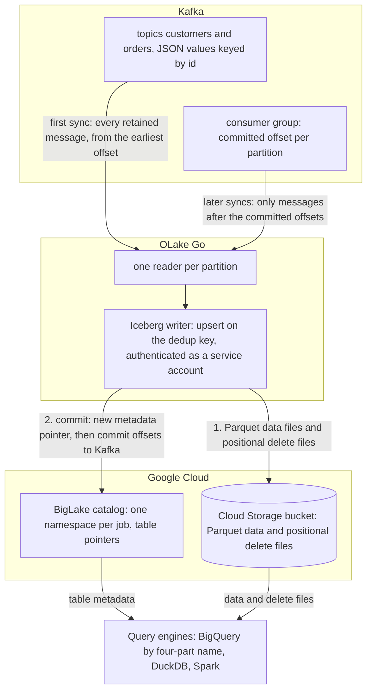

import * as I from '@site/src/components/integrations';

Kafka to BigQuery usually means a Kafka Connect cluster with the BigQuery sink, a Dataflow pipeline, or a consumer that writes files for `bq load`, and tables that only BigQuery can read. This guide takes a different route.

OLake Go reads the topics itself as a change data capture (CDC) stream and keeps one row per key. It writes the result once, as Apache Iceberg tables in a BigLake catalog, Google Cloud's Iceberg representational state transfer (REST) catalog, with the files in your own Cloud Storage bucket.

BigQuery queries the tables through the catalog with a four-part name, with no dataset to create and no external table to declare. Nothing else is in the path: no Kafka Connect, no Dataflow, no load job. DuckDB and Spark read the same tables through the same catalog.

<I.IntegrationByline />

<TLDR title='Key takeaways'>

- OLake Go turns Kafka topics into Iceberg tables in a BigLake catalog: each sync reads from the last committed offset and upserts messages on a deduplication key, so a repeated key updates its row instead of adding one.
- BigQuery reads the catalog as a data source. Every change a sync commits is visible on the next `SELECT`, with no refresh and no load job.
- The same tables, written once by OLake Go, are also queryable from DuckDB and Spark. In the run on this page all three engines returned identical rows.

</TLDR>

**The short answer.** To stream Kafka to BigQuery as Iceberg, run OLake Go with the Kafka cluster as the source and a BigLake catalog with a Cloud Storage bucket as the destination, with BigQuery as the target query engine.

Put each topic in **CDC Only** mode with **Upsert** on a deduplication key. The first sync reads every retained message; every later sync reads only the messages after the committed offsets. BigQuery, DuckDB and Spark then query the same Iceberg tables, with no second copy.

## How Kafka messages reach BigQuery here



There is no separate snapshot phase, because the topic is the history. The first sync runs with a new consumer group, which has no committed offset, so it reads every message the broker still holds: on this page all 48.

OLake Go commits the Iceberg snapshot first and the consumer-group offsets second. A sync that fails mid-way therefore re-reads its messages on the next run. In Upsert mode the re-read is harmless; in Append mode it duplicates those rows.

Every later sync resumes from the committed offsets and reads only what arrived since. In **Upsert** mode a message whose deduplication key already exists in the table retires the old row with a positional delete and writes the new one.

A key seen for the first time becomes a new row. In **Append** mode every message is a row, which suits event logs that are never corrected.

One thing to keep an eye on: retention is the replay window. Kafka deletes messages past `retention.ms`, and OLake Go cannot read what is gone.

A job paused longer than the retention of its topics silently misses the expired messages. Set retention from your longest tolerable pause, not from disk size.

## What you need

- **A Kafka cluster on version 2.4 or later** that OLake Go can reach, with JSON messages (or Avro plus a schema registry) on the topics you want. Confluent Cloud, Amazon Managed Streaming for Apache Kafka (MSK), Redpanda and self-hosted Kafka all work; the run on this page used a single-node Apache Kafka 4.3.1 in KRaft mode in Docker.
- **A field that identifies each entity** in every message, such as `id`, when you want one row per key. Without it, run the topic in Append mode.
- **A Google Cloud project** with the BigLake API enabled, a Cloud Storage bucket for the files, and a service account for OLake Go with the BigLake Editor role on the project and Storage Object User on the bucket. The run on this page used a bucket in `us-central1`.
- **BigQuery** in the same project. Queries run in the bucket's region, and the account running them needs the BigQuery Job User role plus read access to the catalog.
- **OLake UI** from the [Docker Compose install](/docs/install/olake-ui/), on OLake UI v0.7.1 or later with the OLake Go Kafka source on v0.12.1 or later, which is when Upsert mode for Kafka arrived. The run on this page used OLake Go v1.1.0.
- **Docker**, and about 30 minutes.

## Step 1: Prepare the Kafka topics

Most readers point OLake Go at topics they already have. If you want to follow along with the exact data from this page, produce messages shaped like these first:

<details>
<summary>The two sample topics used on this page</summary>

Both topics have one partition and carry JSON values keyed by the entity `id`. The scripts ship with Apache Kafka under `bin/`; on a managed cluster, run them from a client machine that can reach the brokers with the cluster's bootstrap string.

```bash title="Sample topics and messages"
kafka-topics.sh --bootstrap-server localhost:9092 --create --topic customers --partitions 1
kafka-topics.sh --bootstrap-server localhost:9092 --create --topic orders --partitions 1
# key<TAB>value, one message per line
printf '1\t{"id":1,"name":"Aarav Mehta","email":"aarav@example.com","city":"Mumbai","tier":"gold","created_at":"2026-10-29T15:22:04+00:00","updated_at":"2026-10-29T15:22:04+00:00"}\n' \
  | kafka-console-producer.sh --bootstrap-server localhost:9092 --topic customers --property parse.key=true --property key.separator=$'\t'
printf '1\t{"id":1,"customer_id":2,"product":"Headphones","amount":99.19,"status":"shipped","created_at":"2026-10-29T15:22:04+00:00","updated_at":"2026-10-29T15:22:04+00:00"}\n' \
  | kafka-console-producer.sh --bootstrap-server localhost:9092 --topic orders --property parse.key=true --property key.separator=$'\t'
# Then produce whatever you like. This page started with 8 customers and 40 orders.
```

</details>

<I.Partial id="sources/kafka/prereqs" topics="customers orders" />

## Step 2: Set up the BigLake catalog

BigQuery reads Iceberg tables through a catalog. **BigLake** is the one this page uses: it is Google Cloud's Iceberg REST catalog, OLake Go creates a namespace per job in it, and the files sit in your Cloud Storage bucket.

BigQuery, DuckDB and Spark all read from the same catalog. BigQuery treats it as a data source in the project, so a table OLake Go commits is queryable on the next statement.

<I.CatalogStrip />

<I.CatalogTabs>
<TabItem value="biglake">

<I.Partial id="catalogs/biglake/setup" />

<Figure src='/img/docs/integrations/kafka-to-bigquery/gcp-service-account-key-json.webp' alt='Google Cloud console Create private key dialog for the OLake service account with the JSON key type selected' caption='The JSON key for the service account. The console downloads it once; its contents go into the OLake Go destination form.' />

</TabItem>
</I.CatalogTabs>

## Step 3: Connect Kafka to OLake Go

<I.Partial id="sources/kafka/connect">

Here is the source form from the run on this page. Kafka ran in another container, so the bootstrap server is `host.docker.internal:19092`; the topic pattern `^(customers|orders)$` keeps discovery to the two sample topics.

<Figure src='/img/docs/integrations/kafka-to-bigquery/olake-source-kafka.webp' alt='OLake UI Edit source form for Kafka on OLake Go v1.1.0 with the Enable CDC toggle marked not supported, bootstrap server host.docker.internal:19092, consumer group olake_kafka_to_snowflake, topic pattern ^(customers|orders)$, security protocol PLAINTEXT, schema registry off, max threads 2' caption='The Kafka source in OLake UI: bootstrap server, a consumer group for this job only, and a topic pattern that matches the two sample topics.' width='760px' />

**Set up source** pings the brokers before anything is saved. The consumer group is created on the first sync; it does not need to exist yet.

</I.Partial>

## Step 4: Configure the Iceberg destination

<I.CatalogTabs>
<TabItem value="biglake">

<I.Partial id="catalogs/biglake/writer">

Here is the destination form from the run on this page. It holds the BigLake endpoint, the bucket as the catalog path, the service account JSON and the project ID.

<Figure src='/img/docs/integrations/kafka-to-bigquery/olake-destination-biglake.webp' alt='OLake UI Edit destination form for Apache Iceberg with catalog type Big Lake, REST catalog URI https://biglake.googleapis.com/iceberg/v1/restcatalog, BigLake catalog path gs://olake-x2y-lab-bq, authentication type GCP and the project ID oauth-361809' caption='The BigLake destination in OLake UI: the endpoint, the bucket as catalog path, GCP authentication and the project ID.' width='760px' />

</I.Partial>

</TabItem>
</I.CatalogTabs>

## Step 5: Create the job and run the first sync

This job lists **BigQuery**, **Spark** and **DuckDB** as target query engines. Kafka streams offer one sync mode, **CDC Only**, and one upsert type, **Positional Deletes**, which all three engines read. The decisions on the Streams page are the ingestion mode and the deduplication key.

<I.Partial id="jobs/create" engines="Google BigQuery, Apache Spark and DuckDB" unit="topics" syncMode="CDC Only" dedupKeys="id" upsert="Positional Deletes" updateType="pos" image="olakego/source-kafka:latest" cliSyncMode="strict_cdc" namespace="topics">

<Figure src='/img/docs/integrations/kafka-to-bigquery/olake-streams-cdc-only-upsert.webp' alt='OLake UI Streams Selection page with the topics namespace, customers and orders selected, sync mode CDC Only, ingestion mode Upsert, dedup key id and upsert type Positional Deletes on Iceberg format version V2' caption='Each topic: CDC Only, Upsert on the id field, and Positional Deletes as the upsert type. The Iceberg DB name at the top is editable.' />

<Figure src='/img/docs/integrations/kafka-to-bigquery/olake-job-history-two-syncs.webp' alt='OLake UI Job Logs and History for kafka_to_bigquery showing two completed syncs, the first in 44 seconds and the second in 53 seconds' caption='Job history: the 44 s first read of both topics, then the 53 s sync of the new messages.' />

</I.Partial>

On this page the first run read 8 customer and 40 order messages (48 records, 9.00 KB) and finished in **44 seconds**, container start included. OLake Go names the BigLake namespace after the job and the source namespace.

The namespace for every Kafka topic is `topics`, so `kafka_to_bigquery` produced `kafka_to_bigquery_topics`. The **Iceberg DB** field at the top of the Streams page changes it before the first sync.

## Step 6: Query the tables in BigQuery

<I.CatalogTabs>
<TabItem value="biglake">

<I.Partial id="engines/bigquery/query-biglake" schema="kafka_to_bigquery_topics" />

<Figure src='/img/docs/integrations/kafka-to-bigquery/bigquery-biglake-customers.webp' alt='BigQuery SQL editor in the Google Cloud console running the customers query on the olake-x2y-lab-bq catalog and returning 10 rows with id, name, city and tier' caption='BigQuery reading the customers table through the BigLake catalog after the second sync: 10 rows, one per key.' />

</TabItem>
</I.CatalogTabs>

<I.Cta />

## Step 7: Produce new messages and sync again

To see the change path work, the run on this page produced 12 more messages after the first sync. Seven carry new keys; five repeat an existing key with a changed value.

```bash title="Messages produced between the two syncs (key, then value)"
# customers: two new keys, two repeated keys
9   {"id":9,"name":"Maya Patel","email":"maya@example.com","city":"Pune","tier":"silver", ...}
10  {"id":10,"name":"Lucas Silva","email":"lucas@example.com","city":"São Paulo","tier":"bronze", ...}
3   {"id":3,"name":"Liam Carter","email":"liam@example.com","city":"Austin","tier":"gold", ...}
8   {"id":8,"name":"Zara Ali","email":"zara@example.com","city":"Abu Dhabi","tier":"silver", ...}
# orders: five new keys (41 to 45), three repeated keys (1, 4, 7) with status "delivered"
41  {"id":41,"customer_id":9,"product":"Laptop","amount":1299.0,"status":"placed", ...}
1   {"id":1,"customer_id":2,"product":"Headphones","amount":99.19,"status":"delivered", ...}
```

The second sync read **12 records (2.26 KB)** from the two topics and finished in **53 seconds** end to end. For `customers` that meant one new data file with 4 rows: the 2 new keys plus the new versions of the 2 repeated keys.

One small positional delete file retires the 2 old versions. OLake Go's commit report in the sync log shows it directly: `addedDataFiles=1`, `addedRecords=4`, `addedPositionalDeleteFiles=1`, `addedPositionalDeletes=2`. The `orders` table has the same shape with 8 rows and 3 deletes.

<Figure src='/img/docs/integrations/kafka-to-bigquery/olake-sync-log-positional-delete-commit.webp' alt='OLake UI sync log filtered to the Iceberg commit report, showing addedDataFiles 1, addedPositionalDeleteFiles 1, addedRecords and addedPositionalDeletes for the second sync' caption='The second sync in the OLake UI log: one data file and one positional delete file per topic.' />

BigQuery shows the result on the next query, with no refresh. Liam Carter is `gold`, Zara Ali moved to Abu Dhabi, and the two new customers are there, with still one row per key. The `_op_type` column shows how each row arrived (`c` for a first-seen key, `u` for a repeated key) and `_kafka_offset` shows which message it came from.

**Schema changes.** When a new field appears in the messages, OLake Go adds it as a column on the next sync and commits the new schema to BigLake in the same commit. BigQuery shows the column on the next query.

A field whose type changes in an incompatible way fails the sync rather than corrupt the table. Full rules are on the [schema evolution page](/docs/features/schema/).

## Query the same tables from DuckDB and Spark

This is the point of writing Iceberg instead of loading BigQuery tables. Nothing is exported, copied or refreshed: both engines read the files OLake Go wrote, through the same BigLake catalog.

<Tabs groupId="engine" queryString="engine">
<TabItem value="duckdb" label="DuckDB" default>

<I.Partial id="engines/duckdb/connect-biglake" schema="kafka_to_bigquery_topics" />

<Figure src='/img/docs/integrations/kafka-to-bigquery/gcp-hmac-key-service-account.webp' alt='Google Cloud console Cloud Storage Interoperability settings with the Select a service account dialog, the OLake service account selected and the Create key button' caption='The key for DuckDB: Cloud Storage, Settings, Interoperability, then a key for the same service account OLake Go uses.' />

DuckDB 1.5.5 returned the same 10 customers and the same `orders` roll-up as BigQuery in the run on this page. It read the current metadata file of each table through the catalog and the data files through the hash-based message authentication code (HMAC) key.

</TabItem>
<TabItem value="spark" label="Apache Spark">

<I.Partial id="engines/spark/connect-biglake" schema="kafka_to_bigquery_topics" />

Spark 4.0.1 with Iceberg 1.10.0 returned the same rows in the run on this page, running on a laptop against the same catalog and bucket.

</TabItem>
</Tabs>

An `orders` roll-up matched the latest message per key in all three engines. It gave 16 delivered orders for 8659.68, 18 placed for 10522.26, 11 shipped for 6397.25.

## Data types: Kafka JSON to Iceberg to BigQuery

A Kafka message has no schema of its own, so OLake Go infers one from a sample of messages at discover time and maps it to Iceberg types.

BigQuery then maps Iceberg types to its own when it reads the catalog. Four Kafka columns are added to every row. This is what the run on this page produced:

| In the JSON value | Iceberg (written by OLake Go) | BigQuery shows | Notes |
| --- | --- | --- | --- |
| Integer (`"id": 3`) | `long` | `INT64` | |
| Decimal (`"amount": 99.19`) | `double` | `FLOAT64` | The `orders.amount` sums on this page matched the messages to the cent in every engine; round at query time when you need exact decimal arithmetic. |
| ISO 8601 timestamp string (`"2026-10-29T15:22:04+00:00"`) | `timestamptz` (UTC) | `TIMESTAMP` | Strings that parse as timestamps are stored as timestamps and shown as UTC instants. |
| Other strings | `string` | `STRING` | |
| `_kafka_key` | `string` | `STRING` | The message key, base64-encoded (`3` arrives as `Mw==`). |
| `_kafka_partition`, `_kafka_offset` | `int`, `long` | `INT64` | Where the row's latest message sat on the topic. |
| `_kafka_timestamp` | `timestamptz` | `TIMESTAMP` | The message timestamp: produce time or broker append time, depending on the topic's `message.timestamp.type`. |

Types on the left come from the [Kafka connector reference](/docs/connectors/kafka/#kafka-general-information). The BigQuery side comes from the [BigQuery Iceberg tables page](https://docs.cloud.google.com/bigquery/docs/iceberg-external-tables) (checked 2026-10-30) and from the table schemas of this run. With **Normalization** on, which is the default, top-level fields become columns.

## Cost and maintenance

- **Storage** is your bucket: you pay Cloud Storage rates for the Parquet and delete files. The BigLake catalog itself has no per-table charge.
- **Compute.** OLake Go runs wherever you run Docker. BigQuery bills on-demand queries by bytes scanned, or by slot time on an edition; a query over the catalog reads the Parquet files in the bucket, so filter on the columns you need. DuckDB and Spark cost whatever machine they run on.
- **Maintenance.** A topic synced every minute adds a small file and a delete file per run, and BigLake keeps every snapshot OLake Go commits in the table's `metadata.json`. BigLake rejects a `metadata.json` above 1 MB, which a busy table reaches after a few thousand syncs. Expire old snapshots and compact on a schedule with [OLake Fusion](/docs/fusion/getting-started/overview/) or with Spark's `expire_snapshots` and `rewrite_data_files` procedures through the same catalog.
- **Retention disk.** Seven days of a busy topic is real disk on the brokers. Size for it, or shorten retention once the job runs reliably every hour.
- **Key rotation.** The service account key is what OLake Go writes with. Rotate it on your schedule from the service account's **Keys** tab and paste the new JSON into the destination.

## Troubleshooting

### 1. The source test cannot reach the brokers

```text
failed to ping kafka brokers: unable to dial: dial tcp 192.168.65.254:19999: connect: connection refused
```

The address in **Bootstrap Servers** is not reachable from inside the OLake Go container. For a broker on the same machine use `host.docker.internal`, not `localhost`.

Make sure the broker also advertises a listener the container can resolve; Kafka's `advertised.listeners` decides that. On a managed cluster, run OLake Go on a network that can reach the brokers' advertised addresses.

### 2. The Streams page is empty

```text
Skipping topic customers (does not match topic_pattern: ^nothing_here$)
```

The topic pattern is a full regular expression anchored by you. `^orders$` matches one topic, `^orders` matches every topic that starts with it, and a pattern with a typo matches nothing. Fix the pattern on the source and run discovery again; the sync log names every topic it skipped and why.

### 3. The destination test fails on a catalog in vended-credentials mode

```text
failed to test destination: failed to create or get table: rpc error: code = Internal desc = Failed to process request: Malformed request: X-Iceberg-Access-Delegation header must be present and contain `vended-credentials` when credential mode is `CREDENTIAL_MODE_VENDED_CREDENTIALS`.
```

The catalog was created, or switched, with `--credential-mode=vended-credentials`, and OLake Go 1.1.0 does not send the header BigLake wants in that mode ([olake#1369](https://github.com/datazip-inc/olake/issues/1369)). Switch the catalog back with `gcloud beta biglake iceberg catalogs update <bucket> --credential-mode=end-user`, which is the default for a catalog OLake Go created itself. With the CLI, `"rest_access_delegation": "vended-credentials"` in `destination.json` makes the same test pass; the UI has no field for it yet.

### 4. BigQuery cannot find the dataset

```text
Not found: Dataset <project>:<bucket>.kafka_to_bigquery_topics was not found in location US
```

The query ran in a location other than the bucket's region. Set the query location to the bucket's region in the editor's **More**, **Query settings** panel, or pass `--location=<region>` to `bq`. Leaving the location unset lets BigQuery pick it from the table.

### 5. A sync ends early after a consumer-group rebalance

A rebalance in OLake Go's consumer group, usually because another process joined it, makes the sync stop cleanly with what it has read. Nothing is lost: the messages read so far are committed, and the next sync resumes from the committed offsets.

Give each job its own consumer group and never point another consumer at it. If a group's offsets are damaged, create the job again with a new group id. The group name cannot be edited on an existing source in the UI.

<details>
<summary>How this compares with other ways to move Kafka data to BigQuery</summary>

| Method | Freshness | Updates and deletes | Where the data lands | What you run |
| --- | --- | --- | --- | --- |
| [Dataflow Kafka to BigQuery template](https://docs.cloud.google.com/dataflow/docs/guides/templates/provided/kafka-to-bigquery) | Seconds, streaming | No; appends through the Storage Write API | Native BigQuery tables; BigQuery is the only reader | A Dataflow streaming job per topic set, billed per vCPU-hour |
| Kafka Connect with the BigQuery sink | Seconds to minutes | Upsert and delete in its upsert mode, with an intermediate table and merge | Native BigQuery tables | A Kafka Connect cluster and the sink connector |
| Confluent Cloud managed BigQuery sink | Seconds to minutes | Upsert and delete in its upsert mode | Native BigQuery tables | Nothing; a managed connector billed per task and per GB |
| Managed ELT (Fivetran, Estuary, Airbyte Cloud) | Minutes, by plan | Varies by tool | BigQuery tables, a second copy you pay to move and store | Nothing; priced per row, per GB or per connector |
| **OLake Go to Iceberg on BigLake (this guide)** | On a schedule down to one minute | Yes, upsert on a key with Iceberg row-level deletes | Apache Iceberg tables that BigQuery, Spark, DuckDB, Trino and Flink all read | One Docker Compose stack, open source; your bucket plus your own compute |

The Dataflow template is the simpler choice when you need seconds of latency, append-only is fine and BigQuery is the only reader. Writing Iceberg once, with one row per key, avoids paying to move and store a second copy. That matters as soon as Spark, DuckDB or a notebook needs the same rows, or you want to own the files.

</details>

## When not to use this

- **You need seconds of latency.** OLake Go drains the topic on a schedule, one minute at the shortest. Use a streaming Dataflow job or the Storage Write API for a continuous feed.
- **Messages are not JSON or Avro.** Protobuf, plain text and binary payloads cannot be mapped to columns.
- **Deletes must propagate and the key is in the payload.** Tombstones delete a row only when `_kafka_key` is the single deduplication key; on a topic whose dedup key is a payload field, a tombstone fails the sync. Key the messages by the entity id and use the key as the deduplication key, or run the topic in Append mode and filter deletes downstream.
- **The partition count will change while the job runs in Upsert mode.** The same key would then hash to a different partition, and concurrent partition readers could leave a stale row behind. Finish the repartition, then create the job.

## FAQs

<I.IntegrationFaq />

<I.HowWeTested />

## Related guides

<I.RelatedIntegrations />

Deeper reading on this site:

- [Kafka connector reference](/docs/connectors/kafka/)
- [Equality vs positional deletes vs deletion vectors](/blog/iceberg-delete-formats-cdc-equality-vs-positional-vs-deletion-vectors/)
- [Which engines read which delete formats](/blog/iceberg-delete-formats-interoperability-olake-go/)
- [OLake Go ingestion benchmarks](/docs/benchmarks/ingestion/)

<I.IntegrationJsonLd />

<I.Cta title='Start with your own topics' body='The quickstart runs OLake UI with Docker Compose. Create the Kafka source, the BigLake destination and the job as above, and the first sync lands your topics where BigQuery can read them.' />
