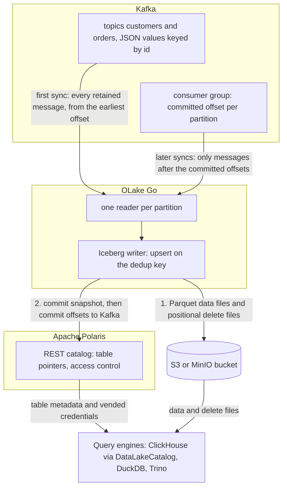

import * as I from '@site/src/components/integrations';

Kafka to ClickHouse usually means a Kafka engine table with a materialized view per topic, ClickPipes on ClickHouse Cloud, or a Kafka Connect sink. All three load MergeTree tables that only ClickHouse reads, and updates need `ReplacingMergeTree` or `FINAL` to collapse. OLake Go reads the topics on a schedule as a change data capture (CDC) stream, keeps one row per key, and writes Apache Iceberg tables into an Apache Polaris catalog.

ClickHouse attaches that catalog as a database and queries the tables in place. Polaris is an open source Iceberg REST (Representational State Transfer) catalog you run yourself, with the files in your own bucket. DuckDB and Trino read the same tables through the same endpoint.

<I.IntegrationByline />

<TLDR title='Key takeaways'>

- OLake Go turns Kafka topics into Iceberg tables in Polaris: each sync reads from the last committed offset and upserts messages on a deduplication key, so a repeated key updates its row instead of adding one.
- ClickHouse attaches the whole Polaris catalog as one database with `DataLakeCatalog` and returns one current row per key, with no `FINAL` and no `ReplacingMergeTree`.
- The same tables, written once by OLake Go, are also queryable from DuckDB and Trino through the same catalog. In the run on this page all three engines returned identical rows.

</TLDR>

**The short answer.** To stream Kafka to ClickHouse as Iceberg, run OLake Go with the Kafka cluster as the source and an Apache Polaris catalog as the destination. Put each topic in **CDC Only** mode with **Upsert** on a deduplication key. The first sync reads every retained message; every later sync reads only newer messages. ClickHouse, DuckDB and Trino query the same tables.

## How Kafka messages reach ClickHouse here



There is no separate snapshot phase, because the topic is the history. The first sync runs with a new consumer group, which has no committed offset, so it reads every message the broker still holds: on this page all 48. OLake Go commits the Iceberg snapshot first and the consumer-group offsets second. A sync that fails mid-way therefore re-reads its messages on the next run, which Upsert mode absorbs.

Every later sync resumes from the committed offsets and reads only what arrived since. A message whose deduplication key already exists retires the old row with a positional delete and writes the new one. Keys seen for the first time become new rows, and ClickHouse applies the deletes while reading.

One thing to keep an eye on: retention is the replay window. Kafka deletes messages past `retention.ms`, and OLake Go cannot read what is gone. A job paused longer than the retention of its topics silently misses the expired messages.

## What you need

- **A Kafka cluster on version 2.4 or later** that OLake Go can reach, with JSON messages (or Avro plus a schema registry) on the topics you want. Amazon Managed Streaming for Apache Kafka (MSK), Confluent Cloud, Redpanda and self-hosted Kafka all work; the run on this page used a single-node Apache Kafka 4.3.1 in KRaft mode in Docker.
- **A field that identifies each entity** in every message, such as `id`, when you want one row per key. Without it, run the topic in Append mode.
- **An Apache Polaris server and a bucket**, both reachable from OLake Go and from ClickHouse. The run on this page used Polaris 1.8.0 and MinIO in Docker.
- **ClickHouse 26.1 or later**, where the `DataLakeCatalog` engine reads REST catalogs. The run on this page used the 26.8 LTS release in Docker.
- **OLake UI** from the [Docker Compose install](/docs/install/olake-ui/), on OLake UI v0.7.1 or later with the OLake Go Kafka source on v0.12.1 or later, which is when Upsert mode for Kafka arrived. The run on this page used OLake Go v1.1.0.
- **Docker**, and about 40 minutes.

## Step 1: Prepare the Kafka topics

Most readers point OLake Go at topics they already have. If you want to follow along with the exact data from this page, produce messages shaped like these first:

<details>
<summary>The two sample topics used on this page</summary>

Both topics have one partition and carry JSON values keyed by the entity `id`. The scripts ship with Apache Kafka under `bin/`.

```bash title="Sample topics and messages"
kafka-topics.sh --bootstrap-server localhost:9092 --create --topic customers --partitions 1
kafka-topics.sh --bootstrap-server localhost:9092 --create --topic orders --partitions 1

# key<TAB>value, one message per line
printf '1\t{"id":1,"name":"Aarav Mehta","email":"aarav@example.com","city":"Mumbai","tier":"gold","created_at":"2026-10-29T15:22:04+00:00","updated_at":"2026-10-29T15:22:04+00:00"}\n' \
  | kafka-console-producer.sh --bootstrap-server localhost:9092 --topic customers --property parse.key=true --property key.separator=$'\t'

printf '1\t{"id":1,"customer_id":2,"product":"Headphones","amount":99.19,"status":"shipped","created_at":"2026-10-29T15:22:04+00:00","updated_at":"2026-10-29T15:22:04+00:00"}\n' \
  | kafka-console-producer.sh --bootstrap-server localhost:9092 --topic orders --property parse.key=true --property key.separator=$'\t'

# Then produce whatever you like. This page started with 8 customers and 40 orders.
```

</details>

<I.Partial id="sources/kafka/prereqs" topics="customers orders" />

## Step 2: Set up the Polaris catalog

ClickHouse reads Iceberg tables through a catalog. **Apache Polaris** is the one this page uses: an open source REST catalog that you run next to your bucket. OLake Go writes into it, and ClickHouse, DuckDB and Trino read from it with the credentials Polaris hands out. The [Polaris catalog page](/docs/integrations/catalogs/polaris/) lists every engine that reads it.

<I.CatalogStrip />

<I.CatalogTabs>
<TabItem value="polaris">

<I.Partial id="catalogs/polaris/setup" />

</TabItem>
</I.CatalogTabs>

## Step 3: Connect Kafka to OLake Go

<I.Partial id="sources/kafka/connect">

Here is the source form from the run on this page. Kafka ran in another container, so the bootstrap server is `host.docker.internal:19092`; the topic pattern `^(customers|orders)$` keeps discovery to the two sample topics.

<Figure src='/img/docs/integrations/kafka-to-clickhouse/olake-source-kafka.webp' alt='OLake UI Edit source form for Kafka on OLake Go v1.1.0 with bootstrap server host.docker.internal:19092, a consumer group, topic pattern ^(customers|orders)$ and security protocol PLAINTEXT' caption='The Kafka source in OLake UI: bootstrap server, a consumer group for the job, and a topic pattern that matches the two sample topics.' width='760px' />

**Set up source** pings the brokers before anything is saved. The consumer group is created on the first sync; it does not need to exist yet.

</I.Partial>

## Step 4: Configure the Iceberg destination

<I.CatalogTabs>
<TabItem value="polaris">

<I.Partial id="catalogs/polaris/writer">

Here is the destination form from the run on this page. Polaris and MinIO ran in other containers, so both addresses use `host.docker.internal`; the credential is the `olake` principal from step 2.

<Figure src='/img/docs/integrations/kafka-to-clickhouse/olake-destination-polaris.webp' alt='OLake UI Edit destination form for Apache Iceberg with catalog type Polaris, OAuth2, REST catalog URI on port 8181, catalog name olake and the MinIO endpoint' caption='The Polaris destination in OLake UI: OAuth2 with the principal from step 2, and the MinIO endpoint for the files.' width='760px' />

</I.Partial>

</TabItem>
</I.CatalogTabs>

## Step 5: Create the job and run the first sync

The target query engines on this job are ClickHouse, DuckDB and Trino. Kafka streams offer one sync mode, **CDC Only**, and Upsert on a Kafka stream writes **Positional Deletes**, which all three engines read. What you decide on the Streams page is the ingestion mode and the deduplication key.

<I.Partial id="jobs/create" engines="ClickHouse, plus DuckDB and Trino if they will read the tables too" unit="topics" syncMode="CDC Only" dedupKeys="id" upsert="Positional Deletes" updateType="pos" image="olakego/source-kafka:latest" cliSyncMode="strict_cdc" namespace="topics">

<Figure src='/img/docs/integrations/kafka-to-clickhouse/olake-streams-positional-deletes.webp' alt='OLake UI Streams Selection page with the topics namespace, customers and orders selected, CDC Only, Upsert, dedup key id and Positional Deletes on Iceberg V2' caption='Each topic: CDC Only, Upsert on the id field, and Positional Deletes on Iceberg v2. The Iceberg DB name at the top is editable.' />

<Figure src='/img/docs/integrations/kafka-to-clickhouse/olake-job-history-two-syncs.webp' alt='OLake UI Job Logs and History for kafka_to_clickhouse showing two completed syncs, 25 seconds and then 23 seconds' caption='Job history: the 25 s first read of both topics, then the 23 s sync of the new messages.' />

</I.Partial>

On this page the first run read 8 customer and 40 order messages (48 records, 9.00 KB) and finished in **25 seconds**, container start included. OLake Go names the Iceberg namespace after the job and the source namespace. The namespace for every Kafka topic is `topics`, so `kafka_to_clickhouse` produced `kafka_to_clickhouse_topics`.

## Step 6: Query the tables in ClickHouse

<I.CatalogTabs>
<TabItem value="polaris">

<I.Partial id="engines/clickhouse/query-polaris" schema="kafka_to_clickhouse_topics" />

<Figure src='/img/docs/integrations/kafka-to-clickhouse/clickhouse-polaris-customers.webp' alt='clickhouse-client querying polaris.kafka_to_clickhouse_topics.customers through the DataLakeCatalog engine and returning 10 rows, one per key' caption='ClickHouse 26.8 reading the customers table through Polaris after the second sync: 10 rows, one per key, with no FINAL.' />

</TabItem>
</I.CatalogTabs>

<I.Cta />

## Step 7: Produce new messages and sync again

To see the change path work, the run on this page produced 12 more messages after the first sync. Seven carry new keys; five repeat an existing key with a changed value.

```bash title="Messages produced between the two syncs (key, then value)"
# customers: two new keys, two repeated keys
9   {"id":9,"name":"Maya Patel","email":"maya@example.com","city":"Pune","tier":"silver", ...}
10  {"id":10,"name":"Lucas Silva","email":"lucas@example.com","city":"São Paulo","tier":"bronze", ...}
3   {"id":3,"name":"Liam Carter","email":"liam@example.com","city":"Austin","tier":"gold", ...}
8   {"id":8,"name":"Zara Ali","email":"zara@example.com","city":"Abu Dhabi","tier":"silver", ...}

# orders: five new keys (41 to 45), three repeated keys (1, 4, 7) with status "delivered"
41  {"id":41,"customer_id":9,"product":"Laptop","amount":1299.0,"status":"placed", ...}
1   {"id":1,"customer_id":2,"product":"Headphones","amount":99.19,"status":"delivered", ...}
```

The second sync read **12 records (2.26 KB)** from the two topics and finished in **23 seconds** end to end. For `orders` that meant one new data file with 8 rows: the 5 new keys plus the new versions of the 3 repeated keys. One small positional delete file retires the 3 old versions. OLake Go's commit report in the sync log shows it directly: `addedDataFiles=1`, `addedRecords=8`, `addedPositionalDeleteFiles=1`, `addedPositionalDeletes=3`.

<Figure src='/img/docs/integrations/kafka-to-clickhouse/olake-sync-log-positional-delete-commit.webp' alt='OLake UI sync log filtered to the Iceberg commit report for orders, showing addedDataFiles 1, addedPositionalDeleteFiles 1, addedRecords 8 and addedPositionalDeletes 3' caption='The second sync in the OLake UI log: one data file and one positional delete file for orders.' />

`customers` has the same shape with 4 rows and 2 deletes. ClickHouse shows the result on the next query, with no refresh and still one row per key. Liam Carter is `gold`, Zara Ali moved to Abu Dhabi, and the two new customers are there. The `_op_type` column shows how each row arrived (`c` for a first-seen key, `u` for a repeated key) and `_kafka_offset` shows which message it came from.

**Schema changes.** When a new field appears in the messages, OLake Go adds it as a column on the next sync and commits the new schema to Polaris. ClickHouse shows it the next time the table is opened. A field whose type changes in an incompatible way fails the sync rather than corrupt the table. Full rules are on the [schema evolution page](/docs/features/schema/).

## Query the same tables from DuckDB and Trino

This is the point of writing Iceberg instead of loading ClickHouse tables. Nothing is exported, copied or refreshed: both engines read the files OLake Go wrote, through the same Polaris endpoint.

<Tabs groupId="engine" queryString="engine">
<TabItem value="duckdb" label="DuckDB" default>

<I.Partial id="engines/duckdb/connect-polaris" schema="kafka_to_clickhouse_topics" />

DuckDB 1.5.5 returned the same 10 customers and 45 orders as ClickHouse in the run on this page.

</TabItem>
<TabItem value="trino" label="Trino">

<I.Partial id="engines/trino/connect-polaris" schema="kafka_to_clickhouse_topics" />

Trino 484 returned the same 10 customers and 45 orders as ClickHouse in the run on this page.

</TabItem>
</Tabs>

An `orders` roll-up matched the latest message per key in all three engines: 45 orders for 25579.19 in total. By status it gave 16 delivered orders for 8659.68, 18 placed for 10522.26, 11 shipped for 6397.25.

## Data types: Kafka JSON to Iceberg to ClickHouse

A Kafka message has no schema of its own, so OLake Go infers one from a sample of messages at discover time and maps it to Iceberg types. ClickHouse then maps Iceberg types to its own. Four Kafka columns are added to every row:

| In the JSON value | Iceberg (written by OLake Go) | ClickHouse shows | Notes |
| --- | --- | --- | --- |
| Integer (`"id": 3`) | `long` | `Nullable(Int64)` | |
| Decimal (`"amount": 99.19`) | `double` | `Nullable(Float64)` | The `orders.amount` sums on this page matched the messages to the cent in every engine; round at query time when you need exact decimal arithmetic. |
| ISO 8601 timestamp string (`"2026-10-29T15:22:04+00:00"`) | `timestamptz` (UTC) | `Nullable(DateTime64(6, 'UTC'))` | Strings that parse as timestamps are stored as timestamps. |
| Other strings | `string` | `Nullable(String)` | |
| `_kafka_key` | `string` | `Nullable(String)` | The message key, base64-encoded (`3` arrives as `Mw==`). |
| `_kafka_partition`, `_kafka_offset` | `int`, `long` | `Nullable(Int32)`, `Nullable(Int64)` | Where the row's latest message sat on the topic. |
| `_kafka_timestamp` | `timestamptz` | `Nullable(DateTime64(6, 'UTC'))` | Produce time or broker append time, depending on the topic's `message.timestamp.type`. |

Types on the left come from the [Kafka connector reference](/docs/connectors/kafka/#kafka-general-information). The ClickHouse side comes from the [ClickHouse Iceberg table engine page](https://clickhouse.com/docs/engines/table-engines/integrations/iceberg) (checked 2026-10-30).

## Cost and maintenance

- **Storage** is your bucket: you pay S3 or MinIO rates for the Parquet and delete files, and nothing to Polaris or ClickHouse for holding them.
- **Compute.** OLake Go runs wherever you run Docker, for the length of a sync. ClickHouse spends CPU only when you query; a `DataLakeCatalog` query reads Parquet over the network with no MergeTree index, so load a hot slice into a MergeTree table when a dashboard needs sub-second answers.
- **Maintenance.** A topic synced every minute adds a small file and a delete file per run, so plan compaction. [OLake Fusion](/docs/fusion/getting-started/overview/) does this for the catalogs OLake Go writes to, and Spark's `rewrite_data_files` works through the same Polaris endpoint.
- **Retention disk.** Seven days of a busy topic is real disk on the brokers. Size for it, or shorten retention once the job runs reliably every hour.

## Troubleshooting

### 1. The source test cannot reach the brokers

```text
failed to ping kafka brokers: unable to dial: dial tcp 192.168.65.254:19999: connect: connection refused
```

The address in **Bootstrap Servers** is not reachable from inside the OLake Go container. For a broker on the same machine use `host.docker.internal`, not `localhost`. Make sure the broker also advertises a listener the container can resolve; Kafka's `advertised.listeners` decides that.

### 2. The Streams page is empty

```text
Skipping topic customers (does not match topic_pattern: ^nothing_here$)
```

The topic pattern is a full regular expression anchored by you. `^orders$` matches one topic, `^orders` matches every topic that starts with it, and a pattern with a typo matches nothing. Fix the pattern on the source and run discovery again.

### 3. ClickHouse lists the tables but every query returns a 404

```text
Code: 499. DB::Exception: Failed to get object info for key olake/.../metadata/00003-....metadata.json in bucket lakehouse: No response body.. HTTP response code: 404
```

The object key is doubled. ClickHouse 26.8 and 26.10 join the table location onto the storage endpoint, then fail to strip it again when the endpoint has no trailing slash. Set the Polaris catalog's `endpoint` (and `storage_endpoint` in ClickHouse, if you use static keys) to a value ending in `/`, for example `http://minio:9000/`.

### 4. The destination test fails at the token exchange

OLake Go's destination test exchanges the principal's credentials at `/api/catalog/v1/oauth/tokens` before anything else. Three causes cover nearly every failure: a wrong client id or secret, a principal with no role that carries `CATALOG_MANAGE_CONTENT` on the catalog, or a wrong `Polaris Catalog Name`. Run the token check from the catalog setup; it returns the same error Polaris gives OLake Go.

### 5. A sync ends early after a consumer-group rebalance

A rebalance in OLake Go's consumer group, usually because another process joined it, makes the sync stop cleanly with what it has read. Nothing is lost: the messages read so far are committed, and the next sync resumes from the committed offsets. Give each job its own consumer group and never point another consumer at it.

<details>
<summary>How this compares with other ways to move Kafka data to ClickHouse</summary>

| Method | Freshness | Updates and deletes | Where the data lands | What you run |
| --- | --- | --- | --- | --- |
| [ClickHouse Kafka table engine](https://clickhouse.com/docs/engines/table-engines/integrations/kafka) and a materialized view | Seconds | Through `ReplacingMergeTree` and `FINAL`, or your own merge | Native ClickHouse tables; ClickHouse is the only reader | A Kafka engine table and a materialized view per topic |
| [ClickPipes for Kafka](https://clickhouse.com/docs/integrations/clickpipes/kafka) | Seconds | Appends; collapse with a table engine | Native ClickHouse Cloud tables | Nothing on your side; ClickHouse Cloud only |
| [Kafka Connect ClickHouse sink](https://clickhouse.com/docs/integrations/kafka/clickhouse-kafka-connect-sink) | Seconds to minutes | Appends; collapse with a table engine | Native ClickHouse tables | A Kafka Connect cluster and the sink connector |
| Managed ELT (Fivetran, Estuary, Airbyte Cloud) | Minutes, by plan | Varies by tool | ClickHouse tables, a second copy you pay to move and store | Nothing; priced per row, per GB or per connector |
| **OLake Go to Iceberg on Polaris (this guide)** | On a schedule down to one minute | Yes, upsert on a key with Iceberg row-level deletes | Apache Iceberg tables that ClickHouse, DuckDB, Trino and Spark all read | One Docker Compose stack, open source; your bucket plus your own compute |

The Kafka table engine is the simpler choice when you need seconds of latency into MergeTree and ClickHouse is the only reader. Writing Iceberg once, with one row per key, avoids paying to move and store a second copy. That matters as soon as another engine needs the same rows, or you want to own the files and the catalog.

</details>

## When not to use this

- **You need seconds of latency.** OLake Go drains the topic on a schedule, one minute at the shortest. Use the Kafka table engine or ClickPipes for a continuous feed.
- **Every query must hit MergeTree speed.** A `DataLakeCatalog` query reads Parquet with no primary index. Keep the Iceberg tables as the source and load the hot slice into a MergeTree table on a schedule.
- **Messages are not JSON or Avro.** Protobuf, plain text and binary payloads cannot be mapped to columns.
- **The partition count will change while the job runs in Upsert mode.** The same key would then hash to a different partition, and concurrent partition readers could leave a stale row behind. Finish the repartition, then create the job.

## FAQs

<I.IntegrationFaq />

<I.HowWeTested />

## Related guides

<I.RelatedIntegrations />

Deeper reading on this site:

- [Kafka connector reference](/docs/connectors/kafka/)
- [ClickHouse readers and delete formats](/docs/integrations/clickhouse/)
- [Kafka to Apache Iceberg on the same catalog](/docs/integrations/kafka-to-iceberg/)
- [Equality vs positional deletes vs deletion vectors](/blog/iceberg-delete-formats-cdc-equality-vs-positional-vs-deletion-vectors/)
- [OLake Go ingestion benchmarks](/docs/benchmarks/ingestion/)

<I.IntegrationJsonLd />

<I.Cta title='Start with your own topics' body='The quickstart runs OLake UI with Docker Compose. Create the Kafka source, the Polaris destination and the job as above, and the first sync lands your topics where ClickHouse can read them.' />
