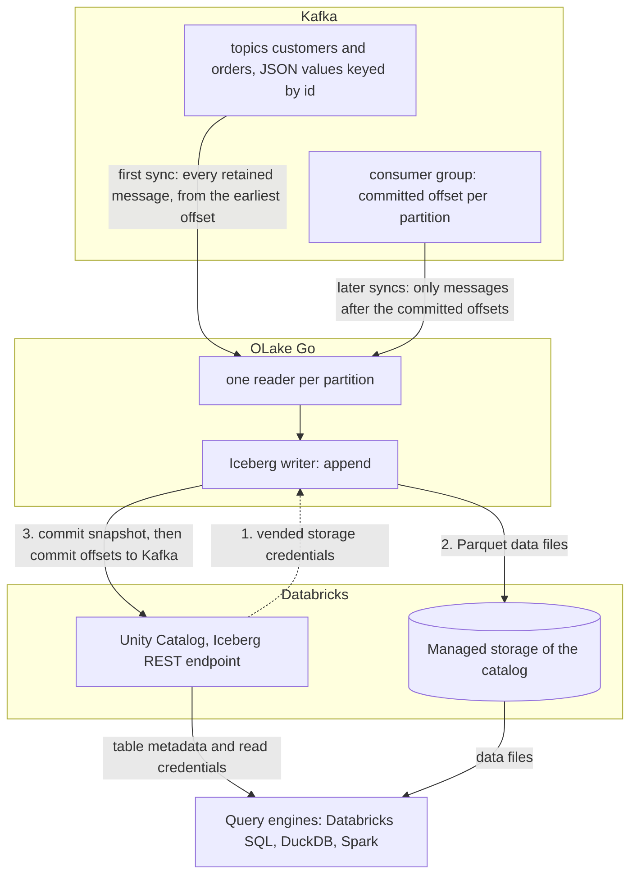

import * as I from '@site/src/components/integrations';

Kafka to Databricks usually means a Structured Streaming job that runs on a cluster all day, or a Kafka Connect sink. This guide takes a different route. OLake Go reads the topics itself on a schedule, as a change data capture (CDC) stream, and appends every message to an Apache Iceberg table in Unity Catalog.

The tables land as Unity Catalog managed Iceberg tables, with the files in your own cloud storage. Nothing else is in the path: no Kafka Connect, no Databricks job, no staging table. DuckDB and Spark read the same tables through the same catalog.

<I.IntegrationByline />

<TLDR title='Key takeaways'>

- OLake Go turns Kafka topics into Databricks Iceberg tables: each sync reads from the last committed offset and appends the new messages, with the partition, offset and key kept in columns.
- The tables are Unity Catalog managed Iceberg tables. You query them from the Databricks SQL editor or a notebook right away, with no external table and no refresh.
- The same tables, written once by OLake Go, are also queryable from DuckDB and Spark through Unity Catalog. In the run on this page all three engines returned identical rows.

</TLDR>

**The short answer.** To stream Kafka to Databricks as Iceberg, run OLake Go with the Kafka cluster as the source and Unity Catalog as the destination, with Databricks as a target query engine. Each topic runs in **CDC Only** mode with **Append**, because Upsert on Kafka is not available for Databricks in OLake Go v1.1.0. The first sync reads every retained message; every later sync reads only the messages after the committed offsets. A `QUALIFY` query returns the latest row per key in Databricks, DuckDB and Spark.

## How Kafka messages reach Databricks here



There is no separate snapshot phase, because the topic is the history. The first sync runs with a new consumer group, which has no committed offset, so it reads every message the broker still holds: on this page all 48. OLake Go commits the Iceberg snapshot first and the consumer-group offsets second.

Every later sync resumes from the committed offsets and reads only what arrived since. In **Append** mode every message is a row, so a repeated key adds a row next to the old one. A sync that fails mid-way re-reads its messages on the next run, which can add those rows twice; the latest-row query in step 6 hides both cases.

One thing to keep an eye on: retention is the replay window. Kafka deletes messages past `retention.ms`, and OLake Go cannot read what is gone. A job paused longer than the retention of its topics silently misses the expired messages.

## What you need

- **A Kafka cluster on version 2.4 or later** that OLake Go can reach, with JSON messages (or Avro plus a schema registry) on the topics you want. Amazon Managed Streaming for Apache Kafka (MSK), Confluent Cloud, Redpanda and self-hosted Kafka all work; the run on this page used a single-node Apache Kafka 4.3.1 in KRaft mode in Docker.
- **A field that identifies each entity** in every message, such as `id`, so a query can pick the latest row per key.
- **A Databricks workspace with Unity Catalog**, a catalog with managed storage, and an admin who can turn on external data access and grant `EXTERNAL USE SCHEMA`. The run on this page used a workspace on Google Cloud.
- **OLake UI** from the [Docker Compose install](/docs/install/olake-ui/) with the OLake Go Kafka source. The run on this page used v1.1.0.
- **Docker**, and about 30 minutes.

## Step 1: Prepare the Kafka topics

Most readers point OLake Go at topics they already have. If you want to follow along with the exact data from this page, produce messages shaped like these first:

<details>
<summary>The two sample topics used on this page</summary>

Both topics have one partition and carry JSON values keyed by the entity `id`. The scripts ship with Apache Kafka under `bin/`; with Redpanda, `rpk topic create` and `rpk topic produce -f '%k\t%v\n'` do the same.

```bash title="Sample topics and messages"
kafka-topics.sh --bootstrap-server localhost:9092 --create --topic customers --partitions 1
kafka-topics.sh --bootstrap-server localhost:9092 --create --topic orders --partitions 1

# key<TAB>value, one message per line
printf '1\t{"id":1,"name":"Aarav Mehta","email":"aarav@example.com","city":"Mumbai","tier":"gold","created_at":"2026-10-29T15:22:04+00:00","updated_at":"2026-10-29T15:22:04+00:00"}\n' \
  | kafka-console-producer.sh --bootstrap-server localhost:9092 --topic customers --property parse.key=true --property key.separator=$'\t'

printf '1\t{"id":1,"customer_id":2,"product":"Headphones","amount":99.19,"status":"shipped","created_at":"2026-10-29T15:22:04+00:00","updated_at":"2026-10-29T15:22:04+00:00"}\n' \
  | kafka-console-producer.sh --bootstrap-server localhost:9092 --topic orders --property parse.key=true --property key.separator=$'\t'

# Then produce whatever you like. This page started with 8 customers and 40 orders.
```

</details>

<I.Partial id="sources/kafka/prereqs" topics="customers orders" />

## Step 2: Set up Unity Catalog in Databricks

Databricks reads Iceberg tables through Unity Catalog, the catalog built into every Databricks workspace. OLake Go writes straight into it, so the tables become Unity Catalog managed Iceberg tables. They show up in Catalog Explorer and the SQL editor the moment a sync commits.

The files sit in the catalog's managed storage, which is backed by an external location in your own cloud account. DuckDB and Spark reach the same tables through the same Unity Catalog endpoint.

<I.CatalogStrip />

<I.CatalogTabs>
<TabItem value="unity">

<I.Partial id="catalogs/unity/setup" />

</TabItem>
</I.CatalogTabs>

## Step 3: Connect Kafka to OLake Go

<I.Partial id="sources/kafka/connect">

Here is the source form from the run on this page. Kafka ran in another container, so the bootstrap server is `host.docker.internal:19092`; the topic pattern `^(customers|orders)$` keeps discovery to the two sample topics.

<Figure src='/img/docs/integrations/kafka-to-databricks/olake-source-kafka.webp' alt='OLake UI Edit source form for Kafka on OLake Go v1.1.0 with the Enable CDC toggle marked not supported, bootstrap server host.docker.internal:19092, consumer group olake_kafka_to_snowflake, topic pattern ^(customers|orders)$, security protocol PLAINTEXT, schema registry off, max threads 2' caption='The Kafka source in OLake UI: bootstrap server, a consumer group for this job only, and a topic pattern that matches the two sample topics.' width='760px' />

**Set up source** pings the brokers before anything is saved. The consumer group is created on the first sync; it does not need to exist yet.

</I.Partial>

## Step 4: Configure the Iceberg destination

<I.CatalogTabs>
<TabItem value="unity">

<I.Partial id="catalogs/unity/writer">

The run on this page wrote into a catalog called `datazip`, with a personal access token that expires after seven days. The snippets below use `lakehouse`; replace it with your catalog name.

</I.Partial>

</TabItem>
</I.CatalogTabs>

## Step 5: Create the job and run the first sync

<I.Partial id="jobs/create" engines="Databricks, plus DuckDB and Apache Spark if they will read the tables too" unit="topics" syncMode="CDC Only" image="olakego/source-kafka:latest" cliSyncMode="strict_cdc" namespace="topics" ingestion="Append">

Three target query engines were set on this job. Kafka streams offer one sync mode, **CDC Only**, and with Databricks as a target the ingestion mode is **Append**. The Streams page greys out Upsert with the note "Upsert is not supported for this query engine."

<Figure src='/img/docs/integrations/kafka-to-databricks/olake-streams.webp' alt='OLake UI Streams Selection page with the topics namespace, customers and orders selected, sync mode CDC Only, ingestion mode Append with Upsert greyed out and the note Upsert is not supported for this query engine, normalization on' caption='Each topic: CDC Only and Append. Upsert is greyed out for Databricks; the Iceberg DB name at the top is editable.' />

<Figure src='/img/docs/integrations/kafka-to-databricks/olake-job-history-two-syncs.webp' alt='OLake UI Job Logs and History for kafka_to_databricks showing two completed syncs, the first in 33 seconds and the second in 27 seconds' caption='Job history: the 33 s first read of both topics, then the 27 s sync of the new messages.' />

</I.Partial>

On this page the first run read 8 customer and 40 order messages (48 records, 9.00 KB) and finished in **33 seconds**, container start included. OLake Go names the Unity Catalog schema after the job and the source namespace. The namespace for every Kafka topic is `topics`, so `kafka_to_databricks` produced `kafka_to_databricks_topics`.

## Step 6: Query the tables in Databricks

<I.CatalogTabs>
<TabItem value="unity">

<I.Partial id="engines/databricks/query-unity" schema="kafka_to_databricks_topics" idCol="id" />

<Figure src='/img/docs/integrations/kafka-to-databricks/databricks-sql-editor-customers.webp' alt='Databricks SQL editor running a latest-row-per-id query on datazip.kafka_to_databricks_topics.customers on the 2X-Small SQL warehouse, returning 10 rows' caption='The same table in the Databricks SQL editor: the Kafka rows are append-only, so the query keeps the latest row per id and returns the 10 current customers.' />

The tables are append-only, so the queries above return every message: 12 customer rows and 48 order rows after the second sync. The query that most readers want is the latest row per key. `QUALIFY` does that in one statement, ordering by the time OLake Go wrote each row:

```sql title="Latest row per id"
SELECT id, name, city, tier
FROM lakehouse.kafka_to_databricks_topics.customers
QUALIFY ROW_NUMBER() OVER (PARTITION BY id ORDER BY _olake_timestamp DESC) = 1
ORDER BY id;

SELECT status, count(*) AS n, round(sum(amount), 2) AS total
FROM (
  SELECT * FROM lakehouse.kafka_to_databricks_topics.orders
  QUALIFY ROW_NUMBER() OVER (PARTITION BY id ORDER BY _olake_timestamp DESC) = 1
)
GROUP BY status ORDER BY status;
```

It returned 10 customers, and 45 orders worth 25579.19 in total, on the 2X-Small serverless warehouse.

</TabItem>
</I.CatalogTabs>

<I.Cta />

## Step 7: Produce new messages and sync again

To see the change path work, the run on this page produced 12 more messages after the first sync. Seven carry new keys; five repeat an existing key with a changed value.

```bash title="Messages produced between the two syncs (key, then value)"
# customers: two new keys, two repeated keys
9   {"id":9,"name":"Maya Patel","email":"maya@example.com","city":"Pune","tier":"silver", ...}
10  {"id":10,"name":"Lucas Silva","email":"lucas@example.com","city":"São Paulo","tier":"bronze", ...}
3   {"id":3,"name":"Liam Carter","email":"liam@example.com","city":"Austin","tier":"gold", ...}
8   {"id":8,"name":"Zara Ali","email":"zara@example.com","city":"Abu Dhabi","tier":"silver", ...}

# orders: five new keys (41 to 45), three repeated keys (1, 4, 7) with status "delivered"
41  {"id":41,"customer_id":9,"product":"Laptop","amount":1299.0,"status":"placed", ...}
1   {"id":1,"customer_id":2,"product":"Headphones","amount":99.19,"status":"delivered", ...}
```

The second sync read **12 records (2.26 KB)** from the two topics and finished in **27 seconds** end to end. Each message became a new row, with no delete files: `customers` now holds 12 rows and `orders` 48.

Every customer row carries `_op_type` `c`, because Kafka has no snapshot phase and Append never updates a row. `_kafka_offset` shows which message each row came from. The latest-row query from step 6 returns Liam Carter as `gold`, Zara Ali in Abu Dhabi, and the two new customers: 10 rows, one per key.

**Schema changes.** When a new field appears in the messages, OLake Go adds it as a column on the next sync, and Databricks shows it. A field whose type changes in an incompatible way fails the sync rather than corrupt the table. Full rules are on the [schema evolution page](/docs/features/schema/).

## Query the same tables from DuckDB and Spark

Nothing is exported, copied or refreshed. Both engines read the files OLake Go wrote, through the same Unity Catalog endpoint, with storage credentials vended by Databricks. The same `QUALIFY` pattern works in DuckDB; Spark uses a `ROW_NUMBER()` subquery.

<Tabs groupId="engine" queryString="engine">
<TabItem value="duckdb" label="DuckDB" default>

<I.Partial id="engines/duckdb/connect-unity" schema="kafka_to_databricks_topics" idCol="id" />

DuckDB 1.5.5 returned the same 12 customer rows as Databricks, and the same 10 with `QUALIFY ROW_NUMBER() OVER (PARTITION BY id ORDER BY _olake_timestamp DESC) = 1`.

</TabItem>
<TabItem value="spark" label="Apache Spark">

<I.Partial id="engines/spark/connect-unity" schema="kafka_to_databricks_topics" idCol="id" />

Spark 4.0.1 with Iceberg 1.10.0 returned the same 10 customers and the same `orders` roll-up as Databricks and DuckDB in the run on this page. It used `ROW_NUMBER() OVER (PARTITION BY id ORDER BY _olake_timestamp DESC)` in a subquery.

</TabItem>
</Tabs>

An `orders` roll-up over the latest row per id matched the messages in all three engines. It gave 16 delivered orders for 8659.68, 18 placed for 10522.26, 11 shipped for 6397.25.

## Data types: Kafka JSON to Iceberg to Databricks

A Kafka message has no schema of its own, so OLake Go infers one from a sample of messages at discover time and maps it to Iceberg types. Databricks then maps Iceberg types to its own. Four Kafka columns are added to every row. This is what the run on this page produced:

| In the JSON value | Iceberg (written by OLake Go) | Databricks shows | Notes |
| --- | --- | --- | --- |
| Integer (`"id": 3`) | `long` | `BIGINT` | |
| Decimal (`"amount": 99.19`) | `double` | `DOUBLE` | The `orders.amount` sums on this page matched the messages to the cent in every engine; round at query time when you need exact decimal arithmetic. |
| ISO 8601 timestamp string (`"2026-10-29T15:22:04+00:00"`) | `timestamptz` (UTC) | `TIMESTAMP` | Strings that parse as timestamps are stored as timestamps. |
| Other strings | `string` | `STRING` | |
| `_kafka_key` | `string` | `STRING` | The message key, base64-encoded (`3` arrives as `Mw==`). |
| `_kafka_partition` | `int` | `INT` | The partition the message was read from. |
| `_kafka_offset` | `long` | `BIGINT` | The message's position in its partition. |
| `_kafka_timestamp` | `timestamptz` | `TIMESTAMP` | The message timestamp: produce time or broker append time, depending on the topic's `message.timestamp.type`. |

Types on the left come from the [Kafka connector reference](/docs/connectors/kafka/#kafka-general-information); the Databricks side comes from `DESCRIBE` on the tables of this run. With **Normalization** on, which is the default, top-level fields become columns.

## Cost and maintenance

- **Storage** is your cloud bucket behind the catalog's managed location. You pay your cloud's storage rates for the Parquet data files and deletion vectors.
- **Compute.** OLake Go runs wherever you run Docker and does not use a Databricks warehouse or cluster to write. Databricks compute is spent only when you query; the checks on this page ran on a 2X-Small serverless SQL warehouse.
- **Maintenance.** Each sync adds a small data file, plus a deletion vector when rows change. Plan compaction from the writer side: [OLake Fusion](/docs/fusion/getting-started/overview/) does this for the catalogs OLake Go writes to, and Spark's `rewrite_data_files` works through the same Unity Catalog endpoint.
- **Token rotation.** A personal access token expires on the date set when it was created, and an expired token fails the next sync at the first catalog call. Use a service principal with OAuth machine-to-machine credentials for production jobs.
- **Retention disk.** Seven days of a busy topic is real disk on the brokers. Size for it, or shorten retention once the job runs reliably every hour.

## Troubleshooting

### 1. The source test cannot reach the brokers

```text
failed to ping kafka brokers: unable to dial: dial tcp 192.168.65.254:19999: connect: connection refused
```

The address in **Bootstrap Servers** is not reachable from inside the OLake Go container. For a broker on the same machine use `host.docker.internal`, not `localhost`. Make sure the broker also advertises a listener the container can resolve; Kafka's `advertised.listeners` (and Redpanda's `--advertise-kafka-addr`) decide that. Credentials are not checked until the ping succeeds.

### 2. The Streams page is empty

```text
Skipping topic customers (does not match topic_pattern: ^nothing_here$)
```

The topic pattern is a full regular expression anchored by you. `^orders$` matches one topic, `^orders` matches every topic that starts with it, and a pattern with a typo matches nothing. Fix the pattern on the source and run discovery again; the sync log names every topic it skipped and why.

### 3. Upsert is greyed out on the Streams page

```text
Upsert is not supported for this query engine.
```

With Databricks among the target query engines, OLake Go v1.1.0 offers only Append for Kafka streams. Its Kafka upsert writes positional delete files, and the job is set to deletion vectors for Unity Catalog. Keep Append and read through the latest-row query from step 6.

### 4. A sync ends early after a consumer-group rebalance

A rebalance in OLake Go's consumer group, usually because another process joined it, makes the sync stop cleanly with what it has read. Nothing is lost: the messages read so far are committed, and the next sync resumes from the committed offsets. Give each job its own consumer group and never point another consumer at it. If a group's offsets are damaged, create the job again with a new group id. The group name cannot be edited on an existing source in the UI.

### 5. The destination test fails with a permission error

Three settings cover nearly every failure. **External data access** may be off on the metastore, or the principal may lack `EXTERNAL USE SCHEMA` on the catalog. The third is a wrong catalog name in the destination. `ALL PRIVILEGES` does not include `EXTERNAL USE SCHEMA`, so a catalog owner still has to grant it explicitly. Run the grants from step 2 again for the principal that owns the token.

<details>
<summary>How this compares with other ways to move Kafka data to Databricks</summary>

| Method | Freshness | Updates and deletes | Where the data lands | What you run |
| --- | --- | --- | --- | --- |
| [Databricks Structured Streaming with the Kafka source](https://docs.databricks.com/gcp/en/connect/streaming/kafka) (checked Oct 2026) | Seconds, while the stream runs | With your own `MERGE` in `foreachBatch` | Tables written by a Databricks streaming job | A Databricks job or pipeline running on Databricks compute |
| [Lakeflow Connect](https://docs.databricks.com/gcp/en/ingestion/lakeflow-connect/) | Kafka is not among its managed connectors (checked Oct 2026) | Not applicable | Not applicable | Not applicable |
| [Apache Iceberg Kafka Connect sink](https://iceberg.apache.org/docs/latest/kafka-connect/) (checked Oct 2026) | Minutes, by commit interval | Append, or row-level changes when id columns and the Debezium or DMS transform are configured | Iceberg tables in a catalog you choose | A Kafka Connect cluster with the sink |
| **OLake Go to Iceberg on Unity Catalog (this guide)** | On a schedule down to one minute | Append only for Databricks in v1.1.0; latest row per key at query time | Apache Iceberg tables that Databricks, DuckDB, Spark and Trino all read | One Docker Compose stack, open source; your storage plus your own compute |

Structured Streaming is the simpler choice when you need seconds of latency and a cluster can run all day. OLake Go suits topics that are fine on a schedule, and it keeps the ingestion off Databricks compute.

</details>

## When not to use this

- **You need seconds of latency.** OLake Go drains the topic on a schedule, one minute at the shortest. Use Structured Streaming for a continuous feed.
- **You need one row per key in the table itself.** Upsert on Kafka is not offered for Databricks in OLake Go v1.1.0, so the table holds every message. Use a view over the latest-row query, or merge downstream.
- **Messages are not JSON or Avro.** Protobuf, plain text and binary payloads cannot be mapped to columns.

## FAQs

<I.IntegrationFaq />

<I.HowWeTested />

## Related guides

<I.RelatedIntegrations />

Deeper reading on this site:

- [Kafka connector reference](/docs/connectors/kafka/)
- [Equality vs positional deletes vs deletion vectors](/blog/iceberg-delete-formats-cdc-equality-vs-positional-vs-deletion-vectors/)
- [Which engines read which delete formats](/blog/iceberg-delete-formats-interoperability-olake-go/)
- [OLake Go ingestion benchmarks](/docs/benchmarks/ingestion/)

<I.IntegrationJsonLd />

<I.Cta title='Start with your own topics' body='The quickstart runs OLake UI with Docker Compose. Create the Kafka source, the Unity Catalog destination and the job as above, and the first sync lands your topics in Databricks.' />
