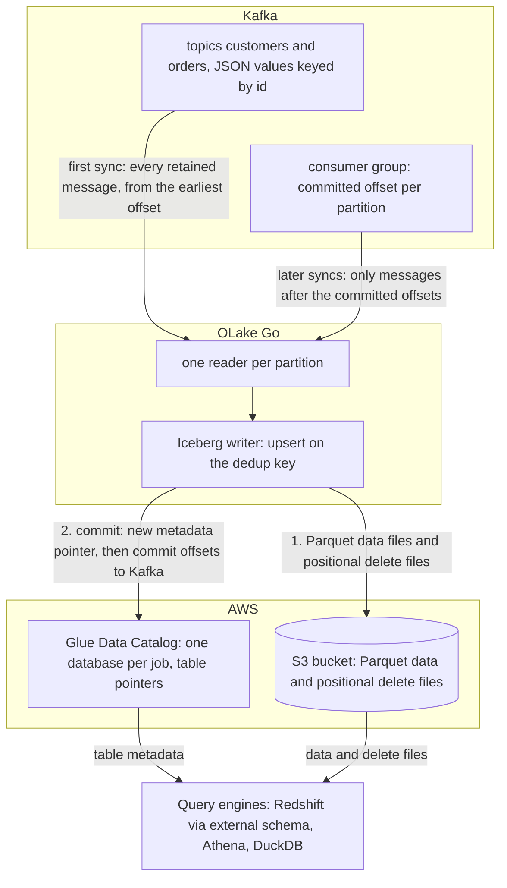

import * as I from '@site/src/components/integrations';

Kafka to Redshift usually means a Kafka Connect cluster with a Redshift sink, a Firehose stream, or a consumer that writes files for `COPY`, and tables that only Redshift can read. This guide takes a different route.

OLake Go reads the topics itself as a change data capture (CDC) stream and keeps one row per key. It writes the result once, as Apache Iceberg tables in the AWS Glue Data Catalog, with the files in your own S3 bucket.

Redshift maps the Glue database onto an external schema and queries the tables in place. Nothing else is in the path: no Kafka Connect, no Firehose, no load job. Athena and DuckDB read the same tables through the same catalog.

<I.IntegrationByline />

<TLDR title='Key takeaways'>

- OLake Go turns Kafka topics into Iceberg tables in the Glue Data Catalog: each sync reads from the last committed offset and upserts messages on a deduplication key, so a repeated key updates its row instead of adding one.
- Redshift reads the Glue database through one `CREATE EXTERNAL SCHEMA` statement, with no refresh. Every change a sync commits is visible on the next query, on Serverless and RA3 alike.
- The same tables, written once by OLake Go, are also queryable from Athena and DuckDB. In the run on this page all three engines returned identical rows.

</TLDR>

**The short answer.** To stream Kafka to Redshift as Iceberg, run OLake Go with the Kafka cluster as the source and the AWS Glue Data Catalog as the destination. Put each topic in **CDC Only** mode with **Upsert** on a deduplication key.

The first sync reads every retained message; every later sync reads only the messages after the committed offsets. Redshift, Athena and DuckDB then query the same Iceberg tables, with no second copy.

## How Kafka messages reach Redshift here



There is no separate snapshot phase, because the topic is the history. The first sync runs with a new consumer group, which has no committed offset, so it reads every message the broker still holds: on this page all 48.

OLake Go commits the Iceberg snapshot first and the consumer-group offsets second. A sync that fails mid-way therefore re-reads its messages on the next run. In Upsert mode the re-read is harmless; in Append mode it duplicates those rows.

Every later sync resumes from the committed offsets and reads only what arrived since. In **Upsert** mode a message whose deduplication key already exists in the table retires the old row with a positional delete and writes the new one.

A key seen for the first time becomes a new row. In **Append** mode every message is a row, which suits event logs that are never corrected.

One thing to keep an eye on: retention is the replay window. Kafka deletes messages past `retention.ms`, and OLake Go cannot read what is gone.

A job paused longer than the retention of its topics silently misses the expired messages. Set retention from your longest tolerable pause, not from disk size.

## What you need

- **A Kafka cluster on version 2.4 or later** that OLake Go can reach, with JSON messages (or Avro plus a schema registry) on the topics you want. Amazon Managed Streaming for Apache Kafka (MSK), Confluent Cloud, Redpanda and self-hosted Kafka all work; the run on this page used a single-node Apache Kafka 4.3.1 in KRaft mode in Docker.
- **A field that identifies each entity** in every message, such as `id`, when you want one row per key. Without it, run the topic in Append mode.
- **An AWS account** with an S3 bucket for the files and an IAM user or role for OLake Go with Glue and S3 permissions. The run on this page used a bucket and a scoped IAM user in `ap-southeast-1`.
- **Amazon Redshift**, Serverless or an RA3 cluster, with an IAM role attached that can read Glue and the bucket. The run on this page used a Serverless workgroup at 8 RPU.
- **OLake UI** from the [Docker Compose install](/docs/install/olake-ui/), on OLake UI v0.7.1 or later with the OLake Go Kafka source on v0.12.1 or later, which is when Upsert mode for Kafka arrived. The run on this page used OLake Go v1.1.0.
- **Docker**, and about 40 minutes.

## Step 1: Prepare the Kafka topics

Most readers point OLake Go at topics they already have. If you want to follow along with the exact data from this page, produce messages shaped like these first:

<details>
<summary>The two sample topics used on this page</summary>

Both topics have one partition and carry JSON values keyed by the entity `id`. The scripts ship with Apache Kafka under `bin/`; on Amazon Managed Streaming for Apache Kafka (MSK), run them from a client machine in the virtual private cloud (VPC) with the broker's bootstrap string.

```bash title="Sample topics and messages"
kafka-topics.sh --bootstrap-server localhost:9092 --create --topic customers --partitions 1
kafka-topics.sh --bootstrap-server localhost:9092 --create --topic orders --partitions 1

# key<TAB>value, one message per line
printf '1\t{"id":1,"name":"Aarav Mehta","email":"aarav@example.com","city":"Mumbai","tier":"gold","created_at":"2026-10-29T15:22:04+00:00","updated_at":"2026-10-29T15:22:04+00:00"}\n' \
  | kafka-console-producer.sh --bootstrap-server localhost:9092 --topic customers --property parse.key=true --property key.separator=$'\t'

printf '1\t{"id":1,"customer_id":2,"product":"Headphones","amount":99.19,"status":"shipped","created_at":"2026-10-29T15:22:04+00:00","updated_at":"2026-10-29T15:22:04+00:00"}\n' \
  | kafka-console-producer.sh --bootstrap-server localhost:9092 --topic orders --property parse.key=true --property key.separator=$'\t'

# Then produce whatever you like. This page started with 8 customers and 40 orders.
```

</details>

<I.Partial id="sources/kafka/prereqs" topics="customers orders" />

## Step 2: Set up the Glue catalog

Redshift reads Iceberg tables through a catalog. **AWS Glue Data Catalog** is the one this page uses: OLake Go creates a Glue database per job and registers each table there. The files sit in your S3 bucket.

Redshift, Athena, Amazon Elastic MapReduce (EMR) and DuckDB all read from the same catalog. Redshift reaches it through an external schema, with the IAM role attached to the workgroup or cluster.

<I.CatalogStrip />

<I.CatalogTabs>
<TabItem value="glue">

<I.Partial id="catalogs/glue/setup" />

The run on this page gave OLake Go a scoped IAM user with this inline policy. Redshift got a role with `AmazonS3ReadOnlyAccess` and read access to Glue:

```json title="IAM policy for the OLake Go user (replace the bucket, region and account)"
{
  "Version": "2012-10-17",
  "Statement": [
    { "Effect": "Allow", "Action": ["s3:ListBucket", "s3:GetBucketLocation"], "Resource": "arn:aws:s3:::<bucket>" },
    { "Effect": "Allow", "Action": ["s3:GetObject", "s3:PutObject", "s3:DeleteObject", "s3:AbortMultipartUpload", "s3:ListMultipartUploadParts"], "Resource": "arn:aws:s3:::<bucket>/*" },
    { "Effect": "Allow",
      "Action": ["glue:GetDatabase", "glue:GetDatabases", "glue:CreateDatabase", "glue:GetTable", "glue:GetTables", "glue:CreateTable", "glue:UpdateTable", "glue:DeleteTable"],
      "Resource": ["arn:aws:glue:<region>:<account>:catalog", "arn:aws:glue:<region>:<account>:database/*", "arn:aws:glue:<region>:<account>:table/*/*"] }
  ]
}
```

</TabItem>
</I.CatalogTabs>

## Step 3: Connect Kafka to OLake Go

<I.Partial id="sources/kafka/connect">

Here is the source form from the run on this page. Kafka ran in another container, so the bootstrap server is `host.docker.internal:19092`; the topic pattern `^(customers|orders)$` keeps discovery to the two sample topics.

<Figure src='/img/docs/integrations/kafka-to-redshift/olake-source-kafka.webp' alt='OLake UI Edit source form for Kafka on OLake Go v1.1.0 with the Enable CDC toggle marked not supported, bootstrap server host.docker.internal:19092, consumer group olake_kafka_to_snowflake, topic pattern ^(customers|orders)$, security protocol PLAINTEXT, schema registry off, max threads 2' caption='The Kafka source in OLake UI: bootstrap server, a consumer group for this job only, and a topic pattern that matches the two sample topics.' width='760px' />

**Set up source** pings the brokers before anything is saved. The consumer group is created on the first sync; it does not need to exist yet.

</I.Partial>

## Step 4: Configure the Iceberg destination

<I.CatalogTabs>
<TabItem value="glue">

<I.Partial id="catalogs/glue/writer" />

Here is the destination form from the run on this page. It holds the bucket path OLake Go writes under, the region of the bucket and the Glue catalog, and the access key pair of the IAM user from step 2.

<Figure src='/img/docs/integrations/kafka-to-redshift/olake-destination-glue.webp' alt='OLake UI Edit destination form for Apache Iceberg with catalog type AWS Glue, an S3 path under the lab bucket, region ap-southeast-1 and an access key pair' caption='The Glue destination in OLake UI: the S3 path, the region and the keys of the scoped IAM user.' width='760px' />

</TabItem>
</I.CatalogTabs>

## Step 5: Create the job and run the first sync

Redshift is not in OLake Go's target engine picker yet. This job therefore lists **Athena** and **DuckDB** as target engines.

Kafka streams offer one sync mode, **CDC Only**, and one upsert type, **Positional Deletes**, which is also the format Redshift reads. The decisions on the Streams page are the ingestion mode and the deduplication key.

<I.Partial id="jobs/create" engines="AWS Athena and DuckDB (Redshift is not in the list yet; it reads what Athena reads)" unit="topics" syncMode="CDC Only" dedupKeys="id" upsert="Positional Deletes" updateType="pos" image="olakego/source-kafka:latest" cliSyncMode="strict_cdc" namespace="topics">

<Figure src='/img/docs/integrations/kafka-to-redshift/olake-streams-cdc-only-upsert.webp' alt='OLake UI Streams Selection page with the topics namespace, customers and orders selected, sync mode CDC Only, ingestion mode Upsert, dedup key id and upsert type Positional Deletes on Iceberg format version V2' caption='Each topic: CDC Only, Upsert on the id field, and Positional Deletes as the upsert type. The Iceberg DB name at the top is editable.' />

<Figure src='/img/docs/integrations/kafka-to-redshift/olake-job-history-two-syncs.webp' alt='OLake UI Job Logs and History for kafka_to_redshift showing two completed syncs, the first in 25 seconds and the second in 23 seconds' caption='Job history: the 25 s first read of both topics, then the 23 s sync of the new messages.' />

</I.Partial>

On this page the first run read 8 customer and 40 order messages (48 records, 9.00 KB) and finished in **25 seconds**, container start included. OLake Go names the Glue database after the job and the source namespace.

The namespace for every Kafka topic is `topics`, so `kafka_to_redshift` produced `kafka_to_redshift_topics`. The **Iceberg DB** field at the top of the Streams page changes it before the first sync.

## Step 6: Query the tables in Redshift

<I.CatalogTabs>
<TabItem value="glue">

<I.Partial id="engines/redshift/query-glue" schema="kafka_to_redshift_topics" />

<Figure src='/img/docs/integrations/kafka-to-redshift/redshift-glue-customers.webp' alt='Redshift query editor v2 in the AWS console running the customers query on the Serverless workgroup and returning 10 rows with id, name, city and tier' caption='Redshift Serverless reading the customers table through the external schema after the second sync in query editor v2: 10 rows, one per key.' />

</TabItem>
</I.CatalogTabs>

<I.Cta />

## Step 7: Produce new messages and sync again

To see the change path work, the run on this page produced 12 more messages after the first sync. Seven carry new keys; five repeat an existing key with a changed value.

```bash title="Messages produced between the two syncs (key, then value)"
# customers: two new keys, two repeated keys
9   {"id":9,"name":"Maya Patel","email":"maya@example.com","city":"Pune","tier":"silver", ...}
10  {"id":10,"name":"Lucas Silva","email":"lucas@example.com","city":"São Paulo","tier":"bronze", ...}
3   {"id":3,"name":"Liam Carter","email":"liam@example.com","city":"Austin","tier":"gold", ...}
8   {"id":8,"name":"Zara Ali","email":"zara@example.com","city":"Abu Dhabi","tier":"silver", ...}

# orders: five new keys (41 to 45), three repeated keys (1, 4, 7) with status "delivered"
41  {"id":41,"customer_id":9,"product":"Laptop","amount":1299.0,"status":"placed", ...}
1   {"id":1,"customer_id":2,"product":"Headphones","amount":99.19,"status":"delivered", ...}
```

The second sync read **12 records (2.26 KB)** from the two topics and finished in **23 seconds** end to end. For `customers` that meant one new data file with 4 rows: the 2 new keys plus the new versions of the 2 repeated keys.

One small positional delete file retires the 2 old versions. OLake Go's commit report in the sync log shows it directly: `addedDataFiles=1`, `addedRecords=4`, `addedPositionalDeleteFiles=1`, `addedPositionalDeletes=2`. The `orders` table has the same shape with 8 rows and 3 deletes.

<Figure src='/img/docs/integrations/kafka-to-redshift/olake-sync-log-positional-delete-commit.webp' alt='OLake UI sync log filtered to the Iceberg commit report, showing addedDataFiles 1, addedPositionalDeleteFiles 1, addedRecords and addedPositionalDeletes for the second sync' caption='The second sync in the OLake UI log: one data file and one positional delete file per topic.' />

Redshift shows the result on the next query, with no refresh. Liam Carter is `gold`, Zara Ali moved to Abu Dhabi, and the two new customers are there, with still one row per key. The `_op_type` column shows how each row arrived (`c` for a first-seen key, `u` for a repeated key) and `_kafka_offset` shows which message it came from.

**Schema changes.** When a new field appears in the messages, OLake Go adds it as a column on the next sync and updates the Glue table definition. Redshift shows it on the next query of the external schema.

A field whose type changes in an incompatible way fails the sync rather than corrupt the table. Full rules are on the [schema evolution page](/docs/features/schema/).

## Query the same tables from Athena and DuckDB

This is the point of writing Iceberg instead of loading Redshift tables. Nothing is exported, copied or refreshed: both engines read the files OLake Go wrote, through the same Glue database.

<Tabs groupId="engine" queryString="engine">
<TabItem value="athena" label="Amazon Athena" default>

<I.Partial id="engines/athena/connect-glue" schema="kafka_to_redshift_topics" />

<Figure src='/img/docs/integrations/kafka-to-redshift/athena-glue-customers.webp' alt='Athena query editor in the AWS console running the customers query on the kafka_to_redshift_topics database and returning 10 rows' caption='Athena reading the same table through Glue: the same 10 rows.' />

</TabItem>
<TabItem value="duckdb" label="DuckDB">

<I.Partial id="engines/duckdb/connect-glue" schema="kafka_to_redshift_topics" />

DuckDB 1.5.5 returned the same 10 customers and the same `orders` roll-up as Redshift and Athena in the run on this page. It read the current metadata file of each table.

</TabItem>
</Tabs>

An `orders` roll-up matched the latest message per key in all three engines. It gave 16 delivered orders for 8659.68, 18 placed for 10522.26, 11 shipped for 6397.25.

## Data types: Kafka JSON to Iceberg to Redshift

A Kafka message has no schema of its own, so OLake Go infers one from a sample of messages at discover time and maps it to Iceberg types.

Redshift then maps Iceberg types to its own through the external schema. Four Kafka columns are added to every row. This is what the run on this page produced:

| In the JSON value | Iceberg (written by OLake Go) | Redshift shows | Notes |
| --- | --- | --- | --- |
| Integer (`"id": 3`) | `long` | `BIGINT` | |
| Decimal (`"amount": 99.19`) | `double` | `DOUBLE PRECISION` | The `orders.amount` sums on this page matched the messages to the cent in every engine; round at query time when you need exact decimal arithmetic. |
| ISO 8601 timestamp string (`"2026-10-29T15:22:04+00:00"`) | `timestamptz` (UTC) | `TIMESTAMP` | Strings that parse as timestamps are stored as timestamps and shown as UTC instants. |
| Other strings | `string` | `VARCHAR` | |
| `_kafka_key` | `string` | `VARCHAR` | The message key, base64-encoded (`3` arrives as `Mw==`). |
| `_kafka_partition`, `_kafka_offset` | `int`, `long` | `INTEGER`, `BIGINT` | Where the row's latest message sat on the topic. |
| `_kafka_timestamp` | `timestamptz` | `TIMESTAMP` | The message timestamp: produce time or broker append time, depending on the topic's `message.timestamp.type`. |

Types on the left come from the [Kafka connector reference](/docs/connectors/kafka/#kafka-general-information). The Redshift side comes from the [Redshift Iceberg page](https://docs.aws.amazon.com/redshift/latest/dg/querying-iceberg.html) (checked 2026-10-30) and from `svv_external_columns` on the tables of this run. With **Normalization** on, which is the default, top-level fields become columns.

## Cost and maintenance

- **Storage** is your bucket: you pay S3 rates for the Parquet and delete files, and nothing to Glue beyond its per-object pricing for the table entries.
- **Compute.** OLake Go runs wherever you run Docker. Redshift Serverless bills RPU-hours only while queries run; a query over the external schema scans the Parquet files in S3 through Redshift Spectrum, so filter on the columns you need. Athena bills per terabyte scanned.
- **Maintenance.** Glue has no built-in compaction for tables written by external engines. A topic synced every minute adds a small file and a delete file per run, so plan compaction from the writer side; [OLake Fusion](/docs/fusion/getting-started/overview/) does this for the catalogs OLake Go writes to, and Spark on EMR's `rewrite_data_files` works through the same Glue catalog.
- **Retention disk.** Seven days of a busy topic is real disk on the brokers. Size for it, or shorten retention once the job runs reliably every hour.
- **Key rotation.** The IAM user's access key is what OLake Go writes with. Rotate it on your schedule, or run OLake Go on an instance with a role and leave the key fields empty.

## Troubleshooting

### 1. The source test cannot reach the brokers

```text
failed to ping kafka brokers: unable to dial: dial tcp 192.168.65.254:19999: connect: connection refused
```

The address in **Bootstrap Servers** is not reachable from inside the OLake Go container. For a broker on the same machine use `host.docker.internal`, not `localhost`.

Make sure the broker also advertises a listener the container can resolve; Kafka's `advertised.listeners` decides that. On MSK, run OLake Go inside the cluster's VPC or over a VPC connection.

### 2. The Streams page is empty

```text
Skipping topic customers (does not match topic_pattern: ^nothing_here$)
```

The topic pattern is a full regular expression anchored by you. `^orders$` matches one topic, `^orders` matches every topic that starts with it, and a pattern with a typo matches nothing. Fix the pattern on the source and run discovery again; the sync log names every topic it skipped and why.

### 3. The destination test fails on a table OLake Go did not create

```text
User: arn:aws:iam::<account>:user/<olake user> is not authorized to perform: s3:GetObject on resource: "arn:aws:s3:::<another bucket>/.../test_olake.db/test_olake/metadata/00000-....metadata.json"
```

OLake Go's destination test opens a probe table called `test_olake.test_olake` in the Glue database `test_olake`. An earlier run in the same account and region may have left that table behind, pointing at a bucket your user cannot read.

The test then fails before it writes anything. Delete the stale table from Glue, or run OLake Go against a region whose Glue catalog does not have it.

### 4. Redshift cannot see the external schema's tables

```text
ERROR: Database 'kafka_to_redshift_topics' does not exist in the Glue Data Catalog
```

The external schema was created before the first sync, or in a different region from the Glue database. OLake Go creates the Glue database on the first sync; create the external schema after it, in the workgroup's region.

### 5. A sync ends early after a consumer-group rebalance

A rebalance in OLake Go's consumer group, usually because another process joined it, makes the sync stop cleanly with what it has read. Nothing is lost: the messages read so far are committed, and the next sync resumes from the committed offsets.

Give each job its own consumer group and never point another consumer at it. If a group's offsets are damaged, create the job again with a new group id. The group name cannot be edited on an existing source in the UI.

<details>
<summary>How this compares with other ways to move Kafka data to Redshift</summary>

| Method | Freshness | Updates and deletes | Where the data lands | What you run |
| --- | --- | --- | --- | --- |
| [Amazon Data Firehose to Redshift](https://docs.aws.amazon.com/firehose/latest/dev/create-destination.html#create-destination-redshift) from an MSK source | Minutes, by buffer | No; delivers through S3 and `COPY` | Native Redshift tables; Redshift is the only reader | A Firehose stream, an intermediate S3 bucket and a `COPY` command |
| [Redshift streaming ingestion from MSK](https://docs.aws.amazon.com/redshift/latest/dg/materialized-view-streaming-ingestion.html) | Seconds | No; a materialized view over the stream, merge is yours | Native Redshift materialized view | An external schema on the MSK cluster and a materialized view per topic |
| Kafka Connect with a Redshift or S3 sink | Seconds to minutes | No; appends, or your own merge | Native Redshift tables or S3 files | A Kafka Connect cluster and the sink connector |
| Managed ELT (Fivetran, Estuary, Airbyte Cloud) | Minutes, by plan | Varies by tool | Redshift tables, a second copy you pay to move and store | Nothing; priced per row, per GB or per connector |
| **OLake Go to Iceberg on Glue (this guide)** | On a schedule down to one minute | Yes, upsert on a key with Iceberg row-level deletes | Apache Iceberg tables that Redshift, Athena, EMR, Spark and DuckDB all read | One Docker Compose stack, open source; your bucket plus your own compute |

Streaming ingestion is the simpler choice when the source is MSK, you need seconds of latency and Redshift is the only reader. Writing Iceberg once, with one row per key, avoids paying to move and store a second copy. That matters as soon as Athena, EMR or a notebook needs the same rows, or you want to own the files.

</details>

## When not to use this

- **You need seconds of latency.** OLake Go drains the topic on a schedule, one minute at the shortest. Use Redshift streaming ingestion from MSK for a continuous feed.
- **Messages are not JSON or Avro.** Protobuf, plain text and binary payloads cannot be mapped to columns.
- **Deletes must propagate and the key is in the payload.** Tombstones delete a row only when `_kafka_key` is the single deduplication key; on a topic whose dedup key is a payload field, a tombstone fails the sync. Key the messages by the entity id and use the key as the deduplication key, or run the topic in Append mode and filter deletes downstream.
- **The partition count will change while the job runs in Upsert mode.** The same key would then hash to a different partition, and concurrent partition readers could leave a stale row behind. Finish the repartition, then create the job.

## FAQs

<I.IntegrationFaq />

<I.HowWeTested />

## Related guides

<I.RelatedIntegrations />

Deeper reading on this site:

- [Kafka connector reference](/docs/connectors/kafka/)
- [Equality vs positional deletes vs deletion vectors](/blog/iceberg-delete-formats-cdc-equality-vs-positional-vs-deletion-vectors/)
- [Which engines read which delete formats](/blog/iceberg-delete-formats-interoperability-olake-go/)
- [OLake Go ingestion benchmarks](/docs/benchmarks/ingestion/)

<I.IntegrationJsonLd />

<I.Cta title='Start with your own topics' body='The quickstart runs OLake UI with Docker Compose. Create the Kafka source, the Glue destination and the job as above, and the first sync lands your topics where Redshift can read them.' />
