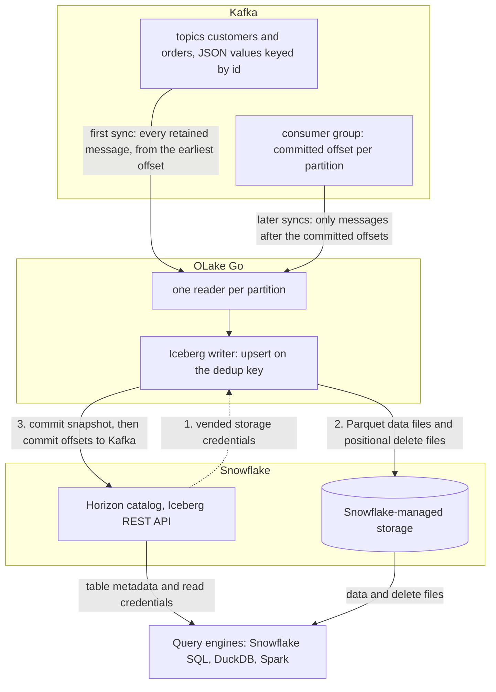

import * as I from '@site/src/components/integrations';

Kafka to Snowflake usually means the Snowflake Kafka connector, a Kafka Connect cluster, and tables that only Snowflake can read. This guide takes a different route.

OLake Go reads the topics itself as a change data capture (CDC) stream and keeps one row per key. It writes the result once, as Apache Iceberg tables that Snowflake and every other engine can query.

With Snowflake's own Horizon catalog, the default on this page, the files sit on Snowflake-managed storage. Nothing else is in the path: no Kafka Connect, no Snowpipe, no staging table. With AWS Glue, the files sit in your S3 bucket and Snowflake reads them through a catalog integration.

<I.IntegrationByline />

<TLDR title='Key takeaways'>

- OLake Go turns Kafka topics into Snowflake Iceberg tables: each sync reads from the last committed offset and upserts messages on a deduplication key, so a repeated key updates its row instead of adding one.
- Through the Horizon catalog the tables land as Snowflake-managed Iceberg tables. You query them in Snowsight right away, with no `CREATE ICEBERG TABLE`, no external volume and no refresh.
- The same tables, written once by OLake Go, are also queryable from DuckDB and Spark through the same catalog. In the run on this page all three engines returned identical rows.

</TLDR>

**The short answer.** To stream Kafka to Snowflake as Iceberg, run OLake Go with the Kafka cluster as the source and the Snowflake Horizon catalog as the destination. Put each topic in **CDC Only** mode with **Upsert** on a deduplication key.

The first sync reads every retained message; every later sync reads only the messages after the committed offsets. Snowflake, DuckDB and Spark then query the same Iceberg tables, with no second copy.

## How Kafka messages reach Snowflake here



There is no separate snapshot phase, because the topic is the history. The first sync runs with a new consumer group, which has no committed offset, so it reads every message the broker still holds: on this page all 48.

OLake Go commits the Iceberg snapshot first and the consumer-group offsets second. A sync that fails mid-way therefore re-reads its messages on the next run. In Upsert mode the re-read is harmless; in Append mode it duplicates those rows.

Every later sync resumes from the committed offsets and reads only what arrived since. In **Upsert** mode a message whose deduplication key already exists in the table retires the old row with a positional delete and writes the new one.

A key seen for the first time becomes a new row. In **Append** mode every message is a row, which suits event logs that are never corrected.

One thing to keep an eye on: retention is the replay window. Kafka deletes messages past `retention.ms`, and OLake Go cannot read what is gone.

A job paused longer than the retention of its topics silently misses the expired messages. Set retention from your longest tolerable pause, not from disk size.

## What you need

- **A Kafka cluster on version 2.4 or later** that OLake Go can reach, with JSON messages (or Avro plus a schema registry) on the topics you want. Amazon Managed Streaming for Apache Kafka (MSK), Confluent Cloud, Redpanda and self-hosted Kafka all work; the run on this page used a single-node Apache Kafka 4.3.1 in KRaft mode in Docker.
- **A field that identifies each entity** in every message, such as `id`, when you want one row per key. Without it, run the topic in Append mode.
- **A Snowflake account** where you can run the one-time setup as `ACCOUNTADMIN`. Snowflake-managed storage means no cloud bucket or IAM role on your side.
- **OLake UI** from the [Docker Compose install](/docs/install/olake-ui/), on OLake UI v0.7.1 or later with the OLake Go Kafka source on v0.12.1 or later, which is when Upsert mode for Kafka arrived. The run on this page used OLake Go v1.1.0.
- **Docker**, and about 30 minutes.

## Step 1: Prepare the Kafka topics

Most readers point OLake Go at topics they already have. If you want to follow along with the exact data from this page, produce messages shaped like these first:

<details>
<summary>The two sample topics used on this page</summary>

Both topics have one partition and carry JSON values keyed by the entity `id`. The scripts ship with Apache Kafka under `bin/`; with Redpanda, `rpk topic create` and `rpk topic produce -f '%k\t%v\n'` do the same.

```bash title="Sample topics and messages"
kafka-topics.sh --bootstrap-server localhost:9092 --create --topic customers --partitions 1
kafka-topics.sh --bootstrap-server localhost:9092 --create --topic orders --partitions 1

# key<TAB>value, one message per line
printf '1\t{"id":1,"name":"Aarav Mehta","email":"aarav@example.com","city":"Mumbai","tier":"gold","created_at":"2026-10-29T15:22:04+00:00","updated_at":"2026-10-29T15:22:04+00:00"}\n' \
  | kafka-console-producer.sh --bootstrap-server localhost:9092 --topic customers --property parse.key=true --property key.separator=$'\t'

printf '1\t{"id":1,"customer_id":2,"product":"Headphones","amount":99.19,"status":"shipped","created_at":"2026-10-29T15:22:04+00:00","updated_at":"2026-10-29T15:22:04+00:00"}\n' \
  | kafka-console-producer.sh --bootstrap-server localhost:9092 --topic orders --property parse.key=true --property key.separator=$'\t'

# Then produce whatever you like. This page started with 8 customers and 40 orders.
```

</details>

<I.Partial id="sources/kafka/prereqs" topics="customers orders" />

## Step 2: Set up the catalog in Snowflake

Snowflake reads Iceberg tables from two kinds of catalog. **Horizon** is Snowflake's own: OLake Go writes straight into it, the tables are Snowflake-managed, and they appear in Snowsight the moment a sync commits.

**AWS Glue** is a catalog outside Snowflake, so the files stay in your S3 bucket. Snowflake reaches them through a *catalog integration*: a read-only link to that external catalog, refreshed after each sync.

Horizon is the default on this page. Glue is the right pick when Athena, Redshift or Spark on Amazon Elastic MapReduce (EMR) will read the same tables. It also keeps the files in your own bucket.

<I.CatalogStrip />

<I.CatalogTabs>
<TabItem value="horizon">

<I.Partial id="catalogs/horizon/setup" />

</TabItem>
<TabItem value="glue">

<I.Partial id="catalogs/glue/setup" />

</TabItem>
</I.CatalogTabs>

## Step 3: Connect Kafka to OLake Go

<I.Partial id="sources/kafka/connect">

Here is the source form from the run on this page. Kafka ran in another container, so the bootstrap server is `host.docker.internal:19092`; the topic pattern `^(customers|orders)$` keeps discovery to the two sample topics.

<Figure src='/img/docs/integrations/kafka-to-snowflake/olake-source-kafka.webp' alt='OLake UI Edit source form for Kafka on OLake Go v1.1.0 with the Enable CDC toggle marked not supported, bootstrap server host.docker.internal:19092, consumer group olake_kafka_to_snowflake, topic pattern ^(customers|orders)$, security protocol PLAINTEXT, schema registry off, max threads 2' caption='The Kafka source in OLake UI: bootstrap server, a consumer group for this job only, and a topic pattern that matches the two sample topics.' width='760px' />

**Set up source** pings the brokers before anything is saved. The consumer group is created on the first sync; it does not need to exist yet.

</I.Partial>

## Step 4: Configure the Iceberg destination

<I.CatalogTabs>
<TabItem value="horizon">

<I.Partial id="catalogs/horizon/writer" />

</TabItem>
<TabItem value="glue">

<I.Partial id="catalogs/glue/writer" />

</TabItem>
</I.CatalogTabs>

## Step 5: Create the job and run the first sync

<I.Partial id="jobs/create" engines="Snowflake, plus DuckDB and Apache Spark if they will read the tables too" unit="topics" syncMode="CDC Only" dedupKeys="id" upsert="Positional Deletes" updateType="pos" image="olakego/source-kafka:latest" cliSyncMode="strict_cdc" namespace="topics">

Three target query engines were set on this job. Kafka streams offer one sync mode, **CDC Only**, so the two decisions on the Streams page are the ingestion mode and the deduplication key. OLake Go works out the Iceberg delete format all three engines can read and sets it on every stream.

<Figure src='/img/docs/integrations/kafka-to-snowflake/olake-streams-cdc-only-upsert.webp' alt='OLake UI Streams Selection page with the topics namespace, customers and orders selected, sync mode CDC Only, ingestion mode Upsert, dedup key id and upsert type Positional Deletes on Iceberg format version V2' caption='Each topic: CDC Only, Upsert on the id field, and the upsert type OLake Go resolved (Positional Deletes in this run). The Iceberg DB name at the top is editable.' />

<Figure src='/img/docs/integrations/kafka-to-snowflake/olake-job-history-two-syncs.webp' alt='OLake UI Job Logs and History for kafka_to_snowflake showing two completed syncs, the first in 44 seconds and the second in 24 seconds' caption='Job history: the 44 s first read of both topics, then the 24 s sync of the new messages.' />

</I.Partial>

On this page the first run read 8 customer and 40 order messages (48 records, 9.00 KB) and finished in **44 seconds**, container start included. OLake Go names the destination schema after the job and the source namespace.

The namespace for every Kafka topic is `topics`, so `kafka_to_snowflake` produced `kafka_to_snowflake_topics`. The **Iceberg DB** field at the top of the Streams page changes it before the first sync.

## Step 6: Query the tables in Snowflake

<I.CatalogTabs>
<TabItem value="horizon">

<I.Partial id="engines/snowflake/query-horizon" schema="kafka_to_snowflake_topics" />

<Figure src='/img/docs/integrations/kafka-to-snowflake/snowsight-show-iceberg-tables.webp' alt='Snowsight SQL file running SHOW ICEBERG TABLES on the kafka_to_snowflake_topics schema and listing customers and orders with owner OLAKE_ROLE, external volume SNOWFLAKE_MANAGED, catalog SNOWFLAKE and table type MANAGED' caption='SHOW ICEBERG TABLES in Snowsight: both topics are now Snowflake-managed tables, created by OLAKE_ROLE through Horizon.' />

<Figure src='/img/docs/integrations/kafka-to-snowflake/snowsight-customers-query.webp' alt='Snowsight query on OLAKE_DEMO.kafka_to_snowflake_topics.customers returning 10 rows with id, name, city and tier' caption='The customers table in Snowsight after the second sync: 10 rows, one per key, on an X-Small warehouse.' />

</TabItem>
<TabItem value="glue">

<I.Partial id="engines/snowflake/query-glue" schema="kafka_to_snowflake_topics" />

</TabItem>
</I.CatalogTabs>

<I.Cta />

## Step 7: Produce new messages and sync again

To see the change path work, the run on this page produced 12 more messages after the first sync. Seven carry new keys; five repeat an existing key with a changed value.

```bash title="Messages produced between the two syncs (key, then value)"
# customers: two new keys, two repeated keys
9   {"id":9,"name":"Maya Patel","email":"maya@example.com","city":"Pune","tier":"silver", ...}
10  {"id":10,"name":"Lucas Silva","email":"lucas@example.com","city":"São Paulo","tier":"bronze", ...}
3   {"id":3,"name":"Liam Carter","email":"liam@example.com","city":"Austin","tier":"gold", ...}
8   {"id":8,"name":"Zara Ali","email":"zara@example.com","city":"Abu Dhabi","tier":"silver", ...}

# orders: five new keys (41 to 45), three repeated keys (1, 4, 7) with status "delivered"
41  {"id":41,"customer_id":9,"product":"Laptop","amount":1299.0,"status":"placed", ...}
1   {"id":1,"customer_id":2,"product":"Headphones","amount":99.19,"status":"delivered", ...}
```

The second sync read **12 records (2.26 KB)** from the two topics and finished in **24 seconds** end to end. For `customers` that meant one new data file with 4 rows: the 2 new keys plus the new versions of the 2 repeated keys.

One small delete file retires the 2 old versions. OLake Go's commit report in the sync log shows it directly: `addedDataFiles=1`, `addedRecords=4`, `addedPositionalDeleteFiles=1`, `addedPositionalDeletes=2`, and `orders` the same shape with 8 rows and 3 deletes.

<Figure src='/img/docs/integrations/kafka-to-snowflake/olake-sync-log-positional-delete-commit.webp' alt='OLake UI sync log filtered to the Iceberg commit report for customers, showing addedDataFiles 1, addedPositionalDeleteFiles 1, addedRecords 4, totalRecords 12 and addedPositionalDeletes 2' caption='The second sync in the OLake UI log: one data file and one positional delete file for customers, zero equality deletes.' />

Snowflake shows the result with no refresh. Liam Carter is `gold`, Zara Ali moved to Abu Dhabi, and the two new customers are there, with still one row per key. The `_op_type` column shows how each row arrived and `_kafka_offset` shows which message it came from:

<Figure src='/img/docs/integrations/kafka-to-snowflake/snowsight-customers-after-cdc.webp' alt='Snowsight query on customers after the second sync showing 10 rows with _op_type c for first-seen keys, u for Liam Carter and Zara Ali, and _kafka_offset 10 and 11 for the two replaced rows' caption='Snowsight after the second sync: the two repeated keys (u) carry offsets 10 and 11, the rest are first-seen keys (c).' />

**Schema changes.** When a new field appears in the messages, OLake Go adds it as a column on the next sync, and Snowflake shows it. Widening changes (an integer field that starts carrying decimals) are applied.

A field whose type changes in an incompatible way fails the sync rather than corrupt the table. Full rules are on the [schema evolution page](/docs/features/schema/).

## Query the same tables from DuckDB and Spark

This is the point of writing Iceberg instead of loading Snowflake tables. Nothing is exported, copied or refreshed: both engines read the files OLake Go wrote, through the same Horizon endpoint, with credentials vended by Snowflake.

<Tabs groupId="engine" queryString="engine">
<TabItem value="duckdb" label="DuckDB" default>

<I.Partial id="engines/duckdb/connect-horizon" schema="kafka_to_snowflake_topics" />

<Figure src='/img/docs/integrations/kafka-to-snowflake/duckdb-horizon-customers.webp' alt='DuckDB 1.5.5 shell querying horizon.kafka_to_snowflake_topics.customers and returning the same 10 rows as Snowflake' caption='DuckDB 1.5.5 reading the Snowflake-managed table through Horizon: the same 10 rows.' />

</TabItem>
<TabItem value="spark" label="Apache Spark">

<I.Partial id="engines/spark/connect-horizon" schema="kafka_to_snowflake_topics" />

Spark 3.5.6 with Iceberg 1.10.0 returned the same 10 customers and the same `orders` roll-up as Snowflake and DuckDB in the run on this page.

</TabItem>
</Tabs>

An `orders` roll-up matched the latest message per key in all three engines: 16 delivered orders for 8659.68, 18 placed for 10522.26, 11 shipped for 6397.25.

## Data types: Kafka JSON to Iceberg to Snowflake

A Kafka message has no schema of its own, so OLake Go infers one from a sample of messages at discover time and maps it to Iceberg types.

Snowflake then maps Iceberg types to its own. Four Kafka columns are added to every row. This is what the run on this page produced:

| In the JSON value | Iceberg (written by OLake Go) | Snowflake shows | Notes |
| --- | --- | --- | --- |
| Integer (`"id": 3`) | `long` | `NUMBER` | |
| Decimal (`"amount": 99.19`) | `double` | `FLOAT` | The `orders.amount` sums on this page matched the messages to the cent in every engine; round at query time when you need exact decimal arithmetic. |
| ISO 8601 timestamp string (`"2026-10-29T15:22:04+00:00"`) | `timestamptz` (UTC) | `TIMESTAMP_LTZ(6)` | Strings that parse as timestamps are stored as timestamps; set the session zone before comparing. |
| Other strings | `string` | `VARCHAR` | |
| `_kafka_key` | `string` | `VARCHAR` | The message key, base64-encoded (`3` arrives as `Mw==`). |
| `_kafka_partition`, `_kafka_offset` | `long` | `NUMBER` | Where the row's latest message sat on the topic. |
| `_kafka_timestamp` | `timestamptz` | `TIMESTAMP_LTZ(6)` | The message timestamp: produce time or broker append time, depending on the topic's `message.timestamp.type`. |

Types on the left come from the [Kafka connector reference](/docs/connectors/kafka/#kafka-general-information); the Snowflake side from Snowflake's [Iceberg data types](https://docs.snowflake.com/en/user-guide/tables-iceberg-data-types) page (checked 2026-10-14). With **Normalization** on, which is the default, top-level fields become columns.

## Cost and maintenance

- **Storage** is Snowflake's with `SNOWFLAKE_MANAGED`: you pay Snowflake storage rates for the Parquet and delete files. Point the database at your own external volume to keep the files in your bucket instead.
- **Compute.** OLake Go runs wherever you run Docker; it does not use a Snowflake warehouse to write. Snowflake compute is spent only when you query.
- **Maintenance.** Snowflake expires old snapshots and compacts manifests on Snowflake-managed tables at no cost. Automatic data-file compaction is bundled only when Snowflake alone writes the table ([Snowflake-managed Iceberg table maintenance](https://docs.snowflake.com/en/user-guide/tables-iceberg-manage)). A topic synced every minute adds a small file and a delete file per run, so plan compaction from the writer side; [OLake Fusion](/docs/fusion/getting-started/overview/) does this for the catalogs OLake Go writes to, and Spark's `rewrite_data_files` works through the same Horizon endpoint.
- **Retention disk.** Seven days of a busy topic is real disk on the brokers. Size for it, or shorten retention once the job runs reliably every hour.
- **Token rotation.** The programmatic access token expires (30 days in the setup above, 365 at most). Put the renewal on a calendar; an expired token fails the next sync at the catalog handshake, before any message is read.

## Troubleshooting

### 1. The source test cannot reach the brokers

```text
failed to ping kafka brokers: unable to dial: dial tcp 192.168.65.254:19999: connect: connection refused
```

The address in **Bootstrap Servers** is not reachable from inside the OLake Go container. For a broker on the same machine use `host.docker.internal`, not `localhost`.

Make sure the broker also advertises a listener the container can resolve; Kafka's `advertised.listeners` (and Redpanda's `--advertise-kafka-addr`) decide that. Credentials are not checked until the ping succeeds.

### 2. The Streams page is empty

```text
Skipping topic customers (does not match topic_pattern: ^nothing_here$)
```

The topic pattern is a full regular expression anchored by you. `^orders$` matches one topic, `^orders` matches every topic that starts with it, and a pattern with a typo matches nothing. Fix the pattern on the source and run discovery again; the sync log names every topic it skipped and why.

### 3. Snowflake cannot find the table

```text
SQL compilation error:
Object 'OLAKE_DEMO.KAFKA_TO_SNOWFLAKE_TOPICS.CUSTOMERS' does not exist or not authorized.
```

Snowflake upper-cased an unquoted identifier. OLake Go creates the schema and tables with their lowercase topic names, so quote them: `OLAKE_DEMO."kafka_to_snowflake_topics"."customers"`.

### 4. A sync ends early after a consumer-group rebalance

A rebalance in OLake Go's consumer group, usually because another process joined it, makes the sync stop cleanly with what it has read. Nothing is lost: the messages read so far are committed, and the next sync resumes from the committed offsets.

Give each job its own consumer group and never point another consumer at it. If a group's offsets are damaged, create the job again with a new group id. The group name cannot be edited on an existing source in the UI.

### 5. The destination test fails at the catalog handshake

OLake Go's destination test exchanges the token at `/v1/oauth/tokens` before anything else. Three causes cover nearly every failure: a service user without a network or authentication policy, a `scope` that does not match the token's `ROLE_RESTRICTION`, or an expired token. Run the `curl` exchange from the catalog setup; it returns the same error Snowflake gives OLake Go.

<details>
<summary>How this compares with other ways to move Kafka data to Snowflake</summary>

| Method | Freshness | Updates and deletes | Where the data lands | What you run |
| --- | --- | --- | --- | --- |
| [Snowflake connector for Kafka](https://docs.snowflake.com/en/user-guide/kafka-connector-overview) with Snowpipe Streaming | Seconds | Loads only; Snowflake's overview says updates and deletes to messages might not be reflected | Native Snowflake tables, as `RECORD_CONTENT` and `RECORD_METADATA` VARIANT columns unless schematized; Snowflake is the only reader | A Kafka Connect cluster with the connector, plus Snowpipe credits |
| [Snowflake Openflow connector for Kafka](https://docs.snowflake.com/en/user-guide/data-integration/openflow/connectors/kafka/about) | Seconds | Not stated in the connector docs | Native Snowflake tables | An Openflow deployment, billed in Snowflake credits |
| [Apache Iceberg Kafka Connect sink](https://iceberg.apache.org/docs/latest/kafka-connect/) | Minutes, by commit interval | Append, or row-level changes when id columns and the Debezium or DMS transform are configured | Iceberg tables in a catalog you run | A Kafka Connect cluster with the sink, plus a catalog |
| Managed ELT (Fivetran, Estuary, Airbyte Cloud) | Minutes, by plan | Varies by tool | Snowflake tables, a second copy you pay to move and store | Nothing; priced per row, per GB or per connector |
| **OLake Go to Iceberg on Horizon (this guide)** | On a schedule down to one minute | Yes, upsert on a key with Iceberg row-level deletes | Apache Iceberg tables that Snowflake, DuckDB, Spark and Trino all read | One Docker Compose stack, open source; Snowflake storage plus your own compute |

The Snowflake connector is the simpler choice when you need seconds of latency and Snowflake is the only reader. Writing Iceberg once, with one row per key, avoids paying to move and store a second copy. That matters as soon as another engine needs the same rows, or you want to own the files.

</details>

## When not to use this

- **You need seconds of latency.** OLake Go drains the topic on a schedule, one minute at the shortest. Use the Snowflake connector with Snowpipe Streaming for a continuous feed.
- **Messages are not JSON or Avro.** Protobuf, plain text and binary payloads cannot be mapped to columns.
- **Deletes must propagate and the key is in the payload.** Tombstones delete a row only when `_kafka_key` is the single deduplication key; on a topic whose dedup key is a payload field, a tombstone fails the sync. Key the messages by the entity id and use the key as the deduplication key, or run the topic in Append mode and filter deletes downstream.
- **The partition count will change while the job runs in Upsert mode.** The same key would then hash to a different partition, and concurrent partition readers could leave a stale row behind. Finish the repartition, then create the job.

## FAQs

<I.IntegrationFaq />

<I.HowWeTested />

## Related guides

<I.RelatedIntegrations />

Deeper reading on this site:

- [Kafka connector reference](/docs/connectors/kafka/)
- [Equality vs positional deletes vs deletion vectors](/blog/iceberg-delete-formats-cdc-equality-vs-positional-vs-deletion-vectors/)
- [Which engines read which delete formats](/blog/iceberg-delete-formats-interoperability-olake-go/)
- [OLake Go ingestion benchmarks](/docs/benchmarks/ingestion/)

<I.IntegrationJsonLd />

<I.Cta title='Start with your own topics' body='The quickstart runs OLake UI with Docker Compose. Create the Kafka source, the Horizon destination and the job as above, and the first sync lands your topics in Snowflake.' />
