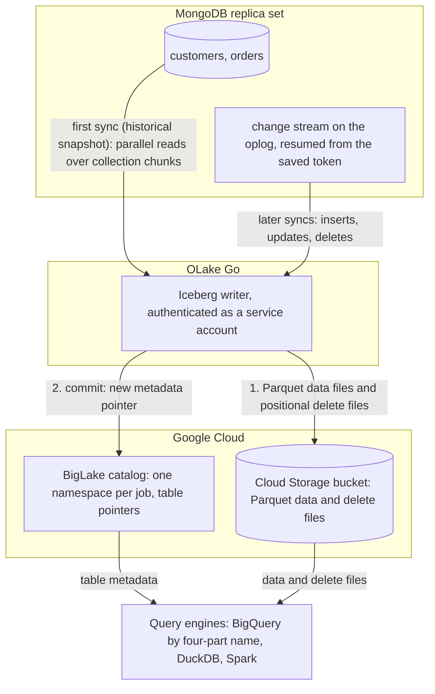

import * as I from '@site/src/components/integrations';

MongoDB to BigQuery usually means a Datastream stream, Debezium through Kafka, or a nightly `mongoexport` and `bq load`. This guide takes a fourth route. OLake Go reads the MongoDB change stream and commits the changes as Apache Iceberg tables into a BigLake catalog, Google Cloud's Iceberg representational state transfer (REST) catalog, with the files in your own Cloud Storage bucket.

BigQuery queries the tables through the catalog with a four-part name, with no dataset to create and no external table to declare. Nothing else is in the path: no Datastream, no Kafka, no load job. DuckDB and Spark read the same tables through the same catalog.

<I.IntegrationByline />

<TLDR title='Key takeaways'>

- OLake Go replicates MongoDB into Iceberg tables in a BigLake catalog: a full historical snapshot first, then change data capture (CDC) from the change stream, with no Datastream or Debezium in between. Documents are flattened into columns on the way.
- BigQuery reads the catalog as a data source. Every change a sync commits is visible on the next `SELECT`, with no refresh and no load job.
- The same tables, written once by OLake Go, are also queryable from DuckDB and Spark. In the run on this page all three engines returned identical rows.

</TLDR>

**The short answer.** To replicate MongoDB to BigQuery with change data capture (CDC), run OLake Go with a MongoDB replica set as the source and a BigLake catalog with a Cloud Storage bucket as the Iceberg destination, with BigQuery as the target query engine. The first sync copies each collection in full (the historical snapshot); every later sync replays inserts, updates and deletes from the change stream. BigQuery, DuckDB and Spark then query the same Iceberg tables, with no second copy.

## How MongoDB CDC reaches BigQuery here



Two things happen in order, and OLake Go does both on its own. The first sync opens a change stream and saves its resume token. Then it reads each collection in parallel chunks and writes Parquet data files: that is the historical load. Every later sync resumes the stream from the saved token and replays the inserts, updates and deletes since. Nothing written during the snapshot is lost, and there is no separate backfill job.

Each sync ends with one commit to BigLake. OLake Go uploads the data and delete files to the bucket with the service account's own credentials, then updates the table's metadata pointer in the catalog. BigQuery, DuckDB and Spark see the new snapshot on their next query; none of them keeps a copy.

One thing to keep an eye on: the oplog is MongoDB's replay window. A change stream can only resume from a token that is still in the oplog. A job paused for longer than the oplog window cannot resume and needs a fresh snapshot. Size the oplog for your longest planned pause; the source test on this page reports the current window.

## What you need

- **MongoDB 4.0 or later running as a replica set**, self-hosted or on Atlas, with a user that can read the database and the oplog. The collections on this page ran on MongoDB 7 as a single-node replica set in Docker; step 1 covers Atlas too.
- **A Google Cloud project** with the BigLake API enabled, a Cloud Storage bucket for the files, and a service account for OLake Go with the BigLake Editor role on the project and Storage Object User on the bucket. The run on this page used a bucket in `us-central1`.
- **BigQuery** in the same project. Queries run in the bucket's region, and the account running them needs the BigQuery Job User role plus read access to the catalog.
- **OLake UI** from the [Docker Compose install](/docs/install/olake-ui/). The run on this page used OLake Go v1.1.0.
- **Docker**, and about 30 minutes.

## Step 1: Prepare MongoDB for CDC

Most readers point OLake Go at collections they already have. If you want to follow along with the exact data from this page, create these two collections first:

<details>
<summary>The two sample collections used on this page</summary>

```javascript title="mongosh, database shop"
const now = new Date();
db.customers.insertMany([
  { _id: 1, name: 'Aarav Mehta', email: 'aarav@example.com', city: 'Mumbai', tier: 'gold', created_at: now, updated_at: now },
  // ... 8 customers with integer _id values
]);
db.orders.insertMany([
  { _id: 1, customer_id: 2, product: 'Headphones', amount: NumberDecimal('99.19'), status: 'shipped', created_at: now, updated_at: now },
  // ... 40 orders
]);
// Then insert whatever you like. This page started with 8 customers and 40 orders.
```

</details>

<I.Partial id="sources/mongodb/prereqs" />

## Step 2: Set up the BigLake catalog

BigQuery reads Iceberg tables through a catalog. **BigLake** is the one this page uses: it is Google Cloud's Iceberg REST catalog, OLake Go creates a namespace per job in it, and the files sit in your Cloud Storage bucket. BigQuery, DuckDB and Spark all read from the same catalog. BigQuery treats it as a data source in the project, so a table OLake Go commits is queryable on the next statement.

<I.CatalogStrip />

<I.CatalogTabs>
<TabItem value="biglake">

<I.Partial id="catalogs/biglake/setup" />

<Figure src='/img/docs/integrations/mongodb-to-bigquery/gcp-service-account-key-json.webp' alt='Google Cloud console Create private key dialog for the OLake service account with the JSON key type selected' caption='The JSON key for the service account. The console downloads it once; its contents go into the OLake Go destination form.' />

</TabItem>
</I.CatalogTabs>

## Step 3: Connect MongoDB to OLake Go

<I.Partial id="sources/mongodb/connect">

Here is the source form from the run on this page. MongoDB ran in another container, so the host is `host.docker.internal:27017`; the replica set is `rs0` and the user is the one from step 1, authenticating against `admin`.

<Figure src='/img/docs/integrations/mongodb-to-bigquery/olake-source-mongodb-cdc.webp' alt='OLake UI Edit source form for MongoDB on OLake Go v1.1.0 with Enable CDC on, host host.docker.internal:27017, database shop, auth DB admin, user olake, replica set rs0 and chunking strategy Split Vector' caption='The MongoDB source in OLake UI: Enable CDC on, replica set rs0, with the user from step 1.' width='760px' />

**Set up source** runs the connection test, confirms that a change stream can be opened, and reports the oplog window before anything is saved. A window under 7 days shows as a warning, not a blocker.

</I.Partial>

## Step 4: Configure the Iceberg destination

<I.CatalogTabs>
<TabItem value="biglake">

<I.Partial id="catalogs/biglake/writer">

Here is the destination form from the run on this page. It holds the BigLake endpoint, the bucket as the catalog path, the service account JSON and the project ID.

<Figure src='/img/docs/integrations/mongodb-to-bigquery/olake-destination-biglake.webp' alt='OLake UI Edit destination form for Apache Iceberg with catalog type Big Lake, REST catalog URI https://biglake.googleapis.com/iceberg/v1/restcatalog, BigLake catalog path gs://olake-x2y-lab-bq, authentication type GCP and the project ID oauth-361809' caption='The BigLake destination in OLake UI: the endpoint, the bucket as catalog path, GCP authentication and the project ID.' width='760px' />

</I.Partial>

</TabItem>
</I.CatalogTabs>

## Step 5: Create the job and run the first sync

This job lists **BigQuery**, **Spark** and **DuckDB** as target query engines. OLake Go then offers only the delete formats all three read, and the run on this page picked **Positional Deletes** from that list. Each stream runs as **Full Refresh + CDC**, so the change stream carries every change after the snapshot.

<I.Partial id="jobs/create" engines="Google BigQuery, Apache Spark and DuckDB" unit="collections" upsert="Positional Deletes" updateType="pos" image="olakego/source-mongodb:latest" namespace="shop">

OLake Go offers every delete format BigQuery, Spark and DuckDB all read: equality and positional deletes. Deletion vectors are not in the list because BigQuery reads them only in preview.

<Figure src='/img/docs/integrations/mongodb-to-bigquery/olake-streams-positional-deletes.webp' alt='OLake UI Streams Selection page with the shop database, customers and orders selected, sync mode Full Refresh + CDC, ingestion mode Upsert and upsert type Positional Deletes on Iceberg format version V2' caption='Each stream: Full Refresh + CDC, Upsert, and Positional Deletes as the upsert type. The Iceberg DB name at the top is editable.' />

<Figure src='/img/docs/integrations/mongodb-to-bigquery/olake-job-history-two-syncs.webp' alt='OLake UI Job Logs and History for mongodb_to_bigquery showing two completed syncs, the first in 34 seconds and the second in 33 seconds' caption='Job history: the 34 s historical snapshot, then the 33 s change-only sync.' />

</I.Partial>

On this page the first run copied 8 customers and 40 orders (48 documents, 6.40 KB) and finished in **34 seconds**, container start included. OLake Go names the BigLake namespace after the job and the source database, so `mongodb_to_bigquery` on database `shop` produced `mongodb_to_bigquery_shop`. The **Iceberg DB** field at the top of the Streams page changes it before the first sync.

## Step 6: Query the tables in BigQuery

<I.CatalogTabs>
<TabItem value="biglake">

<I.Partial id="engines/bigquery/query-biglake" schema="mongodb_to_bigquery_shop" idCol="_id" amount="round(sum(cast(amount AS NUMERIC)), 2)" />

<Figure src='/img/docs/integrations/mongodb-to-bigquery/bigquery-biglake-customers.webp' alt='BigQuery SQL editor in the Google Cloud console running the customers query on the olake-x2y-lab-bq catalog and returning 10 rows with _id, name, city and tier' caption='BigQuery reading the customers table through the BigLake catalog after the change sync: 10 rows, one per key.' />

The key column is `_id`, as in MongoDB, and `amount` arrives as text because the fixture stores it as `Decimal128`. The roll-up above therefore casts it: `round(sum(cast(amount AS NUMERIC)), 2)`.

</TabItem>
</I.CatalogTabs>

<I.Cta />

## Step 7: Change documents in MongoDB and sync again

To see the change path work, the run on this page made 12 changes in MongoDB after the first sync:

```javascript title="Changes made in MongoDB between the two syncs"
const now = new Date();
db.customers.insertMany([
  { _id: 9,  name: 'Maya Patel',  email: 'maya@example.com',  city: 'Pune',      tier: 'silver', created_at: now, updated_at: now },
  { _id: 10, name: 'Lucas Silva', email: 'lucas@example.com', city: 'São Paulo', tier: 'bronze', created_at: now, updated_at: now }
]);
db.orders.insertMany([
  { _id: 41, customer_id: 9,  product: 'Laptop',   amount: NumberDecimal('1299.00'), status: 'placed', created_at: now, updated_at: now },
  { _id: 42, customer_id: 9,  product: 'Mouse',    amount: NumberDecimal('25.50'),   status: 'placed', created_at: now, updated_at: now },
  { _id: 43, customer_id: 10, product: 'Monitor',  amount: NumberDecimal('349.99'),  status: 'placed', created_at: now, updated_at: now },
  { _id: 44, customer_id: 3,  product: 'Keyboard', amount: NumberDecimal('89.00'),   status: 'placed', created_at: now, updated_at: now },
  { _id: 45, customer_id: 7,  product: 'Webcam',   amount: NumberDecimal('79.90'),   status: 'placed', created_at: now, updated_at: now }
]);
db.customers.updateOne({ name: 'Liam Carter' }, { $set: { tier: 'gold', updated_at: now } });
db.customers.updateOne({ name: 'Zara Ali' },    { $set: { city: 'Abu Dhabi', updated_at: now } });
db.orders.updateMany({ _id: { $in: [1, 4, 7] } }, { $set: { status: 'delivered', updated_at: now } });
```

The second sync read **12 change events (1.60 KB)** from the stream and finished in **33 seconds** end to end. For `customers` that meant one new data file with 4 rows: 2 inserts plus the new versions of 2 updated documents. One small positional delete file retires the 2 old versions. OLake Go's commit report in the sync log shows it directly: `addedDataFiles=1`, `addedRecords=4`, `addedPositionalDeleteFiles=1`, `addedPositionalDeletes=2`. The `orders` table has the same shape with 8 rows and 3 deletes.

<Figure src='/img/docs/integrations/mongodb-to-bigquery/olake-sync-log-positional-delete-commit.webp' alt='OLake UI sync log filtered to the Iceberg commit report for customers, showing addedDataFiles 1, addedPositionalDeleteFiles 1, addedRecords 4 and addedPositionalDeletes 2' caption='The change-only sync in the OLake UI log: one data file and one positional delete file per collection.' />

BigQuery shows the result on the next query, with no refresh and no `ALTER TABLE`. Liam Carter is `gold`, Zara Ali moved to Abu Dhabi, and the two new customers are there. The two retired versions are gone, because BigQuery applies the positional deletes while reading. The `_op_type` column shows how each row arrived: `r` for the snapshot, `c` for the inserts and `u` for the updates.

**Schema changes.** When a new field appears in the documents, OLake Go adds it as a column on the next sync and commits the new schema to BigLake in the same commit. BigQuery shows the column on the next query, with nulls for older rows. A field whose type changes in an incompatible way fails the sync rather than corrupt the table. Full rules are on the [schema evolution page](/docs/features/schema/).

## Query the same tables from DuckDB and Spark

This is the point of writing Iceberg instead of loading BigQuery tables. Nothing is exported, copied or refreshed: both engines read the files OLake Go wrote, through the same BigLake catalog.

<Tabs groupId="engine" queryString="engine">
<TabItem value="duckdb" label="DuckDB" default>

<I.Partial id="engines/duckdb/connect-biglake" schema="mongodb_to_bigquery_shop" idCol="_id" />

<Figure src='/img/docs/integrations/mongodb-to-bigquery/gcp-hmac-key-service-account.webp' alt='Google Cloud console Cloud Storage Interoperability settings with the Select a service account dialog, the OLake service account selected and the Create key button' caption='The key for DuckDB: Cloud Storage, Settings, Interoperability, then a key for the same service account OLake Go uses.' />

DuckDB 1.5.5 returned the same 10 customers and the same `orders` roll-up as BigQuery in the run on this page, with `sum(cast(amount AS decimal(12,2)))` for the money column. It read the current metadata file of each table through the catalog and the data files through the hash-based message authentication code (HMAC) key.

</TabItem>
<TabItem value="spark" label="Apache Spark">

<I.Partial id="engines/spark/connect-biglake" schema="mongodb_to_bigquery_shop" idCol="_id" />

Spark 4.0.1 with Iceberg 1.10.0 returned the same rows in the run on this page, running on a laptop against the same catalog and bucket, with the same decimal cast on `amount`.

</TabItem>
</Tabs>

An `orders` roll-up matched MongoDB to the cent in all three engines, each casting `amount` to a decimal first. It gave 16 delivered orders for 8659.68, 18 placed for 10522.26, 11 shipped for 6397.25.

## Data types: MongoDB to Iceberg to BigQuery

OLake Go maps MongoDB's BSON (Binary JSON) types to Iceberg types, and BigQuery maps Iceberg types to its own when it reads the catalog. Scalars pass through; everything structured arrives as text.

| MongoDB type | Iceberg (written by OLake Go) | BigQuery shows | Notes |
| --- | --- | --- | --- |
| `int`, `timestamp` | `int` | `INT64` | The integer `_id` keys on this page arrived as `INT64`. |
| `long` | `long` | `INT64` | |
| `double` | `double` | `FLOAT64` | |
| `boolean` | `boolean` | `BOOL` | |
| `date` | `timestamptz` (UTC) | `TIMESTAMP` | |
| `decimal128` | `string` | `STRING` | Money stored as `NumberDecimal` arrives as text. `sum(cast(amount AS NUMERIC))` gives the exact total; the roll-up on this page used that cast. Store doubles in MongoDB if you want a numeric column without the cast. |
| `objectId`, `binData`, `regex`, `code` | `string` | `STRING` | An `ObjectId` primary key arrives as its 24-character hex string. |
| `object`, `array` | `string` | `STRING` | JSON text. Parse with `PARSE_JSON` into a `JSON` value, or pick fields with `JSON_VALUE`. |

MongoDB types in the table come from the [MongoDB connector reference](/docs/connectors/mongodb/#data-type-mapping). The BigQuery side comes from the [BigQuery Iceberg tables page](https://docs.cloud.google.com/bigquery/docs/iceberg-external-tables) (checked 2026-10-30) and from the table schemas of this run. OLake Go adds `_cdc_resume_token` on MongoDB tables, the change-stream token each change came from.

## Cost and maintenance

- **Storage** is your bucket: you pay Cloud Storage rates for the Parquet and delete files. The BigLake catalog itself has no per-table charge.
- **Compute.** OLake Go runs wherever you run Docker. BigQuery bills on-demand queries by bytes scanned, or by slot time on an edition; a query over the catalog reads the Parquet files in the bucket, so filter on the columns you need. DuckDB and Spark cost whatever machine they run on.
- **Maintenance.** A CDC table that gets a new small file and delete file per sync wants compaction, and BigLake keeps every snapshot OLake Go commits in the table's `metadata.json`. BigLake rejects a `metadata.json` above 1 MB, which a busy table reaches after a few thousand syncs. Expire old snapshots and compact on a schedule with [OLake Fusion](/docs/fusion/getting-started/overview/) or with Spark's `expire_snapshots` and `rewrite_data_files` procedures through the same catalog.
- **Oplog size.** The oplog is sized in gigabytes, not hours, so a write-heavy cluster shortens the window. Check it after a busy day and resize before a planned pause.
- **Key rotation.** The service account key is what OLake Go writes with. Rotate it on your schedule from the service account's **Keys** tab and paste the new JSON into the destination.

## Troubleshooting

### 1. The source test warns about the oplog

```text
oplog_retention: current 1.3 hours, recommended >= 7 days
```

Not a blocker, but it is the window in which the next sync must start. The fix is on the MongoDB side: `replSetResizeOplog` on self-hosted, or the minimum oplog window setting on Atlas. Until then, run the job more often than the window.

### 2. The source test cannot open a change stream

```text
change_streams: OLake cannot open a change stream, so CDC cannot run.
```

Either `mongod` is not running with `--replSet`, or the user lacks oplog access. Check `rs.status()` on the server and give the OLake Go user `clusterMonitor` (or `readAnyDatabase`) in `admin` on top of `read` on the database.

### 3. A money column will not sum in BigQuery

```text
No matching signature for aggregate function SUM
Argument types: STRING
```

The field is a `Decimal128` in MongoDB, which arrives as `STRING`. Wrap it: `sum(cast(amount AS NUMERIC))`. DuckDB and Spark need the same cast, to `decimal(12,2)`.

### 4. The destination test fails on a catalog in vended-credentials mode

```text
failed to test destination: failed to create or get table: rpc error: code = Internal desc = Failed to process request: Malformed request: X-Iceberg-Access-Delegation header must be present and contain `vended-credentials` when credential mode is `CREDENTIAL_MODE_VENDED_CREDENTIALS`.
```

The catalog was created, or switched, with `--credential-mode=vended-credentials`, and OLake Go 1.1.0 does not send the header BigLake wants in that mode ([olake#1369](https://github.com/datazip-inc/olake/issues/1369)). Switch the catalog back with `gcloud beta biglake iceberg catalogs update <bucket> --credential-mode=end-user`, which is the default for a catalog OLake Go created itself. With the CLI, `"rest_access_delegation": "vended-credentials"` in `destination.json` makes the same test pass; the UI has no field for it yet.

### 5. BigQuery cannot find the dataset

```text
Not found: Dataset <project>:<bucket>.mongodb_to_bigquery_shop was not found in location US
```

The query ran in a location other than the bucket's region. Set the query location to the bucket's region in the editor's **More**, **Query settings** panel, or pass `--location=<region>` to `bq`. Leaving the location unset lets BigQuery pick it from the table.

<details>
<summary>How this compares with other ways to move MongoDB data to BigQuery</summary>

| Method | Freshness | Updates and deletes | Where the data lands | What you run |
| --- | --- | --- | --- | --- |
| [Datastream for MongoDB](https://docs.cloud.google.com/datastream/docs/overview) | Near real time, by Google's description; CDC from change streams | Yes | Native BigQuery datasets; BigQuery is the only reader | Nothing to run; a connection profile and a stream in the console |
| Debezium, Kafka and a BigQuery sink | Seconds | Yes, with the connector's upsert mode | Kafka topics, then BigQuery tables | Kafka, Kafka Connect, Debezium and a sink connector per collection |
| Export (`mongoexport` to JSON), then `bq load` | Hours to daily | No; full reloads only | Native BigQuery tables | A script, a scheduler and a staging bucket |
| Managed ELT (Fivetran, Estuary, Airbyte Cloud) | Minutes, by plan | Varies by tool | BigQuery tables, a second copy you pay to move and store | Nothing; priced per row, per GB or per connector |
| **OLake Go to Iceberg on BigLake (this guide)** | CDC on a schedule down to one minute | Yes, as Iceberg row-level deletes | Apache Iceberg tables that BigQuery, Spark, DuckDB, Trino and Flink all read | One Docker Compose stack, open source; your bucket plus your own compute |

Datastream is the simpler choice when BigQuery is the only reader and a managed Google service is the preference. Writing Iceberg once avoids paying to move and store a second copy. That matters as soon as Spark, DuckDB or a notebook needs the same rows, or you want to own the files.

</details>

## When not to use this

- **Every query must hit native BigQuery speed.** A catalog table is read from Parquet in the bucket on every query. Keep the Iceberg tables as the source and load the hot slice into a native table on a schedule.
- **Deeply nested documents must stay queryable as columns.** OLake Go flattens one level; nested objects and arrays arrive as JSON text. Model them with `JSON_VALUE` in BigQuery, or use a tool that unnests on write.
- **You want deletion vectors.** BigQuery reads them only in preview, with a cap of 100,000 deletion vector entries per query. Keep the job on positional deletes while BigQuery is a reader.

## FAQs

<I.IntegrationFaq />

<I.HowWeTested />

## Related guides

<I.RelatedIntegrations />

Deeper reading on this site:

- [How to set up MongoDB to Apache Iceberg](/blog/how-to-set-up-mongodb-apache-iceberg/)
- [Equality vs positional deletes vs deletion vectors](/blog/iceberg-delete-formats-cdc-equality-vs-positional-vs-deletion-vectors/)
- [Which engines read which delete formats](/blog/iceberg-delete-formats-interoperability-olake-go/)
- [OLake Go ingestion benchmarks](/docs/benchmarks/ingestion/)

<I.IntegrationJsonLd />

<I.Cta title='Start with your own MongoDB' body='The quickstart runs OLake UI with Docker Compose. Create the source, the BigLake destination and the job as above, and the first sync lands your collections where BigQuery can read them.' />
