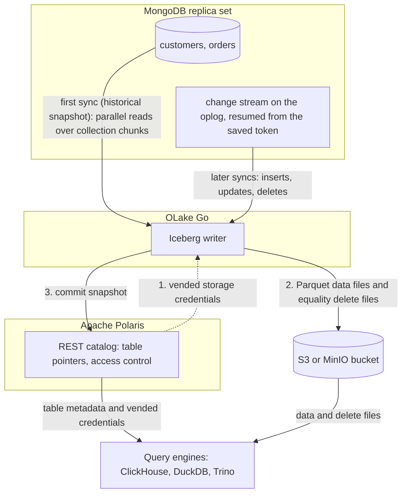

import * as I from '@site/src/components/integrations';

MongoDB to ClickHouse usually means ClickPipes on ClickHouse Cloud, the MongoDB table engine, or Debezium through Kafka, and tables that only ClickHouse can read. This guide takes a different route. OLake Go reads a MongoDB change stream and commits the changes as Apache Iceberg tables into an Apache Polaris catalog. ClickHouse attaches that catalog as a database.

Polaris is an open source Iceberg REST (Representational State Transfer) catalog you run yourself, with the files in your own bucket. Nothing else is in the path: no Kafka, no Debezium, no ClickHouse Cloud. DuckDB and Trino read the same tables through the same endpoint.

<I.IntegrationByline />

<TLDR title='Key takeaways'>

- OLake Go replicates MongoDB collections into Iceberg tables in Polaris: a full historical snapshot first, then change data capture (CDC) from a change stream, with no Kafka or Debezium in between.
- ClickHouse attaches the whole Polaris catalog as one database with `DataLakeCatalog`, reads the files with the credentials Polaris vends, and sees every change the moment a sync commits.
- The same tables, written once by OLake Go, are also queryable from DuckDB and Trino through the same catalog. In the run on this page all three engines returned identical rows.

</TLDR>

**The short answer.** To replicate MongoDB to ClickHouse with change data capture (CDC), run OLake Go with a MongoDB replica set as the source. Point it at an Apache Polaris catalog as the Iceberg destination. The first sync copies each collection in full (the historical snapshot); every later sync replays inserts, updates and deletes from the change stream. ClickHouse, DuckDB and Trino then query the same Iceberg tables, with no second copy.

## How MongoDB CDC reaches ClickHouse here



Two things happen in order, and OLake Go does both on its own. The first sync opens a change stream and saves its resume token. Then it reads each collection in parallel chunks and writes Parquet data files: that is the historical load. Every later sync resumes the stream from the saved token and replays the inserts, updates and deletes since. Nothing written during the snapshot is lost, and there is no separate backfill job.

Each sync ends with one commit to Polaris. OLake Go asks Polaris for short-lived storage credentials, uploads the data and delete files, then posts the new snapshot to the catalog. ClickHouse, DuckDB and Trino see it on their next query; none of them keeps a copy.

One thing to keep an eye on: the oplog is MongoDB's replay window. A change stream can only resume from a token that is still in the oplog. A job paused for longer than the oplog window cannot resume and needs a fresh snapshot. Size the oplog for your longest planned pause; the source test on this page reports the current window.

## What you need

- **MongoDB 4.0 or later running as a replica set**, self-hosted or on Atlas, with a user that can read the database and the oplog. The collections on this page ran on MongoDB 7 as a single-node replica set; step 1 covers Atlas too.
- **An Apache Polaris server and a bucket**, both reachable from OLake Go and from ClickHouse. The run on this page used Polaris 1.8.0 and MinIO in Docker; on AWS, use an S3 bucket and an IAM role instead.
- **ClickHouse 26.1 or later**, where the `DataLakeCatalog` engine reads REST catalogs. The run on this page used the 26.8 LTS release in Docker.
- **OLake UI** from the [Docker Compose install](/docs/install/olake-ui/). The run on this page used OLake Go v1.1.0.
- **Docker**, and about 40 minutes.

## Step 1: Prepare MongoDB for CDC

Most readers point OLake Go at collections they already have. If you want to follow along with the exact data from this page, create these two collections first:

<details>
<summary>The two sample collections used on this page</summary>

```javascript title="mongosh, database shop"
const now = new Date();
db.customers.insertMany([
  { _id: 1, name: 'Aarav Mehta', email: 'aarav@example.com', city: 'Mumbai', tier: 'gold', created_at: now, updated_at: now },
  // ... 8 customers with integer _id values
]);
db.orders.insertMany([
  { _id: 1, customer_id: 2, product: 'Headphones', amount: NumberDecimal('99.19'), status: 'shipped', created_at: now, updated_at: now },
  // ... 40 orders
]);
// Then insert whatever you like. This page started with 8 customers and 40 orders.
```

</details>

<I.Partial id="sources/mongodb/prereqs" />

## Step 2: Set up the Polaris catalog

ClickHouse reads Iceberg tables through a catalog. **Apache Polaris** is the one this page uses: an open source REST catalog that you run next to your bucket. OLake Go writes into it, and ClickHouse, DuckDB and Trino read from it with the credentials Polaris hands out. The Iceberg files sit in your own S3 or MinIO bucket; Polaris holds only the pointers and the permissions.

<I.CatalogStrip />

<I.CatalogTabs>
<TabItem value="polaris">

<I.Partial id="catalogs/polaris/setup" />

</TabItem>
</I.CatalogTabs>

## Step 3: Connect MongoDB to OLake Go

<I.Partial id="sources/mongodb/connect">

Here is the source form from the run on this page. MongoDB ran in another container as a single-node replica set, so the host is `host.docker.internal`; the user is the one from step 1.

<Figure src='/img/docs/integrations/mongodb-to-clickhouse/olake-source-mongodb-cdc.webp' alt='OLake UI Edit source form for MongoDB on OLake Go v1.1.0 with Enable CDC on, host host.docker.internal, replica set rs0, database shop and user olake' caption='The MongoDB source in OLake UI: Enable CDC on, with the replica set and the user from step 1.' width='760px' />

**Set up source** runs the connection test, then checks that the server is a replica set, that a change stream can be opened and how long the oplog window is. When one fails, the dialog names the setting and its recommended value.

</I.Partial>

## Step 4: Configure the Iceberg destination

<I.CatalogTabs>
<TabItem value="polaris">

<I.Partial id="catalogs/polaris/writer">

Here is the destination form from the run on this page. Polaris and MinIO ran in other containers, so both addresses use `host.docker.internal`; the credential is the `olake` principal from step 2.

<Figure src='/img/docs/integrations/mongodb-to-clickhouse/olake-destination-polaris.webp' alt='OLake UI Edit destination form for Apache Iceberg with catalog type Polaris, authentication type OAuth2, REST catalog URI http://host.docker.internal:8181/api/catalog, Polaris catalog name olake, S3 endpoint http://host.docker.internal:9000, REST scope PRINCIPAL_ROLE:ALL and region us-east-1' caption='The Polaris destination in OLake UI: OAuth2 with the principal from step 2, and the MinIO endpoint for the files.' width='760px' />

</I.Partial>

</TabItem>
</I.CatalogTabs>

## Step 5: Create the job and run the first sync

<I.Partial id="jobs/create" engines="ClickHouse, plus DuckDB and Trino if they will read the tables too" unit="collections" upsert="Equality Deletes" updateType="eq" image="olakego/source-mongodb:latest" namespace="shop">

Three target query engines were set on this job. That is the only format decision you make. OLake Go works out which Iceberg delete format all three can read and sets it on every stream. With ClickHouse in the list it chose equality deletes, which need no index between runs.

<Figure src='/img/docs/integrations/mongodb-to-clickhouse/olake-streams-equality-deletes.webp' alt='OLake UI Streams Selection page with the shop database, customers and orders selected, sync mode Full Refresh + CDC, ingestion mode Upsert and upsert type Equality Deletes on Iceberg format version V2' caption='Each collection: Full Refresh + CDC, Upsert, and the upsert type OLake Go resolved (Equality Deletes in this run). The Iceberg DB name at the top is editable.' />

<Figure src='/img/docs/integrations/mongodb-to-clickhouse/olake-job-history-two-syncs.webp' alt='OLake UI Job Logs and History for mongodb_to_clickhouse showing two completed syncs, the first in 15 seconds and the second in 8 seconds' caption='Job history: the 15 s historical snapshot, then the 8 s change-only sync.' />

</I.Partial>

On this page the first run copied 8 customers and 40 orders (48 documents, 6.40 KB) and finished in **15 seconds**, container start included. OLake Go names the destination namespace after the job and the source database, so `mongodb_to_clickhouse` on database `shop` produced `mongodb_to_clickhouse_shop`. The **Iceberg DB** field at the top of the Streams page changes it before the first sync.

## Step 6: Query the tables in ClickHouse

<I.CatalogTabs>
<TabItem value="polaris">

<I.Partial id="engines/clickhouse/query-polaris" schema="mongodb_to_clickhouse_shop" idCol="_id" />

MongoDB's `_id` is the key column, and a `Decimal128` field such as `amount` arrives as `String`, so cast it before you sum:

```sql title="Money stored as NumberDecimal"
SELECT status, count() AS n, round(sum(toDecimal64(amount, 2)), 2) AS total
FROM polaris.`mongodb_to_clickhouse_shop.orders`
GROUP BY status ORDER BY status;
```

<Figure src='/img/docs/integrations/mongodb-to-clickhouse/clickhouse-polaris-customers.webp' alt='clickhouse-client querying polaris.mongodb_to_clickhouse_shop.customers through the DataLakeCatalog engine and returning 10 rows with _id, name, city and tier' caption='ClickHouse 26.8 reading the customers table through Polaris after the change sync: 10 rows, one per _id.' />

</TabItem>
</I.CatalogTabs>

<I.Cta />

## Step 7: Change documents in MongoDB and sync again

To see the change path work, the run on this page made 12 changes in MongoDB after the first sync:

```javascript title="Changes made in MongoDB between the two syncs"
const now = new Date();
db.customers.insertMany([
  { _id: 9,  name: 'Maya Patel',  email: 'maya@example.com',  city: 'Pune',      tier: 'silver', created_at: now, updated_at: now },
  { _id: 10, name: 'Lucas Silva', email: 'lucas@example.com', city: 'São Paulo', tier: 'bronze', created_at: now, updated_at: now }
]);
db.orders.insertMany([
  { _id: 41, customer_id: 9,  product: 'Laptop',   amount: NumberDecimal('1299.00'), status: 'placed', created_at: now, updated_at: now },
  { _id: 42, customer_id: 9,  product: 'Mouse',    amount: NumberDecimal('25.50'),   status: 'placed', created_at: now, updated_at: now },
  { _id: 43, customer_id: 10, product: 'Monitor',  amount: NumberDecimal('349.99'),  status: 'placed', created_at: now, updated_at: now },
  { _id: 44, customer_id: 3,  product: 'Keyboard', amount: NumberDecimal('89.00'),   status: 'placed', created_at: now, updated_at: now },
  { _id: 45, customer_id: 7,  product: 'Webcam',   amount: NumberDecimal('79.90'),   status: 'placed', created_at: now, updated_at: now }
]);
db.customers.updateOne({ name: 'Liam Carter' }, { $set: { tier: 'gold', updated_at: now } });
db.customers.updateOne({ name: 'Zara Ali' },    { $set: { city: 'Abu Dhabi', updated_at: now } });
db.orders.updateMany({ _id: { $in: [1, 4, 7] } }, { $set: { status: 'delivered', updated_at: now } });
```

The second sync read **12 change events (1.60 KB)** from the stream and finished in **8 seconds** end to end. For `customers` that meant one new data file with 4 rows: 2 inserts plus the new versions of 2 updated documents. One small equality delete file retires the 2 old versions by key. OLake Go's commit report in the sync log shows it directly: `addedDataFiles=1`, `addedRecords=4`, `addedEqualityDeleteFiles=1`, `addedEqualityDeletes=2`. The `orders` table has the same shape with 8 rows and 3 deletes.

<Figure src='/img/docs/integrations/mongodb-to-clickhouse/olake-sync-log-equality-delete-commit.webp' alt='OLake UI sync log filtered to the Iceberg commit report for orders, showing addedDataFiles 1, addedEqualityDeleteFiles 1, addedRecords 8, totalRecords 48 and addedEqualityDeletes 3' caption='The change-only sync in the OLake UI log: one data file and one equality delete file per collection.' />

ClickHouse shows the result on the next query, with no refresh. Liam Carter is `gold`, Zara Ali moved to Abu Dhabi, and the two new customers are there. The two retired versions are gone, because ClickHouse applies the equality deletes while reading. The `_op_type` column shows how each row arrived: `r` for the snapshot, `c` for the inserts and `u` for the updates.

**Schema changes.** When a new field appears in the documents, OLake Go adds it as a column on the next sync. ClickHouse shows it the next time the table is opened, with nulls for older rows. A field whose type changes in an incompatible way fails the sync rather than corrupt the table. Full rules are on the [schema evolution page](/docs/features/schema/).

## Query the same tables from DuckDB and Trino

This is the point of writing Iceberg instead of loading ClickHouse tables. Nothing is exported, copied or refreshed: both engines read the files OLake Go wrote, through the same Polaris endpoint.

<Tabs groupId="engine" queryString="engine">
<TabItem value="duckdb" label="DuckDB" default>

<I.Partial id="engines/duckdb/connect-polaris" schema="mongodb_to_clickhouse_shop" idCol="_id" />

<Figure src='/img/docs/integrations/mongodb-to-clickhouse/duckdb-polaris-customers.webp' alt='DuckDB 1.5.5 shell querying polaris.mongodb_to_clickhouse_shop.customers and returning the same 10 rows as ClickHouse' caption='DuckDB 1.5.5 reading the same table through Polaris: the same 10 rows.' />

</TabItem>
<TabItem value="trino" label="Trino">

<I.Partial id="engines/trino/connect-polaris" schema="mongodb_to_clickhouse_shop" idCol="_id" />

<Figure src='/img/docs/integrations/mongodb-to-clickhouse/trino-polaris-customers.webp' alt='Trino 484 CLI querying customers in the polaris catalog and returning the same 10 rows as ClickHouse' caption='Trino 484 reading the same table through Polaris with vended credentials: the same 10 rows.' />

</TabItem>
</Tabs>

An `orders` roll-up matched MongoDB to the cent in all three engines, each casting `amount` to a decimal first. It gave 16 delivered orders for 8659.68, 18 placed for 10522.26, 11 shipped for 6397.25.

## Data types: MongoDB to Iceberg to ClickHouse

OLake Go maps MongoDB's BSON (Binary JSON) types to Iceberg types, and ClickHouse maps Iceberg types to its own. Scalars pass through; everything structured arrives as text.

| MongoDB type | Iceberg (written by OLake Go) | ClickHouse shows | Notes |
| --- | --- | --- | --- |
| `int`, `timestamp` | `int` | `Nullable(Int32)` | The integer `_id` keys on this page arrived as `Int32`. |
| `long` | `long` | `Nullable(Int64)` | |
| `double` | `double` | `Nullable(Float64)` | |
| `boolean` | `boolean` | `Nullable(Bool)` | |
| `date` | `timestamptz` (UTC) | `Nullable(DateTime64(6, 'UTC'))` | |
| `decimal128` | `string` | `Nullable(String)` | Money stored as `NumberDecimal` arrives as text. `sum(toDecimal64(amount, 2))` gives the exact total; the roll-up on this page used that cast. Store doubles in MongoDB if you want a numeric column without the cast. |
| `objectId`, `binData`, `regex`, `code` | `string` | `Nullable(String)` | An `ObjectId` primary key arrives as its 24-character hex string. |
| `object`, `array` | `string` | `Nullable(String)` | JSON text. Parse with `JSONExtract` or `JSONExtractString` in ClickHouse. |

MongoDB types in the table come from the [MongoDB connector reference](/docs/connectors/mongodb/#data-type-mapping). The ClickHouse side comes from the [ClickHouse Iceberg table engine page](https://clickhouse.com/docs/engines/table-engines/integrations/iceberg) (checked 2026-10-29) and from `DESCRIBE` on the tables of this run. OLake Go adds `_cdc_resume_token` on MongoDB tables, the change-stream token each change came from.

## Cost and maintenance

- **Storage** is your bucket: you pay S3 or MinIO rates for the Parquet and delete files, and nothing to Polaris or ClickHouse for holding them.
- **Compute.** OLake Go runs wherever you run Docker. ClickHouse spends CPU only when you query; a `DataLakeCatalog` query reads Parquet over the network with no MergeTree index, so load a hot slice into a MergeTree table when a dashboard needs sub-second answers.
- **Maintenance.** Nothing compacts the tables for you. A CDC table that gets a new small file and delete file per sync wants compaction; [OLake Fusion](/docs/fusion/getting-started/overview/) does this for the catalogs OLake Go writes to, and Spark's `rewrite_data_files` works through the same Polaris endpoint.
- **Oplog size.** The oplog is sized in gigabytes, not hours, so a write-heavy cluster shortens the window. Check it after a busy day and resize before a planned pause.
- **Credential rotation.** Polaris principals do not expire by default. Rotate the `olake` principal's secret on your own schedule with the management API; a rotated secret fails the next sync at the token exchange, before any data moves.

## Troubleshooting

### 1. The source test warns about the oplog

```text
oplog_retention: current 1.3 hours, recommended >= 7 days
```

Not a blocker, but it is the window in which the next sync must start. The fix is on the MongoDB side: `replSetResizeOplog` on self-hosted, or the minimum oplog window setting on Atlas. Until then, run the job more often than the window.

### 2. The source test cannot open a change stream

```text
change_streams: OLake cannot open a change stream, so CDC cannot run.
```

Either `mongod` is not running with `--replSet`, or the user lacks oplog access. Check `rs.status()` on the server and give the OLake Go user `clusterMonitor` (or `readAnyDatabase`) in `admin` on top of `read` on the database.

### 3. ClickHouse lists the tables but every query returns a 404

```text
Code: 499. DB::Exception: Failed to get object info for key olake/mongodb_to_clickhouse_shop/customers/lakehouse/olake/mongodb_to_clickhouse_shop/customers/metadata/00003-....metadata.json in bucket lakehouse: No response body.. HTTP response code: 404
```

The object key is doubled. ClickHouse 26.8 and 26.10 join the table location onto the storage endpoint, then fail to strip it again when the endpoint has no trailing slash. Set the Polaris catalog's `endpoint` (and `storage_endpoint` in ClickHouse, if you use static keys) to a value ending in `/`, for example `http://minio:9000/`.

### 4. A money column will not sum

```text
Code: 43. DB::Exception: Illegal type String of argument for aggregate function sum. (ILLEGAL_TYPE_OF_ARGUMENT)
```

The field is a `Decimal128` in MongoDB, which arrives as `String`. Wrap it: `sum(toDecimal64(amount, 2))`. The run on this page hit this on its first roll-up.

### 5. The destination test fails at the token exchange

OLake Go's destination test exchanges the principal's credentials at `/api/catalog/v1/oauth/tokens` before anything else. Three causes cover nearly every failure. A wrong client id or secret, a principal without a role that carries `CATALOG_MANAGE_CONTENT` on the catalog, or a wrong `Polaris Catalog Name`. Run the token check from the catalog setup; it returns the same error Polaris gives OLake Go.

<details>
<summary>How this compares with other ways to move MongoDB data to ClickHouse</summary>

| Method | Freshness | Updates and deletes | Where the data lands | What you run |
| --- | --- | --- | --- | --- |
| [ClickPipes for MongoDB](https://clickhouse.com/docs/integrations/clickpipes/mongodb) (ClickHouse Cloud) | CDC through change streams | Yes, into `ReplacingMergeTree` tables | Native ClickHouse Cloud tables, documents as JSON; ClickHouse is the only reader | Nothing to run; ClickHouse Cloud only, billed per ClickPipe |
| [ClickHouse MongoDB table engine](https://clickhouse.com/docs/engines/table-engines/integrations/mongodb) | Live, per query | Reads the current document | Nothing is copied; every query hits MongoDB | A MongoDB user ClickHouse can log in with |
| Debezium, Kafka and the ClickHouse Kafka engine | Seconds | Yes, with your own merge logic | Kafka topics, then ClickHouse tables | Kafka, Kafka Connect, Debezium and a materialized view per collection |
| Managed ELT (Fivetran, Estuary, Airbyte Cloud) | Minutes, by plan | Varies by tool | ClickHouse tables, a second copy you pay to move and store | Nothing; priced per row, per GB or per connector |
| **OLake Go to Iceberg on Polaris (this guide)** | CDC on a schedule down to one minute | Yes, as Iceberg row-level deletes | Apache Iceberg tables that ClickHouse, DuckDB, Trino and Spark all read | One Docker Compose stack, open source; your bucket plus your own compute |

ClickPipes is the simpler choice when you are on ClickHouse Cloud, ClickHouse is the only reader and you want MergeTree query speed. Writing Iceberg once avoids paying to move and store a second copy. That matters as soon as another engine needs the same rows, or you want to own the files and the catalog.

</details>

## When not to use this

- **Every query must hit MergeTree speed.** A `DataLakeCatalog` query reads Parquet with no primary index. Keep the Iceberg tables as the source and load the hot slice into a MergeTree table on a schedule.
- **You need the documents kept whole.** OLake Go flattens one level; deeply nested documents arrive as JSON text in one column. If every query starts with `JSONExtract`, ClickHouse's own JSON column type on a MergeTree table may serve you better.
- **You need deletion vectors on ClickHouse 26.8.** The LTS release reads positional and equality deletes only; keep the upsert type OLake Go resolves, or move to a release that reads Iceberg v3.

## FAQs

<I.IntegrationFaq />

<I.HowWeTested />

## Related guides

<I.RelatedIntegrations />

Deeper reading on this site:

- [Equality vs positional deletes vs deletion vectors](/blog/iceberg-delete-formats-cdc-equality-vs-positional-vs-deletion-vectors/)
- [Which engines read which delete formats](/blog/iceberg-delete-formats-interoperability-olake-go/)
- [OLake Go ingestion benchmarks](/docs/benchmarks/ingestion/)

<I.IntegrationJsonLd />

<I.Cta title='Start with your own MongoDB' body='The quickstart runs OLake UI with Docker Compose. Create the source, the Polaris destination and the job as above, and the first sync lands your collections where ClickHouse can read them.' />
