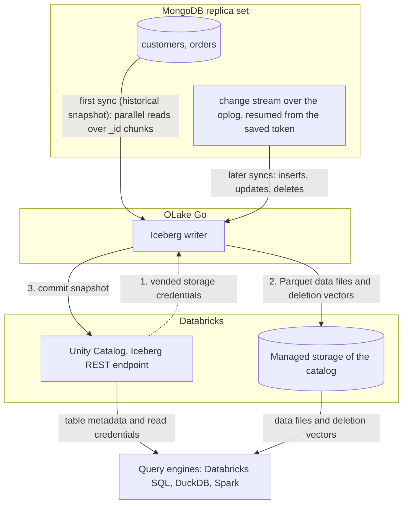

import * as I from '@site/src/components/integrations';

MongoDB to Databricks usually means a Debezium and Kafka pipeline, or nightly `mongoexport` files picked up by Auto Loader. This guide takes a different route. OLake Go reads MongoDB changes through change streams and commits them as Apache Iceberg tables into Unity Catalog, one column per top-level field.

The collections land as Unity Catalog managed Iceberg tables, with the files in the catalog's managed storage. Nothing else is in the path: no Kafka, no Debezium, no Databricks ingestion pipeline. DuckDB and Spark read the same tables through the same catalog.

<I.IntegrationByline />

<TLDR title='Key takeaways'>

- OLake Go replicates MongoDB collections into Databricks as Iceberg tables: a full historical snapshot first, then change data capture (CDC) from a change stream, with no Kafka or Debezium in between.
- The tables are Unity Catalog managed Iceberg tables, flattened one level with a column per field. You query them from the Databricks SQL editor or a notebook right away, with no external table and no refresh.
- The same tables, written once by OLake Go, are also queryable from DuckDB and Spark through Unity Catalog. In the run on this page all three engines returned identical rows.

</TLDR>

**The short answer.** To replicate MongoDB to Databricks with change data capture (CDC), run OLake Go against a MongoDB replica set with Unity Catalog as the Iceberg destination and Databricks as a target query engine. The first sync copies each collection in full (the historical snapshot), and every later sync replays inserts, updates and deletes from the change stream. Databricks, DuckDB and Spark then query the same Iceberg tables, with no second copy.

## How MongoDB CDC reaches Databricks here



Two things happen in order, and OLake Go does both on its own. The first sync opens a change stream and keeps its resume token, then reads each collection in parallel chunks split on `_id` and writes Parquet data files: that is the historical load. Every later sync resumes the change stream from the saved token and replays the inserts, updates and deletes since.

Nothing written during the snapshot is lost, and there is no separate backfill job. An update or delete retires the old row with a deletion vector, a small bitmap per data file that marks the replaced positions.

Each sync ends with one commit to Unity Catalog. Databricks sees the new snapshot on its next query, and DuckDB and Spark see it on their next catalog load.

One thing to keep an eye on: the oplog is MongoDB's replay window. If the resume token has fallen out of the oplog by the time the next sync runs, OLake Go cannot resume and needs a fresh snapshot. The source test reports the window and warns below 7 days.

## What you need

- **MongoDB 4.0 or later running as a replica set**, self-hosted or on Atlas, with a user that can read the database and the oplog. The collections on this page ran on MongoDB 7 as a single-node replica set; step 1 covers Atlas too.
- **A Databricks workspace with Unity Catalog**, a catalog with managed storage, and an admin who can turn on external data access and grant `EXTERNAL USE SCHEMA`. The run on this page used a workspace on Google Cloud.
- **OLake UI** from the [Docker Compose install](/docs/install/olake-ui/). The run on this page used OLake Go v1.1.0.
- **Docker**, and about 30 minutes.

## Step 1: Prepare MongoDB for CDC

Most readers point OLake Go at collections they already have. If you want to follow along with the exact data from this page, create these two collections first:

<details>
<summary>The two sample collections used on this page</summary>

```javascript title="mongosh, database shop"
const now = new Date();
db.customers.insertMany([
  { _id: 1, name: 'Aarav Mehta', email: 'aarav@example.com', city: 'Mumbai', tier: 'gold', created_at: now, updated_at: now },
  // ... 8 customers with integer _id values
]);
db.orders.insertMany([
  { _id: 1, customer_id: 2, product: 'Headphones', amount: NumberDecimal('99.19'), status: 'shipped', created_at: now, updated_at: now },
  // ... 40 orders
]);
// Then insert whatever you like. This page started with 8 customers and 40 orders.
```

</details>

<I.Partial id="sources/mongodb/prereqs" />

## Step 2: Set up Unity Catalog in Databricks

Databricks reads Iceberg tables through Unity Catalog, the catalog built into every Databricks workspace. OLake Go writes straight into it, so the tables become Unity Catalog managed Iceberg tables. They show up in Catalog Explorer and the SQL editor the moment a sync commits.

The files sit in the catalog's managed storage, which is backed by an external location in your own cloud account. DuckDB and Spark reach the same tables through the same Unity Catalog endpoint.

<I.CatalogStrip />

<I.CatalogTabs>
<TabItem value="unity">

<I.Partial id="catalogs/unity/setup" />

</TabItem>
</I.CatalogTabs>

## Step 3: Connect MongoDB to OLake Go

<I.Partial id="sources/mongodb/connect">

Here is the source form from the run on this page. MongoDB ran in another container, so the host is `host.docker.internal:27017`; the replica set is `rs0` and the user is the one from step 1.

<Figure src='/img/docs/integrations/mongodb-to-databricks/olake-source-mongodb-cdc.webp' alt='OLake UI Edit source form for MongoDB on OLake Go v1.1.0 with Enable CDC on, host host.docker.internal:27017, database shop, auth DB admin, user olake, replica set rs0 and read preference primary' caption='The MongoDB source in OLake UI: Enable CDC on, the replica set name and the user from step 1.' width='760px' />

**Set up source** runs the connection test, confirms that a change stream can be opened, and reports the oplog window before anything is saved. A single-node test container keeps a short oplog, so expect a warning there.

</I.Partial>

## Step 4: Configure the Iceberg destination

<I.CatalogTabs>
<TabItem value="unity">

<I.Partial id="catalogs/unity/writer">

The run on this page wrote into a catalog called `datazip`, with a personal access token that expires after seven days. The snippets below use `lakehouse`; replace it with your catalog name.

</I.Partial>

</TabItem>
</I.CatalogTabs>

## Step 5: Create the job and run the first sync

<I.Partial id="jobs/create" engines="Databricks, plus DuckDB and Apache Spark if they will read the tables too" upsert="Deletion Vector" updateType="dv" image="olakego/source-mongodb:latest" namespace="shop" unit="collections">

Three target query engines were set on this job, and Databricks narrows the delete formats to one: deletion vectors on Iceberg v3 tables. OLake Go sets that format on every stream, so there is nothing to pick.

<Figure src='/img/docs/integrations/mongodb-to-databricks/olake-streams.webp' alt='OLake UI Streams Selection page with the shop database, customers and orders selected, sync mode Full Refresh + CDC, ingestion mode Upsert and upsert type Deletion Vector on Iceberg format version V3' caption='Each stream: Full Refresh + CDC, Upsert, and Deletion Vector on Iceberg v3, the format OLake Go resolved for Databricks.' />

<Figure src='/img/docs/integrations/mongodb-to-databricks/olake-job-history-two-syncs.webp' alt='OLake UI Job Logs and History for mongodb_to_databricks showing two completed syncs, the first in 23 seconds and the second in 16 seconds' caption='Job history: the 23 s historical snapshot, then the 16 s change-only sync.' />

</I.Partial>

On this page the first run copied 8 customers and 40 orders (48 documents, 6.40 KB) and finished in **23 seconds**, container start included. OLake Go names the Unity Catalog schema after the job and the source database, so `mongodb_to_databricks` on database `shop` produced `mongodb_to_databricks_shop`. The **Iceberg DB** field at the top of the Streams page changes it before the first sync.

## Step 6: Query the tables in Databricks

<I.CatalogTabs>
<TabItem value="unity">

<I.Partial id="engines/databricks/query-unity" schema="mongodb_to_databricks_shop" key="_id" amount="round(sum(CAST(amount AS DOUBLE)), 2)" />

{/* TODO-DATABRICKS-SHOT */}

Two MongoDB details show up here. The key column is `_id`, as in the documents, and `amount` is a `STRING` because the source stores it as `Decimal128`, so the roll-up casts it before summing. OLake Go also adds `_cdc_resume_token` next to its usual columns.

</TabItem>
</I.CatalogTabs>

<I.Cta />

## Step 7: Change documents in MongoDB and sync again

To see the change path work, the run on this page made 12 changes in MongoDB after the first sync:

```javascript title="Changes made in MongoDB between the two syncs"
const now = new Date();
db.customers.insertMany([
  { _id: 9,  name: 'Maya Patel',  email: 'maya@example.com',  city: 'Pune',      tier: 'silver', created_at: now, updated_at: now },
  { _id: 10, name: 'Lucas Silva', email: 'lucas@example.com', city: 'São Paulo', tier: 'bronze', created_at: now, updated_at: now }
]);
db.orders.insertMany([
  { _id: 41, customer_id: 9,  product: 'Laptop',   amount: NumberDecimal('1299.00'), status: 'placed', created_at: now, updated_at: now },
  { _id: 42, customer_id: 9,  product: 'Mouse',    amount: NumberDecimal('25.50'),   status: 'placed', created_at: now, updated_at: now },
  { _id: 43, customer_id: 10, product: 'Monitor',  amount: NumberDecimal('349.99'),  status: 'placed', created_at: now, updated_at: now },
  { _id: 44, customer_id: 3,  product: 'Keyboard', amount: NumberDecimal('89.00'),   status: 'placed', created_at: now, updated_at: now },
  { _id: 45, customer_id: 7,  product: 'Webcam',   amount: NumberDecimal('79.90'),   status: 'placed', created_at: now, updated_at: now }
]);
db.customers.updateOne({ name: 'Liam Carter' }, { $set: { tier: 'gold', updated_at: now } });
db.customers.updateOne({ name: 'Zara Ali' },    { $set: { city: 'Abu Dhabi', updated_at: now } });
db.orders.updateMany({ _id: { $in: [1, 4, 7] } }, { $set: { status: 'delivered', updated_at: now } });
```

The second sync read **12 change events (1.60 KB)** from the stream and finished in **16 seconds** end to end. For `customers` that meant one new data file with 4 rows: 2 inserts plus the new versions of 2 updated documents. One deletion vector retires the 2 old versions.

OLake Go's commit report in the sync log shows it directly: `addedDataFiles=1`, `addedRecords=4`, `addedDVs=1` and `addedPositionalDeletes=2`. The `orders` table has the same shape with 8 rows and 3 deleted positions, and the equality delete count stays at 0.

<Figure src='/img/docs/integrations/mongodb-to-databricks/olake-sync-log-commit.webp' alt='OLake UI sync log filtered to the Iceberg commit reports for customers and orders after the change sync, showing addedDataFiles 1, addedDVs 1, addedRecords 4 and 8, and addedPositionalDeletes 2 and 3' caption='The change-only sync in the OLake UI log: one data file and one deletion vector per collection, zero equality deletes.' />

Databricks shows the result on the next query, with no refresh. Liam Carter is `gold`, Zara Ali moved to Abu Dhabi, and the two new customers are there. The `_op_type` column marks how each row arrived: `r` for the snapshot rows, `c` for the inserts and `u` for the updates.

**Schema changes.** MongoDB has no schema, so new fields show up whenever a document carries one. OLake Go adds a column for a new top-level field on the next sync and commits the new schema to Unity Catalog; documents without the field hold `NULL` there. A field whose type changes between documents is widened to `STRING`, and the full rules are on the [schema evolution page](/docs/features/schema/).

## Query the same tables from DuckDB and Spark

Nothing is exported, copied or refreshed. Both engines read the files OLake Go wrote, through the same Unity Catalog endpoint, with storage credentials vended by Databricks.

<Tabs groupId="engine" queryString="engine">
<TabItem value="duckdb" label="DuckDB" default>

<I.Partial id="engines/duckdb/connect-unity" schema="mongodb_to_databricks_shop" key="_id" />

DuckDB 1.5.5 returned the same 10 customers and the same `orders` roll-up as Databricks in the run on this page.

</TabItem>
<TabItem value="spark" label="Apache Spark">

<I.Partial id="engines/spark/connect-unity" schema="mongodb_to_databricks_shop" key="_id" />

Spark 4.0.1 with Iceberg 1.10.0 returned the same 10 customers and the same `orders` roll-up as Databricks and DuckDB in the run on this page.

</TabItem>
</Tabs>

An `orders` roll-up matched MongoDB to the cent in all three engines once `amount` was cast. It gave 16 delivered orders for 8659.68, 18 placed for 10522.26, 11 shipped for 6397.25.

## Data types: MongoDB to Iceberg to Databricks

OLake Go maps MongoDB's BSON (Binary JSON) types to Iceberg types, and Databricks maps Iceberg types to its own. Scalars pass through; everything structured arrives as text.

| MongoDB type | Iceberg (written by OLake Go) | Databricks shows | Notes |
| --- | --- | --- | --- |
| `int`, `timestamp` | `int` | `INT` | The integer `_id` and `customer_id` fields on this page arrived as `INT`. |
| `long` | `long` | `BIGINT` | |
| `double` | `double` | `DOUBLE` | |
| `boolean` | `boolean` | `BOOLEAN` | |
| `date` | `timestamptz` (UTC) | `TIMESTAMP` | |
| `decimal128` | `string` | `STRING` | Money stored as `NumberDecimal` arrives as text. Cast it before summing; the roll-up on this page used `CAST(amount AS DOUBLE)`. |
| `objectId`, `binData`, `regex`, `code` | `string` | `STRING` | An `ObjectId` primary key arrives as its 24-character hex string. |
| `object`, `array` | `string` | `STRING` | JSON text; parse it at query time. |

MongoDB types in the table come from the [MongoDB connector reference](/docs/connectors/mongodb/#data-type-mapping); the Databricks side comes from `DESCRIBE` on the tables of this run.

## Cost and maintenance

- **Storage** is the cloud bucket behind the catalog's managed location. You pay your cloud's storage rates for the Parquet data files and deletion vectors.
- **Compute.** OLake Go runs wherever you run Docker and does not use a Databricks warehouse or cluster to write. Databricks compute is spent only when you query; the checks on this page ran on a 2X-Small serverless SQL warehouse.
- **Maintenance.** Unity Catalog runs snapshot expiration and file compaction on managed Iceberg tables when predictive optimization is on ([Databricks: Iceberg tables](https://docs.databricks.com/gcp/en/iceberg/) (checked Oct 2026)). Check that it is on for the catalog OLake Go writes to. Spark's `rewrite_data_files` also works through the same Unity Catalog endpoint.
- **Token rotation.** A personal access token expires on the date set when it was created, and an expired token fails the next sync at the first catalog call. Use a service principal with OAuth machine-to-machine credentials for production jobs.
- **Oplog window.** On Atlas, raise the minimum oplog window in the cluster settings if the job runs less often than once a day; on self-hosted, use `replSetResizeOplog`.

## Troubleshooting

### 1. The source test warns about the oplog

```text
oplog_retention: current 1.3 hours, recommended >= 7 days
```

Not a blocker, but it is the window in which the next sync must start. The fix is on the MongoDB side: `replSetResizeOplog` on self-hosted, or the minimum oplog window setting on Atlas. Until then, run the job more often than the window.

### 2. The source test cannot open a change stream

```text
change_streams: OLake cannot open a change stream, so CDC cannot run.
```

Either `mongod` is not running with `--replSet`, or the user lacks oplog access. Check `rs.status()` on the server and give the OLake Go user `clusterMonitor` (or `readAnyDatabase`) in `admin` on top of `read` on the database.

### 3. Order totals come back as text

`decimal128` fields land as `STRING`, so a plain `sum(amount)` does not add money. Cast in the query, as the roll-up on this page does with `CAST(amount AS DOUBLE)`, or cast to `DECIMAL(12,2)` for exact arithmetic. Storing the value as a `double` in MongoDB removes the cast.

### 4. The destination test fails with a permission error

Three settings cover nearly every failure: **External data access** is off on the metastore, the principal lacks `EXTERNAL USE SCHEMA` on the catalog, or the catalog name in the destination is wrong. `ALL PRIVILEGES` does not include `EXTERNAL USE SCHEMA`, so a catalog owner still has to grant it explicitly. Run the grants from step 2 again for the principal that owns the token.

### 5. Databricks rejects a commit with "Can not create a Path from a null string"

```text
Can not create a Path from a null string [ErrorCode: 2015]
```

Unity Catalog returns this when a client commits equality delete files to a managed Iceberg table ([Databricks: access tables from Iceberg clients](https://docs.databricks.com/gcp/en/external-access/iceberg) (checked Oct 2026)). Set Databricks as a target query engine on the job, so OLake Go writes deletion vectors. Start any table that was written with another delete format again from a full refresh.

<details>
<summary>How this compares with other ways to move MongoDB data to Databricks</summary>

| Method | Freshness | Updates and deletes | Where the data lands | What you run |
| --- | --- | --- | --- | --- |
| Debezium, Kafka and [Structured Streaming from Kafka](https://docs.databricks.com/gcp/en/connect/streaming/kafka) (checked Oct 2026) | Seconds | Yes, with your own merge logic | Kafka topics, then tables written by a Databricks streaming job | Kafka, Kafka Connect, Debezium and a running Databricks job |
| `mongoexport` to JSON files in a bucket, then [COPY INTO](https://docs.databricks.com/gcp/en/ingestion/cloud-object-storage/copy-into/) or [Auto Loader](https://docs.databricks.com/gcp/en/ingestion/cloud-object-storage/auto-loader/) (checked Oct 2026) | Hours to daily | No; full reloads or your own merge | Tables written by a Databricks job | An export script, a bucket and a Databricks job |
| **OLake Go to Iceberg on Unity Catalog (this guide)** | CDC on a schedule down to one minute | Yes, as deletion vectors | Apache Iceberg tables that Databricks, DuckDB and Spark all read | One Docker Compose stack, open source; your storage plus your own compute |

Log-based capture through Debezium fits when you need seconds of latency and already run Kafka. Writing Iceberg once avoids a second copy as soon as another engine needs the same rows.

</details>

## When not to use this

- **You need the documents kept whole.** OLake Go flattens one level, and deeply nested documents arrive as JSON text in one column. If every query starts by parsing that text, a landing table built for semi-structured data may serve you better.
- **Every query must run on Databricks-native tables.** OLake Go writes managed Iceberg tables. If a pipeline needs native Delta Lake features on these rows, load them into a Delta table downstream.

## FAQs

<I.IntegrationFaq />

<I.HowWeTested />

## Related guides

<I.RelatedIntegrations />

Deeper reading on this site:

- [MongoDB and Atlas CDC setup](/docs/connectors/mongodb/cdc_setup)
- [Equality vs positional deletes vs deletion vectors](/blog/iceberg-delete-formats-cdc-equality-vs-positional-vs-deletion-vectors/)
- [Which engines read which delete formats](/blog/iceberg-delete-formats-interoperability-olake-go/)
- [OLake Go ingestion benchmarks](/docs/benchmarks/ingestion/)

<I.IntegrationJsonLd />

<I.Cta title='Start with your own MongoDB' body='The quickstart runs OLake UI with Docker Compose. Create the source, the Unity Catalog destination and the job as above, and the first sync lands your collections in Databricks.' />
