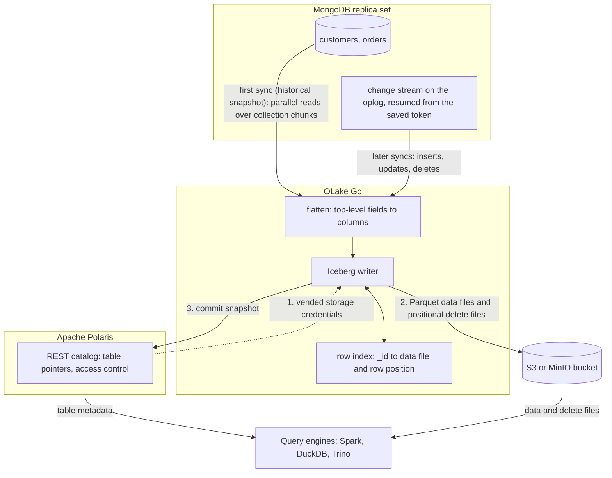

import * as I from '@site/src/components/integrations';

MongoDB to Apache Iceberg usually means Debezium's MongoDB connector, Kafka and a sink connector, before a single row reaches the lake. This guide replicates MongoDB to Iceberg without Kafka. OLake Go opens a MongoDB change stream itself and commits the changes as Iceberg tables into an Apache Polaris catalog, with the files in your own bucket.

Polaris is an open source Iceberg REST (Representational State Transfer) catalog you run yourself. Apache Spark, DuckDB and Trino read the tables through that one endpoint, and in the run on this page all three returned the same rows.

<I.IntegrationByline />

<TLDR title='Key takeaways'>

- OLake Go replicates MongoDB collections into Iceberg tables in Polaris: a full historical snapshot first, then change data capture (CDC) from a change stream, with no Kafka, Debezium or Kafka Connect in between.
- Documents land as flat tables: top-level fields become columns, and every sync is one Iceberg commit with Parquet data files and positional delete files.
- The same tables are open to any engine that reads an Iceberg REST catalog. Spark, DuckDB and Trino returned identical rows and totals in the run on this page.

</TLDR>

**The short answer.** To replicate MongoDB to Apache Iceberg without Kafka, run OLake Go with a MongoDB replica set as the source and an Iceberg REST catalog such as Apache Polaris as the destination. The first sync copies each collection in full; every later sync replays inserts, updates and deletes from a change stream. Spark, DuckDB and Trino then query the same tables.

## How MongoDB CDC reaches Apache Iceberg here



Two things happen in order, and OLake Go does both on its own. The first sync opens a change stream and saves its resume token, then reads each collection in parallel chunks and writes Parquet data files. Every later sync resumes the stream from the saved token and replays the inserts, updates and deletes since.

An update needs the old version of the document retired. With positional deletes, OLake Go keeps an index of where each `_id` sits (data file and row number) and writes a small delete file that points at those positions. Readers skip the retired rows without comparing keys, which is why every current Spark, DuckDB and Trino release reads this format.

One thing to keep an eye on: the oplog is MongoDB's replay window. A change stream can only resume from a token that is still in the oplog, so a job paused for longer than the oplog window needs a fresh snapshot. Size the oplog for your longest planned pause; the source test reports the current window.

## What you need

- **MongoDB 4.0 or later running as a replica set**, self-hosted or on Atlas, with a user that can read the database and the oplog. The collections on this page ran on MongoDB 7 as a single-node replica set; step 1 covers Atlas too.
- **An Apache Polaris server and a bucket**, both reachable from OLake Go and from your query engines. The run on this page used Polaris 1.8.0 and MinIO in Docker; on AWS, use an S3 bucket and an IAM role instead.
- **At least one engine that reads an Iceberg REST catalog.** This page shows Apache Spark 3.5.6 with Iceberg 1.10.0, DuckDB 1.5.5 and Trino 484.
- **OLake UI** from the [Docker Compose install](/docs/install/olake-ui/). The run on this page used OLake Go v1.1.0.
- **Docker**, and about 40 minutes.

## Step 1: Prepare MongoDB for CDC

Most readers point OLake Go at collections they already have. If you want to follow along with the exact data from this page, create these two collections first:

<details>
<summary>The two sample collections used on this page</summary>

```javascript title="mongosh, database shop"
const now = new Date();
db.customers.insertMany([
  { _id: 1, name: 'Aarav Mehta', email: 'aarav@example.com', city: 'Mumbai', tier: 'gold', created_at: now, updated_at: now },
  // ... 8 customers with integer _id values
]);
db.orders.insertMany([
  { _id: 1, customer_id: 2, product: 'Headphones', amount: NumberDecimal('99.19'), status: 'shipped', created_at: now, updated_at: now },
  // ... 40 orders
]);
// Then insert whatever you like. This page started with 8 customers and 40 orders.
```

</details>

<I.Partial id="sources/mongodb/prereqs" />

## Step 2: Set up the Polaris catalog

An Iceberg table is a set of files plus a catalog entry that says which metadata file is current. **Apache Polaris** holds those entries and the permissions; the Parquet files sit in your own S3 or MinIO bucket. OLake Go writes through Polaris, and every engine on this page reads through it with the credentials Polaris hands out.

The [Polaris catalog page](/docs/integrations/catalogs/polaris/) lists the other engines that read it. If you already run AWS Glue, Lakekeeper or another catalog, the [Apache Iceberg overview](/docs/integrations/iceberg/) shows what changes.

<I.CatalogStrip />

<I.CatalogTabs>
<TabItem value="polaris">

<I.Partial id="catalogs/polaris/setup" />

</TabItem>
</I.CatalogTabs>

## Step 3: Connect MongoDB to OLake Go

<I.Partial id="sources/mongodb/connect">

Here is the source form from the run on this page. MongoDB ran in another container as a single-node replica set, so the host is `host.docker.internal`; the user is the one from step 1.

<Figure src='/img/docs/integrations/mongodb-to-iceberg/olake-source-mongodb-cdc.webp' alt='OLake UI Edit source form for MongoDB on OLake Go v1.1.0 with Enable CDC on, host host.docker.internal, replica set rs0, database shop and user olake' caption='The MongoDB source in OLake UI: Enable CDC on, with the replica set and the user from step 1.' width='760px' />

**Set up source** runs the connection test, then checks that the server is a replica set, that a change stream can be opened and how long the oplog window is. When one fails, the dialog names the setting and its recommended value.

</I.Partial>

## Step 4: Configure the Iceberg destination

<I.CatalogTabs>
<TabItem value="polaris">

<I.Partial id="catalogs/polaris/writer">

Here is the destination form from the run on this page. Polaris and MinIO ran in other containers, so both addresses use `host.docker.internal`; the credential is the `olake` principal from step 2.

<Figure src='/img/docs/integrations/mongodb-to-iceberg/olake-destination-polaris.webp' alt='OLake UI Edit destination form for Apache Iceberg with catalog type Polaris, OAuth2 authentication, REST catalog URI on port 8181, catalog name olake and the MinIO S3 endpoint' caption='The Polaris destination in OLake UI: OAuth2 with the principal from step 2, and the MinIO endpoint for the files.' width='760px' />

</I.Partial>

</TabItem>
</I.CatalogTabs>

## Step 5: Create the job and run the first sync

<I.Partial id="jobs/create" engines="Apache Spark, DuckDB and Trino, or whichever engines will read the tables" unit="collections" upsert="Positional Deletes" updateType="pos" image="olakego/source-mongodb:latest" namespace="shop">

Three target query engines were set on this job: Apache Spark, DuckDB and Trino. All three read every Iceberg delete format, and the run on this page used positional deletes on Iceberg format version 2 for every collection.

<Figure src='/img/docs/integrations/mongodb-to-iceberg/olake-streams-positional-deletes.webp' alt='OLake UI Streams Selection page with the shop database, customers and orders selected, Full Refresh + CDC, Upsert and Positional Deletes on Iceberg format version V2' caption='Each collection: Full Refresh + CDC, Upsert, and Positional Deletes on Iceberg v2. The Iceberg DB name at the top is editable.' />

<Figure src='/img/docs/integrations/mongodb-to-iceberg/olake-job-history-two-syncs.webp' alt='OLake UI Job Logs and History for mongodb_to_iceberg showing two completed syncs of 12 seconds each' caption='Job history: the 12 s historical snapshot, then the 12 s change-only sync.' />

</I.Partial>

On this page the first run copied 8 customers and 40 orders (48 documents, 6.40 KB) and finished in **12 seconds**, container start included. OLake Go names the destination namespace after the job and the source database, so `mongodb_to_iceberg` on database `shop` produced `mongodb_to_iceberg_shop`. The **Iceberg DB** field at the top of the Streams page changes it before the first sync.

## Step 6: Query the tables from DuckDB

DuckDB is the quickest way to check the result from a laptop: one `ATTACH` and the whole catalog is visible.

<I.CatalogTabs>
<TabItem value="polaris">

<I.Partial id="engines/duckdb/connect-polaris" schema="mongodb_to_iceberg_shop" idCol="_id" />

A `Decimal128` field such as `amount` arrives as a string, so cast it before you sum:

```sql title="Money stored as NumberDecimal"
SELECT status, count(*) AS n, round(sum(CAST(amount AS DOUBLE)), 2) AS total
FROM polaris.mongodb_to_iceberg_shop.orders
GROUP BY status ORDER BY status;
```

<Figure src='/img/docs/integrations/mongodb-to-iceberg/duckdb-polaris-customers.webp' alt='DuckDB 1.5.5 shell querying polaris.mongodb_to_iceberg_shop.customers ordered by _id and returning 10 rows with _id, name, city and tier' caption='DuckDB 1.5.5 reading the customers table through Polaris after the change sync: 10 rows, one per _id.' />

</TabItem>
</I.CatalogTabs>

<I.Cta />

## Step 7: Change documents in MongoDB and sync again

To see the change path work, the run on this page made 12 changes in MongoDB after the first sync:

```javascript title="Changes made in MongoDB between the two syncs"
const now = new Date();
db.customers.insertMany([
  { _id: 9,  name: 'Maya Patel',  email: 'maya@example.com',  city: 'Pune',      tier: 'silver', created_at: now, updated_at: now },
  { _id: 10, name: 'Lucas Silva', email: 'lucas@example.com', city: 'São Paulo', tier: 'bronze', created_at: now, updated_at: now }
]);
db.orders.insertMany([
  { _id: 41, customer_id: 9,  product: 'Laptop',   amount: NumberDecimal('1299.00'), status: 'placed', created_at: now, updated_at: now },
  { _id: 42, customer_id: 9,  product: 'Mouse',    amount: NumberDecimal('25.50'),   status: 'placed', created_at: now, updated_at: now },
  { _id: 43, customer_id: 10, product: 'Monitor',  amount: NumberDecimal('349.99'),  status: 'placed', created_at: now, updated_at: now },
  { _id: 44, customer_id: 3,  product: 'Keyboard', amount: NumberDecimal('89.00'),   status: 'placed', created_at: now, updated_at: now },
  { _id: 45, customer_id: 7,  product: 'Webcam',   amount: NumberDecimal('79.90'),   status: 'placed', created_at: now, updated_at: now }
]);
db.customers.updateOne({ name: 'Liam Carter' }, { $set: { tier: 'gold', updated_at: now } });
db.customers.updateOne({ name: 'Zara Ali' },    { $set: { city: 'Abu Dhabi', updated_at: now } });
db.orders.updateMany({ _id: { $in: [1, 4, 7] } }, { $set: { status: 'delivered', updated_at: now } });
```

The second sync read **12 change events (1.60 KB)** from the stream and finished in **12 seconds** end to end. For `orders` that meant one new data file with 8 rows: 5 inserts plus the new versions of 3 updated documents. One positional delete file retires the 3 old versions by file and row number.

OLake Go's commit report in the sync log shows it directly: `addedDataFiles=1`, `addedRecords=8`, `addedPositionalDeleteFiles=1`, `addedPositionalDeletes=3`, and no equality delete files. The `customers` table has the same shape with 4 rows and 2 deletes.

<Figure src='/img/docs/integrations/mongodb-to-iceberg/olake-sync-log-positional-delete-commit.webp' alt='OLake UI sync log filtered to the Iceberg commit report for orders, showing addedDataFiles 1, addedPositionalDeleteFiles 1, addedRecords 8 and addedPositionalDeletes 3' caption='The change-only sync in the OLake UI log: one data file and one positional delete file per collection.' />

Every engine shows the result on its next query, with no refresh. Liam Carter is `gold`, Zara Ali moved to Abu Dhabi, and the two new customers are there. The `_op_type` column shows how each row arrived: `r` for the snapshot, `c` for the inserts and `u` for the updates.

**Schema changes.** When a new field appears in the documents, OLake Go adds it as a column on the next sync, with nulls for older rows. A field whose type changes in an incompatible way fails the sync rather than corrupt the table. Full rules are on the [schema evolution page](/docs/features/schema/).

## Query the same tables from Trino and Spark

Nothing is exported or copied for a second engine. Trino and Spark read the files OLake Go wrote, through the same Polaris endpoint. As in DuckDB, the key column is `_id`.

<Tabs groupId="engine" queryString="engine">
<TabItem value="trino" label="Trino" default>

<I.Partial id="engines/trino/connect-polaris" schema="mongodb_to_iceberg_shop" idCol="_id" />

<Figure src='/img/docs/integrations/mongodb-to-iceberg/trino-polaris-customers.webp' alt='Trino 484 CLI querying customers in the polaris catalog schema mongodb_to_iceberg_shop ordered by _id and returning the same 10 rows' caption='Trino 484 reading the same table through Polaris: the same 10 rows.' />

</TabItem>
<TabItem value="spark" label="Apache Spark">

<I.Partial id="engines/spark/connect-polaris" schema="mongodb_to_iceberg_shop" idCol="_id" />

</TabItem>
</Tabs>

All three engines agreed on the counts and the money: 10 customers, 45 orders and 25579.19 in total, each casting `amount` to a double first. The `orders` roll-up matched MongoDB to the cent: 16 delivered orders for 8659.68, 18 placed for 10522.26, 11 shipped for 6397.25.

## Data types: MongoDB to Iceberg

OLake Go maps MongoDB's BSON (Binary JSON) types to Iceberg types. Scalars pass through; everything structured arrives as text.

| MongoDB type | Iceberg (written by OLake Go) | Trino shows | Notes |
| --- | --- | --- | --- |
| `int`, `timestamp` | `int` | `integer` | The integer `_id` keys on this page arrived as `integer`. |
| `long` | `long` | `bigint` | |
| `double` | `double` | `double` | |
| `boolean` | `boolean` | `boolean` | |
| `date` | `timestamptz` (UTC) | `timestamp(6) with time zone` | |
| `decimal128` | `string` | `varchar` | Money stored as `NumberDecimal` arrives as text. `sum(CAST(amount AS DOUBLE))` gave the exact totals on this page; store doubles in MongoDB if you want a numeric column without the cast. |
| `objectId`, `binData`, `regex`, `code` | `string` | `varchar` | An `ObjectId` primary key arrives as its 24-character hex string. |
| `object`, `array` | `string` | `varchar` | JSON text; parse it at query time. |

MongoDB types in the table come from the [MongoDB connector reference](/docs/connectors/mongodb/#data-type-mapping); the Trino column comes from `DESCRIBE` on the tables of this run. OLake Go adds `_cdc_resume_token` on MongoDB tables, the change-stream token each change came from.

## Cost and maintenance

- **Storage** is your bucket: you pay S3 or MinIO rates for the Parquet and delete files, and nothing to Polaris for holding pointers.
- **Compute.** OLake Go runs wherever you run Docker. Each engine spends compute only when it queries, and none of them keeps its own copy.
- **Maintenance.** Nothing compacts the tables for you. A CDC table that gets a new small file and delete file per sync wants compaction; [OLake Fusion](/docs/fusion/getting-started/overview/) does this for the catalogs OLake Go writes to, and Spark's `rewrite_data_files` works through the same Polaris endpoint.
- **Oplog size.** The oplog is sized in gigabytes, not hours, so a write-heavy cluster shortens the window. Check it after a busy day and resize before a planned pause.
- **Credential rotation.** Polaris principals do not expire by default. Rotate the `olake` principal's secret on your own schedule; a rotated secret fails the next sync at the token exchange, before any data moves.

## Troubleshooting

### 1. The source test warns about the oplog

```text
oplog_retention: current 1.3 hours, recommended >= 7 days
```

Not a blocker, but it is the window in which the next sync must start. The fix is on the MongoDB side: `replSetResizeOplog` on self-hosted, or the minimum oplog window setting on Atlas. Until then, run the job more often than the window.

### 2. The source test cannot open a change stream

```text
change_streams: OLake cannot open a change stream, so CDC cannot run.
```

Either `mongod` is not running with `--replSet`, or the user lacks oplog access. Check `rs.status()` on the server and give the OLake Go user `clusterMonitor` (or `readAnyDatabase`) in `admin` on top of `read` on the database.

### 3. A money column will not sum

```text
Binder Error: No function matches the given name and argument types 'sum(VARCHAR)'. You might need to add explicit type casts.
```

That is DuckDB; Trino says `Unexpected parameters (varchar) for function sum`. The field is a `Decimal128` in MongoDB, which arrives as a string. Wrap it: `sum(CAST(amount AS DOUBLE))`, as in step 6.

### 4. The destination test fails at the token exchange

OLake Go's destination test exchanges the principal's credentials at `/api/catalog/v1/oauth/tokens` before anything else. Three causes cover nearly every failure: a wrong client id or secret, a principal without a role that carries `CATALOG_MANAGE_CONTENT` on the catalog, or a wrong `Polaris Catalog Name`. Run the token check from the catalog setup; it returns the same error Polaris gives OLake Go.

<details>
<summary>How this compares with other ways to move MongoDB data to Apache Iceberg</summary>

| Method | Freshness | Updates and deletes | What you run |
| --- | --- | --- | --- |
| [Debezium MongoDB connector](https://debezium.io/documentation/reference/stable/connectors/mongodb.html), Kafka and Kafka Connect with an Iceberg sink | Set by the sink commit interval | Appended as change events, with a separate merge job for the current state | Debezium, Kafka, Kafka Connect and usually a schema registry |
| [Flink CDC](https://nightlies.apache.org/flink/flink-cdc-docs-stable/) with the Iceberg Flink sink | Set by the checkpoint interval | Upserts through equality deletes on tables with a key | A Flink cluster with checkpoint storage |
| Managed ELT with an Iceberg destination | Minutes, by plan | Varies by tool | Nothing to run; priced per row, per GB or per connector |
| Periodic `mongoexport` to JSON, then a load job | Hours | Full reload or hand-written merge | A scheduler and your own scripts |
| **OLake Go to Iceberg on Polaris (this guide)** | CDC on a schedule down to one minute | Upserts through positional deletes, equality deletes or deletion vectors, matched to the target engines | One Docker Compose stack, open source; your bucket plus your own compute |

Debezium and Kafka make sense when Kafka already carries the change events for other consumers. Flink wins when you need joins, enrichment or second-level latency on the way in. For copying MongoDB collections into Iceberg without Kafka, OLake Go is one job and one catalog; the trade-off is that freshness is a schedule, not a stream.

</details>

## When not to use this

- **You need the documents kept whole.** OLake Go flattens one level; deeply nested documents arrive as JSON text in one column. If every query starts by parsing that text, a document store or a JSON-native table may serve you better.
- **You need sub-minute freshness.** OLake Go runs on a schedule, down to one minute between syncs. A streaming pipeline is the better fit for second-level latency.
- **Your server is a standalone `mongod`.** Change streams need a replica set. Convert it to a single-node replica set first, which needs a restart.

## FAQs

<I.IntegrationFaq />

<I.HowWeTested />

## Related guides

<I.RelatedIntegrations />

Deeper reading on this site:

- [MongoDB to ClickHouse through the same Polaris catalog](/docs/integrations/mongodb-to-clickhouse/)
- [How to set up MongoDB to Apache Iceberg replication](/blog/how-to-set-up-mongodb-apache-iceberg/)
- [Equality vs positional deletes vs deletion vectors](/blog/iceberg-delete-formats-cdc-equality-vs-positional-vs-deletion-vectors/)
- [OLake Go ingestion benchmarks](/docs/benchmarks/ingestion/)

<I.IntegrationJsonLd />

<I.Cta title='Start with your own MongoDB' body='The quickstart runs OLake UI with Docker Compose. Create the source, the Polaris destination and the job as above, and the first sync lands your collections as Iceberg in your own bucket.' />
