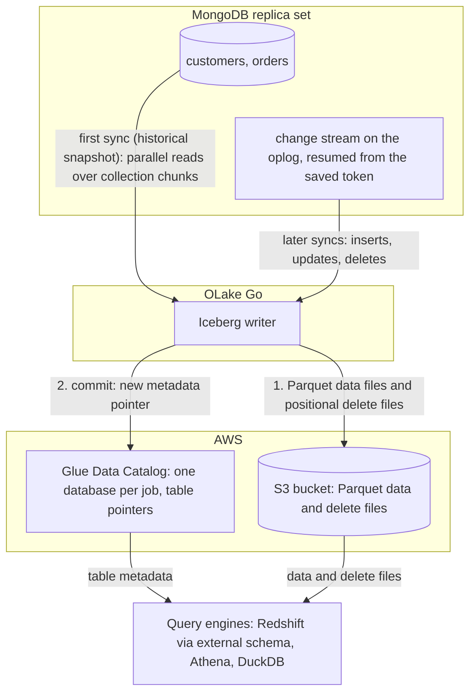

import * as I from '@site/src/components/integrations';

MongoDB to Redshift usually means a Database Migration Service (DMS) task, Debezium through Kafka, or a nightly export and `COPY`. This guide takes a fourth route. OLake Go reads the MongoDB change stream and commits the changes as Apache Iceberg tables into the AWS Glue Data Catalog, with the files in your own S3 bucket.

Redshift maps the Glue database onto an external schema and queries the tables in place. Nothing else is in the path: no DMS, no Kafka, no load job. Athena and DuckDB read the same tables through the same catalog.

<I.IntegrationByline />

<TLDR title='Key takeaways'>

- OLake Go replicates MongoDB into Iceberg tables in the Glue Data Catalog: a full historical snapshot first, then change data capture (CDC) from the change stream, with no DMS or Debezium in between. Documents are flattened into columns on the way.
- Redshift reads the Glue database through one `CREATE EXTERNAL SCHEMA` statement, with no refresh. Every change a sync commits is visible on the next query, on Serverless and RA3 alike.
- The same tables, written once by OLake Go, are also queryable from Athena and DuckDB. In the run on this page all three engines returned identical rows.

</TLDR>

**The short answer.** To replicate MongoDB to Redshift with change data capture (CDC), run OLake Go with a MongoDB replica set as the source and the AWS Glue Data Catalog as the Iceberg destination. Set the upsert type to Positional Deletes, the format Redshift reads. The first sync copies each collection in full (the historical snapshot); every later sync replays inserts, updates and deletes from the change stream. Redshift, Athena and DuckDB then query the same Iceberg tables, with no second copy.

## How MongoDB CDC reaches Redshift here



Two things happen in order, and OLake Go does both on its own. The first sync opens a change stream and saves its resume token. Then it reads each collection in parallel chunks and writes Parquet data files: that is the historical load. Every later sync resumes the stream from the saved token and replays the inserts, updates and deletes since. Nothing written during the snapshot is lost, and there is no separate backfill job.

Each sync ends with one commit to Glue. OLake Go uploads the data and delete files to the bucket, then updates the table's metadata pointer in the Glue database. Redshift, Athena and DuckDB see the new snapshot on their next query; none of them keeps a copy.

One thing to keep an eye on: the oplog is MongoDB's replay window. A change stream can only resume from a token that is still in the oplog. A job paused for longer than the oplog window cannot resume and needs a fresh snapshot. Size the oplog for your longest planned pause; the source test on this page reports the current window.

## What you need

- **MongoDB 4.0 or later running as a replica set**, self-hosted or on Atlas, with a user that can read the database and the oplog. The collections on this page ran on MongoDB 7 as a single-node replica set in Docker; step 1 covers Atlas too.
- **An AWS account** with an S3 bucket for the files and an IAM user or role for OLake Go with Glue and S3 permissions. The run on this page used a bucket and a scoped IAM user in `ap-southeast-1`.
- **Amazon Redshift**, Serverless or an RA3 cluster, with an IAM role attached that can read Glue and the bucket. The run on this page used a Serverless workgroup at 8 RPU.
- **OLake UI** from the [Docker Compose install](/docs/install/olake-ui/). The run on this page used OLake Go v1.1.0.
- **Docker**, and about 40 minutes.

## Step 1: Prepare MongoDB for CDC

Most readers point OLake Go at collections they already have. If you want to follow along with the exact data from this page, create these two collections first:

<details>
<summary>The two sample collections used on this page</summary>

```javascript title="mongosh, database shop"
const now = new Date();
db.customers.insertMany([
  { _id: 1, name: 'Aarav Mehta', email: 'aarav@example.com', city: 'Mumbai', tier: 'gold', created_at: now, updated_at: now },
  // ... 8 customers with integer _id values
]);
db.orders.insertMany([
  { _id: 1, customer_id: 2, product: 'Headphones', amount: NumberDecimal('99.19'), status: 'shipped', created_at: now, updated_at: now },
  // ... 40 orders
]);
// Then insert whatever you like. This page started with 8 customers and 40 orders.
```

</details>

<I.Partial id="sources/mongodb/prereqs" />

## Step 2: Set up the Glue catalog

Redshift reads Iceberg tables through a catalog. **AWS Glue Data Catalog** is the one this page uses: OLake Go creates a Glue database per job and registers each table there. The files sit in your S3 bucket. Redshift, Athena, Amazon Elastic MapReduce (EMR) and DuckDB all read from the same catalog. Redshift reaches it through an external schema, with the IAM role attached to the workgroup or cluster.

<I.CatalogStrip />

<I.CatalogTabs>
<TabItem value="glue">

<I.Partial id="catalogs/glue/setup" />

The run on this page gave OLake Go a scoped IAM user with this inline policy. Redshift got a role with `AmazonS3ReadOnlyAccess` and read access to Glue:

```json title="IAM policy for the OLake Go user (replace the bucket, region and account)"
{
  "Version": "2012-10-17",
  "Statement": [
    { "Effect": "Allow", "Action": ["s3:ListBucket", "s3:GetBucketLocation"], "Resource": "arn:aws:s3:::<bucket>" },
    { "Effect": "Allow", "Action": ["s3:GetObject", "s3:PutObject", "s3:DeleteObject", "s3:AbortMultipartUpload", "s3:ListMultipartUploadParts"], "Resource": "arn:aws:s3:::<bucket>/*" },
    { "Effect": "Allow",
      "Action": ["glue:GetDatabase", "glue:GetDatabases", "glue:CreateDatabase", "glue:GetTable", "glue:GetTables", "glue:CreateTable", "glue:UpdateTable", "glue:DeleteTable"],
      "Resource": ["arn:aws:glue:<region>:<account>:catalog", "arn:aws:glue:<region>:<account>:database/*", "arn:aws:glue:<region>:<account>:table/*/*"] }
  ]
}
```

</TabItem>
</I.CatalogTabs>

## Step 3: Connect MongoDB to OLake Go

<I.Partial id="sources/mongodb/connect">

Here is the source form from the run on this page. MongoDB ran in another container, so the host is `host.docker.internal:27017`; the replica set is `rs0` and the user is the one from step 1, authenticating against `admin`.

<Figure src='/img/docs/integrations/mongodb-to-redshift/olake-source-mongodb-cdc.webp' alt='OLake UI Edit source form for MongoDB on OLake Go v1.1.0 with Enable CDC on, host host.docker.internal:27017, database shop, auth DB admin, user olake, replica set rs0 and chunking strategy Split Vector' caption='The MongoDB source in OLake UI: Enable CDC on, replica set rs0, with the user from step 1.' width='760px' />

**Set up source** runs the connection test, confirms that a change stream can be opened, and reports the oplog window before anything is saved. A window under 7 days shows as a warning, not a blocker.

</I.Partial>

## Step 4: Configure the Iceberg destination

<I.CatalogTabs>
<TabItem value="glue">

<I.Partial id="catalogs/glue/writer" />

Here is the destination form from the run on this page. It holds the bucket path OLake Go writes under, the region of the bucket and the Glue catalog, and the access key pair of the IAM user from step 2.

<Figure src='/img/docs/integrations/mongodb-to-redshift/olake-destination-glue.webp' alt='OLake UI Edit destination form for Apache Iceberg with catalog type AWS Glue, an S3 path under the lab bucket, region ap-southeast-1 and an access key pair' caption='The Glue destination in OLake UI: the S3 path, the region and the keys of the scoped IAM user.' width='760px' />

</TabItem>
</I.CatalogTabs>

## Step 5: Create the job and run the first sync

Redshift is not in OLake Go's target engine picker yet. This job therefore lists **Athena** and **DuckDB** as target engines and sets the upsert type to **Positional Deletes** by hand. That is the format Redshift reads, and both listed engines read it too. Each stream runs as **Full Refresh + CDC**, so the change stream carries every change after the snapshot.

<I.Partial id="jobs/create" engines="AWS Athena and DuckDB (Redshift is not in the list yet; it reads what Athena reads)" unit="collections" upsert="Positional Deletes" updateType="pos" image="olakego/source-mongodb:latest" namespace="shop">

OLake Go offers every delete format Athena and DuckDB both read. The run on this page picked **Positional Deletes** from that list because Redshift reads Iceberg v2 tables with positional deletes and nothing else.

<Figure src='/img/docs/integrations/mongodb-to-redshift/olake-streams-positional-deletes.webp' alt='OLake UI Streams Selection page with the shop database, customers and orders selected, sync mode Full Refresh + CDC, ingestion mode Upsert and upsert type Positional Deletes on Iceberg format version V2' caption='Each stream: Full Refresh + CDC, Upsert, and Positional Deletes as the upsert type. The Iceberg DB name at the top is editable.' />

<Figure src='/img/docs/integrations/mongodb-to-redshift/olake-job-history-two-syncs.webp' alt='OLake UI Job Logs and History for mongodb_to_redshift showing two completed syncs, the first in 14 seconds and the second in 11 seconds' caption='Job history: the 14 s historical snapshot, then the 11 s change-only sync.' />

</I.Partial>

On this page the first run copied 8 customers and 40 orders (48 documents, 6.40 KB) and finished in **14 seconds**, container start included. OLake Go names the Glue database after the job and the source database, so `mongodb_to_redshift` on database `shop` produced `mongodb_to_redshift_shop`. The **Iceberg DB** field at the top of the Streams page changes it before the first sync.

## Step 6: Query the tables in Redshift

<I.CatalogTabs>
<TabItem value="glue">

<I.Partial id="engines/redshift/query-glue" schema="mongodb_to_redshift_shop" key="_id" amount="sum(cast(amount AS decimal(12,2)))" />

<Figure src='/img/docs/integrations/mongodb-to-redshift/redshift-glue-customers.webp' alt='Redshift query editor v2 in the AWS console running the customers query on the Serverless workgroup and returning 10 rows with _id, name, city and tier' caption='Redshift Serverless reading the customers table through the external schema after the change sync in query editor v2: 10 rows, one per key.' />

The key column is `_id`, as in MongoDB, and `amount` arrives as text because the fixture stores it as `Decimal128`. The roll-up below therefore casts it: `sum(cast(amount AS decimal(12,2)))`.

</TabItem>
</I.CatalogTabs>

<I.Cta />

## Step 7: Change documents in MongoDB and sync again

To see the change path work, the run on this page made 12 changes in MongoDB after the first sync:

```javascript title="Changes made in MongoDB between the two syncs"
const now = new Date();
db.customers.insertMany([
  { _id: 9,  name: 'Maya Patel',  email: 'maya@example.com',  city: 'Pune',      tier: 'silver', created_at: now, updated_at: now },
  { _id: 10, name: 'Lucas Silva', email: 'lucas@example.com', city: 'São Paulo', tier: 'bronze', created_at: now, updated_at: now }
]);
db.orders.insertMany([
  { _id: 41, customer_id: 9,  product: 'Laptop',   amount: NumberDecimal('1299.00'), status: 'placed', created_at: now, updated_at: now },
  { _id: 42, customer_id: 9,  product: 'Mouse',    amount: NumberDecimal('25.50'),   status: 'placed', created_at: now, updated_at: now },
  { _id: 43, customer_id: 10, product: 'Monitor',  amount: NumberDecimal('349.99'),  status: 'placed', created_at: now, updated_at: now },
  { _id: 44, customer_id: 3,  product: 'Keyboard', amount: NumberDecimal('89.00'),   status: 'placed', created_at: now, updated_at: now },
  { _id: 45, customer_id: 7,  product: 'Webcam',   amount: NumberDecimal('79.90'),   status: 'placed', created_at: now, updated_at: now }
]);
db.customers.updateOne({ name: 'Liam Carter' }, { $set: { tier: 'gold', updated_at: now } });
db.customers.updateOne({ name: 'Zara Ali' },    { $set: { city: 'Abu Dhabi', updated_at: now } });
db.orders.updateMany({ _id: { $in: [1, 4, 7] } }, { $set: { status: 'delivered', updated_at: now } });
```

The second sync read **12 change events (1.60 KB)** from the stream and finished in **11 seconds** end to end. For `customers` that meant one new data file with 4 rows: 2 inserts plus the new versions of 2 updated documents. One small positional delete file retires the 2 old versions. OLake Go's commit report in the sync log shows it directly: `addedDataFiles=1`, `addedRecords=4`, `addedPositionalDeleteFiles=1`, `addedPositionalDeletes=2`. The `orders` table has the same shape with 8 rows and 3 deletes.

<Figure src='/img/docs/integrations/mongodb-to-redshift/olake-sync-log-positional-delete-commit.webp' alt='OLake UI sync log filtered to the Iceberg commit report for customers, showing addedDataFiles 1, addedPositionalDeleteFiles 1, addedRecords 4, totalRecords 12 and addedPositionalDeletes 2' caption='The change-only sync in the OLake UI log: one data file and one positional delete file per collection.' />

Redshift shows the result on the next query, with no refresh and no `ALTER TABLE`. Liam Carter is `gold`, Zara Ali moved to Abu Dhabi, and the two new customers are there. The two retired versions are gone, because Redshift applies the positional deletes while reading. The `_op_type` column shows how each row arrived: `r` for the snapshot, `c` for the inserts and `u` for the updates.

**Schema changes.** When a new field appears in the documents, OLake Go adds it as a column on the next sync. The Glue table definition is updated in the same commit, and Redshift shows it on the next query of the external schema, with nulls for older rows. A field whose type changes in an incompatible way fails the sync rather than corrupt the table. Full rules are on the [schema evolution page](/docs/features/schema/).

## Query the same tables from Athena and DuckDB

This is the point of writing Iceberg instead of loading Redshift tables. Nothing is exported, copied or refreshed: both engines read the files OLake Go wrote, through the same Glue database.

<Tabs groupId="engine" queryString="engine">
<TabItem value="athena" label="Amazon Athena" default>

<I.Partial id="engines/athena/connect-glue" schema="mongodb_to_redshift_shop" key="_id" amount="sum(cast(amount AS decimal(12,2)))" />

<Figure src='/img/docs/integrations/mongodb-to-redshift/athena-glue-customers.webp' alt='Athena query editor in the AWS console running the customers query on the mongodb_to_redshift_shop database and returning 10 rows with _id, name, city and tier' caption='Athena reading the same table through Glue: the same 10 rows, 0.76 KB scanned.' />

</TabItem>
<TabItem value="duckdb" label="DuckDB">

<I.Partial id="engines/duckdb/connect-glue" schema="mongodb_to_redshift_shop" key="_id" amount="sum(cast(amount AS decimal(12,2)))" />

DuckDB 1.5.5 returned the same 10 customers and the same `orders` roll-up as Redshift and Athena in the run on this page. It read the current metadata file of each table.

</TabItem>
</Tabs>

An `orders` roll-up matched MongoDB to the cent in all three engines, each casting `amount` to a decimal first. It gave 16 delivered orders for 8659.68, 18 placed for 10522.26, 11 shipped for 6397.25.

## Data types: MongoDB to Iceberg to Redshift

OLake Go maps MongoDB's BSON (Binary JSON) types to Iceberg types, and Redshift maps Iceberg types to its own through the external schema. Scalars pass through; everything structured arrives as text.

| MongoDB type | Iceberg (written by OLake Go) | Redshift shows | Notes |
| --- | --- | --- | --- |
| `int`, `timestamp` | `int` | `INTEGER` | The integer `_id` keys on this page arrived as `INTEGER`. |
| `long` | `long` | `BIGINT` | |
| `double` | `double` | `DOUBLE PRECISION` | |
| `boolean` | `boolean` | `BOOLEAN` | |
| `date` | `timestamptz` (UTC) | `TIMESTAMP` | Shown without a zone. |
| `decimal128` | `string` | `VARCHAR` | Money stored as `NumberDecimal` arrives as text. `sum(cast(amount AS decimal(12,2)))` gives the exact total; the roll-up on this page used that cast. Store doubles in MongoDB if you want a numeric column without the cast. |
| `objectId`, `binData`, `regex`, `code` | `string` | `VARCHAR` | An `ObjectId` primary key arrives as its 24-character hex string. |
| `object`, `array` | `string` | `VARCHAR` | JSON text. Parse with `JSON_PARSE` into a `SUPER` value, or pick fields with `json_extract_path_text`. |

MongoDB types in the table come from the [MongoDB connector reference](/docs/connectors/mongodb/#data-type-mapping). The Redshift side comes from the [Redshift Iceberg page](https://docs.aws.amazon.com/redshift/latest/dg/querying-iceberg.html) (checked 2026-10-30) and from `svv_external_columns` on the tables of this run. OLake Go adds `_cdc_resume_token` on MongoDB tables, the change-stream token each change came from.

## Cost and maintenance

- **Storage** is your bucket: you pay S3 rates for the Parquet and delete files, and nothing to Glue beyond its per-object pricing for the table entries.
- **Compute.** OLake Go runs wherever you run Docker. Redshift Serverless bills RPU-hours only while queries run; a query over the external schema scans the Parquet files in S3 through Redshift Spectrum, so filter on the columns you need. Athena bills per terabyte scanned.
- **Maintenance.** Glue has no built-in compaction for tables written by external engines. A CDC table that gets a new small file and delete file per sync wants compaction; [OLake Fusion](/docs/fusion/getting-started/overview/) does this for the catalogs OLake Go writes to, and Spark on EMR's `rewrite_data_files` works through the same Glue catalog.
- **Oplog size.** The oplog is sized in gigabytes, not hours, so a write-heavy cluster shortens the window. Check it after a busy day and resize before a planned pause.
- **Key rotation.** The IAM user's access key is what OLake Go writes with. Rotate it on your schedule, or run OLake Go on an instance with a role and leave the key fields empty.

## Troubleshooting

### 1. The source test warns about the oplog

```text
oplog_retention: current 1.3 hours, recommended >= 7 days
```

Not a blocker, but it is the window in which the next sync must start. The fix is on the MongoDB side: `replSetResizeOplog` on self-hosted, or the minimum oplog window setting on Atlas. Until then, run the job more often than the window.

### 2. The source test cannot open a change stream

```text
change_streams: OLake cannot open a change stream, so CDC cannot run.
```

Either `mongod` is not running with `--replSet`, or the user lacks oplog access. Check `rs.status()` on the server and give the OLake Go user `clusterMonitor` (or `readAnyDatabase`) in `admin` on top of `read` on the database.

### 3. A money column will not sum in Redshift

```text
ERROR: function sum(character varying) does not exist
```

The field is a `Decimal128` in MongoDB, which arrives as `VARCHAR`. Wrap it: `sum(cast(amount AS decimal(12,2)))`. Athena and DuckDB need the same cast.

### 4. The destination test fails on a table OLake Go did not create

```text
User: arn:aws:iam::<account>:user/<olake user> is not authorized to perform: s3:GetObject on resource: "arn:aws:s3:::<another bucket>/.../test_olake.db/test_olake/metadata/00000-....metadata.json"
```

OLake Go's destination test opens a probe table called `test_olake.test_olake` in the Glue database `test_olake`. An earlier run in the same account and region may have left that table behind, pointing at a bucket your user cannot read. The test then fails before it writes anything. Delete the stale table from Glue, or run OLake Go against a region whose Glue catalog does not have it.

### 5. Redshift cannot see the external schema's tables

```text
ERROR: Database 'mongodb_to_redshift_shop' does not exist in the Glue Data Catalog
```

The external schema was created before the first sync, or in a different region from the Glue database. OLake Go creates the Glue database on the first sync; create the external schema after it, in the workgroup's region.

<details>
<summary>How this compares with other ways to move MongoDB data to Redshift</summary>

| Method | Freshness | Updates and deletes | Where the data lands | What you run |
| --- | --- | --- | --- | --- |
| [AWS DMS to Redshift](https://docs.aws.amazon.com/dms/latest/userguide/CHAP_Target.Redshift.html) with the [MongoDB source](https://docs.aws.amazon.com/dms/latest/userguide/CHAP_Source.MongoDB.html) | CDC through the oplog or change streams | Yes | Native Redshift tables, in document or table mode | A DMS replication instance and task, plus an S3 staging bucket |
| Debezium, Kafka and a Redshift sink | Seconds | Yes, with your own merge logic | Kafka topics, then Redshift tables | Kafka, Kafka Connect, Debezium and a sink connector per collection |
| Export (`mongoexport` to JSON), then `COPY` into Redshift | Hours to daily | No; full reloads only | Native Redshift tables | A script, a scheduler and a staging bucket |
| Managed ELT (Fivetran, Estuary, Airbyte Cloud) | Minutes, by plan | Varies by tool | Redshift tables, a second copy you pay to move and store | Nothing; priced per row, per GB or per connector |
| **OLake Go to Iceberg on Glue (this guide)** | CDC on a schedule down to one minute | Yes, as Iceberg row-level deletes | Apache Iceberg tables that Redshift, Athena, EMR, Spark and DuckDB all read | One Docker Compose stack, open source; your bucket plus your own compute |

DMS is the simpler choice when Redshift is the only reader and you are already on AWS. Writing Iceberg once avoids paying to move and store a second copy. That matters as soon as Athena, EMR or a notebook needs the same rows, or you want to own the files.

</details>

## When not to use this

- **Every query must hit native Redshift speed.** Spectrum reads Parquet from S3 on every query. Keep the Iceberg tables as the source and load the hot slice into a native table on a schedule.
- **You need the documents kept whole.** OLake Go flattens one level; deeply nested documents arrive as JSON text in one column. If every query starts with `JSON_PARSE`, loading the documents into a `SUPER` column in a native Redshift table may serve you better.
- **You need equality deletes or deletion vectors.** Redshift reads positional deletes only. Keep the upsert type on Positional Deletes while Redshift is a reader.

## FAQs

<I.IntegrationFaq />

<I.HowWeTested />

## Related guides

<I.RelatedIntegrations />

Deeper reading on this site:

- [How to set up MongoDB to Apache Iceberg](/blog/how-to-set-up-mongodb-apache-iceberg/)
- [Equality vs positional deletes vs deletion vectors](/blog/iceberg-delete-formats-cdc-equality-vs-positional-vs-deletion-vectors/)
- [Which engines read which delete formats](/blog/iceberg-delete-formats-interoperability-olake-go/)
- [OLake Go ingestion benchmarks](/docs/benchmarks/ingestion/)

<I.IntegrationJsonLd />

<I.Cta title='Start with your own MongoDB' body='The quickstart runs OLake UI with Docker Compose. Create the source, the Glue destination and the job as above, and the first sync lands your collections where Redshift can read them.' />
