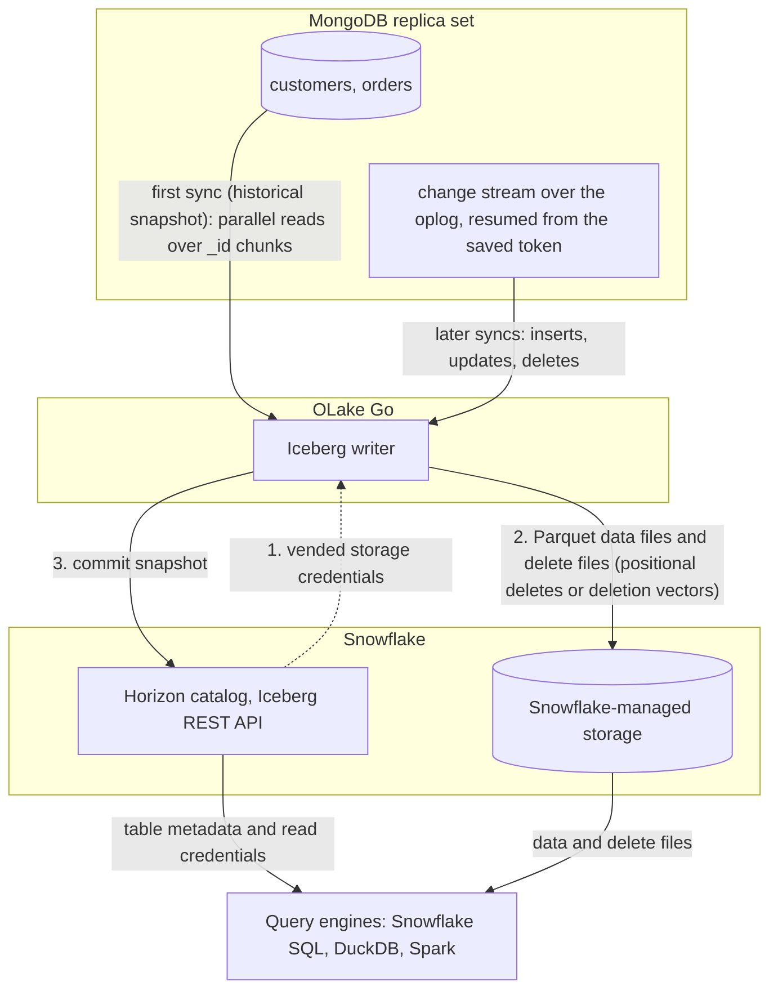

import * as I from '@site/src/components/integrations';

MongoDB to Snowflake comes down to one choice. Copy the documents into tables Snowflake owns, or write them once as Apache Iceberg tables that Snowflake and every other engine can read. This guide does the second.

OLake Go reads MongoDB changes through change streams and commits them as Iceberg tables into a catalog Snowflake reads, one column per top-level field. With Snowflake's own Horizon catalog, the default on this page, the files sit on Snowflake-managed storage. Nothing else is in the path: no Kafka, no Debezium, no Spark. With AWS Glue, the files sit in your S3 bucket and Snowflake reads them through a catalog integration.

<I.IntegrationByline />

<TLDR title='Key takeaways'>

- OLake Go replicates MongoDB collections into Snowflake as Iceberg tables: a full historical snapshot first, then change data capture (CDC) from a change stream, with no Kafka or Debezium in between.
- Through the Horizon catalog the tables land as Snowflake-managed Iceberg tables, flattened one level with a column per field. You query them in Snowsight right away, with no `CREATE ICEBERG TABLE`, no external volume and no refresh.
- The same tables, written once by OLake Go, are also queryable from DuckDB and Spark through the same catalog. In the run on this page all three engines returned identical rows.

</TLDR>

**The short answer.** To replicate MongoDB to Snowflake with change data capture (CDC), run OLake Go against a MongoDB replica set. Point it at the Snowflake Horizon catalog as the Iceberg destination. The first sync copies each collection in full (the historical snapshot); every later sync replays inserts, updates and deletes from the change stream. Snowflake, DuckDB and Spark then query the same Iceberg tables, with no second copy.

## How MongoDB CDC reaches Snowflake here



Two things happen in order, and OLake Go does both on its own. The first sync opens a change stream and keeps its resume token. It then reads each collection in parallel chunks, split on `_id`, and writes Parquet data files: that is the historical load. Every later sync resumes the change stream from the saved token and replays the inserts, updates and deletes since. Nothing written during the snapshot is lost, and there is no separate backfill job.

Each sync ends with one commit to Horizon. OLake Go asks Horizon for short-lived storage credentials, uploads the data and delete files, then posts the new snapshot to the catalog. Snowflake sees it the moment the commit lands; DuckDB and Spark see it on their next catalog load.

One thing to keep an eye on: the oplog is MongoDB's replay window. If the resume token has fallen out of the oplog by the time the next sync runs, OLake Go cannot resume and needs a fresh snapshot. The source test reports the window and warns below 7 days. The single-node container on this page had 1.3 hours: fine for a demo, not for production.

## What you need

- **MongoDB 4.0 or later running as a replica set**, self-hosted or on Atlas, with a user that can read the database and the oplog. The collections on this page ran on MongoDB 7 as a single-node replica set; step 1 covers Atlas too.
- **A Snowflake account** where you can run the one-time setup as `ACCOUNTADMIN`. Snowflake-managed storage means no cloud bucket or IAM role on your side.
- **OLake UI** from the [Docker Compose install](/docs/install/olake-ui/), with the OLake Go MongoDB source on v0.11 or later. The run on this page used v1.1.0.
- **Docker**, and about 30 minutes.

## Step 1: Prepare MongoDB for CDC

Most readers point OLake Go at collections they already have. If you want to follow along with the exact data from this page, create these two collections first:

<details>
<summary>The two sample collections used on this page</summary>

```javascript title="mongosh, database shop"
const now = new Date();
db.customers.insertMany([
  { _id: 1, name: 'Aarav Mehta', email: 'aarav@example.com', city: 'Mumbai', tier: 'gold', created_at: now, updated_at: now },
  // ... 8 customers with integer _id values
]);
db.orders.insertMany([
  { _id: 1, customer_id: 2, product: 'Headphones', amount: NumberDecimal('99.19'), status: 'shipped', created_at: now, updated_at: now },
  // ... 40 orders
]);
// Then insert whatever you like. This page started with 8 customers and 40 orders.
```

</details>

<I.Partial id="sources/mongodb/prereqs" />

## Step 2: Set up the catalog in Snowflake

Snowflake reads Iceberg tables from two kinds of catalog. **Horizon** is Snowflake's own: OLake Go writes straight into it, the tables are Snowflake-managed, and they appear in Snowsight the moment a sync commits. **AWS Glue** is a catalog outside Snowflake, so the files stay in your S3 bucket. Snowflake reaches them through a *catalog integration*: a read-only link to that external catalog, refreshed after each sync.

Horizon is the default on this page. Glue is the right pick when Athena, Redshift or Spark on Amazon Elastic MapReduce (EMR) will read the same tables. It keeps the files in your own bucket.

<I.CatalogStrip />

<I.CatalogTabs>
<TabItem value="horizon">

<I.Partial id="catalogs/horizon/setup" />

</TabItem>
<TabItem value="glue">

<I.Partial id="catalogs/glue/setup" />

</TabItem>
</I.CatalogTabs>

## Step 3: Connect MongoDB to OLake Go

<I.Partial id="sources/mongodb/connect">

Here is the source form from the run on this page. MongoDB ran in another container, so the host is `host.docker.internal:27017`; the replica set is `rs0` and the user is the one from step 1.

<Figure src='/img/docs/integrations/mongodb-to-snowflake/olake-source-mongodb-cdc.webp' alt='OLake UI Edit source form for MongoDB on OLake Go v1.1.0 with Enable CDC on, host host.docker.internal:27017, database shop, auth DB admin, user olake, replica set rs0 and read preference primary' caption='The MongoDB source in OLake UI: Enable CDC on, the replica set name and the user from step 1.' width='760px' />

**Set up source** runs the connection test, confirms that a change stream can be opened, and reports the oplog window before anything is saved. The run on this page got a warning here, because the single-node container keeps only 1.3 hours of oplog.

</I.Partial>

## Step 4: Configure the Iceberg destination

<I.CatalogTabs>
<TabItem value="horizon">

<I.Partial id="catalogs/horizon/writer" />

</TabItem>
<TabItem value="glue">

<I.Partial id="catalogs/glue/writer" />

</TabItem>
</I.CatalogTabs>

## Step 5: Create the job and run the first sync

<I.Partial id="jobs/create" engines="Snowflake, plus DuckDB and Apache Spark if they will read the tables too" upsert="Positional Deletes" updateType="pos" image="olakego/source-mongodb:latest">

Three target query engines were set on this job. That is the only format decision you make: OLake Go works out which Iceberg delete format all three can read and sets it on every stream.

<Figure src='/img/docs/integrations/mongodb-to-snowflake/olake-streams-positional-deletes.webp' alt='OLake UI Streams Selection page with the shop database, customers and orders selected, sync mode Full Refresh + CDC, ingestion mode Upsert and upsert type Positional Deletes on Iceberg format version V2' caption='Each stream: Full Refresh + CDC, Upsert, and the upsert type OLake Go resolved (Positional Deletes in this run). The Iceberg DB name at the top is editable.' />

<Figure src='/img/docs/integrations/mongodb-to-snowflake/olake-job-history-two-syncs.webp' alt='OLake UI Job Logs and History for mongodb_to_snowflake showing two completed syncs, the first in 30 seconds and the second in 15 seconds' caption='Job history: the 30 s historical snapshot, then the 15 s change-only sync.' />

</I.Partial>

On this page the first run copied 8 customers and 40 orders (48 documents) and finished in **30 seconds**, container start included. OLake Go names the destination schema after the job and the source database, so `mongodb_to_snowflake` on database `shop` produced `mongodb_to_snowflake_shop`. The **Iceberg DB** field at the top of the Streams page changes it before the first sync.

## Step 6: Query the tables in Snowflake

<I.CatalogTabs>
<TabItem value="horizon">

<I.Partial id="engines/snowflake/query-horizon" schema="mongodb_to_snowflake_shop" idCol="_id" />

One MongoDB-specific detail: the primary key column is `_id`, as in the documents, and OLake Go adds `_cdc_resume_token` next to its usual `_olake_id`, `_op_type`, `_olake_timestamp` and `_cdc_timestamp` columns.

<Figure src='/img/docs/integrations/mongodb-to-snowflake/snowsight-show-iceberg-tables.webp' alt='Snowsight SQL file running SHOW ICEBERG TABLES on the mongodb_to_snowflake_shop schema and listing customers and orders with owner OLAKE_ROLE, external volume SNOWFLAKE_MANAGED, catalog SNOWFLAKE and table type MANAGED' caption='SHOW ICEBERG TABLES in Snowsight: both collections are now Snowflake-managed Iceberg tables, created by OLAKE_ROLE through Horizon.' />

<Figure src='/img/docs/integrations/mongodb-to-snowflake/snowsight-customers-query.webp' alt='Snowsight query on OLAKE_DEMO.mongodb_to_snowflake_shop.customers returning 10 rows with _id, name, city and tier' caption='The customers collection in Snowsight after the change sync: 10 rows, one column per field.' />

</TabItem>
<TabItem value="glue">

<I.Partial id="engines/snowflake/query-glue" schema="mongodb_to_snowflake_shop" idCol="_id" />

</TabItem>
</I.CatalogTabs>

<I.Cta />

## Step 7: Change documents in MongoDB and sync again

To see the change path work, the run on this page made 12 changes in MongoDB after the first sync:

```javascript title="Changes made in MongoDB between the two syncs"
const now = new Date();
db.customers.insertMany([
  { _id: 9,  name: 'Maya Patel',  email: 'maya@example.com',  city: 'Pune',      tier: 'silver', created_at: now, updated_at: now },
  { _id: 10, name: 'Lucas Silva', email: 'lucas@example.com', city: 'São Paulo', tier: 'bronze', created_at: now, updated_at: now }
]);
db.orders.insertMany([
  { _id: 41, customer_id: 9,  product: 'Laptop',   amount: NumberDecimal('1299.00'), status: 'placed', created_at: now, updated_at: now },
  { _id: 42, customer_id: 9,  product: 'Mouse',    amount: NumberDecimal('25.50'),   status: 'placed', created_at: now, updated_at: now },
  { _id: 43, customer_id: 10, product: 'Monitor',  amount: NumberDecimal('349.99'),  status: 'placed', created_at: now, updated_at: now },
  { _id: 44, customer_id: 3,  product: 'Keyboard', amount: NumberDecimal('89.00'),   status: 'placed', created_at: now, updated_at: now },
  { _id: 45, customer_id: 7,  product: 'Webcam',   amount: NumberDecimal('79.90'),   status: 'placed', created_at: now, updated_at: now }
]);
db.customers.updateOne({ name: 'Liam Carter' }, { $set: { tier: 'gold', updated_at: now } });
db.customers.updateOne({ name: 'Zara Ali' },    { $set: { city: 'Abu Dhabi', updated_at: now } });
db.orders.updateMany({ _id: { $in: [1, 4, 7] } }, { $set: { status: 'delivered', updated_at: now } });
```

The second sync read **12 change events (1.60 KB)** from the stream and finished in **15 seconds** end to end. For `customers` that meant one new data file with 4 rows: 2 inserts plus the new versions of 2 updated documents. One small delete file retires the 2 old versions. OLake Go's commit report in the sync log shows it directly: `addedDataFiles=1`, `addedRecords=4`, `addedPositionalDeleteFiles=1`, `addedPositionalDeletes=2`, and `orders` the same shape with 8 rows and 3 deletes.

<Figure src='/img/docs/integrations/mongodb-to-snowflake/olake-sync-log-positional-delete-commit.webp' alt='OLake UI sync log filtered to the Iceberg commit reports for orders and customers, showing addedDataFiles 1, addedPositionalDeleteFiles 1, addedRecords 8 and 4, totalEqualityDeletes 0' caption='The change-only sync in the OLake UI log: one data file and one positional delete file per collection, zero equality deletes.' />

Snowflake shows the result with no refresh. Liam Carter is `gold`, Zara Ali moved to Abu Dhabi, and the two new customers are there. The `_op_type` column shows how each row arrived:

<Figure src='/img/docs/integrations/mongodb-to-snowflake/snowsight-customers-after-cdc.webp' alt='Snowsight query on customers after the CDC sync showing 10 rows with _op_type r for the snapshot rows, u for Liam Carter and Zara Ali, c for Maya Patel and Lucas Silva' caption='Snowsight after the change sync: the two updates (u), the two inserts (c) and the untouched snapshot rows (r).' />

**Schema changes.** MongoDB has no schema, so new fields show up whenever a document carries one. OLake Go adds a column for a new top-level field on the next sync, and Snowflake shows it; documents without the field hold `NULL` there. A field whose type changes between documents (a number in one, a string in another) is widened to `VARCHAR`. Full rules are on the [schema evolution page](/docs/features/schema/).

## Query the same tables from DuckDB and Spark

This is the point of writing Iceberg instead of loading Snowflake tables. Nothing is exported, copied or refreshed: both engines read the files OLake Go wrote, through the same Horizon endpoint, with credentials vended by Snowflake.

<Tabs groupId="engine" queryString="engine">
<TabItem value="duckdb" label="DuckDB" default>

<I.Partial id="engines/duckdb/connect-horizon" schema="mongodb_to_snowflake_shop" idCol="_id" />

<Figure src='/img/docs/integrations/mongodb-to-snowflake/duckdb-horizon-customers.webp' alt='DuckDB 1.5.5 shell querying horizon.mongodb_to_snowflake_shop.customers and returning the same 10 rows as Snowflake' caption='DuckDB 1.5.5 reading the Snowflake-managed table through Horizon: the same 10 rows.' />

</TabItem>
<TabItem value="spark" label="Apache Spark">

<I.Partial id="engines/spark/connect-horizon" schema="mongodb_to_snowflake_shop" idCol="_id" />

Spark 3.5.6 with Iceberg 1.10.0 returned the same 10 customers and the same `orders` roll-up as Snowflake and DuckDB in the run on this page.

</TabItem>
</Tabs>

An `orders` roll-up matched MongoDB to the cent in all three engines once `amount` was cast. 16 delivered orders for 8659.68, 18 placed for 10522.26, 11 shipped for 6397.25.

## Data types: MongoDB to Iceberg to Snowflake

OLake Go maps MongoDB's BSON (Binary JSON) types to Iceberg types, and Snowflake maps Iceberg types to its own. Scalars pass through; everything structured arrives as text.

| MongoDB type | Iceberg (written by OLake Go) | Snowflake shows | Notes |
| --- | --- | --- | --- |
| `int`, `timestamp` | `int` | `NUMBER(10,0)` | |
| `long` | `long` | `NUMBER(19,0)` | |
| `double` | `double` | `FLOAT` | |
| `boolean` | `boolean` | `BOOLEAN` | |
| `date` | `timestamptz` (UTC) | `TIMESTAMP_LTZ(6)` | |
| `decimal128` | `string` | `VARCHAR` | Money stored as `NumberDecimal` arrives as text. `SUM("amount"::NUMBER(10,2))` gives the exact total; the roll-up on this page used that cast. Store doubles in MongoDB if you want a numeric column without the cast. |
| `objectId`, `binData`, `regex`, `code` | `string` | `VARCHAR` | An `ObjectId` primary key arrives as its 24-character hex string. |
| `object`, `array` | `string` | `VARCHAR` | JSON text. Parse with `PARSE_JSON()` in Snowflake, or query `:field` paths after `PARSE_JSON`. |

MongoDB types in the table come from the [MongoDB connector reference](/docs/connectors/mongodb/#data-type-mapping); the Snowflake side from Snowflake's [Iceberg data types](https://docs.snowflake.com/en/user-guide/tables-iceberg-data-types) page (checked 2026-10-14).

## Cost and maintenance

- **Storage** is Snowflake's with `SNOWFLAKE_MANAGED`: you pay Snowflake storage rates for the Parquet and delete files. Point the database at your own external volume to keep the files in your bucket instead.
- **Compute.** OLake Go runs wherever you run Docker; it does not use a Snowflake warehouse to write. Snowflake compute is spent only when you query.
- **Maintenance.** Snowflake expires old snapshots and compacts manifests on Snowflake-managed tables at no cost. Automatic data-file compaction is bundled only when Snowflake alone writes the table ([Snowflake-managed Iceberg table maintenance](https://docs.snowflake.com/en/user-guide/tables-iceberg-manage)). A CDC table that gets a new small file every minute will want compaction from the writer side; [OLake Fusion](/docs/fusion/getting-started/overview/) does this for the catalogs OLake Go writes to, and Spark's `rewrite_data_files` works through the same Horizon endpoint.
- **Oplog window.** On Atlas, raise the minimum oplog window in the cluster settings if the job runs less often than once a day; on self-hosted, `replSetResizeOplog`.
- **Token rotation.** The programmatic access token expires (30 days in the setup above, 365 at most). Put the renewal on a calendar; an expired token fails the next sync at the catalog handshake, before any data moves.

## Troubleshooting

### 1. The source test warns about the oplog

```text
oplog_retention: current 1.3 hours, recommended >= 7 days
```

Not a blocker, but it is the window in which the next sync must start. The fix is on the MongoDB side: `replSetResizeOplog` on self-hosted, or the minimum oplog window setting on Atlas. Until then, run the job more often than the window.

### 2. The source test cannot open a change stream

```text
change_streams: OLake cannot open a change stream, so CDC cannot run.
```

Either `mongod` is not running with `--replSet`, or the user lacks oplog access. Check `rs.status()` on the server and give the OLake Go user `clusterMonitor` (or `readAnyDatabase`) in `admin` on top of `read` on the database.

### 3. Snowflake cannot find the table

```text
SQL compilation error:
Object 'OLAKE_DEMO.MONGODB_TO_SNOWFLAKE_SHOP.CUSTOMERS' does not exist or not authorized.
```

Snowflake upper-cased an unquoted identifier. OLake Go creates the schema and tables with their lowercase MongoDB names, so quote them: `OLAKE_DEMO."mongodb_to_snowflake_shop"."customers"`.

### 4. A money column sums to text

```text
Numeric value 'abc' is not recognized
```

`decimal128` fields land as `VARCHAR`. Cast them in the query (`"amount"::NUMBER(12,2)`), or store the value as a `double` in MongoDB. A row with a non-numeric string in that field breaks the cast; find it with `TRY_TO_NUMBER("amount") IS NULL`.

### 5. The destination test fails at the catalog handshake

OLake Go's destination test exchanges the token at `/v1/oauth/tokens` before anything else. Three causes cover nearly every failure: a service user without a network or authentication policy, a `scope` that does not match the token's `ROLE_RESTRICTION`, or an expired token. Run the `curl` exchange from the catalog setup; it returns the same error Snowflake gives OLake Go.

<details>
<summary>How this compares with other ways to move MongoDB data to Snowflake</summary>

| Method | Freshness | Updates and deletes | Where the data lands | What you run |
| --- | --- | --- | --- | --- |
| [Snowflake Openflow connector for MongoDB](https://docs.snowflake.com/en/user-guide/data-integration/openflow/connectors/mongodb/about) | CDC through change streams | Yes | Native Snowflake tables, documents as VARIANT; Snowflake is the only reader | An Openflow deployment in Snowpark Container Services or your own AWS account, billed in Snowflake credits |
| Debezium, Kafka and the Snowflake Kafka connector | Seconds | Yes, with the connector's tombstone handling | Kafka topics, then Snowflake tables | Kafka, Kafka Connect, Debezium and a schema registry |
| Managed ELT (Fivetran, Estuary, Airbyte Cloud) | Minutes, by plan | Yes | Snowflake tables, a second copy you pay to move and store | Nothing; priced per row, per GB or per connector |
| Manual export (`mongoexport` to JSON, then `COPY INTO` a VARIANT column) | Hours to daily | No; full reloads only | Files you control | A script and a scheduler |
| **OLake Go to Iceberg on Horizon (this guide)** | CDC on a schedule down to one minute | Yes, as Iceberg row-level deletes | Apache Iceberg tables that Snowflake, DuckDB, Spark and Trino all read | One Docker Compose stack, open source; Snowflake storage plus your own compute |

Openflow is the simpler choice when Snowflake is the only reader and you want Snowflake to run the pipeline. Writing Iceberg once avoids paying to move and store a second copy as soon as another engine needs the same rows, or you want to own the files.

</details>

## When not to use this

- **Your Snowflake account is on Azure and DuckDB is a reader.** DuckDB attaches REST catalogs backed by S3, S3 Tables and Google Cloud Storage only, so pick Spark or Trino as the second engine there.
- **You need the documents kept whole.** OLake Go flattens one level; deeply nested documents arrive as JSON text in one column. If every query starts with `PARSE_JSON`, a VARIANT landing table in Snowflake may serve you better.

## FAQs

<I.IntegrationFaq />

<I.HowWeTested />

## Related guides

<I.RelatedIntegrations />

Deeper reading on this site:

- [MongoDB and Atlas CDC setup](/docs/connectors/mongodb/cdc_setup)
- [Equality vs positional deletes vs deletion vectors](/blog/iceberg-delete-formats-cdc-equality-vs-positional-vs-deletion-vectors/)
- [Which engines read which delete formats](/blog/iceberg-delete-formats-interoperability-olake-go/)
- [OLake Go ingestion benchmarks](/docs/benchmarks/ingestion/)

<I.IntegrationJsonLd />

<I.Cta title='Start with your own MongoDB' body='The quickstart runs OLake UI with Docker Compose. Create the source, the Horizon destination and the job as above, and the first sync lands your collections in Snowflake.' />
