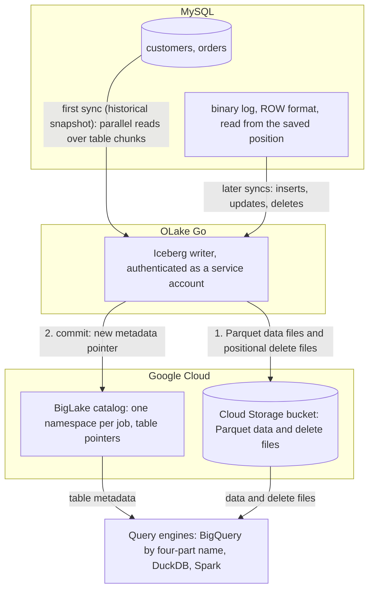

import * as I from '@site/src/components/integrations';

MySQL to BigQuery usually means a Datastream stream, Debezium through Kafka, or a nightly `mysqldump` and `bq load`. This guide takes a fourth route. OLake Go reads the MySQL binary log and commits the changes as Apache Iceberg tables into a BigLake catalog, Google Cloud's Iceberg representational state transfer (REST) catalog, with the files in your own Cloud Storage bucket.

BigQuery queries the tables through the catalog with a four-part name, with no dataset to create and no external table to declare. Nothing else is in the path: no Datastream, no Kafka, no load job. DuckDB and Spark read the same tables through the same catalog.

<I.IntegrationByline />

<TLDR title='Key takeaways'>

- OLake Go replicates MySQL into Iceberg tables in a BigLake catalog: a full historical snapshot first, then change data capture (CDC) from the binlog, with no Datastream or Debezium in between.
- BigQuery reads the catalog as a data source. Every change a sync commits is visible on the next `SELECT`, with no refresh and no load job.
- The same tables, written once by OLake Go, are also queryable from DuckDB and Spark. In the run on this page all three engines returned identical rows.

</TLDR>

**The short answer.** To replicate MySQL to BigQuery with change data capture (CDC), run OLake Go with a MySQL replication user as the source and a BigLake catalog with a Cloud Storage bucket as the Iceberg destination, with BigQuery as the target query engine. The first sync copies each table in full (the historical snapshot); every later sync replays inserts, updates and deletes from the binlog. BigQuery, DuckDB and Spark then query the same Iceberg tables, with no second copy.

## How MySQL CDC reaches BigQuery here



Two things happen in order, and OLake Go does both on its own. The first sync records the current binlog position. Then it reads each table in parallel chunks and writes Parquet data files: that is the historical load. Every later sync opens the binlog at the saved position and replays the inserts, updates and deletes since. Nothing written during the snapshot is lost, and there is no separate backfill job.

Each sync ends with one commit to BigLake. OLake Go uploads the data and delete files to the bucket with the service account's own credentials, then updates the table's metadata pointer in the catalog. BigQuery, DuckDB and Spark see the new snapshot on their next query; none of them keeps a copy.

One thing to keep an eye on: the binlog is MySQL's replay window. MySQL deletes binlog files after `binlog_expire_logs_seconds`. A job paused for longer than that cannot resume and needs a fresh snapshot. Keep retention longer than your longest planned pause, and alert on `SHOW BINARY LOGS` size if disk is tight.

## What you need

- **MySQL 8.0 or later** with the binlog on in `ROW` format and a user that can read it. The tables on this page ran on MySQL 8.4 in Docker. Hosted MySQL on Google Cloud SQL, Amazon RDS, Aurora or Azure works the same way; step 1 links the setup guides.
- **A Google Cloud project** with the BigLake API enabled, a Cloud Storage bucket for the files, and a service account for OLake Go with the BigLake Editor role on the project and Storage Object User on the bucket. The run on this page used a bucket in `us-central1`.
- **BigQuery** in the same project. Queries run in the bucket's region, and the account running them needs the BigQuery Job User role plus read access to the catalog.
- **OLake UI** from the [Docker Compose install](/docs/install/olake-ui/). The run on this page used OLake Go v1.1.0.
- **Docker**, and about 30 minutes.

## Step 1: Prepare MySQL for CDC

Most readers point OLake Go at tables they already have. If you want to follow along with the exact data from this page, create these two tables first:

<details>
<summary>The two sample tables used on this page</summary>

```sql title="Sample schema"
CREATE TABLE customers (
  id INT AUTO_INCREMENT PRIMARY KEY,
  name VARCHAR(100), email VARCHAR(200), city VARCHAR(100), tier VARCHAR(20),
  created_at TIMESTAMP DEFAULT CURRENT_TIMESTAMP,
  updated_at TIMESTAMP DEFAULT CURRENT_TIMESTAMP ON UPDATE CURRENT_TIMESTAMP);

CREATE TABLE orders (
  id INT AUTO_INCREMENT PRIMARY KEY,
  customer_id INT, product VARCHAR(100), amount DECIMAL(10,2), status VARCHAR(20),
  created_at TIMESTAMP DEFAULT CURRENT_TIMESTAMP,
  updated_at TIMESTAMP DEFAULT CURRENT_TIMESTAMP ON UPDATE CURRENT_TIMESTAMP,
  FOREIGN KEY (customer_id) REFERENCES customers(id));

-- Then insert whatever you like. This page started with 8 customers and 40 orders.
```

</details>

<I.Partial id="sources/mysql/prereqs" tables="customers, orders" />

## Step 2: Set up the BigLake catalog

BigQuery reads Iceberg tables through a catalog. **BigLake** is the one this page uses: it is Google Cloud's Iceberg REST catalog, OLake Go creates a namespace per job in it, and the files sit in your Cloud Storage bucket. BigQuery, DuckDB and Spark all read from the same catalog. BigQuery treats it as a data source in the project, so a table OLake Go commits is queryable on the next statement.

<I.CatalogStrip />

<I.CatalogTabs>
<TabItem value="biglake">

<I.Partial id="catalogs/biglake/setup" />

<Figure src='/img/docs/integrations/mysql-to-bigquery/gcp-service-account-key-json.webp' alt='Google Cloud console Create private key dialog for the OLake service account with the JSON key type selected' caption='The JSON key for the service account. The console downloads it once; its contents go into the OLake Go destination form.' />

</TabItem>
</I.CatalogTabs>

## Step 3: Connect MySQL to OLake Go

<I.Partial id="sources/mysql/connect">

Here is the source form from the run on this page. MySQL ran in another container, so the host is `host.docker.internal`; the user is the replication user from step 1.

<Figure src='/img/docs/integrations/mysql-to-bigquery/olake-source-mysql-cdc.webp' alt='OLake UI Edit source form for MySQL on OLake Go v1.1.0 with Enable CDC on, initial wait time 10, host host.docker.internal, database shop, user olake and SSL disabled' caption='The MySQL source in OLake UI: Enable CDC on, with the replication user from step 1.' width='760px' />

**Set up source** runs the connection test and the binlog checks (`binlog_access`, `log_bin`, `binlog_format`, `binlog_row_metadata`) before anything is saved. When one fails, the dialog names the setting and its recommended value.

</I.Partial>

## Step 4: Configure the Iceberg destination

<I.CatalogTabs>
<TabItem value="biglake">

<I.Partial id="catalogs/biglake/writer">

Here is the destination form from the run on this page. It holds the BigLake endpoint, the bucket as the catalog path, the service account JSON and the project ID.

<Figure src='/img/docs/integrations/mysql-to-bigquery/olake-destination-biglake.webp' alt='OLake UI Edit destination form for Apache Iceberg with catalog type Big Lake, REST catalog URI https://biglake.googleapis.com/iceberg/v1/restcatalog, BigLake catalog path gs://olake-x2y-lab-bq, authentication type GCP and the project ID oauth-361809' caption='The BigLake destination in OLake UI: the endpoint, the bucket as catalog path, GCP authentication and the project ID.' width='760px' />

</I.Partial>

</TabItem>
</I.CatalogTabs>

## Step 5: Create the job and run the first sync

This job lists **BigQuery**, **Spark** and **DuckDB** as target query engines. OLake Go then offers only the delete formats all three read, and the run on this page picked **Positional Deletes** from that list. Each stream runs as **Full Refresh + CDC**, so the binlog carries every change after the snapshot.

<I.Partial id="jobs/create" engines="Google BigQuery, Apache Spark and DuckDB" upsert="Positional Deletes" updateType="pos" image="olakego/source-mysql:latest" namespace="shop">

OLake Go offers every delete format BigQuery, Spark and DuckDB all read: equality and positional deletes. Deletion vectors are not in the list because BigQuery reads them only in preview.

<Figure src='/img/docs/integrations/mysql-to-bigquery/olake-streams-positional-deletes.webp' alt='OLake UI Streams Selection page with the shop database, customers and orders selected, sync mode Full Refresh + CDC, ingestion mode Upsert and upsert type Positional Deletes on Iceberg format version V2' caption='Each stream: Full Refresh + CDC, Upsert, and Positional Deletes as the upsert type. The Iceberg DB name at the top is editable.' />

<Figure src='/img/docs/integrations/mysql-to-bigquery/olake-job-history-two-syncs.webp' alt='OLake UI Job Logs and History for mysql_to_bigquery showing two completed syncs, the first in 37 seconds and the second in 55 seconds' caption='Job history: the 37 s historical snapshot, then the 55 s change-only sync.' />

</I.Partial>

On this page the first run copied 8 customers and 40 orders (48 records, 2.10 KB) and finished in **37 seconds**, container start included. OLake Go names the BigLake namespace after the job and the source database, so `mysql_to_bigquery` on database `shop` produced `mysql_to_bigquery_shop`. The **Iceberg DB** field at the top of the Streams page changes it before the first sync.

## Step 6: Query the tables in BigQuery

<I.CatalogTabs>
<TabItem value="biglake">

<I.Partial id="engines/bigquery/query-biglake" schema="mysql_to_bigquery_shop" />

<Figure src='/img/docs/integrations/mysql-to-bigquery/bigquery-biglake-customers.webp' alt='BigQuery SQL editor in the Google Cloud console running the customers query on the olake-x2y-lab-bq catalog and returning 10 rows with id, name, city and tier' caption='BigQuery reading the customers table through the BigLake catalog after the change sync: 10 rows, one per key.' />

</TabItem>
</I.CatalogTabs>

<I.Cta />

## Step 7: Change rows in MySQL and sync again

To see the change path work, the run on this page made 12 changes in MySQL after the first sync:

```sql title="Changes made in MySQL between the two syncs"
INSERT INTO customers (name, email, city, tier) VALUES
  ('Maya Patel', 'maya@example.com', 'Pune', 'silver'),
  ('Lucas Silva', 'lucas@example.com', 'São Paulo', 'bronze');
INSERT INTO orders (customer_id, product, amount, status) VALUES
  (9, 'Laptop', 1299.00, 'placed'), (9, 'Mouse', 25.50, 'placed'),
  (10, 'Monitor', 349.99, 'placed'), (3, 'Keyboard', 89.00, 'placed'), (7, 'Webcam', 79.90, 'placed');
UPDATE customers SET tier = 'gold'      WHERE name = 'Liam Carter';
UPDATE customers SET city = 'Abu Dhabi' WHERE name = 'Zara Ali';
UPDATE orders    SET status = 'delivered' WHERE id IN (1, 4, 7);
```

The second sync read **12 records (563 bytes)** from the binlog and finished in **55 seconds** end to end. For `customers` that meant one new data file with 4 rows: 2 inserts plus the new versions of 2 updated rows. One small positional delete file retires the 2 old versions. OLake Go's commit report in the sync log shows it directly: `addedDataFiles=1`, `addedRecords=4`, `addedPositionalDeleteFiles=1`, `addedPositionalDeletes=2`. The `orders` table has the same shape with 8 rows and 3 deletes.

<Figure src='/img/docs/integrations/mysql-to-bigquery/olake-sync-log-positional-delete-commit.webp' alt='OLake UI sync log filtered to the Iceberg commit report, showing addedDataFiles 1, addedPositionalDeleteFiles 1, addedRecords and addedPositionalDeletes for the change-only sync' caption='The change-only sync in the OLake UI log: one data file and one positional delete file per table.' />

BigQuery shows the result on the next query, with no refresh and no `ALTER TABLE`. Liam Carter is `gold`, Zara Ali moved to Abu Dhabi, and the two new customers are there. The two retired versions are gone, because BigQuery applies the positional deletes while reading. The `_op_type` column shows how each row arrived: `r` for the snapshot, `c` for the inserts and `u` for the updates.

**Schema changes.** When a column is added in MySQL, OLake Go adds it to the Iceberg table on the next sync and commits the new schema to BigLake in the same commit. BigQuery shows the column on the next query. Widening changes (`int` to `bigint`, `float` to `double`) are applied. Narrowing or incompatible type changes fail the sync rather than corrupt the table. `binlog_row_metadata = FULL` is what lets OLake Go see the new column names in the binlog. Full rules are on the [schema evolution page](/docs/features/schema/).

## Query the same tables from DuckDB and Spark

This is the point of writing Iceberg instead of loading BigQuery tables. Nothing is exported, copied or refreshed: both engines read the files OLake Go wrote, through the same BigLake catalog.

<Tabs groupId="engine" queryString="engine">
<TabItem value="duckdb" label="DuckDB" default>

<I.Partial id="engines/duckdb/connect-biglake" schema="mysql_to_bigquery_shop" />

<Figure src='/img/docs/integrations/mysql-to-bigquery/gcp-hmac-key-service-account.webp' alt='Google Cloud console Cloud Storage Interoperability settings with the Select a service account dialog, the OLake service account selected and the Create key button' caption='The key for DuckDB: Cloud Storage, Settings, Interoperability, then a key for the same service account OLake Go uses.' />

DuckDB 1.5.5 returned the same 10 customers and the same `orders` roll-up as BigQuery in the run on this page. It read the current metadata file of each table through the catalog and the data files through the hash-based message authentication code (HMAC) key.

</TabItem>
<TabItem value="spark" label="Apache Spark">

<I.Partial id="engines/spark/connect-biglake" schema="mysql_to_bigquery_shop" />

Spark 4.0.1 with Iceberg 1.10.0 returned the same rows in the run on this page, running on a laptop against the same catalog and bucket.

</TabItem>
</Tabs>

An `orders` roll-up matched MySQL to the cent in all three engines. It gave 16 delivered orders for 8659.68, 18 placed for 10522.26, 11 shipped for 6397.25.

## Data types: MySQL to Iceberg to BigQuery

OLake Go maps MySQL types to Iceberg types, and BigQuery maps Iceberg types to its own when it reads the catalog. Most columns pass through unchanged; three groups are worth knowing about.

| MySQL | Iceberg (written by OLake Go) | BigQuery shows | Notes |
| --- | --- | --- | --- |
| `int`, `mediumint`, `smallint`, `tinyint` (signed or unsigned) | `int` | `INT64` | The `id` and `customer_id` columns on this page arrived as `INT64`. |
| `bigint`, `bigint unsigned` | `long` | `INT64` | |
| `decimal(p,s)`, `float`, `double` | `double` | `FLOAT64` | OLake Go stores decimals as doubles. The `orders.amount` sums on this page matched MySQL to the cent in every engine; round at query time when you need exact decimal arithmetic. |
| `datetime`, `timestamp` | `timestamptz` (UTC) | `TIMESTAMP` | `datetime` has no zone in MySQL; it is read as UTC. |
| `char`, `varchar`, `text` family, `enum`, `json`, `time`, `bit(1)` | `string` | `STRING` | Parse `json` with `PARSE_JSON` or `JSON_VALUE`. `time` arrives as text. |
| `binary(n)`, `varbinary`, `blob` family | `fixed[n]` or `binary` | `BYTES` | Keep large binaries out of the sync. |

MySQL types in the table come from the [MySQL connector reference](/docs/connectors/mysql/#data-type-mapping). The BigQuery side comes from the [BigQuery Iceberg tables page](https://docs.cloud.google.com/bigquery/docs/iceberg-external-tables) (checked 2026-10-30) and from the table schemas of this run.

## Cost and maintenance

- **Storage** is your bucket: you pay Cloud Storage rates for the Parquet and delete files. The BigLake catalog itself has no per-table charge.
- **Compute.** OLake Go runs wherever you run Docker. BigQuery bills on-demand queries by bytes scanned, or by slot time on an edition; a query over the catalog reads the Parquet files in the bucket, so filter on the columns you need. DuckDB and Spark cost whatever machine they run on.
- **Maintenance.** A CDC table that gets a new small file and delete file per sync wants compaction, and BigLake keeps every snapshot OLake Go commits in the table's `metadata.json`. BigLake rejects a `metadata.json` above 1 MB, which a busy table reaches after a few thousand syncs. Expire old snapshots and compact on a schedule with [OLake Fusion](/docs/fusion/getting-started/overview/) or with Spark's `expire_snapshots` and `rewrite_data_files` procedures through the same catalog.
- **Binlog disk.** Seven days of binlog on a busy server can be tens of gigabytes. Size the volume for it, or shorten retention once the job runs reliably every hour.
- **Key rotation.** The service account key is what OLake Go writes with. Rotate it on your schedule from the service account's **Keys** tab and paste the new JSON into the destination.

## Troubleshooting

### 1. The first sync stops with a statistics error

```text
failed to get or split chunks: stats not populated for table[shop.orders]. Please run ANALYZE TABLE to update table statistics
```

OLake Go plans the parallel snapshot from `information_schema` row estimates. A freshly created or freshly loaded table has none. Run `ANALYZE TABLE <table>;` for each table in the job, then sync again.

### 2. The source test fails on the binlog

```text
binlog_format: current STATEMENT, recommended ROW
```

The test dialog names the setting. `binlog_format` and `binlog_row_metadata` can be changed at runtime with `SET GLOBAL`. Put them in `my.cnf` (or the instance flags) too, or they revert on restart. `log_bin` itself needs a restart.

### 3. The next sync cannot find its binlog position

```text
idle timeout reached, exiting binlog syncer
```

Two causes. If `binlog_expire_logs_seconds` already removed the saved binlog file, run a fresh full snapshot and lengthen retention. If the file exists but the server is slow to seek to the position, raise **Initial Wait Time** on the source. 10 seconds was enough for the two-table database on this page.

### 4. The destination test fails on a catalog in vended-credentials mode

```text
failed to test destination: failed to create or get table: rpc error: code = Internal desc = Failed to process request: Malformed request: X-Iceberg-Access-Delegation header must be present and contain `vended-credentials` when credential mode is `CREDENTIAL_MODE_VENDED_CREDENTIALS`.
```

The catalog was created, or switched, with `--credential-mode=vended-credentials`, and OLake Go 1.1.0 does not send the header BigLake wants in that mode ([olake#1369](https://github.com/datazip-inc/olake/issues/1369)). Switch the catalog back with `gcloud beta biglake iceberg catalogs update <bucket> --credential-mode=end-user`, which is the default for a catalog OLake Go created itself. With the CLI, `"rest_access_delegation": "vended-credentials"` in `destination.json` makes the same test pass; the UI has no field for it yet.

### 5. BigQuery cannot find the dataset

```text
Not found: Dataset <project>:<bucket>.mysql_to_bigquery_shop was not found in location US
```

The query ran in a location other than the bucket's region. Set the query location to the bucket's region in the editor's **More**, **Query settings** panel, or pass `--location=<region>` to `bq`. Leaving the location unset lets BigQuery pick it from the table.

<details>
<summary>How this compares with other ways to move MySQL data to BigQuery</summary>

| Method | Freshness | Updates and deletes | Where the data lands | What you run |
| --- | --- | --- | --- | --- |
| [Datastream for MySQL](https://docs.cloud.google.com/datastream/docs/overview) | Near real time, by Google's description; CDC from the binlog | Yes | Native BigQuery datasets; BigQuery is the only reader | Nothing to run; a connection profile and a stream in the console |
| Debezium, Kafka and a BigQuery sink | Seconds | Yes, with the connector's upsert mode | Kafka topics, then BigQuery tables | Kafka, Kafka Connect, Debezium and a sink connector per table |
| Export (`mysqldump` or `SELECT INTO OUTFILE`), then `bq load` | Hours to daily | No; full reloads only | Native BigQuery tables | A script, a scheduler and a staging bucket |
| Managed ELT (Fivetran, Estuary, Airbyte Cloud) | Minutes, by plan | Varies by tool | BigQuery tables, a second copy you pay to move and store | Nothing; priced per row, per GB or per connector |
| **OLake Go to Iceberg on BigLake (this guide)** | CDC on a schedule down to one minute | Yes, as Iceberg row-level deletes | Apache Iceberg tables that BigQuery, Spark, DuckDB, Trino and Flink all read | One Docker Compose stack, open source; your bucket plus your own compute |

Datastream is the simpler choice when BigQuery is the only reader and a managed Google service is the preference. Writing Iceberg once avoids paying to move and store a second copy. That matters as soon as Spark, DuckDB or a notebook needs the same rows, or you want to own the files.

</details>

## When not to use this

- **Every query must hit native BigQuery speed.** A catalog table is read from Parquet in the bucket on every query. Keep the Iceberg tables as the source and load the hot slice into a native table on a schedule.
- **Tables have no primary key.** Inserts replicate; updates and deletes cannot be matched to a row and are not applied. Add a primary key or a unique index first.
- **You want deletion vectors.** BigQuery reads them only in preview, with a cap of 100,000 deletion vector entries per query. Keep the job on positional deletes while BigQuery is a reader.

## FAQs

<I.IntegrationFaq />

<I.HowWeTested />

## Related guides

<I.RelatedIntegrations />

Deeper reading on this site:

- [Equality vs positional deletes vs deletion vectors](/blog/iceberg-delete-formats-cdc-equality-vs-positional-vs-deletion-vectors/)
- [Which engines read which delete formats](/blog/iceberg-delete-formats-interoperability-olake-go/)
- [OLake Go ingestion benchmarks](/docs/benchmarks/ingestion/)

<I.IntegrationJsonLd />

<I.Cta title='Start with your own MySQL' body='The quickstart runs OLake UI with Docker Compose. Create the source, the BigLake destination and the job as above, and the first sync lands your tables where BigQuery can read them.' />
