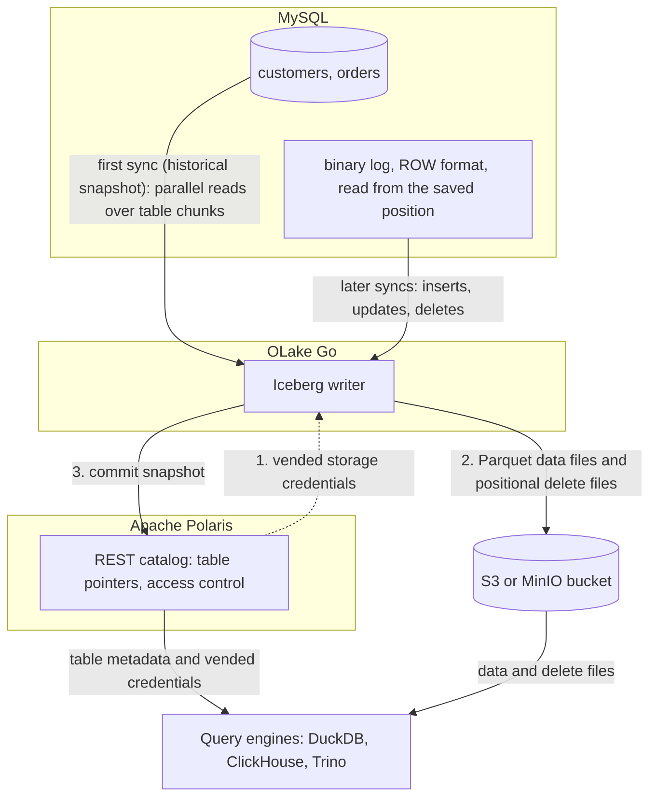

import * as I from '@site/src/components/integrations';

MySQL to DuckDB usually means an export, a CSV or Parquet drop, and a DuckDB file somebody rebuilds. This guide takes a different route.

OLake Go reads the MySQL binary log and commits the changes as Apache Iceberg tables into an Apache Polaris catalog. DuckDB attaches that catalog and queries the tables in place.

Polaris is an open source Iceberg REST (Representational State Transfer) catalog you run yourself, with the files in your own bucket. Nothing else is in the path: no Kafka, no Debezium, no DuckDB file to copy around. ClickHouse and Trino read the same tables through the same endpoint.

<I.IntegrationByline />

<TLDR title='Key takeaways'>

- OLake Go replicates MySQL into Iceberg tables in Polaris: a full historical snapshot first, then change data capture (CDC) from the binlog, with no Kafka or Debezium in between.
- DuckDB attaches the whole Polaris catalog with one `ATTACH`, lists every table OLake Go committed, and sees every change the moment a sync commits. Every session reads the same tables, on a laptop or in a job.
- The same tables, written once by OLake Go, are also queryable from ClickHouse and Trino through the same catalog. In the run on this page all three engines returned identical rows.

</TLDR>

**The short answer.** To replicate MySQL to DuckDB with change data capture (CDC), run OLake Go with MySQL's binary log as the source. Point it at an Apache Polaris catalog as the Iceberg destination.

The first sync copies each table in full (the historical snapshot); every later sync replays inserts, updates and deletes from the binlog. DuckDB, ClickHouse and Trino then query the same Iceberg tables, with no second copy.

## How MySQL CDC reaches DuckDB here



Two things happen in order, and OLake Go does both on its own. The first sync records the current binlog position. Then it reads each table in parallel chunks and writes Parquet data files: that is the historical load.

Every later sync opens the binlog at the saved position and replays the inserts, updates and deletes since. Nothing written during the snapshot is lost, and there is no separate backfill job.

Each sync ends with one commit to Polaris. OLake Go asks Polaris for short-lived storage credentials, uploads the data and delete files, then posts the new snapshot to the catalog. DuckDB, ClickHouse and Trino see it on their next query; none of them keeps a copy.

One thing to keep an eye on: the binlog is MySQL's replay window. MySQL deletes binlog files after `binlog_expire_logs_seconds`.

A job paused for longer than that cannot resume and needs a fresh snapshot. Keep retention longer than your longest planned pause, and alert on `SHOW BINARY LOGS` size if disk is tight.

## What you need

- **MySQL 8.0 or later** with the binlog on in `ROW` format and a user that can read it. The tables on this page ran on MySQL 8.4. Hosted MySQL on Amazon Relational Database Service (RDS), Aurora, Google Cloud SQL or Azure works the same way; step 1 links the setup guides.
- **An Apache Polaris server and a bucket**, both reachable from OLake Go and from wherever DuckDB runs. The run on this page used Polaris 1.8.0 and MinIO in Docker; on AWS, use an S3 bucket and an IAM role instead.
- **DuckDB 1.4 or later** with the `iceberg` and `httpfs` extensions, which DuckDB installs on first use. The run on this page used DuckDB 1.5.5.
- **OLake UI** from the [Docker Compose install](/docs/install/olake-ui/). The run on this page used OLake Go v1.1.0.
- **Docker**, and about 40 minutes.

## Step 1: Prepare MySQL for CDC

Most readers point OLake Go at tables they already have. If you want to follow along with the exact data from this page, create these two tables first:

<details>
<summary>The two sample tables used on this page</summary>

```sql title="Sample schema"
CREATE TABLE customers (
  id INT AUTO_INCREMENT PRIMARY KEY,
  name VARCHAR(100), email VARCHAR(200), city VARCHAR(100), tier VARCHAR(20),
  created_at TIMESTAMP DEFAULT CURRENT_TIMESTAMP,
  updated_at TIMESTAMP DEFAULT CURRENT_TIMESTAMP ON UPDATE CURRENT_TIMESTAMP);

CREATE TABLE orders (
  id INT AUTO_INCREMENT PRIMARY KEY,
  customer_id INT, product VARCHAR(100), amount DECIMAL(10,2), status VARCHAR(20),
  created_at TIMESTAMP DEFAULT CURRENT_TIMESTAMP,
  updated_at TIMESTAMP DEFAULT CURRENT_TIMESTAMP ON UPDATE CURRENT_TIMESTAMP,
  FOREIGN KEY (customer_id) REFERENCES customers(id));

-- Then insert whatever you like. This page started with 8 customers and 40 orders.
```

</details>

<I.Partial id="sources/mysql/prereqs" tables="customers, orders" />

## Step 2: Set up the Polaris catalog

DuckDB reads Iceberg tables through a catalog. **Apache Polaris** is the one this page uses: an open source REST catalog that you run next to your bucket.

OLake Go writes into it, and DuckDB, ClickHouse and Trino read from it with the credentials Polaris hands out. The Iceberg files sit in your own S3 or MinIO bucket; Polaris holds only the pointers and the permissions.

<I.CatalogStrip />

<I.CatalogTabs>
<TabItem value="polaris">

<I.Partial id="catalogs/polaris/setup" />

</TabItem>
</I.CatalogTabs>

## Step 3: Connect MySQL to OLake Go

<I.Partial id="sources/mysql/connect">

Here is the source form from the run on this page. MySQL ran in another container, so the host is `host.docker.internal`; the user is the replication user from step 1.

<Figure src='/img/docs/integrations/mysql-to-duckdb/olake-source-mysql-cdc.webp' alt='OLake UI Edit source form for MySQL on OLake Go v1.1.0 with Enable CDC on, initial wait time 10, host host.docker.internal, database shop, user olake and SSL disabled' caption='The MySQL source in OLake UI: Enable CDC on, with the replication user from step 1.' width='760px' />

**Set up source** runs the connection test and the binlog checks (`binlog_access`, `log_bin`, `binlog_format`, `binlog_row_metadata`) before anything is saved. When one fails, the dialog names the setting and its recommended value.

</I.Partial>

## Step 4: Configure the Iceberg destination

<I.CatalogTabs>
<TabItem value="polaris">

<I.Partial id="catalogs/polaris/writer">

Here is the destination form from the run on this page. Polaris and MinIO ran in other containers, so both addresses use `host.docker.internal`; the credential is the `olake` principal from step 2.

<Figure src='/img/docs/integrations/mysql-to-duckdb/olake-destination-polaris.webp' alt='OLake UI Edit destination form for Apache Iceberg with catalog type Polaris, authentication type OAuth2, REST catalog URI http://host.docker.internal:8181/api/catalog, Polaris catalog name olake, S3 endpoint http://host.docker.internal:9000, REST scope PRINCIPAL_ROLE:ALL and region us-east-1' caption='The Polaris destination in OLake UI: OAuth2 with the principal from step 2, and the MinIO endpoint for the files.' width='760px' />

</I.Partial>

</TabItem>
</I.CatalogTabs>

## Step 5: Create the job and run the first sync

<I.Partial id="jobs/create" engines="DuckDB, plus Trino if it will read the tables too" upsert="Positional Deletes" updateType="pos" image="olakego/source-mysql:latest" namespace="shop">

Two target query engines were set on this job, DuckDB and Trino. OLake Go offers every delete format both can read; the run on this page picked **Positional Deletes**, the format DuckDB documents, from that list. Positional deletes keep a small index between runs, which OLake UI stores for you.

<Figure src='/img/docs/integrations/mysql-to-duckdb/olake-streams-positional-deletes.webp' alt='OLake UI Streams Selection page with the shop database, customers and orders selected, sync mode Full Refresh + CDC, ingestion mode Upsert and upsert type Positional Deletes on Iceberg format version V2' caption='Each stream: Full Refresh + CDC, Upsert, and Positional Deletes as the upsert type. The Iceberg DB name at the top is editable.' />

<Figure src='/img/docs/integrations/mysql-to-duckdb/olake-job-history-two-syncs.webp' alt='OLake UI Job Logs and History for mysql_to_duckdb showing two completed syncs, the first in 17 seconds and the second in 9 seconds' caption='Job history: the 17 s historical snapshot, then the 9 s change-only sync.' />

</I.Partial>

On this page the first run copied 8 customers and 40 orders (48 records, 2.10 KB) and finished in **17 seconds**, container start included. OLake Go names the destination namespace after the job and the source database, so `mysql_to_duckdb` on database `shop` produced `mysql_to_duckdb_shop`. The **Iceberg DB** field at the top of the Streams page changes it before the first sync.

## Step 6: Query the tables in DuckDB

<I.CatalogTabs>
<TabItem value="polaris">

<I.Partial id="engines/duckdb/query-polaris" schema="mysql_to_duckdb_shop" />

<Figure src='/img/docs/integrations/mysql-to-duckdb/duckdb-polaris-customers.webp' alt='DuckDB 1.5.5 shell querying polaris.mysql_to_duckdb_shop.customers through the attached Polaris catalog and returning 10 rows with id, name, city and tier' caption='DuckDB 1.5.5 reading the customers table through Polaris after the change sync: 10 rows, one per key.' />

</TabItem>
</I.CatalogTabs>

<I.Cta />

## Step 7: Change rows in MySQL and sync again

To see the change path work, the run on this page made 12 changes in MySQL after the first sync:

```sql title="Changes made in MySQL between the two syncs"
INSERT INTO customers (name, email, city, tier) VALUES
  ('Maya Patel', 'maya@example.com', 'Pune', 'silver'),
  ('Lucas Silva', 'lucas@example.com', 'São Paulo', 'bronze');
INSERT INTO orders (customer_id, product, amount, status) VALUES
  (9, 'Laptop', 1299.00, 'placed'), (9, 'Mouse', 25.50, 'placed'),
  (10, 'Monitor', 349.99, 'placed'), (3, 'Keyboard', 89.00, 'placed'), (7, 'Webcam', 79.90, 'placed');
UPDATE customers SET tier = 'gold'      WHERE name = 'Liam Carter';
UPDATE customers SET city = 'Abu Dhabi' WHERE name = 'Zara Ali';
UPDATE orders    SET status = 'delivered' WHERE id IN (1, 4, 7);
```

The second sync read **12 records (563 bytes)** from the binlog and finished in **9 seconds** end to end. For `customers` that meant one new data file with 4 rows: 2 inserts plus the new versions of 2 updated rows.

One small positional delete file retires the 2 old versions. OLake Go's commit report in the sync log shows it directly: `addedDataFiles=1`, `addedRecords=4`, `addedPositionalDeleteFiles=1`, `addedPositionalDeletes=2`. The `orders` table has the same shape with 8 rows and 3 deletes.

<Figure src='/img/docs/integrations/mysql-to-duckdb/olake-sync-log-positional-delete-commit.webp' alt='OLake UI sync log filtered to the Iceberg commit report, showing addedDataFiles 1, addedPositionalDeleteFiles 1, addedRecords and addedPositionalDeletes for the change sync' caption='The change-only sync in the OLake UI log: one data file and one positional delete file per table.' />

DuckDB shows the result on the next query, with no refresh. Liam Carter is `gold`, Zara Ali moved to Abu Dhabi, and the two new customers are there.

The two retired versions are gone, because DuckDB applies the positional deletes while reading. The `_op_type` column shows how each row arrived: `r` for the snapshot, `c` for the inserts and `u` for the updates.

**Schema changes.** When a column is added in MySQL, OLake Go adds it to the Iceberg table on the next sync. DuckDB shows it on the next `ATTACH`. Widening changes (`int` to `bigint`, `float` to `double`) are applied.

Narrowing or incompatible type changes fail the sync rather than corrupt the table. `binlog_row_metadata = FULL` is what lets OLake Go see the new column names in the binlog. Full rules are on the [schema evolution page](/docs/features/schema/).

## Query the same tables from ClickHouse and Trino

This is the point of writing Iceberg instead of exporting a DuckDB file. Nothing is exported, copied or refreshed: both engines read the files OLake Go wrote, through the same Polaris endpoint.

<Tabs groupId="engine" queryString="engine">
<TabItem value="clickhouse" label="ClickHouse" default>

<I.Partial id="engines/clickhouse/query-polaris" schema="mysql_to_duckdb_shop" />

<Figure src='/img/docs/integrations/mysql-to-duckdb/clickhouse-polaris-customers.webp' alt='clickhouse-client querying polaris.mysql_to_duckdb_shop.customers through the DataLakeCatalog engine and returning the same 10 rows as DuckDB' caption='ClickHouse 26.8 reading the same table through Polaris: the same 10 rows.' />

</TabItem>
<TabItem value="trino" label="Trino">

<I.Partial id="engines/trino/connect-polaris" schema="mysql_to_duckdb_shop" />

<Figure src='/img/docs/integrations/mysql-to-duckdb/trino-polaris-customers.webp' alt='Trino 484 CLI querying customers in the polaris catalog and returning the same 10 rows as DuckDB' caption='Trino 484 reading the same table through Polaris with vended credentials: the same 10 rows.' />

</TabItem>
</Tabs>

An `orders` roll-up matched MySQL to the cent in all three engines. It gave 16 delivered orders for 8659.68, 18 placed for 10522.26, 11 shipped for 6397.25.

## Data types: MySQL to Iceberg to DuckDB

OLake Go maps MySQL types to Iceberg types, and DuckDB maps Iceberg types to its own. Most columns pass through unchanged; three groups are worth knowing about.

| MySQL | Iceberg (written by OLake Go) | DuckDB shows | Notes |
| --- | --- | --- | --- |
| `int`, `mediumint`, `smallint`, `tinyint` (signed or unsigned) | `int` | `INTEGER` | |
| `bigint`, `bigint unsigned` | `long` | `BIGINT` | |
| `decimal(p,s)`, `float`, `double` | `double` | `DOUBLE` | OLake Go stores decimals as doubles. The `orders.amount` sums on this page matched MySQL to the cent in every engine; round at query time when you need exact decimal arithmetic. |
| `datetime`, `timestamp` | `timestamptz` (UTC) | `TIMESTAMP WITH TIME ZONE` | `datetime` has no zone in MySQL; it is read as UTC. |
| `char`, `varchar`, `text` family, `enum`, `json`, `time`, `bit(1)` | `string` | `VARCHAR` | Parse `json` with DuckDB's `json` extension. `time` arrives as text. |
| `binary(n)`, `varbinary`, `blob` family | `fixed[n]` or `binary` | `BLOB` | |

MySQL types in the table come from the [MySQL connector reference](/docs/connectors/mysql/#data-type-mapping). The DuckDB side comes from the [DuckDB Iceberg extension page](https://duckdb.org/docs/stable/core_extensions/iceberg/overview) (checked 2026-10-29) and from `DESCRIBE` on the tables of this run.

## Cost and maintenance

- **Storage** is your bucket: you pay S3 or MinIO rates for the Parquet and delete files, and nothing to Polaris or DuckDB for holding them.
- **Compute.** OLake Go runs wherever you run Docker. DuckDB reads Parquet over the network on every query; for a table you hit all day, `CREATE TABLE local AS FROM polaris...` once and query the local copy.
- **Maintenance.** Nothing compacts the tables for you. A CDC table that gets a new small file and delete file per sync wants compaction; [OLake Fusion](/docs/fusion/getting-started/overview/) does this for the catalogs OLake Go writes to, and Spark's `rewrite_data_files` works through the same Polaris endpoint.
- **Binlog disk.** Seven days of binlog on a busy server can be tens of gigabytes. Size the volume for it, or shorten retention once the job runs reliably every hour.
- **Credential rotation.** Polaris principals do not expire by default. Rotate the `olake` principal's secret on your own schedule with the management API; a rotated secret fails the next sync at the token exchange, before any data moves.

## Troubleshooting

### 1. The first sync stops with a statistics error

```text
failed to get or split chunks: stats not populated for table[shop.orders]. Please run ANALYZE TABLE to update table statistics
```

OLake Go plans the parallel snapshot from `information_schema` row estimates. A freshly created or freshly loaded table has none. Run `ANALYZE TABLE <table>;` for each table in the job, then sync again.

### 2. The source test fails on the binlog

```text
binlog_format: current STATEMENT, recommended ROW
```

The test dialog names the setting. `binlog_format` and `binlog_row_metadata` can be changed at runtime with `SET GLOBAL`.

Put them in `my.cnf` (or the parameter group) too, or they revert on restart. `log_bin` itself needs a restart.

### 3. DuckDB cannot resolve the store address

```text
IO Error: Could not resolve hostname error for HTTP GET to 'http://host.docker.internal:9000/lakehouse/...'
```

DuckDB used the store address Polaris vends, which resolves inside Docker but not on the laptop. Add an S3 secret with the address DuckDB can reach and attach with `ACCESS_DELEGATION_MODE 'none'`, as in step 6. On AWS S3 the vended address resolves everywhere and the secret is not needed.

### 4. The next sync cannot find its binlog position

```text
idle timeout reached, exiting binlog syncer
```

Two causes. If `binlog_expire_logs_seconds` already removed the saved binlog file, run a fresh full snapshot and lengthen retention.

If the file exists but the server is slow to seek to the position, raise **Initial Wait Time** on the source. 10 seconds was enough for the two-table database on this page.

### 5. The destination test fails at the token exchange

OLake Go's destination test exchanges the principal's credentials at `/api/catalog/v1/oauth/tokens` before anything else. Three causes cover nearly every failure.

A wrong client id or secret, a principal without a role that carries `CATALOG_MANAGE_CONTENT` on the catalog, or a wrong `Polaris Catalog Name`. Run the token check from the catalog setup; it returns the same error Polaris gives OLake Go.

<details>
<summary>How this compares with other ways to get MySQL data into DuckDB</summary>

| Method | Freshness | Updates and deletes | Where the data lands | What you run |
| --- | --- | --- | --- | --- |
| [DuckDB MySQL extension](https://duckdb.org/docs/stable/core_extensions/mysql) | Live, per query | Reads the current row | Nothing is copied; every query hits MySQL | A MySQL user DuckDB can log in with |
| `mysqldump` or `SELECT ... INTO OUTFILE`, then `COPY` into DuckDB | Hours to daily | No; full reloads only | A DuckDB file you rebuild | A script and a scheduler |
| Debezium and Kafka, then a consumer that writes Parquet | Seconds | Yes, with your own merge logic | Parquet files, then DuckDB | Kafka, Kafka Connect, Debezium and a consumer |
| Managed ELT to a warehouse, then DuckDB over it | Minutes, by plan | Varies by tool | Warehouse tables, a second copy you pay to move and store | Nothing; priced per row, per GB or per connector |
| **OLake Go to Iceberg on Polaris (this guide)** | CDC on a schedule down to one minute | Yes, as Iceberg row-level deletes | Apache Iceberg tables that DuckDB, ClickHouse, Trino and Spark all read | One Docker Compose stack, open source; your bucket plus your own compute |

The MySQL extension is the simpler choice for a one-off query against a small table you can reach directly. Writing Iceberg once avoids hitting production MySQL from every notebook, and gives every engine the same rows.

</details>

## When not to use this

- **One analyst, one laptop, one small table.** The DuckDB MySQL extension or a nightly `COPY` is less to run than a catalog and OLake Go.
- **Tables have no primary key.** Inserts replicate; updates and deletes cannot be matched to a row and are not applied. Add a primary key or a unique index first.
- **DuckDB must read equality deletes.** DuckDB does not document them. Keep the job on positional deletes or deletion vectors, as on this page.

## FAQs

<I.IntegrationFaq />

<I.HowWeTested />

## Related guides

<I.RelatedIntegrations />

Deeper reading on this site:

- [MySQL to Apache Iceberg with OLake Go](/blog/mysql-to-iceberg-query-engines/)
- [Equality vs positional deletes vs deletion vectors](/blog/iceberg-delete-formats-cdc-equality-vs-positional-vs-deletion-vectors/)
- [Which engines read which delete formats](/blog/iceberg-delete-formats-interoperability-olake-go/)
- [OLake Go ingestion benchmarks](/docs/benchmarks/ingestion/)

<I.IntegrationJsonLd />

<I.Cta title='Start with your own MySQL' body='The quickstart runs OLake UI with Docker Compose. Create the source, the Polaris destination and the job as above, and the first sync lands your tables where DuckDB can read them.' />
