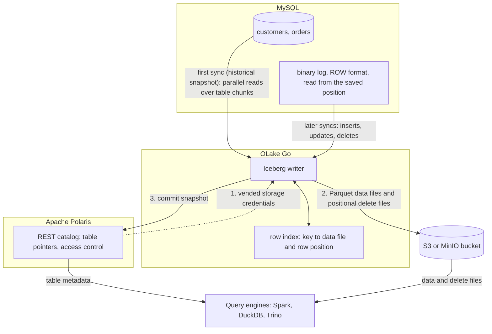

import * as I from '@site/src/components/integrations';

MySQL to Apache Iceberg usually means Debezium, Kafka and a sink connector, or a Flink job that needs its own cluster. This guide takes an open source route with neither. OLake Go reads the MySQL binary log and commits the changes as Iceberg tables into an Apache Polaris catalog, with the files in your own bucket.

Polaris is an open source Iceberg REST (Representational State Transfer) catalog you run yourself. Apache Spark, DuckDB and Trino read the tables through that one endpoint, and in the run on this page all three returned the same rows.

<I.IntegrationByline />

<TLDR title='Key takeaways'>

- OLake Go replicates MySQL into Iceberg tables in Polaris: a full historical snapshot first, then change data capture (CDC) from the binlog, with no Kafka, Debezium or Flink cluster in between.
- Every sync is one Iceberg commit with Parquet data files and positional delete files, so updates land as row-level changes rather than duplicate rows.
- The same tables are open to any engine that reads an Iceberg REST catalog. Spark, DuckDB and Trino returned identical rows and totals in the run on this page.

</TLDR>

**The short answer.** For open source change data capture (CDC) from MySQL into Apache Iceberg, run OLake Go (Apache 2.0) with MySQL's binary log as the source and an Iceberg REST catalog such as Apache Polaris as the destination. The first sync copies each table in full; every later sync replays inserts, updates and deletes from the binlog. Spark, DuckDB and Trino then query the same tables.

## How MySQL CDC reaches Apache Iceberg here



Two things happen in order, and OLake Go does both on its own. The first sync records the current binlog position, then reads each table in parallel chunks and writes Parquet data files. Every later sync opens the binlog at the saved position and replays the inserts, updates and deletes since.

An update needs the old row retired. With positional deletes, OLake Go keeps an index of where each primary key sits (data file and row number) and writes a small delete file that points at those positions. Readers skip the retired rows without comparing keys, which is why every current Spark, DuckDB and Trino release reads this format.

One thing to keep an eye on: the binlog is MySQL's replay window. MySQL deletes binlog files after `binlog_expire_logs_seconds`, and a job paused for longer than that cannot resume. Keep retention longer than your longest planned pause, and alert on `SHOW BINARY LOGS` size if disk is tight.

## What you need

- **MySQL 8.0 or later** with the binlog on in `ROW` format and a user that can read it. The tables on this page ran on MySQL 8.4. Hosted MySQL on Amazon Relational Database Service (RDS), Aurora, Google Cloud SQL or Azure works the same way; step 1 links the setup guides.
- **An Apache Polaris server and a bucket**, both reachable from OLake Go and from your query engines. The run on this page used Polaris 1.8.0 and MinIO in Docker; on AWS, use an S3 bucket and an IAM role instead.
- **At least one engine that reads an Iceberg REST catalog.** This page shows Apache Spark 3.5.6 with Iceberg 1.10.0, DuckDB 1.5.5 and Trino 484.
- **OLake UI** from the [Docker Compose install](/docs/install/olake-ui/). The run on this page used OLake Go v1.1.0.
- **Docker**, and about 40 minutes.

## Step 1: Prepare MySQL for CDC

Most readers point OLake Go at tables they already have. If you want to follow along with the exact data from this page, create these two tables first:

<details>
<summary>The two sample tables used on this page</summary>

```sql title="Sample schema"
CREATE TABLE customers (
  id INT AUTO_INCREMENT PRIMARY KEY,
  name VARCHAR(100), email VARCHAR(200), city VARCHAR(100), tier VARCHAR(20),
  created_at TIMESTAMP DEFAULT CURRENT_TIMESTAMP,
  updated_at TIMESTAMP DEFAULT CURRENT_TIMESTAMP ON UPDATE CURRENT_TIMESTAMP);

CREATE TABLE orders (
  id INT AUTO_INCREMENT PRIMARY KEY,
  customer_id INT, product VARCHAR(100), amount DECIMAL(10,2), status VARCHAR(20),
  created_at TIMESTAMP DEFAULT CURRENT_TIMESTAMP,
  updated_at TIMESTAMP DEFAULT CURRENT_TIMESTAMP ON UPDATE CURRENT_TIMESTAMP,
  FOREIGN KEY (customer_id) REFERENCES customers(id));

-- Then insert whatever you like. This page started with 8 customers and 40 orders.
```

</details>

<I.Partial id="sources/mysql/prereqs" tables="customers, orders" />

## Step 2: Set up the Polaris catalog

An Iceberg table is a set of files plus a catalog entry that says which metadata file is current. **Apache Polaris** holds those entries and the permissions; the Parquet files sit in your own S3 or MinIO bucket. OLake Go writes through Polaris, and every engine on this page reads through it with the credentials Polaris hands out.

The [Polaris catalog page](/docs/integrations/catalogs/polaris/) lists the other engines that read it. If you already run AWS Glue, Lakekeeper or another catalog, the [Apache Iceberg overview](/docs/integrations/iceberg/) shows what changes.

<I.CatalogStrip />

<I.CatalogTabs>
<TabItem value="polaris">

<I.Partial id="catalogs/polaris/setup" />

</TabItem>
</I.CatalogTabs>

## Step 3: Connect MySQL to OLake Go

<I.Partial id="sources/mysql/connect">

Here is the source form from the run on this page. MySQL ran in another container, so the host is `host.docker.internal`; the user is the replication user from step 1.

<Figure src='/img/docs/integrations/mysql-to-iceberg/olake-source-mysql-cdc.webp' alt='OLake UI Edit source form for MySQL on OLake Go v1.1.0 with Enable CDC on, host host.docker.internal, database shop and user olake' caption='The MySQL source in OLake UI: Enable CDC on, with the replication user from step 1.' width='760px' />

**Set up source** runs the connection test and the binlog checks (`binlog_access`, `log_bin`, `binlog_format`, `binlog_row_metadata`) before anything is saved. When one fails, the dialog names the setting and its recommended value.

</I.Partial>

## Step 4: Configure the Iceberg destination

<I.CatalogTabs>
<TabItem value="polaris">

<I.Partial id="catalogs/polaris/writer">

Here is the destination form from the run on this page. Polaris and MinIO ran in other containers, so both addresses use `host.docker.internal`; the credential is the `olake` principal from step 2.

<Figure src='/img/docs/integrations/mysql-to-iceberg/olake-destination-polaris.webp' alt='OLake UI Edit destination form for Apache Iceberg with catalog type Polaris, OAuth2 authentication, REST catalog URI on port 8181, catalog name olake and the MinIO S3 endpoint' caption='The Polaris destination in OLake UI: OAuth2 with the principal from step 2, and the MinIO endpoint for the files.' width='760px' />

</I.Partial>

</TabItem>
</I.CatalogTabs>

## Step 5: Create the job and run the first sync

<I.Partial id="jobs/create" engines="Apache Spark, DuckDB and Trino, or whichever engines will read the tables" upsert="Positional Deletes" updateType="pos" image="olakego/source-mysql:latest" namespace="shop">

Three target query engines were set on this job: Apache Spark, DuckDB and Trino. All three read every Iceberg delete format, and the run on this page used positional deletes on Iceberg format version 2 for every stream.

<Figure src='/img/docs/integrations/mysql-to-iceberg/olake-streams-positional-deletes.webp' alt='OLake UI Streams Selection page with the shop database, customers and orders selected, Full Refresh + CDC, Upsert and Positional Deletes on Iceberg format version V2' caption='Each stream: Full Refresh + CDC, Upsert, and Positional Deletes on Iceberg v2. The Iceberg DB name at the top is editable.' />

<Figure src='/img/docs/integrations/mysql-to-iceberg/olake-job-history-two-syncs.webp' alt='OLake UI Job Logs and History for mysql_to_iceberg showing two completed syncs of 9 seconds each' caption='Job history: the 9 s historical snapshot, then the 9 s change-only sync.' />

</I.Partial>

On this page the first run copied 8 customers and 40 orders (48 records, 2.10 KB) and finished in **9 seconds**, container start included. OLake Go names the destination namespace after the job and the source database, so `mysql_to_iceberg` on database `shop` produced `mysql_to_iceberg_shop`. The **Iceberg DB** field at the top of the Streams page changes it before the first sync.

## Step 6: Query the tables from DuckDB

DuckDB is the quickest way to check the result from a laptop: one `ATTACH` and the whole catalog is visible.

<I.CatalogTabs>
<TabItem value="polaris">

<I.Partial id="engines/duckdb/connect-polaris" schema="mysql_to_iceberg_shop" />

<Figure src='/img/docs/integrations/mysql-to-iceberg/duckdb-polaris-customers.webp' alt='DuckDB 1.5.5 shell querying polaris.mysql_to_iceberg_shop.customers and returning 10 rows with id, name, city and tier' caption='DuckDB 1.5.5 reading the customers table through Polaris after the change sync: 10 rows, one per key.' />

</TabItem>
</I.CatalogTabs>

<I.Cta />

## Step 7: Change rows in MySQL and sync again

To see the change path work, the run on this page made 12 changes in MySQL after the first sync:

```sql title="Changes made in MySQL between the two syncs"
INSERT INTO customers (name, email, city, tier) VALUES
  ('Maya Patel', 'maya@example.com', 'Pune', 'silver'),
  ('Lucas Silva', 'lucas@example.com', 'São Paulo', 'bronze');
INSERT INTO orders (customer_id, product, amount, status) VALUES
  (9, 'Laptop', 1299.00, 'placed'), (9, 'Mouse', 25.50, 'placed'),
  (10, 'Monitor', 349.99, 'placed'), (3, 'Keyboard', 89.00, 'placed'), (7, 'Webcam', 79.90, 'placed');
UPDATE customers SET tier = 'gold'      WHERE name = 'Liam Carter';
UPDATE customers SET city = 'Abu Dhabi' WHERE name = 'Zara Ali';
UPDATE orders    SET status = 'delivered' WHERE id IN (1, 4, 7);
```

The second sync read **12 records (563 bytes)** from the binlog and finished in **9 seconds** end to end. For `customers` that meant one new data file with 4 rows: 2 inserts plus the new versions of 2 updated rows. One positional delete file retires the 2 old versions by file and row number.

OLake Go's commit report in the sync log shows it directly: `addedDataFiles=1`, `addedRecords=4`, `addedPositionalDeleteFiles=1`, `addedPositionalDeletes=2`, and no equality delete files. The `orders` table has the same shape with 8 rows and 3 deletes.

<Figure src='/img/docs/integrations/mysql-to-iceberg/olake-sync-log-positional-delete-commit.webp' alt='OLake UI sync log filtered to the Iceberg commit report for customers, showing addedDataFiles 1, addedPositionalDeleteFiles 1, addedRecords 4 and addedPositionalDeletes 2' caption='The change-only sync in the OLake UI log: one data file and one positional delete file per table.' />

Every engine shows the result on its next query, with no refresh. Liam Carter is `gold`, Zara Ali moved to Abu Dhabi, and the two new customers are there. The `_op_type` column shows how each row arrived: `r` for the snapshot, `c` for the inserts and `u` for the updates.

**Schema changes.** When a column is added in MySQL, OLake Go adds it to the Iceberg table on the next sync, and readers see it the next time they load the table. Widening changes (`int` to `bigint`, `float` to `double`) are applied. Incompatible type changes fail the sync rather than corrupt the table. `binlog_row_metadata = FULL` is what lets OLake Go see new column names in the binlog. Full rules are on the [schema evolution page](/docs/features/schema/).

## Query the same tables from Trino and Spark

Nothing is exported or copied for a second engine. Trino and Spark read the files OLake Go wrote, through the same Polaris endpoint.

<Tabs groupId="engine" queryString="engine">
<TabItem value="trino" label="Trino" default>

<I.Partial id="engines/trino/connect-polaris" schema="mysql_to_iceberg_shop" />

<Figure src='/img/docs/integrations/mysql-to-iceberg/trino-polaris-customers.webp' alt='Trino 484 CLI querying customers in the polaris catalog schema mysql_to_iceberg_shop and returning the same 10 rows as DuckDB' caption='Trino 484 reading the same table through Polaris: the same 10 rows.' />

</TabItem>
<TabItem value="spark" label="Apache Spark">

<I.Partial id="engines/spark/connect-polaris" schema="mysql_to_iceberg_shop" />

</TabItem>
</Tabs>

All three engines agreed on the counts and the money: 10 customers, 45 orders and 25579.19 in total. The `orders` roll-up matched MySQL to the cent: 16 delivered orders for 8659.68, 18 placed for 10522.26, 11 shipped for 6397.25.

## Data types: MySQL to Iceberg

OLake Go maps MySQL types to Iceberg types. Most columns pass through unchanged; three groups are worth knowing about.

| MySQL | Iceberg (written by OLake Go) | Trino shows | Notes |
| --- | --- | --- | --- |
| `int`, `mediumint`, `smallint`, `tinyint` (signed or unsigned) | `int` | `integer` | |
| `bigint`, `bigint unsigned` | `long` | `bigint` | |
| `decimal(p,s)`, `float`, `double` | `double` | `double` | OLake Go stores decimals as doubles. The `orders.amount` sums on this page matched MySQL to the cent in every engine; round at query time when you need exact decimal arithmetic. |
| `datetime`, `timestamp` | `timestamptz` (UTC) | `timestamp(6) with time zone` | `datetime` has no zone in MySQL; it is read as UTC. |
| `char`, `varchar`, `text` family, `enum`, `json`, `time`, `bit(1)` | `string` | `varchar` | `time` arrives as text. |
| `binary(n)`, `varbinary`, `blob` family | `fixed[n]` or `binary` | `varbinary` | |

MySQL types in the table come from the [MySQL connector reference](/docs/connectors/mysql/#data-type-mapping); the Trino column comes from `DESCRIBE` on the tables of this run.

## Cost and maintenance

- **Storage** is your bucket: you pay S3 or MinIO rates for the Parquet and delete files, and nothing to Polaris for holding pointers.
- **Compute.** OLake Go runs wherever you run Docker. Each engine spends compute only when it queries, and none of them keeps its own copy.
- **Maintenance.** Nothing compacts the tables for you. A CDC table that gets a new small file and delete file per sync wants compaction; [OLake Fusion](/docs/fusion/getting-started/overview/) does this for the catalogs OLake Go writes to, and Spark's `rewrite_data_files` works through the same Polaris endpoint.
- **Binlog disk.** Seven days of binlog on a busy server can be tens of gigabytes. Size the volume for it, or shorten retention once the job runs reliably every hour.
- **Credential rotation.** Polaris principals do not expire by default. Rotate the `olake` principal's secret on your own schedule; a rotated secret fails the next sync at the token exchange, before any data moves.

## Troubleshooting

### 1. The first sync stops with a statistics error

```text
failed to get or split chunks: stats not populated for table[shop.orders]. Please run ANALYZE TABLE to update table statistics
```

OLake Go plans the parallel snapshot from `information_schema` row estimates. A freshly created or freshly loaded table has none. Run `ANALYZE TABLE <table>;` for each table in the job, then sync again.

### 2. The source test fails on the binlog

```text
binlog_format: current STATEMENT, recommended ROW
```

The test dialog names the setting. `binlog_format` and `binlog_row_metadata` can be changed at runtime with `SET GLOBAL`. Put them in `my.cnf` or the parameter group too. Otherwise they revert on restart. `log_bin` itself needs a restart.

### 3. A new job over existing tables writes nothing

```text
Table[mysql_to_iceberg_shop.customers]: not found starting index snapshot id, truncating stream index before rebuild
Thread[shop.customers_min[1]-max[<nil>]]: chunk min[1] and max[<nil>] already committed, skipping
Reached the configured latest binlog position mysql-bin.000003:2809; stopping CDC sync
```

The run on this page hit this after a first attempt failed and the job was recreated under the same name. The Iceberg tables from that attempt were still in Polaris. OLake Go treated their snapshot chunks as already committed and skipped them. The change sync then read 0 records. Drop the old tables (or give the job a new **Iceberg DB** name) before a fresh start, and the snapshot and change syncs run normally.

### 4. The next sync cannot find its binlog position

```text
idle timeout reached, exiting binlog syncer
```

Two causes. If `binlog_expire_logs_seconds` already removed the saved binlog file, run a fresh full snapshot and lengthen retention. If the file exists but the server is slow to seek to the position, raise **Initial Wait Time** on the source.

### 5. The destination test fails at the token exchange

OLake Go's destination test exchanges the principal's credentials at `/api/catalog/v1/oauth/tokens` before anything else. Three causes cover nearly every failure: a wrong client id or secret, a principal without a role that carries `CATALOG_MANAGE_CONTENT` on the catalog, or a wrong `Polaris Catalog Name`. Run the token check from the catalog setup; it returns the same error Polaris gives OLake Go.

<details>
<summary>How this compares with other ways to move MySQL data to Apache Iceberg</summary>

| Method | Freshness | Updates and deletes | What you run |
| --- | --- | --- | --- |
| [Debezium](https://debezium.io/documentation/reference/stable/connectors/mysql.html), Kafka and Kafka Connect with an Iceberg sink | Set by the sink commit interval | Appended as change events, with a separate merge job for the current state | Debezium, Kafka, Kafka Connect and usually a schema registry |
| [Flink CDC](https://nightlies.apache.org/flink/flink-cdc-docs-stable/) with the Iceberg Flink sink | Set by the checkpoint interval | Upserts through equality deletes on tables with a primary key | A Flink cluster with checkpoint storage |
| Managed ELT with an Iceberg destination | Minutes, by plan | Varies by tool | Nothing to run; priced per row, per GB or per connector |
| Periodic `mysqldump` or export to Parquet, then a load job | Hours | Full reload or hand-written merge | A scheduler and your own scripts |
| **OLake Go to Iceberg on Polaris (this guide)** | CDC on a schedule down to one minute | Upserts through positional deletes, equality deletes or deletion vectors, matched to the target engines | One Docker Compose stack, open source; your bucket plus your own compute |

Debezium and Kafka make sense when Kafka already carries the change events for other consumers. Flink wins when you need joins, enrichment or second-level latency on the way in. For copying MySQL tables into Iceberg with the least infrastructure, OLake Go is one job and one catalog; the trade-off is that freshness is a schedule, not a stream.

</details>

## When not to use this

- **You need sub-minute freshness.** OLake Go runs on a schedule, down to one minute between syncs. A streaming pipeline is the better fit for second-level latency.
- **You need transformations on the way in.** OLake Go copies tables as they are, with row filters and partitioning. Joins and enrichment belong in a query engine after the data lands, or in a stream processor before it.
- **Tables have no primary key.** Inserts replicate; updates and deletes cannot be matched to a row and are not applied. Add a primary key or a unique index first.

## FAQs

<I.IntegrationFaq />

<I.HowWeTested />

## Related guides

<I.RelatedIntegrations />

Deeper reading on this site:

- [MySQL to ClickHouse through the same Polaris catalog](/docs/integrations/mysql-to-clickhouse/)
- [How to move data from MySQL to Apache Iceberg and query it](/blog/mysql-to-iceberg-query-engines/)
- [Equality vs positional deletes vs deletion vectors](/blog/iceberg-delete-formats-cdc-equality-vs-positional-vs-deletion-vectors/)
- [OLake Go ingestion benchmarks](/docs/benchmarks/ingestion/)

<I.IntegrationJsonLd />

<I.Cta title='Start with your own MySQL' body='The quickstart runs OLake UI with Docker Compose. Create the source, the Polaris destination and the job as above, and the first sync lands your tables as Iceberg in your own bucket.' />
