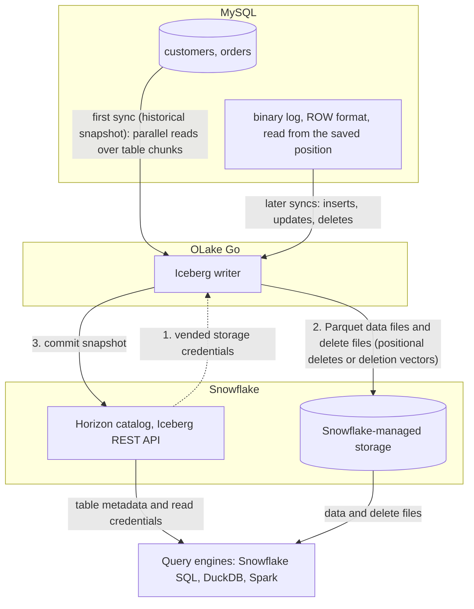

import * as I from '@site/src/components/integrations';

MySQL to Snowflake comes down to one choice. Copy the rows into tables Snowflake owns, or write them once as Apache Iceberg tables that Snowflake and every other engine can read. This guide does the second.

OLake Go reads MySQL changes from the binary log and commits them as Iceberg tables into a catalog Snowflake reads. With Snowflake's own Horizon catalog, the default on this page, the files sit on Snowflake-managed storage. Nothing else is in the path: no Kafka, no Debezium, no Spark. With AWS Glue, the files sit in your S3 bucket and Snowflake reads them through a catalog integration.

<I.IntegrationByline />

<TLDR title='Key takeaways'>

- OLake Go replicates MySQL into Snowflake as Iceberg tables: a full historical snapshot first, then change data capture (CDC) from the binlog, with no Kafka or Debezium in between.
- Through the Horizon catalog the tables land as Snowflake-managed Iceberg tables. You query them in Snowsight right away, with no `CREATE ICEBERG TABLE`, no external volume and no refresh.
- The same tables, written once by OLake Go, are also queryable from DuckDB and Spark through the same catalog. In the run on this page all three engines returned identical rows.

</TLDR>

**The short answer.** To replicate MySQL to Snowflake with change data capture (CDC), run OLake Go with MySQL's binary log as the source and the Snowflake Horizon catalog as the Iceberg destination. The first sync copies each table in full (the historical snapshot); every later sync replays inserts, updates and deletes from the binlog. Snowflake, DuckDB and Spark then query the same Iceberg tables, with no second copy.

## How MySQL CDC reaches Snowflake here



Two things happen in order, and OLake Go does both on its own. The first sync records the current binlog position, then reads each table in parallel chunks and writes Parquet data files: that is the historical load. Every later sync opens the binlog at the saved position and replays the inserts, updates and deletes since. Nothing written during the snapshot is lost, and there is no separate backfill job.

Each sync ends with one commit to Horizon. OLake Go asks Horizon for short-lived storage credentials, uploads the data and delete files, then posts the new snapshot to the catalog. Snowflake sees it the moment the commit lands; DuckDB and Spark see it on their next catalog load.

One thing to keep an eye on: the binlog is MySQL's replay window. MySQL deletes binlog files after `binlog_expire_logs_seconds`. A job paused for longer than that cannot resume and needs a fresh snapshot. Keep retention longer than your longest planned pause, and alert on `SHOW BINARY LOGS` size if disk is tight.

## What you need

- **MySQL 5.7 or later** with the binlog on in `ROW` format and a user that can read it. The tables on this page ran on MySQL 8.4. Hosted MySQL on Amazon Relational Database Service (RDS), Aurora, Azure or Cloud SQL works the same way; step 1 links each guide. MariaDB works through the same connector.
- **A Snowflake account** where you can run the one-time setup as `ACCOUNTADMIN`. Snowflake-managed storage means no cloud bucket or IAM role on your side.
- **OLake UI** from the [Docker Compose install](/docs/install/olake-ui/), with the OLake Go MySQL source on v0.11 or later. The run on this page used v1.1.0.
- **Docker**, and about 30 minutes.

## Step 1: Prepare MySQL for CDC

Most readers point OLake Go at tables they already have. If you want to follow along with the exact data from this page, create these two tables first:

<details>
<summary>The two sample tables used on this page</summary>

```sql title="Sample schema"
CREATE TABLE customers (
  id INT AUTO_INCREMENT PRIMARY KEY,
  name VARCHAR(100), email VARCHAR(200), city VARCHAR(100), tier VARCHAR(20),
  created_at TIMESTAMP DEFAULT CURRENT_TIMESTAMP,
  updated_at TIMESTAMP DEFAULT CURRENT_TIMESTAMP ON UPDATE CURRENT_TIMESTAMP);

CREATE TABLE orders (
  id INT AUTO_INCREMENT PRIMARY KEY,
  customer_id INT, product VARCHAR(100), amount DECIMAL(10,2), status VARCHAR(20),
  created_at TIMESTAMP DEFAULT CURRENT_TIMESTAMP,
  updated_at TIMESTAMP DEFAULT CURRENT_TIMESTAMP ON UPDATE CURRENT_TIMESTAMP,
  FOREIGN KEY (customer_id) REFERENCES customers(id));

-- Then insert whatever you like. This page started with 8 customers and 40 orders.
```

</details>

<I.Partial id="sources/mysql/prereqs" tables="customers, orders" />

## Step 2: Set up the catalog in Snowflake

Snowflake reads Iceberg tables from two kinds of catalog. **Horizon** is Snowflake's own: OLake Go writes straight into it, the tables are Snowflake-managed, and they appear in Snowsight the moment a sync commits. **AWS Glue** is a catalog outside Snowflake, so the files stay in your S3 bucket. Snowflake reaches them through a *catalog integration*: a read-only link to that external catalog, refreshed after each sync.

Horizon is the default on this page. Glue is the right pick when Athena, Redshift or Spark on Amazon Elastic MapReduce (EMR) will read the same tables and you want the files in your own bucket.

<I.CatalogStrip />

<I.CatalogTabs>
<TabItem value="horizon">

<I.Partial id="catalogs/horizon/setup" />

</TabItem>
<TabItem value="glue">

<I.Partial id="catalogs/glue/setup" />

</TabItem>
</I.CatalogTabs>

## Step 3: Connect MySQL to OLake Go

<I.Partial id="sources/mysql/connect">

Here is the source form from the run on this page. MySQL ran in another container, so the host is `host.docker.internal`; the user is the replication user from step 1.

<Figure src='/img/docs/integrations/mysql-to-snowflake/olake-source-mysql-cdc.webp' alt='OLake UI Edit source form for MySQL on OLake Go v1.1.0 with Enable CDC on, initial wait time 10, host host.docker.internal, database shop, user olake and SSL disabled' caption='The MySQL source in OLake UI: Enable CDC on, with the replication user from step 1.' width='760px' />

**Set up source** runs the connection test and the binlog checks (`binlog_access`, `log_bin`, `binlog_format`, `binlog_row_metadata`) before anything is saved. When one fails, the dialog names the setting and its recommended value.

</I.Partial>

## Step 4: Configure the Iceberg destination

<I.CatalogTabs>
<TabItem value="horizon">

<I.Partial id="catalogs/horizon/writer" />

</TabItem>
<TabItem value="glue">

<I.Partial id="catalogs/glue/writer" />

</TabItem>
</I.CatalogTabs>

## Step 5: Create the job and run the first sync

<I.Partial id="jobs/create" engines="Snowflake, plus DuckDB and Apache Spark if they will read the tables too" upsert="Positional Deletes" updateType="pos" image="olakego/source-mysql:latest">

Three target query engines were set on this job. That is the only format decision you make: OLake Go works out which Iceberg delete format all three can read and sets it on every stream.

<Figure src='/img/docs/integrations/mysql-to-snowflake/olake-streams-positional-deletes.webp' alt='OLake UI Streams Selection page with the shop database, customers and orders selected, sync mode Full Refresh + CDC, ingestion mode Upsert and upsert type Positional Deletes on Iceberg format version V2' caption='Each stream: Full Refresh + CDC, Upsert, and the upsert type OLake Go resolved (Positional Deletes in this run). The Iceberg DB name at the top is editable.' />

<Figure src='/img/docs/integrations/mysql-to-snowflake/olake-job-history-two-syncs.webp' alt='OLake UI Job Logs and History for mysql_to_snowflake showing two completed syncs, the first in 34 seconds and the second in 23 seconds' caption='Job history: the 34 s historical snapshot, then the 23 s change-only sync.' />

</I.Partial>

On this page the first run copied 8 customers and 40 orders (48 records) and finished in **34 seconds**, container start included. OLake Go names the destination schema after the job and the source database, so `mysql_to_snowflake` on database `shop` produced `mysql_to_snowflake_shop`. The **Iceberg DB** field at the top of the Streams page changes it before the first sync.

## Step 6: Query the tables in Snowflake

<I.CatalogTabs>
<TabItem value="horizon">

<I.Partial id="engines/snowflake/query-horizon" schema="mysql_to_snowflake_shop" />

<Figure src='/img/docs/integrations/mysql-to-snowflake/snowsight-show-iceberg-tables.webp' alt='Snowsight SQL file running SHOW ICEBERG TABLES on the mysql_to_snowflake_shop schema and listing customers and orders with owner OLAKE_ROLE, external volume SNOWFLAKE_MANAGED, catalog SNOWFLAKE and table type MANAGED' caption='SHOW ICEBERG TABLES in Snowsight: both tables are Snowflake-managed, created by OLAKE_ROLE through Horizon.' />

<Figure src='/img/docs/integrations/mysql-to-snowflake/snowsight-customers-query.webp' alt='Snowsight query on OLAKE_DEMO.mysql_to_snowflake_shop.customers returning 10 rows with id, name, city and tier' caption='The customers table in Snowsight after the change sync: 10 rows on an X-Small warehouse.' />

</TabItem>
<TabItem value="glue">

<I.Partial id="engines/snowflake/query-glue" schema="mysql_to_snowflake_shop" />

</TabItem>
</I.CatalogTabs>

<I.Cta />

## Step 7: Change rows in MySQL and sync again

To see the change path work, the run on this page made 12 changes in MySQL after the first sync:

```sql title="Changes made in MySQL between the two syncs"
INSERT INTO customers (name, email, city, tier) VALUES
  ('Maya Patel', 'maya@example.com', 'Pune', 'silver'),
  ('Lucas Silva', 'lucas@example.com', 'São Paulo', 'bronze');
INSERT INTO orders (customer_id, product, amount, status) VALUES
  (9, 'Laptop', 1299.00, 'placed'), (9, 'Mouse', 25.50, 'placed'),
  (10, 'Monitor', 349.99, 'placed'), (3, 'Keyboard', 89.00, 'placed'), (7, 'Webcam', 79.90, 'placed');
UPDATE customers SET tier = 'gold'      WHERE name = 'Liam Carter';
UPDATE customers SET city = 'Abu Dhabi' WHERE name = 'Zara Ali';
UPDATE orders    SET status = 'delivered' WHERE id IN (1, 4, 7);
```

The second sync read **12 records (563 bytes)** from the binlog and finished in **23 seconds** end to end. For `customers` that meant one new data file with 4 rows: 2 inserts plus the new versions of 2 updated rows. One small delete file retires the 2 old versions. OLake Go's commit report in the sync log shows it directly: `addedDataFiles=1`, `addedRecords=4`, `addedPositionalDeleteFiles=1`, `addedPositionalDeletes=2`, and `orders` the same shape with 8 rows and 3 deletes.

<Figure src='/img/docs/integrations/mysql-to-snowflake/olake-sync-log-positional-delete-commit.webp' alt='OLake UI sync log filtered to the Iceberg commit reports for customers and orders, showing addedDataFiles 1, addedPositionalDeleteFiles 1, addedRecords 4 and 8, totalEqualityDeletes 0' caption='The change-only sync in the OLake UI log: one data file and one positional delete file per table, zero equality deletes.' />

Snowflake shows the result with no refresh. Liam Carter is `gold`, Zara Ali moved to Abu Dhabi, and the two new customers are there. The `_op_type` column shows how each row arrived:

<Figure src='/img/docs/integrations/mysql-to-snowflake/snowsight-customers-after-cdc.webp' alt='Snowsight query on customers after the CDC sync showing 10 rows with _op_type r for the snapshot rows, u for Liam Carter and Zara Ali, c for Maya Patel and Lucas Silva' caption='Snowsight after the change sync: the two updates (u), the two inserts (c) and the untouched snapshot rows (r).' />

**Schema changes.** When a column is added in MySQL, OLake Go adds it to the Iceberg table on the next sync, and Snowflake shows it. Widening changes (`int` to `bigint`, `float` to `double`) are applied. Narrowing or incompatible type changes fail the sync rather than corrupt the table. `binlog_row_metadata = FULL` is what lets OLake Go see the new column names in the binlog. Full rules are on the [schema evolution page](/docs/features/schema/).

## Query the same tables from DuckDB and Spark

This is the point of writing Iceberg instead of loading Snowflake tables. Nothing is exported, copied or refreshed: both engines read the files OLake Go wrote, through the same Horizon endpoint, with credentials vended by Snowflake.

<Tabs groupId="engine" queryString="engine">
<TabItem value="duckdb" label="DuckDB" default>

<I.Partial id="engines/duckdb/connect-horizon" schema="mysql_to_snowflake_shop" />

<Figure src='/img/docs/integrations/mysql-to-snowflake/duckdb-horizon-customers.webp' alt='DuckDB 1.5.5 shell querying horizon.mysql_to_snowflake_shop.customers and returning the same 10 rows as Snowflake' caption='DuckDB 1.5.5 reading the Snowflake-managed table through Horizon: the same 10 rows.' />

</TabItem>
<TabItem value="spark" label="Apache Spark">

<I.Partial id="engines/spark/connect-horizon" schema="mysql_to_snowflake_shop" />

Spark 3.5.6 with Iceberg 1.10.0 returned the same 10 customers and the same `orders` roll-up as Snowflake and DuckDB in the run on this page.

</TabItem>
</Tabs>

An `orders` roll-up matched MySQL to the cent in all three engines: 16 delivered orders for 8659.68, 18 placed for 10522.26, 11 shipped for 6397.25.

## Data types: MySQL to Iceberg to Snowflake

OLake Go maps MySQL types to Iceberg types, and Snowflake maps Iceberg types to its own. Most columns pass through unchanged; three groups are worth knowing about.

| MySQL | Iceberg (written by OLake Go) | Snowflake shows | Notes |
| --- | --- | --- | --- |
| `int`, `mediumint`, `smallint`, `tinyint` (signed or unsigned) | `int` | `NUMBER(10,0)` | |
| `bigint`, `bigint unsigned` | `long` | `NUMBER(19,0)` | |
| `decimal(p,s)`, `float` | `float` | `FLOAT` | OLake Go stores decimals as floats. The `orders.amount` sums on this page matched MySQL to the cent in every engine; round at query time when you need exact decimal arithmetic. |
| `double`, `real` | `double` | `FLOAT` | |
| `datetime`, `timestamp` | `timestamptz` (UTC) | `TIMESTAMP_LTZ(6)` | `datetime` has no zone in MySQL; it is read as UTC, so set the session zone before comparing. |
| `char`, `varchar`, `text` family, `enum`, `json`, `time`, `bit(1)` | `string` | `VARCHAR` | Parse `json` with `PARSE_JSON()` in Snowflake. `time` arrives as text. |
| `binary(n)` | `fixed[n]` | `BINARY(n)` | |
| `varbinary`, `blob` family | `binary` | `BINARY` | |

MySQL types in the table come from the [MySQL connector reference](/docs/connectors/mysql/#data-type-mapping); the Snowflake side from Snowflake's [Iceberg data types](https://docs.snowflake.com/en/user-guide/tables-iceberg-data-types) page (checked 2026-10-14).

## Cost and maintenance

- **Storage** is Snowflake's with `SNOWFLAKE_MANAGED`: you pay Snowflake storage rates for the Parquet and delete files. Point the database at your own external volume to keep the files in your bucket instead.
- **Compute.** OLake Go runs wherever you run Docker; it does not use a Snowflake warehouse to write. Snowflake compute is spent only when you query.
- **Maintenance.** Snowflake expires old snapshots and compacts manifests on Snowflake-managed tables at no cost. Automatic data-file compaction is bundled only when Snowflake alone writes the table ([Snowflake-managed Iceberg table maintenance](https://docs.snowflake.com/en/user-guide/tables-iceberg-manage)). A CDC table that gets a new small file every minute will want compaction from the writer side; [OLake Fusion](/docs/fusion/getting-started/overview/) does this for the catalogs OLake Go writes to, and Spark's `rewrite_data_files` works through the same Horizon endpoint.
- **Binlog disk.** Seven days of binlog on a busy server can be tens of gigabytes. Size the volume for it, or shorten retention once the job runs reliably every hour.
- **Token rotation.** The programmatic access token expires (30 days in the setup above, 365 at most). Put the renewal on a calendar; an expired token fails the next sync at the catalog handshake, before any data moves.

## Troubleshooting

### 1. The first sync stops with a statistics error

```text
failed to get or split chunks: stats not populated for table[shop.orders]. Please run ANALYZE TABLE to update table statistics
```

OLake Go plans the parallel snapshot from `information_schema` row estimates. A freshly created or freshly loaded table has none. Run `ANALYZE TABLE <table>;` for each table in the job, then sync again. The run on this page hit this on its first attempt.

### 2. The source test fails on the binlog

```text
binlog_format: current STATEMENT, recommended ROW
```

The test dialog names the setting. `binlog_format` and `binlog_row_metadata` can be changed at runtime with `SET GLOBAL`. Put them in `my.cnf` (or the parameter group) too, or they revert on restart. `log_bin` itself needs a restart.

### 3. Snowflake cannot find the table

```text
SQL compilation error:
Object 'OLAKE_DEMO.MYSQL_TO_SNOWFLAKE_SHOP.CUSTOMERS' does not exist or not authorized.
```

Snowflake upper-cased an unquoted identifier. OLake Go creates the schema and tables with their lowercase MySQL names, so quote them: `OLAKE_DEMO."mysql_to_snowflake_shop"."customers"`.

### 4. The next sync cannot find its binlog position

```text
idle timeout reached, exiting binlog syncer
```

Two causes. If `binlog_expire_logs_seconds` already removed the saved binlog file, run a fresh full snapshot and lengthen retention. If the file exists but the server is slow to seek to the position, raise **Initial Wait Time** on the source. 10 seconds was enough for the two-table database on this page.

### 5. The destination test fails at the catalog handshake

OLake Go's destination test exchanges the token at `/v1/oauth/tokens` before anything else. Three causes cover nearly every failure: a service user without a network or authentication policy, a `scope` that does not match the token's `ROLE_RESTRICTION`, or an expired token. Run the `curl` exchange from the catalog setup; it returns the same error Snowflake gives OLake Go.

<details>
<summary>How this compares with other ways to move MySQL data to Snowflake</summary>

| Method | Freshness | Updates and deletes | Where the data lands | What you run |
| --- | --- | --- | --- | --- |
| [Snowflake Openflow connector for MySQL](https://docs.snowflake.com/en/user-guide/data-integration/openflow/connectors/mysql/about) | CDC through the binlog | Yes, as soft deletes plus journal tables | Native Snowflake tables; Snowflake is the only reader | An Openflow deployment in Snowpark Container Services or your own AWS account, billed in Snowflake credits |
| Debezium, Kafka and the Snowflake Kafka connector | Seconds | Yes, with the connector's tombstone handling | Kafka topics, then Snowflake tables | Kafka, Kafka Connect, Debezium and a schema registry |
| Managed ELT (Fivetran, Estuary, Airbyte Cloud) | Minutes, by plan | Yes | Snowflake tables, a second copy you pay to move and store | Nothing; priced per row, per GB or per connector |
| Manual export (`mysqldump` or `SELECT ... INTO OUTFILE`, then `COPY INTO`) | Hours to daily | No; full reloads only | Files you control | A script and a scheduler |
| **OLake Go to Iceberg on Horizon (this guide)** | CDC on a schedule down to one minute | Yes, as Iceberg row-level deletes | Apache Iceberg tables that Snowflake, DuckDB, Spark and Trino all read | One Docker Compose stack, open source; Snowflake storage plus your own compute |

Openflow is the simpler choice when Snowflake is the only reader and you want Snowflake to run the pipeline. Writing Iceberg once avoids paying to move and store a second copy as soon as another engine needs the same rows, or you want to own the files.

</details>

## When not to use this

- **Your Snowflake account is on Azure and DuckDB is a reader.** DuckDB attaches REST catalogs backed by S3, S3 Tables and Google Cloud Storage only, so pick Spark or Trino as the second engine there.
- **Tables have no primary key.** Inserts replicate; updates and deletes cannot be matched to a row and are not applied. Add a primary key or a unique index first.

## FAQs

<I.IntegrationFaq />

<I.HowWeTested />

## Related guides

<I.RelatedIntegrations />

Deeper reading on this site:

- [MySQL to Apache Iceberg with OLake Go](/blog/mysql-to-iceberg-query-engines/)
- [Equality vs positional deletes vs deletion vectors](/blog/iceberg-delete-formats-cdc-equality-vs-positional-vs-deletion-vectors/)
- [Which engines read which delete formats](/blog/iceberg-delete-formats-interoperability-olake-go/)
- [OLake Go ingestion benchmarks](/docs/benchmarks/ingestion/)

<I.IntegrationJsonLd />

<I.Cta title='Start with your own MySQL' body='The quickstart runs OLake UI with Docker Compose. Create the source, the Horizon destination and the job as above, and the first sync lands your tables in Snowflake.' />
