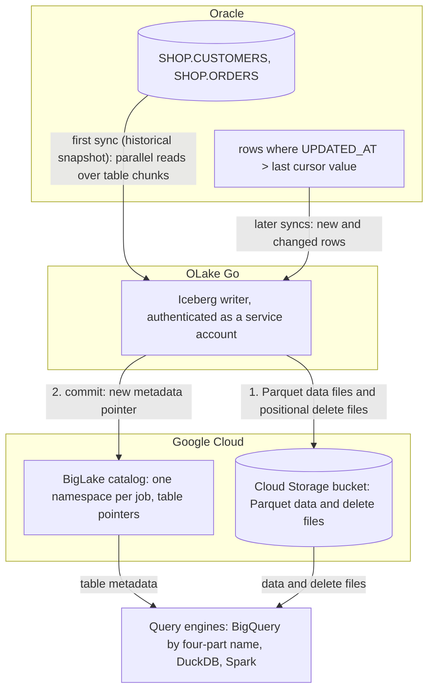

import * as I from '@site/src/components/integrations';

Oracle to BigQuery usually means GoldenGate, a Datastream stream, or a nightly export and `bq load`. This guide takes a fourth route.

OLake Go reads the Oracle tables over a plain Java Database Connectivity (JDBC) connection, writes them once as Apache Iceberg tables into a BigLake catalog, Google Cloud's Iceberg representational state transfer (REST) catalog, and keeps them fresh on a cursor column. The files stay in your own Cloud Storage bucket.

BigQuery queries the tables through the catalog with a four-part name, with no dataset to create and no external table to declare. Nothing else is in the path: no GoldenGate, no Datastream, no load job. DuckDB and Spark read the same tables through the same catalog.

<I.IntegrationByline />

<TLDR title='Key takeaways'>

- OLake Go replicates Oracle into Iceberg tables in a BigLake catalog: a full historical snapshot first, then incremental syncs on a cursor column such as `UPDATED_AT`, with no GoldenGate or Datastream in between. The Oracle connector has no log-based change data capture (CDC), so the cursor is what carries changes.
- BigQuery reads the catalog as a data source. Every change a sync commits is visible on the next `SELECT`, with no refresh and no load job.
- The same tables, written once by OLake Go, are also queryable from DuckDB and Spark. In the run on this page all three engines returned identical rows.

</TLDR>

**The short answer.** To replicate Oracle to BigQuery without redo-log access, run OLake Go with a read-only Oracle user as the source and a BigLake catalog with a Cloud Storage bucket as the Iceberg destination, with BigQuery as the target query engine. The first sync copies each table in full (the historical snapshot); every later sync fetches the rows whose cursor column moved and upserts them. BigQuery, DuckDB and Spark then query the same Iceberg tables, with no second copy.

## How Oracle changes reach BigQuery here



Two things happen in order, and OLake Go does both on its own. The first sync reads each table in parallel chunks and writes Parquet data files, then records the highest cursor value it saw: that is the historical load. Every later sync selects rows above that value and writes them as new data files.

A delete file retires the old version of each updated row. There is no separate backfill job.

Each sync ends with one commit to BigLake. OLake Go uploads the data and delete files to the bucket with the service account's own credentials, then updates the table's metadata pointer in the catalog. BigQuery, DuckDB and Spark see the new snapshot on their next query; none of them keeps a copy.

One thing to keep an eye on: the cursor is the only thing that carries changes. A row whose `UPDATED_AT` is not bumped on update is invisible to the next sync, and a deleted row is never seen. Set the column in every write path, or add a trigger, and soft-delete rows you need to remove downstream.

## What you need

- **Oracle Database 11g or later** reachable over JDBC, with a read-only user and a cursor column on each table. The tables on this page ran on Oracle Database 23ai Free in Docker.
- **A Google Cloud project** with the BigLake API enabled, a Cloud Storage bucket for the files, and a service account for OLake Go with the BigLake Editor role on the project and Storage Object User on the bucket. The run on this page used a bucket in `us-central1`.
- **BigQuery** in the same project. Queries run in the bucket's region, and the account running them needs the BigQuery Job User role plus read access to the catalog.
- **OLake UI** from the [Docker Compose install](/docs/install/olake-ui/). The run on this page used OLake Go v1.1.0.
- **Docker**, and about 30 minutes.

## Step 1: Prepare Oracle for incremental sync

Most readers point OLake Go at tables they already have. If you want to follow along with the exact data from this page, create these two tables first:

<details>
<summary>The two sample tables used on this page</summary>

```sql title="Sample schema, in the SHOP schema of pluggable database FREEPDB1"
CREATE TABLE shop.customers (
  id NUMBER(10) GENERATED BY DEFAULT AS IDENTITY PRIMARY KEY,
  name VARCHAR2(100), email VARCHAR2(200), city VARCHAR2(100), tier VARCHAR2(20),
  created_at TIMESTAMP DEFAULT SYSTIMESTAMP,
  updated_at TIMESTAMP DEFAULT SYSTIMESTAMP);

CREATE TABLE shop.orders (
  id NUMBER(10) GENERATED BY DEFAULT AS IDENTITY PRIMARY KEY,
  customer_id NUMBER(10) REFERENCES shop.customers(id),
  product VARCHAR2(100), amount NUMBER(10,2), status VARCHAR2(20),
  created_at TIMESTAMP DEFAULT SYSTIMESTAMP,
  updated_at TIMESTAMP DEFAULT SYSTIMESTAMP);

-- Then insert whatever you like. This page started with 8 customers and 40 orders.
```

</details>

<I.Partial id="sources/oracle/prereqs" tables="customers, orders" />

## Step 2: Set up the BigLake catalog

BigQuery reads Iceberg tables through a catalog. **BigLake** is the one this page uses: it is Google Cloud's Iceberg REST catalog, OLake Go creates a namespace per job in it, and the files sit in your Cloud Storage bucket.

BigQuery, DuckDB and Spark all read from the same catalog. BigQuery treats it as a data source in the project, so a table OLake Go commits is queryable on the next statement.

<I.CatalogStrip />

<I.CatalogTabs>
<TabItem value="biglake">

<I.Partial id="catalogs/biglake/setup" />

<Figure src='/img/docs/integrations/oracle-to-bigquery/gcp-service-account-key-json.webp' alt='Google Cloud console Create private key dialog for the OLake service account with the JSON key type selected' caption='The JSON key for the service account. The console downloads it once; its contents go into the OLake Go destination form.' />

</TabItem>
</I.CatalogTabs>

## Step 3: Connect Oracle to OLake Go

<I.Partial id="sources/oracle/connect">

Here is the source form from the run on this page. Oracle ran in another container, so the host is `host.docker.internal`. The connection type is **Service Name** (`FREEPDB1`) rather than a system identifier (SID), and the user is the one from step 1.

<Figure src='/img/docs/integrations/oracle-to-bigquery/olake-source-oracle.webp' alt='OLake UI Edit source form for Oracle on OLake Go v1.1.0 with host host.docker.internal, port 1521, connection type Service Name, service name FREEPDB1 and user olake' caption='The Oracle source in OLake UI: service name FREEPDB1 and the read-only user from step 1.' width='760px' />

</I.Partial>

## Step 4: Configure the Iceberg destination

<I.CatalogTabs>
<TabItem value="biglake">

<I.Partial id="catalogs/biglake/writer">

Here is the destination form from the run on this page. It holds the BigLake endpoint, the bucket as the catalog path, the service account JSON and the project ID.

<Figure src='/img/docs/integrations/oracle-to-bigquery/olake-destination-biglake.webp' alt='OLake UI Edit destination form for Apache Iceberg with catalog type Big Lake, REST catalog URI https://biglake.googleapis.com/iceberg/v1/restcatalog, BigLake catalog path gs://olake-x2y-lab-bq, authentication type GCP and the project ID oauth-361809' caption='The BigLake destination in OLake UI: the endpoint, the bucket as catalog path, GCP authentication and the project ID.' width='760px' />

</I.Partial>

</TabItem>
</I.CatalogTabs>

## Step 5: Create the job and run the first sync

This job lists **BigQuery**, **Spark** and **DuckDB** as target query engines. OLake Go then offers only the delete formats all three read, and the run on this page picked **Positional Deletes** from that list. Because the Oracle connector has no change data capture (CDC) mode, each stream runs as **Full Refresh + Incremental** with `UPDATED_AT` as the cursor.

<I.Partial id="jobs/create" engines="Google BigQuery, Apache Spark and DuckDB" upsert="Positional Deletes" updateType="pos" image="olakego/source-oracle:latest" cliSyncMode="incremental" syncMode="Full Refresh + Incremental" cursor="UPDATED_AT" namespace="SHOP" stream="CUSTOMERS">

OLake Go offers every delete format BigQuery, Spark and DuckDB all read: equality and positional deletes. Deletion vectors are not in the list because BigQuery reads them only in preview.

<Figure src='/img/docs/integrations/oracle-to-bigquery/olake-streams-positional-deletes.webp' alt='OLake UI Streams Selection page with the SHOP schema, CUSTOMERS and ORDERS selected, sync mode Full Refresh + Incremental, cursor field UPDATED_AT, ingestion mode Upsert and upsert type Positional Deletes on Iceberg format version V2' caption='Each stream: Full Refresh + Incremental on UPDATED_AT, Upsert, and Positional Deletes as the upsert type. The Iceberg DB name at the top is editable.' />

<Figure src='/img/docs/integrations/oracle-to-bigquery/olake-job-history-two-syncs.webp' alt='OLake UI Job Logs and History for oracle_to_bigquery showing two completed syncs, the first in 32 seconds and the second in 45 seconds' caption='Job history: the 32 s historical snapshot, then the 45 s incremental sync.' />

</I.Partial>

On this page the first run copied 8 customers and 40 orders (48 records, 2.24 KB) and finished in **32 seconds**, container start included. OLake Go names the BigLake namespace after the job and the source schema, lower-cased, so `oracle_to_bigquery` on schema `SHOP` produced `oracle_to_bigquery_shop`. The **Iceberg DB** field at the top of the Streams page changes it before the first sync.

## Step 6: Query the tables in BigQuery

<I.CatalogTabs>
<TabItem value="biglake">

<I.Partial id="engines/bigquery/query-biglake" schema="oracle_to_bigquery_shop" />

<Figure src='/img/docs/integrations/oracle-to-bigquery/bigquery-biglake-customers.webp' alt='BigQuery SQL editor in the Google Cloud console running the customers query on the olake-x2y-lab-bq catalog and returning 10 rows with id, name, city and tier' caption='BigQuery reading the customers table through the BigLake catalog after the incremental sync: 10 rows, one per key.' />

</TabItem>
</I.CatalogTabs>

<I.Cta />

## Step 7: Change rows in Oracle and sync again

To see the incremental path work, the run on this page made 12 changes in Oracle after the first sync. Every update also sets `updated_at`, which is what the cursor sees:

```sql title="Changes made in Oracle between the two syncs"
INSERT INTO customers (name, email, city, tier) VALUES ('Maya Patel', 'maya@example.com', 'Pune', 'silver');
INSERT INTO customers (name, email, city, tier) VALUES ('Lucas Silva', 'lucas@example.com', 'São Paulo', 'bronze');
INSERT INTO orders (customer_id, product, amount, status) VALUES (9, 'Laptop', 1299.00, 'placed');
INSERT INTO orders (customer_id, product, amount, status) VALUES (9, 'Mouse', 25.50, 'placed');
INSERT INTO orders (customer_id, product, amount, status) VALUES (10, 'Monitor', 349.99, 'placed');
INSERT INTO orders (customer_id, product, amount, status) VALUES (3, 'Keyboard', 89.00, 'placed');
INSERT INTO orders (customer_id, product, amount, status) VALUES (7, 'Webcam', 79.90, 'placed');
UPDATE customers SET tier = 'gold',      updated_at = SYSTIMESTAMP WHERE name = 'Liam Carter';
UPDATE customers SET city = 'Abu Dhabi', updated_at = SYSTIMESTAMP WHERE name = 'Zara Ali';
UPDATE orders    SET status = 'delivered', updated_at = SYSTIMESTAMP WHERE id IN (1, 4, 7);
COMMIT;
```

The second sync fetched **12 rows (598 bytes)** above the saved cursor and finished in **45 seconds** end to end. For `customers` that meant one new data file with 4 rows: 2 inserts plus the new versions of 2 updated rows. One small positional delete file retires the 2 old versions.

OLake Go's commit report in the sync log shows it directly: `addedDataFiles=1`, `addedRecords=4`, `addedPositionalDeleteFiles=1`, `addedPositionalDeletes=2`. The `orders` table has the same shape with 8 rows and 3 deletes.

<Figure src='/img/docs/integrations/oracle-to-bigquery/olake-sync-log-positional-delete-commit.webp' alt='OLake UI sync log filtered to the Iceberg commit report, showing addedDataFiles 1, addedPositionalDeleteFiles 1, addedRecords and addedPositionalDeletes for the incremental sync' caption='The incremental sync in the OLake UI log: one data file and one positional delete file per table.' />

BigQuery shows the result on the next query, with no refresh and no `ALTER TABLE`. Liam Carter is `gold`, Zara Ali moved to Abu Dhabi, and the two new customers are there. In incremental mode OLake Go cannot tell an insert from an update, so every row the second sync brought carries `_op_type = u`; the snapshot rows keep `r`.

**Schema changes.** When a column is added in Oracle, OLake Go adds it to the Iceberg table on the next sync and commits the new schema to BigLake in the same commit. BigQuery shows the column on the next query.

Widening changes are applied; narrowing or incompatible type changes fail the sync rather than corrupt the table. Full rules are on the [schema evolution page](/docs/features/schema/).

## Query the same tables from DuckDB and Spark

This is the point of writing Iceberg instead of loading BigQuery tables. Nothing is exported, copied or refreshed: both engines read the files OLake Go wrote, through the same BigLake catalog.

<Tabs groupId="engine" queryString="engine">
<TabItem value="duckdb" label="DuckDB" default>

<I.Partial id="engines/duckdb/connect-biglake" schema="oracle_to_bigquery_shop" />

<Figure src='/img/docs/integrations/oracle-to-bigquery/gcp-hmac-key-service-account.webp' alt='Google Cloud console Cloud Storage Interoperability settings with the Select a service account dialog, the OLake service account selected and the Create key button' caption='The key for DuckDB: Cloud Storage, Settings, Interoperability, then a key for the same service account OLake Go uses.' />

DuckDB 1.5.5 returned the same 10 customers and the same `orders` roll-up as BigQuery in the run on this page. It read the current metadata file of each table through the catalog and the data files through the hash-based message authentication code (HMAC) key.

</TabItem>
<TabItem value="spark" label="Apache Spark">

<I.Partial id="engines/spark/connect-biglake" schema="oracle_to_bigquery_shop" />

Spark 4.0.1 with Iceberg 1.10.0 returned the same rows in the run on this page, running on a laptop against the same catalog and bucket.

</TabItem>
</Tabs>

An `orders` roll-up matched Oracle to the cent in all three engines. It gave 16 delivered orders for 8659.68, 18 placed for 10522.26, 11 shipped for 6397.25.

## Data types: Oracle to Iceberg to BigQuery

OLake Go maps Oracle types to Iceberg types, and BigQuery maps Iceberg types to its own when it reads the catalog. Numbers are the group to watch.

| Oracle | Iceberg (written by OLake Go) | BigQuery shows | Notes |
| --- | --- | --- | --- |
| `NUMBER(n,0)` | `long` | `INT64` | The `NUMBER(10)` identity keys on this page arrived as `INT64`. |
| `NUMBER(n,m)` with a scale, `FLOAT`, `BINARY_DOUBLE` | `double` | `FLOAT64` | OLake Go stores decimals as doubles. The `orders.amount` sums on this page matched Oracle to the cent in every engine; round at query time when you need exact decimal arithmetic. |
| `BINARY_FLOAT` | `float` | `FLOAT64` | |
| `DATE`, `TIMESTAMP`, `TIMESTAMP WITH TIME ZONE`, `TIMESTAMP WITH LOCAL TIME ZONE` | `timestamptz` (UTC) | `TIMESTAMP` | Oracle `DATE` carries a time; it arrives as a UTC instant. |
| `VARCHAR2`, `NVARCHAR2`, `CHAR`, `CLOB`, `NCLOB`, `LONG` | `string` | `STRING` | |
| `RAW`, `LONG RAW`, `BLOB`, `BFILE`, `INTERVAL` types | `string` | `STRING` | Binary values arrive as text; keep large binaries out of the sync. |

Oracle types in the table come from the [Oracle connector reference](/docs/connectors/oracle/#data-type-mapping). The BigQuery side comes from the [BigQuery Iceberg tables page](https://docs.cloud.google.com/bigquery/docs/iceberg-external-tables) (checked 2026-10-30) and from the table schemas of this run.

## Cost and maintenance

- **Storage** is your bucket: you pay Cloud Storage rates for the Parquet and delete files. The BigLake catalog itself has no per-table charge.
- **Compute.** OLake Go runs wherever you run Docker. BigQuery bills on-demand queries by bytes scanned, or by slot time on an edition; a query over the catalog reads the Parquet files in the bucket, so filter on the columns you need. DuckDB and Spark cost whatever machine they run on.
- **Oracle load.** Each incremental sync runs one range query per table on the cursor column. Index `UPDATED_AT` on large tables so the query does not scan them.
- **Maintenance.** A table that gets a new small file and delete file per sync wants compaction, and BigLake keeps every snapshot OLake Go commits in the table's `metadata.json`. BigLake rejects a `metadata.json` above 1 MB, which a busy table reaches after a few thousand syncs. Expire old snapshots and compact on a schedule with [OLake Fusion](/docs/fusion/getting-started/overview/) or with Spark's `expire_snapshots` and `rewrite_data_files` procedures through the same catalog.
- **Key rotation.** The service account key is what OLake Go writes with. Rotate it on your schedule from the service account's **Keys** tab and paste the new JSON into the destination.

## Troubleshooting

### 1. The source test fails to connect

```text
ORA-12514: Cannot connect to database. Service FREEPDB1 is not registered with the listener
```

The service name is wrong or the listener has not finished registering it. Run `lsnrctl status` on the server, or connect with the SID instead. On a fresh container the service appears a minute or two after startup.

### 2. The source test fails with ORA-01017 although sqlplus logs in

```text
failed to ping database: ORA-01017: invalid credential or not authorized; logon denied
```

OLake Go quotes the username when it connects, so Oracle compares it case-sensitively. A user created as `CREATE USER olake` is stored as `OLAKE`; enter it in upper case.

### 3. Updated rows are missing after an incremental sync

The update did not move the cursor column. OLake Go only fetches rows whose cursor value is above the last one it saw, so an `UPDATE` that leaves `UPDATED_AT` untouched is invisible. Set the column in every write path, or add a trigger that sets it on `UPDATE`.

### 4. The destination test fails on a catalog in vended-credentials mode

```text
failed to test destination: failed to create or get table: rpc error: code = Internal desc = Failed to process request: Malformed request: X-Iceberg-Access-Delegation header must be present and contain `vended-credentials` when credential mode is `CREDENTIAL_MODE_VENDED_CREDENTIALS`.
```

The catalog was created, or switched, with `--credential-mode=vended-credentials`, and OLake Go 1.1.0 does not send the header BigLake wants in that mode ([olake#1369](https://github.com/datazip-inc/olake/issues/1369)). Switch the catalog back with `gcloud beta biglake iceberg catalogs update <bucket> --credential-mode=end-user`, which is the default for a catalog OLake Go created itself. With the CLI, `"rest_access_delegation": "vended-credentials"` in `destination.json` makes the same test pass; the UI has no field for it yet.

### 5. BigQuery cannot find the dataset

```text
Not found: Dataset <project>:<bucket>.oracle_to_bigquery_shop was not found in location US
```

The query ran in a location other than the bucket's region. Set the query location to the bucket's region in the editor's **More**, **Query settings** panel, or pass `--location=<region>` to `bq`. Leaving the location unset lets BigQuery pick it from the table.

<details>
<summary>How this compares with other ways to move Oracle data to BigQuery</summary>

| Method | Freshness | Updates and deletes | Where the data lands | What you run |
| --- | --- | --- | --- | --- |
| [Datastream for Oracle](https://docs.cloud.google.com/datastream/docs/overview) | Near real time, by Google's description; CDC from the redo log | Yes | Native BigQuery datasets; BigQuery is the only reader | Nothing to run; a connection profile and a stream in the console, plus supplemental logging on Oracle |
| [Oracle GoldenGate](https://docs.oracle.com/en/middleware/goldengate/core/) to BigQuery | Seconds | Yes | Native BigQuery tables | GoldenGate Extract and Replicat, a licensed Oracle option |
| Export (Data Pump or `SELECT` to CSV), then `bq load` | Hours to daily | No; full reloads only | Native BigQuery tables | A script, a scheduler and a staging bucket |
| Managed ELT (Fivetran, Estuary, Airbyte Cloud) | Minutes, by plan | Varies by tool | BigQuery tables, a second copy you pay to move and store | Nothing; priced per row, per GB or per connector |
| **OLake Go to Iceberg on BigLake (this guide)** | Incremental on a schedule down to one minute | Inserts and updates through the cursor; no deletes | Apache Iceberg tables that BigQuery, Spark, DuckDB, Trino and Flink all read | One Docker Compose stack, open source; your bucket plus your own compute |

Datastream is the simpler choice when you need deletes replicated and BigQuery is the only reader. Writing Iceberg once avoids paying to move and store a second copy. That matters as soon as Spark, DuckDB or a notebook needs the same rows, or you want to own the files.

</details>

## When not to use this

- **You need hard deletes replicated.** Incremental sync cannot see a deleted row. Soft-delete in Oracle, or use a log-based tool.
- **Tables have no cursor column and cannot get one.** Without a monotonically increasing column, only Full Refresh works.
- **Every query must hit native BigQuery speed.** A catalog table is read from Parquet in the bucket on every query. Keep the Iceberg tables as the source and load the hot slice into a native table on a schedule.

## FAQs

<I.IntegrationFaq />

<I.HowWeTested />

## Related guides

<I.RelatedIntegrations />

Deeper reading on this site:

- [Equality vs positional deletes vs deletion vectors](/blog/iceberg-delete-formats-cdc-equality-vs-positional-vs-deletion-vectors/)
- [Which engines read which delete formats](/blog/iceberg-delete-formats-interoperability-olake-go/)
- [OLake Go ingestion benchmarks](/docs/benchmarks/ingestion/)

<I.IntegrationJsonLd />

<I.Cta title='Start with your own Oracle' body='The quickstart runs OLake UI with Docker Compose. Create the source, the BigLake destination and the job as above, and the first sync lands your tables where BigQuery can read them.' />
