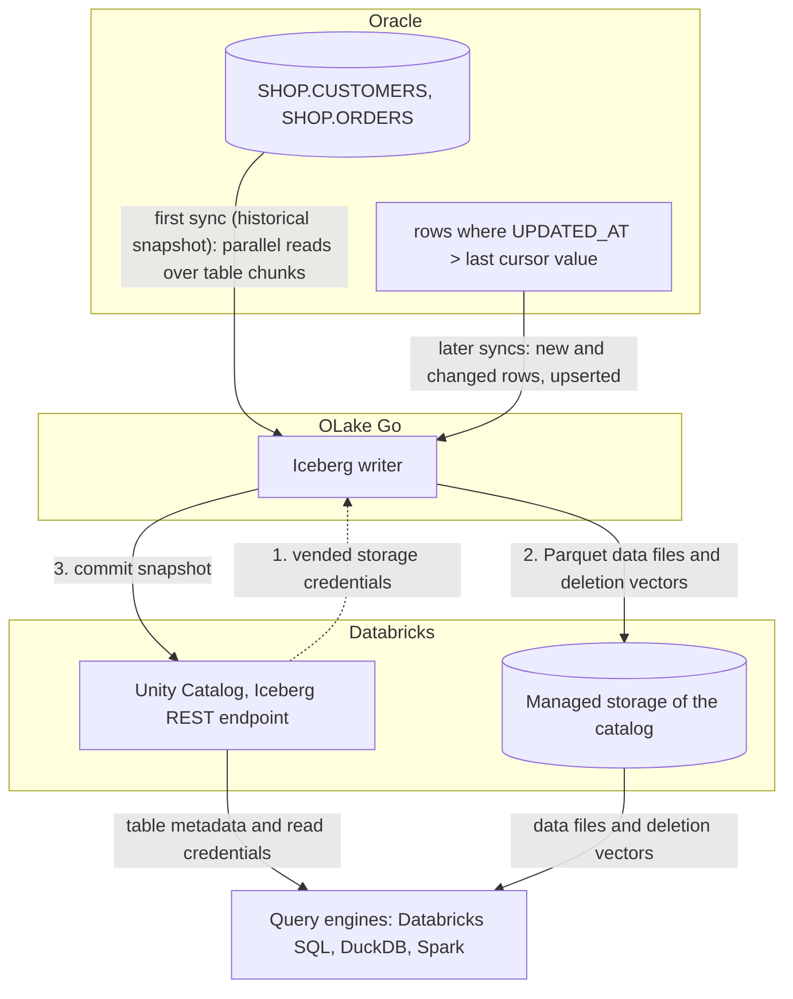

import * as I from '@site/src/components/integrations';

Oracle to Databricks usually means GoldenGate, a Kafka pipeline, or a nightly export picked up by Auto Loader. This guide takes a different route. OLake Go reads the Oracle tables over a plain Java Database Connectivity (JDBC) connection and writes them once as Apache Iceberg tables into Unity Catalog. A cursor column keeps them fresh.

The tables land as Unity Catalog managed Iceberg tables, with the files in your own cloud storage. Nothing else is in the path: no GoldenGate, no Kafka, no Databricks ingestion pipeline. DuckDB and Spark read the same tables through the same catalog.

<I.IntegrationByline />

<TLDR title='Key takeaways'>

- OLake Go replicates Oracle into Databricks as Iceberg tables: a full historical snapshot first, then incremental syncs on a cursor column such as `UPDATED_AT`, with no GoldenGate or Kafka in between.
- The tables are Unity Catalog managed Iceberg tables. You query them from the Databricks SQL editor or a notebook right away, with no external table and no refresh.
- The same tables, written once by OLake Go, are also queryable from DuckDB and Spark through Unity Catalog. In the run on this page all three engines returned identical rows.

</TLDR>

**The short answer.** To replicate Oracle to Databricks without redo-log access, run OLake Go with a read-only Oracle user as the source and Unity Catalog as the Iceberg destination, with Databricks as a target query engine. The first sync copies each table in full (the historical snapshot). Every later sync fetches the rows whose cursor column moved and upserts them with deletion vectors. Databricks, DuckDB and Spark then query the same Iceberg tables, with no second copy.

## How Oracle data reaches Databricks here



The first sync reads each table in parallel chunks, writes Parquet data files, and records the highest cursor value it saw: that is the historical load. Every later sync selects rows above that value and writes them as new data files. A deletion vector, a small bitmap per data file, retires the old version of each updated row.

Each sync ends with one commit to Unity Catalog. Databricks sees the new snapshot on its next query, and DuckDB and Spark see it on their next catalog load.

The cursor is the whole contract. A row that changes without its `updated_at` moving is never picked up, and a deleted row stays in the Iceberg table. Set the column in every write path, and soft-delete if deletes matter.

## What you need

- **Oracle Database 11g or later** reachable over JDBC, with a read-only user and a cursor column on each table. The tables on this page ran on Oracle Database 23ai Free in Docker.
- **A Databricks workspace with Unity Catalog**, a catalog with managed storage, and an admin who can turn on external data access and grant `EXTERNAL USE SCHEMA`. The run on this page used a workspace on Google Cloud.
- **OLake UI** from the [Docker Compose install](/docs/install/olake-ui/). The run on this page used OLake Go v1.1.0.
- **Docker**, and about 30 minutes.

## Step 1: Prepare Oracle for incremental sync

Most readers point OLake Go at tables they already have. If you want to follow along with the exact data from this page, create these two tables first:

<details>
<summary>The two sample tables used on this page</summary>

```sql title="Sample schema, in the SHOP schema of pluggable database FREEPDB1"
CREATE TABLE shop.customers (
  id NUMBER(10) GENERATED BY DEFAULT AS IDENTITY PRIMARY KEY,
  name VARCHAR2(100), email VARCHAR2(200), city VARCHAR2(100), tier VARCHAR2(20),
  created_at TIMESTAMP DEFAULT SYSTIMESTAMP,
  updated_at TIMESTAMP DEFAULT SYSTIMESTAMP);

CREATE TABLE shop.orders (
  id NUMBER(10) GENERATED BY DEFAULT AS IDENTITY PRIMARY KEY,
  customer_id NUMBER(10) REFERENCES shop.customers(id),
  product VARCHAR2(100), amount NUMBER(10,2), status VARCHAR2(20),
  created_at TIMESTAMP DEFAULT SYSTIMESTAMP,
  updated_at TIMESTAMP DEFAULT SYSTIMESTAMP);

-- Then insert whatever you like. This page started with 8 customers and 40 orders.
```

</details>

<I.Partial id="sources/oracle/prereqs" />

## Step 2: Set up Unity Catalog in Databricks

Databricks reads Iceberg tables through Unity Catalog, the catalog built into every Databricks workspace. OLake Go writes straight into it, so the tables become Unity Catalog managed Iceberg tables. They show up in Catalog Explorer and the SQL editor the moment a sync commits.

The files sit in the catalog's managed storage, which is backed by an external location in your own cloud account. DuckDB and Spark reach the same tables through the same Unity Catalog endpoint.

<I.CatalogStrip />

<I.CatalogTabs>
<TabItem value="unity">

<I.Partial id="catalogs/unity/setup" />

</TabItem>
</I.CatalogTabs>

## Step 3: Connect Oracle to OLake Go

<I.Partial id="sources/oracle/connect">

Here is the source form from the run on this page. Oracle ran in another container, so the host is `host.docker.internal`. The connection type is **Service Name** (`FREEPDB1`) rather than a system identifier (SID), and the user is the one from step 1.

<Figure src='/img/docs/integrations/oracle-to-databricks/olake-source-oracle.webp' alt='OLake UI Edit source form for Oracle on OLake Go v1.1.0 with host host.docker.internal, port 1521, connection type Service Name, service name FREEPDB1 and user olake' caption='The Oracle source in OLake UI: service name FREEPDB1 and the read-only user from step 1.' width='760px' />

</I.Partial>

## Step 4: Configure the Iceberg destination

<I.CatalogTabs>
<TabItem value="unity">

<I.Partial id="catalogs/unity/writer">

The run on this page wrote into a catalog called `datazip`, with a personal access token that expires after seven days. The snippets below use `lakehouse`; replace it with your catalog name.

</I.Partial>

</TabItem>
</I.CatalogTabs>

## Step 5: Create the job and run the first sync

<I.Partial id="jobs/create" engines="Databricks, plus DuckDB and Apache Spark if they will read the tables too" upsert="Deletion Vector" updateType="dv" image="olakego/source-oracle:latest" cliSyncMode="incremental" syncMode="Full Refresh + Incremental" cursor="UPDATED_AT" namespace="SHOP" stream="CUSTOMERS">

Three target query engines were set on this job, and Databricks narrows the delete formats to one: deletion vectors on Iceberg v3 tables. Because the Oracle connector has no change data capture (CDC) mode, each stream runs as **Full Refresh + Incremental** with `UPDATED_AT` as the cursor.

<Figure src='/img/docs/integrations/oracle-to-databricks/olake-streams.webp' alt='OLake UI Streams Selection page with the SHOP schema, CUSTOMERS and ORDERS selected, sync mode Full Refresh + Incremental, cursor field UPDATED_AT, ingestion mode Upsert and upsert type Deletion Vector on Iceberg format version V3' caption='Each stream: Full Refresh + Incremental on UPDATED_AT, Upsert, and Deletion Vector on Iceberg v3, the format OLake Go resolved for Databricks.' />

<Figure src='/img/docs/integrations/oracle-to-databricks/olake-job-history-two-syncs.webp' alt='OLake UI Job Logs and History for oracle_to_databricks showing two completed syncs, the first in 22 seconds and the second in 18 seconds' caption='Job history: the 22 s historical snapshot, then the 18 s incremental sync.' />

</I.Partial>

On this page the first run copied 8 customers and 40 orders (48 records, 2.24 KB) and finished in **22 seconds**, container start included. OLake Go names the Unity Catalog schema after the job and the source schema, lower-cased, so `oracle_to_databricks` on schema `SHOP` produced `oracle_to_databricks_shop`. The **Iceberg DB** field at the top of the Streams page changes it before the first sync.

## Step 6: Query the tables in Databricks

<I.CatalogTabs>
<TabItem value="unity">

<I.Partial id="engines/databricks/query-unity" schema="oracle_to_databricks_shop" key="id" />

<Figure src='/img/docs/integrations/oracle-to-databricks/databricks-sql-editor-customers.webp' alt='Databricks SQL editor running SELECT on datazip.oracle_to_databricks_shop.customers on the 2X-Small SQL warehouse, returning 10 rows with id, name, city and tier' caption='The Oracle customers table in the Databricks SQL editor after both syncs: 10 rows, read through Unity Catalog.' />

</TabItem>
</I.CatalogTabs>

<I.Cta />

## Step 7: Change rows in Oracle and sync again

To see the incremental path work, the run on this page made 12 changes in Oracle after the first sync. Every update also sets `updated_at`, which is what the cursor sees:

```sql title="Changes made in Oracle between the two syncs"
INSERT INTO customers (name, email, city, tier) VALUES ('Maya Patel', 'maya@example.com', 'Pune', 'silver');
INSERT INTO customers (name, email, city, tier) VALUES ('Lucas Silva', 'lucas@example.com', 'São Paulo', 'bronze');
INSERT INTO orders (customer_id, product, amount, status) VALUES (9, 'Laptop', 1299.00, 'placed');
INSERT INTO orders (customer_id, product, amount, status) VALUES (9, 'Mouse', 25.50, 'placed');
INSERT INTO orders (customer_id, product, amount, status) VALUES (10, 'Monitor', 349.99, 'placed');
INSERT INTO orders (customer_id, product, amount, status) VALUES (3, 'Keyboard', 89.00, 'placed');
INSERT INTO orders (customer_id, product, amount, status) VALUES (7, 'Webcam', 79.90, 'placed');
UPDATE customers SET tier = 'gold',      updated_at = SYSTIMESTAMP WHERE name = 'Liam Carter';
UPDATE customers SET city = 'Abu Dhabi', updated_at = SYSTIMESTAMP WHERE name = 'Zara Ali';
UPDATE orders    SET status = 'delivered', updated_at = SYSTIMESTAMP WHERE id IN (1, 4, 7);
COMMIT;
```

The second sync fetched **12 rows (598 bytes)** above the saved cursor and finished in **18 seconds** end to end. For `customers` that meant one new data file with 4 rows and one deletion vector marking the 2 old versions. OLake Go's commit report shows `addedDataFiles=1`, `addedRecords=4`, `addedDVs=1` and `addedPositionalDeletes=2`, and `orders` the same shape with 8 rows and 3 deleted positions.

<Figure src='/img/docs/integrations/oracle-to-databricks/olake-sync-log-commit.webp' alt='OLake UI sync log filtered to the Iceberg commit reports for customers and orders after the incremental sync, showing addedDataFiles 1, addedDVs 1, addedRecords 4 and 8, and addedPositionalDeletes 2 and 3' caption='The incremental sync in the OLake UI log: one data file and one deletion vector per table.' />

Databricks shows the result on the next query, with no refresh. Liam Carter is `gold`, Zara Ali moved to Abu Dhabi, and the two new customers are there. In incremental mode OLake Go cannot tell an insert from an update, so the 4 rows the cursor picked up carry `_op_type = u` and the other 6 keep `r`.

**Schema changes.** When a column is added in Oracle, OLake Go adds it to the Iceberg table on the next sync and commits the new schema to Unity Catalog. Widening changes are applied; narrowing or incompatible type changes fail the sync rather than corrupt the table. Full rules are on the [schema evolution page](/docs/features/schema/).

## Query the same tables from DuckDB and Spark

Nothing is exported, copied or refreshed. Both engines read the files OLake Go wrote, through the same Unity Catalog endpoint, with storage credentials vended by Databricks.

<Tabs groupId="engine" queryString="engine">
<TabItem value="duckdb" label="DuckDB" default>

<I.Partial id="engines/duckdb/connect-unity" schema="oracle_to_databricks_shop" key="id" />

DuckDB 1.5.5 returned the same 10 customers and the same `orders` roll-up as Databricks in the run on this page.

</TabItem>
<TabItem value="spark" label="Apache Spark">

<I.Partial id="engines/spark/connect-unity" schema="oracle_to_databricks_shop" key="id" />

Spark 4.0.1 with Iceberg 1.10.0 returned the same 10 customers and the same `orders` roll-up as Databricks and DuckDB in the run on this page.

</TabItem>
</Tabs>

An `orders` roll-up matched Oracle to the cent in all three engines. It gave 16 delivered orders for 8659.68, 18 placed for 10522.26, 11 shipped for 6397.25.

## Data types: Oracle to Iceberg to Databricks

OLake Go maps Oracle types to Iceberg types, and Databricks maps Iceberg types to its own. Numbers are the group to watch.

| Oracle | Iceberg (written by OLake Go) | Databricks shows | Notes |
| --- | --- | --- | --- |
| `NUMBER(n,0)`, n up to 9 | `int` | `INT` | |
| `NUMBER(n,0)`, n above 9 | `long` | `BIGINT` | The `NUMBER(10)` keys on this page arrived as `BIGINT`. |
| `NUMBER(n,m)` with a scale, `FLOAT`, `BINARY_DOUBLE` | `double` | `DOUBLE` | The `orders.amount` sums on this page matched Oracle to the cent; round at query time when you need exact decimal arithmetic. |
| `BINARY_FLOAT` | `float` | `FLOAT` | |
| `DATE`, `TIMESTAMP`, `TIMESTAMP WITH TIME ZONE`, `TIMESTAMP WITH LOCAL TIME ZONE` | `timestamptz` (UTC) | `TIMESTAMP` | Oracle `DATE` carries a time; it arrives as a UTC instant. |
| `VARCHAR2`, `NVARCHAR2`, `CHAR`, `CLOB`, `NCLOB`, `LONG` | `string` | `STRING` | |
| `RAW`, `LONG RAW`, `BLOB`, `BFILE`, `INTERVAL` types | `string` | `STRING` | Binary values arrive as text; keep large binaries out of the sync. |

Oracle types in the table come from the [Oracle connector reference](/docs/connectors/oracle/#data-type-mapping); the Databricks side comes from `DESCRIBE` on the tables of this run.

## Cost and maintenance

- **Storage** is your cloud bucket behind the catalog's managed location. You pay your cloud's storage rates for the Parquet data files and deletion vectors.
- **Compute.** OLake Go runs wherever you run Docker and does not use a Databricks warehouse or cluster to write. Databricks compute is spent only when you query; the checks on this page ran on a 2X-Small serverless SQL warehouse.
- **Maintenance.** Each sync adds a small data file, plus a deletion vector when rows change. Plan compaction from the writer side: [OLake Fusion](/docs/fusion/getting-started/overview/) does this for the catalogs OLake Go writes to, and Spark's `rewrite_data_files` works through the same Unity Catalog endpoint.
- **Token rotation.** A personal access token expires on the date set when it was created, and an expired token fails the next sync at the first catalog call. Use a service principal with OAuth machine-to-machine credentials for production jobs.
- **Oracle load.** Each incremental sync is one indexed range scan per table on the cursor column; index `updated_at` so the scan stays cheap as the table grows.

## Troubleshooting

### 1. The source test fails to connect

```text
ORA-12514: Cannot connect to database. Service FREEPDB1 is not registered with the listener
```

The service name is wrong or the listener has not finished registering it. Run `lsnrctl status` on the server, or connect with the SID instead. On a fresh container the service appears a minute or two after startup.

### 2. The source test fails with ORA-01017 although sqlplus logs in

```text
failed to ping database: ORA-01017: invalid credential or not authorized; logon denied
```

OLake Go quotes the username when it connects, so Oracle compares it case-sensitively. A user created as `CREATE USER olake` is stored as `OLAKE`; enter it in upper case. The run on this page hit this on its first attempt with `olake` in lower case.

### 3. Discovery sees no tables

The OLake Go user can log in but has no `SELECT` on the tables, or the tables live in another schema. Grant `SELECT` per table (step 1) and check `all_tables` as that user.

### 4. Updated rows are missing after an incremental sync

The update did not move the cursor column. OLake Go only fetches rows whose cursor value is above the last one it saw, so an `UPDATE` that leaves `updated_at` untouched is invisible. Set the column in every write path, or add a trigger that sets it on `UPDATE`.

### 5. The destination test fails with a permission error

Three settings cover nearly every failure. **External data access** may be off on the metastore, or the principal may lack `EXTERNAL USE SCHEMA` on the catalog. The third is a wrong catalog name in the destination. `ALL PRIVILEGES` does not include `EXTERNAL USE SCHEMA`, so a catalog owner still has to grant it explicitly. Run the grants from step 2 again for the principal that owns the token.

### 6. Databricks rejects a commit with "Can not create a Path from a null string"

```text
Can not create a Path from a null string [ErrorCode: 2015]
```

Unity Catalog returns this when a client commits equality delete files to a managed Iceberg table, per [Databricks: access tables from Iceberg clients](https://docs.databricks.com/gcp/en/external-access/iceberg) (checked Oct 2026). Set Databricks as a target query engine on the job, so OLake Go writes deletion vectors, and start any table that was written with another delete format again from a full refresh.

<details>
<summary>How this compares with other ways to move Oracle data to Databricks</summary>

| Method | Freshness | Updates and deletes | Where the data lands | What you run |
| --- | --- | --- | --- | --- |
| [Lakeflow Connect](https://docs.databricks.com/gcp/en/ingestion/lakeflow-connect/) | Not available for Oracle as a CDC connector; the overview lists MySQL, PostgreSQL and SQL Server (checked Oct 2026) | Not applicable | Not applicable | Not applicable |
| Debezium's Oracle connector, Kafka and [Databricks Structured Streaming](https://docs.databricks.com/gcp/en/connect/streaming/kafka) (checked Oct 2026) | Seconds, from LogMiner | Yes, with your own merge logic | Kafka topics, then tables written by a Databricks streaming job | Kafka, Kafka Connect, Debezium and a running Databricks job |
| Export to files, then [Auto Loader](https://docs.databricks.com/gcp/en/ingestion/cloud-object-storage/auto-loader/) (checked Oct 2026) | Hours to daily | No; full reloads or your own merge | Tables written by a Databricks pipeline | An export script, a bucket and a Databricks job |
| **OLake Go to Iceberg on Unity Catalog (this guide)** | Incremental on a schedule down to one minute | Inserts and updates that move the cursor; deletes need a soft-delete column | Apache Iceberg tables that Databricks, DuckDB, Spark and Trino all read | One Docker Compose stack, open source; your storage plus your own compute |

Log-based capture through Debezium fits when you need hard deletes and seconds of latency, and already run Kafka. Writing Iceberg once avoids a second copy as soon as another engine needs the same rows.

</details>

## When not to use this

- **You need hard deletes replicated.** Incremental sync cannot see a deleted row. Soft-delete in Oracle, or use a log-based tool.
- **Tables have no cursor column and cannot get one.** Without a column that grows with every change, only Full Refresh works.
- **Every query must run on Databricks-native tables.** OLake Go writes managed Iceberg tables; if a pipeline needs native Delta Lake features on these rows, load them into a Delta table downstream.

## FAQs

<I.IntegrationFaq />

<I.HowWeTested />

## Related guides

<I.RelatedIntegrations />

Deeper reading on this site:

- [Generic Oracle setup for OLake Go](/docs/connectors/oracle/setup/generic/)
- [Equality vs positional deletes vs deletion vectors](/blog/iceberg-delete-formats-cdc-equality-vs-positional-vs-deletion-vectors/)
- [Which engines read which delete formats](/blog/iceberg-delete-formats-interoperability-olake-go/)
- [OLake Go ingestion benchmarks](/docs/benchmarks/ingestion/)

<I.IntegrationJsonLd />

<I.Cta title='Start with your own Oracle' body='The quickstart runs OLake UI with Docker Compose. Create the source, the Unity Catalog destination and the job as above, and the first sync lands your tables in Databricks.' />
