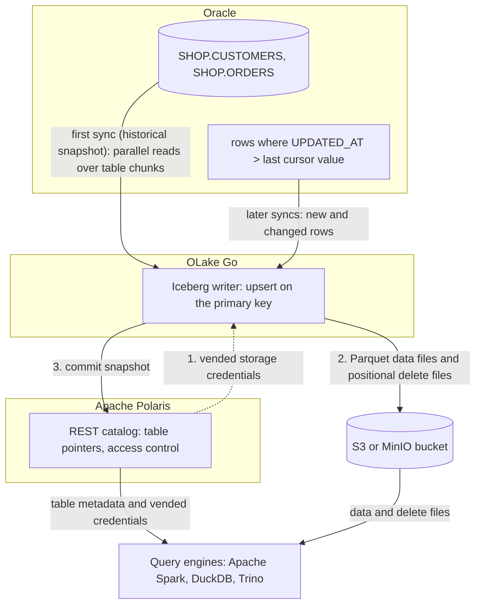

import * as I from '@site/src/components/integrations';

Oracle to Apache Iceberg usually means GoldenGate with a big data handler, or a Spark job that re-reads whole tables over Java Database Connectivity (JDBC) every night. OLake Go reads Oracle over a plain JDBC connection and writes the tables once as Iceberg in an Apache Polaris catalog. A cursor column keeps them fresh. One limit up front: OLake Go has no log-based change data capture (CDC) for Oracle. Changes travel through a column such as `UPDATED_AT`, and hard deletes are not seen.

Polaris is an open source Iceberg REST (Representational State Transfer) catalog you run yourself, with the files in your own bucket. Apache Spark, DuckDB and Trino all read the tables through that one endpoint.

<I.IntegrationByline />

<TLDR title='Key takeaways'>

- OLake Go replicates Oracle into Iceberg tables in Polaris: a full historical snapshot first, then incremental syncs on a cursor column such as `UPDATED_AT`, with no GoldenGate, no LogMiner and no Kafka in between.
- Changed rows replace their old versions through Iceberg row-level deletes in a format every target engine reads, so each table holds one current row per primary key.
- Spark, DuckDB and Trino read the same tables through the same catalog, with no export and no second copy. In the run on this page all three returned identical rows.

</TLDR>

**The short answer.** To replicate Oracle to Apache Iceberg without redo-log access, run OLake Go with a read-only Oracle user as the source and an Iceberg REST catalog such as Apache Polaris as the destination. The first sync copies each table in full; every later sync fetches the rows whose cursor column moved and upserts them. Spark, DuckDB and Trino query the result.

## How Oracle changes reach Apache Iceberg here



Two things happen in order, and OLake Go does both on its own. The first sync reads each table in parallel chunks, writes Parquet data files and records the highest cursor value it saw. Every later sync selects rows above that value, writes them as new data files and retires the old version of each updated row with a delete file.

Each sync ends with one commit to Polaris. OLake Go asks Polaris for short-lived storage credentials, uploads the files, then posts the new snapshot. Spark, DuckDB and Trino see it on their next query.

One thing to keep an eye on: the cursor is the only thing that carries changes. A row whose `UPDATED_AT` is not bumped on update is invisible to the next sync, and a deleted row is never seen. Set the column in every write path, or add a trigger, and soft-delete rows you need to remove downstream.

## What you need

- **Oracle Database 11g or later** reachable over JDBC, with a read-only user and a cursor column on each table. The tables on this page ran on Oracle Database 23ai Free in Docker.
- **An Apache Polaris server and a bucket**, both reachable from OLake Go and from the engines. The run on this page used Polaris 1.8.0 and MinIO in Docker; on AWS, use an S3 bucket and an IAM role instead.
- **At least one Iceberg reader.** The run on this page used Apache Spark 3.5.6 with Iceberg 1.10.0, DuckDB 1.5.5 and Trino 484.
- **OLake UI** from the [Docker Compose install](/docs/install/olake-ui/). The run on this page used OLake Go v1.1.0.
- **Docker**, and about 40 minutes.

## Step 1: Prepare Oracle for incremental sync

Most readers point OLake Go at tables they already have. If you want to follow along with the exact data from this page, create these two tables first:

<details>
<summary>The two sample tables used on this page</summary>

```sql title="Sample schema, in the SHOP schema of pluggable database FREEPDB1"
CREATE TABLE shop.customers (
  id NUMBER(10) GENERATED BY DEFAULT AS IDENTITY PRIMARY KEY,
  name VARCHAR2(100), email VARCHAR2(200), city VARCHAR2(100), tier VARCHAR2(20),
  created_at TIMESTAMP DEFAULT SYSTIMESTAMP,
  updated_at TIMESTAMP DEFAULT SYSTIMESTAMP);

CREATE TABLE shop.orders (
  id NUMBER(10) GENERATED BY DEFAULT AS IDENTITY PRIMARY KEY,
  customer_id NUMBER(10) REFERENCES shop.customers(id),
  product VARCHAR2(100), amount NUMBER(10,2), status VARCHAR2(20),
  created_at TIMESTAMP DEFAULT SYSTIMESTAMP,
  updated_at TIMESTAMP DEFAULT SYSTIMESTAMP);

-- Then insert whatever you like. This page started with 8 customers and 40 orders.
```

</details>

<I.Partial id="sources/oracle/prereqs" tables="customers, orders" />

## Step 2: Set up the Polaris catalog

An Iceberg table is a set of files plus a pointer to its current metadata, and the catalog holds that pointer. **Apache Polaris** is the catalog this page uses: OLake Go commits into it, and every reader asks it where the current snapshot is. The files sit in your own S3 or MinIO bucket; Polaris holds only the pointers and the permissions.

The [Polaris catalog page](/docs/integrations/catalogs/polaris/) lists which engines read it and how. Any Iceberg REST client with OAuth2 works, which covers Spark, DuckDB, Trino, ClickHouse, Flink and PyIceberg.

<I.CatalogStrip />

<I.CatalogTabs>
<TabItem value="polaris">

<I.Partial id="catalogs/polaris/setup" />

</TabItem>
</I.CatalogTabs>

## Step 3: Connect Oracle to OLake Go

<I.Partial id="sources/oracle/connect">

Here is the source form from the run on this page. Oracle ran in another container, so the host is `host.docker.internal`. The connection type is **Service Name** (`FREEPDB1`) rather than a system identifier (SID), and the user is the one from step 1.

<Figure src='/img/docs/integrations/oracle-to-iceberg/olake-source-oracle.webp' alt='OLake UI Edit source form for Oracle on OLake Go v1.1.0 with host host.docker.internal, port 1521, connection type Service Name, service name FREEPDB1 and user olake' caption='The Oracle source in OLake UI: service name FREEPDB1 and the read-only user from step 1.' width='760px' />

</I.Partial>

## Step 4: Configure the Iceberg destination

<I.CatalogTabs>
<TabItem value="polaris">

<I.Partial id="catalogs/polaris/writer">

Here is the destination form from the run on this page. Polaris and MinIO ran in other containers, so both addresses use `host.docker.internal`; the credential is the `olake` principal from step 2.

<Figure src='/img/docs/integrations/oracle-to-iceberg/olake-destination-polaris.webp' alt='OLake UI Edit destination form for Apache Iceberg with catalog type Polaris, OAuth2, REST catalog URI on port 8181, catalog name olake and the MinIO endpoint' caption='The Polaris destination in OLake UI: OAuth2 with the principal from step 2, and the MinIO endpoint for the files.' width='760px' />

</I.Partial>

</TabItem>
</I.CatalogTabs>

## Step 5: Create the job and run the first sync

Because the Oracle connector has no CDC mode, each stream runs as **Full Refresh + Incremental** with `UPDATED_AT` as the cursor. The target query engines are Apache Spark, DuckDB and Trino.

<I.Partial id="jobs/create" engines="Apache Spark, DuckDB and Trino" upsert="Positional Deletes" updateType="pos" image="olakego/source-oracle:latest" cliSyncMode="incremental" syncMode="Full Refresh + Incremental" cursor="UPDATED_AT" namespace="SHOP" stream="CUSTOMERS">

OLake Go offers only the delete formats all three engines read, which here is all three Iceberg formats. The run used **Positional Deletes** on Iceberg v2, readable by every current release of each engine.

<Figure src='/img/docs/integrations/oracle-to-iceberg/olake-streams-positional-deletes.webp' alt='OLake UI Streams Selection page with SHOP CUSTOMERS and ORDERS selected, Full Refresh + Incremental on cursor UPDATED_AT, Upsert and Positional Deletes on Iceberg V2' caption='Each stream: Full Refresh + Incremental on UPDATED_AT, Upsert, and Positional Deletes on Iceberg v2. The Iceberg DB name at the top is editable.' />

<Figure src='/img/docs/integrations/oracle-to-iceberg/olake-job-history-two-syncs.webp' alt='OLake UI Job Logs and History for oracle_to_iceberg showing two completed syncs, 28 seconds and then 16 seconds' caption='Job history: the 28 s historical snapshot, then the 16 s incremental sync.' />

</I.Partial>

On this page the first run copied 8 customers and 40 orders (48 records, 2.24 KB) and finished in **28 seconds**, container start included. OLake Go names the Iceberg namespace after the job and the source schema, lower-cased, so `oracle_to_iceberg` on schema `SHOP` produced `oracle_to_iceberg_shop`. The **Iceberg DB** field at the top of the Streams page changes it before the first sync.

## Step 6: Query the Iceberg tables

DuckDB is the quickest reader to try: one process, no server. It attaches the whole Polaris catalog and reads the tables in place.

<I.CatalogTabs>
<TabItem value="polaris">

<I.Partial id="engines/duckdb/query-polaris" schema="oracle_to_iceberg_shop" />

<Figure src='/img/docs/integrations/oracle-to-iceberg/duckdb-polaris-customers.webp' alt='DuckDB 1.5.5 querying polaris.oracle_to_iceberg_shop.customers through the attached Polaris catalog and returning 10 rows' caption='DuckDB 1.5.5 reading the customers table through Polaris after the incremental sync: 10 rows, one per key.' />

</TabItem>
</I.CatalogTabs>

<I.Cta />

## Step 7: Change rows in Oracle and sync again

To see the incremental path work, the run on this page made 12 changes in Oracle after the first sync. Every update also sets `updated_at`, which is what the cursor sees:

```sql title="Changes made in Oracle between the two syncs"
INSERT INTO customers (name, email, city, tier) VALUES ('Maya Patel', 'maya@example.com', 'Pune', 'silver');
INSERT INTO customers (name, email, city, tier) VALUES ('Lucas Silva', 'lucas@example.com', 'São Paulo', 'bronze');
INSERT INTO orders (customer_id, product, amount, status) VALUES (9, 'Laptop', 1299.00, 'placed');
INSERT INTO orders (customer_id, product, amount, status) VALUES (9, 'Mouse', 25.50, 'placed');
INSERT INTO orders (customer_id, product, amount, status) VALUES (10, 'Monitor', 349.99, 'placed');
INSERT INTO orders (customer_id, product, amount, status) VALUES (3, 'Keyboard', 89.00, 'placed');
INSERT INTO orders (customer_id, product, amount, status) VALUES (7, 'Webcam', 79.90, 'placed');
UPDATE customers SET tier = 'gold',      updated_at = SYSTIMESTAMP WHERE name = 'Liam Carter';
UPDATE customers SET city = 'Abu Dhabi', updated_at = SYSTIMESTAMP WHERE name = 'Zara Ali';
UPDATE orders    SET status = 'delivered', updated_at = SYSTIMESTAMP WHERE id IN (1, 4, 7);
COMMIT;
```

The second sync fetched **12 rows (598 bytes)** above the saved cursor and finished in **16 seconds** end to end. For `orders` that meant one new data file with 8 rows: 5 inserts plus the new versions of 3 updated rows. One small positional delete file retires the 3 old versions by file and row position. OLake Go's commit report in the sync log shows it directly: `addedDataFiles=1`, `addedRecords=8`, `addedPositionalDeleteFiles=1`, `addedPositionalDeletes=3`, and no equality delete files.

<Figure src='/img/docs/integrations/oracle-to-iceberg/olake-sync-log-positional-delete-commit.webp' alt='OLake UI sync log filtered to the Iceberg commit report for orders, showing addedDataFiles 1, addedPositionalDeleteFiles 1, addedRecords 8 and addedPositionalDeletes 3' caption='The incremental sync in the OLake UI log: one data file and one positional delete file for orders.' />

`customers` has the same shape with 4 rows and 2 deletes. Every reader shows the result on its next query: Liam Carter is `gold`, Zara Ali moved to Abu Dhabi, and the two new customers are there. In incremental mode OLake Go cannot tell an insert from an update, so every row the second sync brought carries `_op_type = u`; the snapshot rows keep `r`.

**Schema changes.** When a column is added in Oracle, OLake Go adds it to the Iceberg table on the next sync and commits the new schema to Polaris. Widening changes are applied; narrowing or incompatible type changes fail the sync rather than corrupt the table. Full rules are on the [schema evolution page](/docs/features/schema/).

## Query the same tables from Trino and Spark

This is the point of writing Iceberg. Nothing is exported, copied or refreshed: each engine reads the files OLake Go wrote, through the same Polaris endpoint.

<Tabs groupId="engine" queryString="engine">
<TabItem value="trino" label="Trino" default>

<I.Partial id="engines/trino/connect-polaris" schema="oracle_to_iceberg_shop" />

<Figure src='/img/docs/integrations/oracle-to-iceberg/trino-polaris-customers.webp' alt='Trino 484 CLI querying customers in the oracle_to_iceberg_shop schema of the polaris catalog and returning 10 rows' caption='Trino 484 reading the same table through Polaris: the same 10 rows.' />

</TabItem>
<TabItem value="spark" label="Apache Spark">

<I.Partial id="engines/spark/connect-polaris" schema="oracle_to_iceberg_shop" />

Spark 3.5.6 with Iceberg 1.10.0 returned the same 10 customers and 45 orders in the run on this page.

</TabItem>
</Tabs>

An `orders` roll-up matched Oracle to the cent in all three engines: 45 orders for 25579.19 in total. By status it gave 16 delivered orders for 8659.68, 18 placed for 10522.26, 11 shipped for 6397.25.

## Data types: Oracle to Apache Iceberg

OLake Go maps Oracle types to Iceberg types itself; each engine then shows the Iceberg type in its own terms. Numbers are the group to watch.

| Oracle | Iceberg (written by OLake Go) | Notes |
| --- | --- | --- |
| `NUMBER(n,0)` | `long` | The `NUMBER(10)` identity keys on this page arrived as `long`. |
| `NUMBER(n,m)` with a scale, `FLOAT`, `BINARY_DOUBLE` | `double` | OLake Go stores decimals as doubles. The `orders.amount` sums on this page matched Oracle to the cent in every engine; round at query time when you need exact decimal arithmetic. |
| `BINARY_FLOAT` | `float` | |
| `DATE`, `TIMESTAMP`, `TIMESTAMP WITH TIME ZONE`, `TIMESTAMP WITH LOCAL TIME ZONE` | `timestamptz` (UTC) | Oracle `DATE` carries a time; it arrives as a UTC instant. |
| `VARCHAR2`, `NVARCHAR2`, `CHAR`, `CLOB`, `NCLOB`, `LONG` | `string` | |
| `RAW`, `LONG RAW`, `BLOB`, `BFILE`, `INTERVAL` types | `string` | Binary values arrive as text; keep large binaries out of the sync. |

Oracle types in the table come from the [Oracle connector reference](/docs/connectors/oracle/#data-type-mapping).

## Cost and maintenance

- **Storage** is your bucket: you pay S3 or MinIO rates for the Parquet and delete files, and nothing to Polaris for holding pointers.
- **Compute.** OLake Go runs wherever you run Docker, for the length of a sync; the incremental sync on this page took 16 seconds. Readers spend compute only when they query.
- **Oracle load.** Each incremental sync runs one range query per table on the cursor column. Index `UPDATED_AT` on large tables so the query does not scan them.
- **Maintenance.** Nothing compacts the tables for you. A table that gets a new small file and delete file per sync wants compaction; [OLake Fusion](/docs/fusion/getting-started/overview/) does this for the catalogs OLake Go writes to, and Spark's `rewrite_data_files` works through the same Polaris endpoint.
- **Credential rotation.** Polaris principals do not expire by default. Rotate the `olake` principal's secret on your own schedule; a rotated secret fails the next sync at the token exchange, before any data moves.

## Troubleshooting

### 1. Discovery fails because the service is not registered

```text
FATAL failed to ping database: ORA-12514: TNS:listener does not currently know of service requested in connect descriptor
```

The service name is wrong or the listener has not registered it yet. On a fresh container the pluggable database registers a minute or two after startup; `lsnrctl status` lists `freepdb1` once it is ready. Otherwise fix the service name, or connect with the SID.

### 2. The source test fails with ORA-01017 although sqlplus logs in

```text
failed to ping database: ORA-01017: invalid credential or not authorized; logon denied
```

OLake Go quotes the username when it connects, so Oracle compares it case-sensitively. A user created as `CREATE USER olake` is stored as `OLAKE`; enter it in upper case.

### 3. Updated rows are missing after an incremental sync

The update did not move the cursor column. OLake Go only fetches rows whose cursor value is above the last one it saw, so an `UPDATE` that leaves `UPDATED_AT` untouched is invisible. Set the column in every write path, or add a trigger that sets it on `UPDATE`.

### 4. A recreated job writes nothing on its first sync

```text
Table[<namespace>.customers]: stream index is already up to date at snapshot[...]
chunk min[1] and max[<nil>] already committed, skipping
```

A job deleted and created again with the same name writes into the same Iceberg namespace. OLake Go sees the chunks of the earlier snapshot as already committed and skips them, so the snapshot writes nothing. Drop the old tables from Polaris first, or give the new job a different **Iceberg DB** name.

### 5. The destination test fails at the token exchange

OLake Go's destination test exchanges the principal's credentials at `/api/catalog/v1/oauth/tokens` before anything else. Three causes cover nearly every failure: a wrong client id or secret, a principal with no role that carries `CATALOG_MANAGE_CONTENT` on the catalog, or a wrong `Polaris Catalog Name`. Run the token check from the catalog setup; it returns the same error Polaris gives OLake Go.

<details>
<summary>How this compares with other ways to move Oracle data to Apache Iceberg</summary>

| Method | Freshness | Updates and deletes | Where the data lands | What you run |
| --- | --- | --- | --- | --- |
| [Oracle GoldenGate](https://docs.oracle.com/en/middleware/goldengate/core/) with a big data target | Seconds | Yes, from the redo log | Files or tables, depending on the handler | GoldenGate Extract and Replicat, a licensed Oracle option |
| [Debezium Oracle connector](https://debezium.io/documentation/reference/stable/connectors/oracle.html), Kafka and the [Iceberg Kafka Connect sink](https://iceberg.apache.org/docs/latest/kafka-connect/) | Seconds to minutes | Yes, through LogMiner | Iceberg tables in your catalog | Kafka, Kafka Connect, supplemental logging on Oracle and both connectors |
| Spark job over [JDBC](https://spark.apache.org/docs/latest/sql-data-sources-jdbc.html) | Hours to daily | Only with your own `MERGE` logic | Iceberg tables in your catalog | A Spark cluster, a scheduler and the merge code |
| Managed ELT (Fivetran, Estuary, Airbyte Cloud) | Minutes, by plan | Varies by tool | Their managed destination, often a warehouse table | Nothing; priced per row, per GB or per connector |
| **OLake Go to Iceberg on Polaris (this guide)** | Incremental on a schedule down to one minute | Inserts and updates through the cursor; no deletes | Apache Iceberg tables in your bucket and your catalog | One Docker Compose stack, open source; your bucket plus your own compute |

Debezium or GoldenGate is the right choice when deletes must be replicated from the redo log. OLake Go needs no Oracle option, no supplemental logging and no Kafka. That matters when a cursor column already exists and rows are rarely deleted.

</details>

## When not to use this

- **You need hard deletes replicated.** Incremental sync cannot see a deleted row. Soft-delete in Oracle, or use a log-based tool.
- **Tables have no cursor column and cannot get one.** Without a monotonically increasing column, only Full Refresh works.
- **You need seconds of latency.** OLake Go syncs on a schedule, one minute at the shortest.

## FAQs

<I.IntegrationFaq />

<I.HowWeTested />

## Related guides

<I.RelatedIntegrations />

Deeper reading on this site:

- [Oracle connector reference](/docs/connectors/oracle/)
- [Apache Iceberg readers and delete formats](/docs/integrations/iceberg/)
- [Oracle to Redshift on AWS Glue](/docs/integrations/oracle-to-redshift/)
- [Equality vs positional deletes vs deletion vectors](/blog/iceberg-delete-formats-cdc-equality-vs-positional-vs-deletion-vectors/)
- [OLake Go ingestion benchmarks](/docs/benchmarks/ingestion/)

<I.IntegrationJsonLd />

<I.Cta title='Start with your own Oracle' body='The quickstart runs OLake UI with Docker Compose. Create the source, the Polaris destination and the job as above, and the first sync lands your tables as Iceberg in your own bucket.' />
