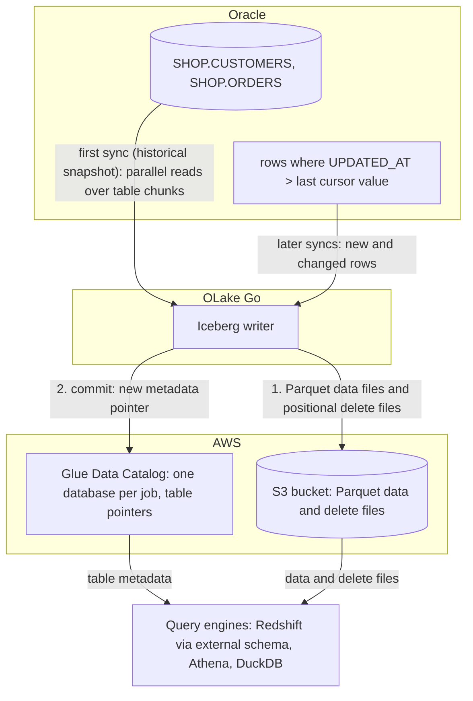

import * as I from '@site/src/components/integrations';

Oracle to Redshift usually means GoldenGate, a Database Migration Service (DMS) task, or a nightly export and `COPY`. This guide takes a fourth route. OLake Go reads the Oracle tables over a plain Java Database Connectivity (JDBC) connection, writes them once as Apache Iceberg tables into the AWS Glue Data Catalog, and keeps them fresh on a cursor column. The files stay in your own S3 bucket.

Redshift maps the Glue database onto an external schema and queries the tables in place. Nothing else is in the path: no GoldenGate, no DMS, no load job. Athena and DuckDB read the same tables through the same catalog.

<I.IntegrationByline />

<TLDR title='Key takeaways'>

- OLake Go replicates Oracle into Iceberg tables in the Glue Data Catalog: a full historical snapshot first, then incremental syncs on a cursor column such as `UPDATED_AT`, with no GoldenGate or DMS in between. The Oracle connector has no log-based change data capture (CDC), so the cursor is what carries changes.
- Redshift reads the Glue database through one `CREATE EXTERNAL SCHEMA` statement, with no refresh. Every change a sync commits is visible on the next query, on Serverless and RA3 alike.
- The same tables, written once by OLake Go, are also queryable from Athena and DuckDB. In the run on this page all three engines returned identical rows.

</TLDR>

**The short answer.** To replicate Oracle to Redshift without redo-log access, run OLake Go with a read-only Oracle user as the source and the AWS Glue Data Catalog as the Iceberg destination. Set the upsert type to Positional Deletes, the format Redshift reads. The first sync copies each table in full (the historical snapshot); every later sync fetches the rows whose cursor column moved and upserts them. Redshift, Athena and DuckDB then query the same Iceberg tables, with no second copy.

## How Oracle changes reach Redshift here



Two things happen in order, and OLake Go does both on its own. The first sync reads each table in parallel chunks and writes Parquet data files, then records the highest cursor value it saw: that is the historical load. Every later sync selects rows above that value and writes them as new data files. A delete file retires the old version of each updated row. There is no separate backfill job.

Each sync ends with one commit to Glue. OLake Go uploads the data and delete files to the bucket, then updates the table's metadata pointer in the Glue database. Redshift, Athena and DuckDB see the new snapshot on their next query; none of them keeps a copy.

One thing to keep an eye on: the cursor is the only thing that carries changes. A row whose `UPDATED_AT` is not bumped on update is invisible to the next sync, and a deleted row is never seen. Set the column in every write path, or add a trigger, and soft-delete rows you need to remove downstream.

## What you need

- **Oracle Database 11g or later** reachable over JDBC, with a read-only user and a cursor column on each table. The tables on this page ran on Oracle Database 23ai Free in Docker.
- **An AWS account** with an S3 bucket for the files and an IAM user or role for OLake Go with Glue and S3 permissions. The run on this page used a bucket and a scoped IAM user in `ap-southeast-1`.
- **Amazon Redshift**, Serverless or an RA3 cluster, with an IAM role attached that can read Glue and the bucket. The run on this page used a Serverless workgroup at 8 RPU.
- **OLake UI** from the [Docker Compose install](/docs/install/olake-ui/). The run on this page used OLake Go v1.1.0.
- **Docker**, and about 40 minutes.

## Step 1: Prepare Oracle for incremental sync

Most readers point OLake Go at tables they already have. If you want to follow along with the exact data from this page, create these two tables first:

<details>
<summary>The two sample tables used on this page</summary>

```sql title="Sample schema, in the SHOP schema of pluggable database FREEPDB1"
CREATE TABLE shop.customers (
  id NUMBER(10) GENERATED BY DEFAULT AS IDENTITY PRIMARY KEY,
  name VARCHAR2(100), email VARCHAR2(200), city VARCHAR2(100), tier VARCHAR2(20),
  created_at TIMESTAMP DEFAULT SYSTIMESTAMP,
  updated_at TIMESTAMP DEFAULT SYSTIMESTAMP);

CREATE TABLE shop.orders (
  id NUMBER(10) GENERATED BY DEFAULT AS IDENTITY PRIMARY KEY,
  customer_id NUMBER(10) REFERENCES shop.customers(id),
  product VARCHAR2(100), amount NUMBER(10,2), status VARCHAR2(20),
  created_at TIMESTAMP DEFAULT SYSTIMESTAMP,
  updated_at TIMESTAMP DEFAULT SYSTIMESTAMP);

-- Then insert whatever you like. This page started with 8 customers and 40 orders.
```

</details>

<I.Partial id="sources/oracle/prereqs" tables="customers, orders" />

## Step 2: Set up the Glue catalog

Redshift reads Iceberg tables through a catalog. **AWS Glue Data Catalog** is the one this page uses: OLake Go creates a Glue database per job and registers each table there. The files sit in your S3 bucket. Redshift, Athena, Amazon Elastic MapReduce (EMR) and DuckDB all read from the same catalog. Redshift reaches it through an external schema, with the IAM role attached to the workgroup or cluster.

<I.CatalogStrip />

<I.CatalogTabs>
<TabItem value="glue">

<I.Partial id="catalogs/glue/setup" />

The run on this page gave OLake Go a scoped IAM user with this inline policy. Redshift got a role with `AmazonS3ReadOnlyAccess` and read access to Glue:

```json title="IAM policy for the OLake Go user (replace the bucket, region and account)"
{
  "Version": "2012-10-17",
  "Statement": [
    { "Effect": "Allow", "Action": ["s3:ListBucket", "s3:GetBucketLocation"], "Resource": "arn:aws:s3:::<bucket>" },
    { "Effect": "Allow", "Action": ["s3:GetObject", "s3:PutObject", "s3:DeleteObject", "s3:AbortMultipartUpload", "s3:ListMultipartUploadParts"], "Resource": "arn:aws:s3:::<bucket>/*" },
    { "Effect": "Allow",
      "Action": ["glue:GetDatabase", "glue:GetDatabases", "glue:CreateDatabase", "glue:GetTable", "glue:GetTables", "glue:CreateTable", "glue:UpdateTable", "glue:DeleteTable"],
      "Resource": ["arn:aws:glue:<region>:<account>:catalog", "arn:aws:glue:<region>:<account>:database/*", "arn:aws:glue:<region>:<account>:table/*/*"] }
  ]
}
```

</TabItem>
</I.CatalogTabs>

## Step 3: Connect Oracle to OLake Go

<I.Partial id="sources/oracle/connect">

Here is the source form from the run on this page. Oracle ran in another container, so the host is `host.docker.internal`. The connection type is **Service Name** (`FREEPDB1`) rather than a system identifier (SID), and the user is the one from step 1.

<Figure src='/img/docs/integrations/oracle-to-redshift/olake-source-oracle.webp' alt='OLake UI Edit source form for Oracle on OLake Go v1.1.0 with host host.docker.internal, port 1521, connection type Service Name, service name FREEPDB1 and user olake' caption='The Oracle source in OLake UI: service name FREEPDB1 and the read-only user from step 1.' width='760px' />

</I.Partial>

## Step 4: Configure the Iceberg destination

<I.CatalogTabs>
<TabItem value="glue">

<I.Partial id="catalogs/glue/writer" />

Here is the destination form from the run on this page. It holds the bucket path OLake Go writes under, the region of the bucket and the Glue catalog, and the access key pair of the IAM user from step 2.

<Figure src='/img/docs/integrations/oracle-to-redshift/olake-destination-glue.webp' alt='OLake UI Edit destination form for Apache Iceberg with catalog type AWS Glue, an S3 path under the lab bucket, region ap-southeast-1 and an access key pair' caption='The Glue destination in OLake UI: the S3 path, the region and the keys of the scoped IAM user.' width='760px' />

</TabItem>
</I.CatalogTabs>

## Step 5: Create the job and run the first sync

Redshift is not in OLake Go's target engine picker yet. This job therefore lists **Athena** and **DuckDB** as target engines and sets the upsert type to **Positional Deletes** by hand. That is the format Redshift reads, and both listed engines read it too. Because the Oracle connector has no change data capture (CDC) mode, each stream runs as **Full Refresh + Incremental** with `UPDATED_AT` as the cursor.

<I.Partial id="jobs/create" engines="AWS Athena and DuckDB (Redshift is not in the list yet; it reads what Athena reads)" upsert="Positional Deletes" updateType="pos" image="olakego/source-oracle:latest" cliSyncMode="incremental" syncMode="Full Refresh + Incremental" cursor="UPDATED_AT" namespace="SHOP" stream="CUSTOMERS">

OLake Go offers every delete format Athena and DuckDB both read. The run on this page picked **Positional Deletes** from that list because Redshift reads Iceberg v2 tables with positional deletes and nothing else.

<Figure src='/img/docs/integrations/oracle-to-redshift/olake-streams-positional-deletes.webp' alt='OLake UI Streams Selection page with the SHOP schema, CUSTOMERS and ORDERS selected, sync mode Full Refresh + Incremental, cursor field UPDATED_AT, ingestion mode Upsert and upsert type Positional Deletes on Iceberg format version V2' caption='Each stream: Full Refresh + Incremental on UPDATED_AT, Upsert, and Positional Deletes as the upsert type. The Iceberg DB name at the top is editable.' />

<Figure src='/img/docs/integrations/oracle-to-redshift/olake-job-history-two-syncs.webp' alt='OLake UI Job Logs and History for oracle_to_redshift showing two completed syncs, the first in 19 seconds and the second in 11 seconds' caption='Job history: the 19 s historical snapshot, then the 11 s incremental sync.' />

</I.Partial>

On this page the first run copied 8 customers and 40 orders (48 records, 2.24 KB) and finished in **19 seconds**, container start included. OLake Go names the Glue database after the job and the source schema, lower-cased, so `oracle_to_redshift` on schema `SHOP` produced `oracle_to_redshift_shop`. The **Iceberg DB** field at the top of the Streams page changes it before the first sync.

## Step 6: Query the tables in Redshift

<I.CatalogTabs>
<TabItem value="glue">

<I.Partial id="engines/redshift/query-glue" schema="oracle_to_redshift_shop" />

<Figure src='/img/docs/integrations/oracle-to-redshift/redshift-glue-customers.webp' alt='Redshift query editor v2 in the AWS console running the customers query on the Serverless workgroup and returning 10 rows with id, name, city and tier' caption='Redshift Serverless reading the customers table through the external schema after the incremental sync in query editor v2: 10 rows, one per key.' />

</TabItem>
</I.CatalogTabs>

<I.Cta />

## Step 7: Change rows in Oracle and sync again

To see the incremental path work, the run on this page made 12 changes in Oracle after the first sync. Every update also sets `updated_at`, which is what the cursor sees:

```sql title="Changes made in Oracle between the two syncs"
INSERT INTO customers (name, email, city, tier) VALUES ('Maya Patel', 'maya@example.com', 'Pune', 'silver');
INSERT INTO customers (name, email, city, tier) VALUES ('Lucas Silva', 'lucas@example.com', 'São Paulo', 'bronze');
INSERT INTO orders (customer_id, product, amount, status) VALUES (9, 'Laptop', 1299.00, 'placed');
INSERT INTO orders (customer_id, product, amount, status) VALUES (9, 'Mouse', 25.50, 'placed');
INSERT INTO orders (customer_id, product, amount, status) VALUES (10, 'Monitor', 349.99, 'placed');
INSERT INTO orders (customer_id, product, amount, status) VALUES (3, 'Keyboard', 89.00, 'placed');
INSERT INTO orders (customer_id, product, amount, status) VALUES (7, 'Webcam', 79.90, 'placed');
UPDATE customers SET tier = 'gold',      updated_at = SYSTIMESTAMP WHERE name = 'Liam Carter';
UPDATE customers SET city = 'Abu Dhabi', updated_at = SYSTIMESTAMP WHERE name = 'Zara Ali';
UPDATE orders    SET status = 'delivered', updated_at = SYSTIMESTAMP WHERE id IN (1, 4, 7);
COMMIT;
```

The second sync fetched **12 rows (598 bytes)** above the saved cursor and finished in **11 seconds** end to end. For `customers` that meant one new data file with 4 rows: 2 inserts plus the new versions of 2 updated rows. One small positional delete file retires the 2 old versions. OLake Go's commit report in the sync log shows it directly: `addedDataFiles=1`, `addedRecords=4`, `addedPositionalDeleteFiles=1`, `addedPositionalDeletes=2`. The `orders` table has the same shape with 8 rows and 3 deletes.

<Figure src='/img/docs/integrations/oracle-to-redshift/olake-sync-log-positional-delete-commit.webp' alt='OLake UI sync log filtered to the Iceberg commit report, showing addedDataFiles 1, addedPositionalDeleteFiles 1, addedRecords and addedPositionalDeletes for the incremental sync' caption='The incremental sync in the OLake UI log: one data file and one positional delete file per table.' />

Redshift shows the result on the next query, with no refresh and no `ALTER TABLE`. Liam Carter is `gold`, Zara Ali moved to Abu Dhabi, and the two new customers are there. In incremental mode OLake Go cannot tell an insert from an update, so every row the second sync brought carries `_op_type = u`; the snapshot rows keep `r`.

**Schema changes.** When a column is added in Oracle, OLake Go adds it to the Iceberg table on the next sync. The Glue table definition is updated in the same commit, and Redshift shows it on the next query of the external schema. Widening changes are applied; narrowing or incompatible type changes fail the sync rather than corrupt the table. Full rules are on the [schema evolution page](/docs/features/schema/).

## Query the same tables from Athena and DuckDB

This is the point of writing Iceberg instead of loading Redshift tables. Nothing is exported, copied or refreshed: both engines read the files OLake Go wrote, through the same Glue database.

<Tabs groupId="engine" queryString="engine">
<TabItem value="athena" label="Amazon Athena" default>

<I.Partial id="engines/athena/connect-glue" schema="oracle_to_redshift_shop" />

<Figure src='/img/docs/integrations/oracle-to-redshift/athena-glue-customers.webp' alt='Athena query editor in the AWS console running the customers query on the oracle_to_redshift_shop database and returning 10 rows' caption='Athena reading the same table through Glue: the same 10 rows.' />

</TabItem>
<TabItem value="duckdb" label="DuckDB">

<I.Partial id="engines/duckdb/connect-glue" schema="oracle_to_redshift_shop" />

DuckDB 1.5.5 returned the same 10 customers and the same `orders` roll-up as Redshift and Athena in the run on this page. It read the current metadata file of each table.

</TabItem>
</Tabs>

An `orders` roll-up matched Oracle to the cent in all three engines. It gave 16 delivered orders for 8659.68, 18 placed for 10522.26, 11 shipped for 6397.25.

## Data types: Oracle to Iceberg to Redshift

OLake Go maps Oracle types to Iceberg types, and Redshift maps Iceberg types to its own through the external schema. Numbers are the group to watch.

| Oracle | Iceberg (written by OLake Go) | Redshift shows | Notes |
| --- | --- | --- | --- |
| `NUMBER(n,0)` | `long` | `BIGINT` | The `NUMBER(10)` identity keys on this page arrived as `BIGINT`. |
| `NUMBER(n,m)` with a scale, `FLOAT`, `BINARY_DOUBLE` | `double` | `DOUBLE PRECISION` | OLake Go stores decimals as doubles. The `orders.amount` sums on this page matched Oracle to the cent in every engine; round at query time when you need exact decimal arithmetic. |
| `BINARY_FLOAT` | `float` | `REAL` | |
| `DATE`, `TIMESTAMP`, `TIMESTAMP WITH TIME ZONE`, `TIMESTAMP WITH LOCAL TIME ZONE` | `timestamptz` (UTC) | `TIMESTAMP` | Oracle `DATE` carries a time; it arrives as a UTC instant, shown without a zone. |
| `VARCHAR2`, `NVARCHAR2`, `CHAR`, `CLOB`, `NCLOB`, `LONG` | `string` | `VARCHAR` | |
| `RAW`, `LONG RAW`, `BLOB`, `BFILE`, `INTERVAL` types | `string` | `VARCHAR` | Binary values arrive as text; keep large binaries out of the sync. |

Oracle types in the table come from the [Oracle connector reference](/docs/connectors/oracle/#data-type-mapping). The Redshift side comes from the [Redshift Iceberg page](https://docs.aws.amazon.com/redshift/latest/dg/querying-iceberg.html) (checked 2026-10-30) and from `svv_external_columns` on the tables of this run.

## Cost and maintenance

- **Storage** is your bucket: you pay S3 rates for the Parquet and delete files, and nothing to Glue beyond its per-object pricing for the table entries.
- **Compute.** OLake Go runs wherever you run Docker. Redshift Serverless bills RPU-hours only while queries run; a query over the external schema scans the Parquet files in S3 through Redshift Spectrum, so filter on the columns you need. Athena bills per terabyte scanned.
- **Oracle load.** Each incremental sync runs one range query per table on the cursor column. Index `UPDATED_AT` on large tables so the query does not scan them.
- **Maintenance.** Glue has no built-in compaction for tables written by external engines. A table that gets a new small file and delete file per sync wants compaction; [OLake Fusion](/docs/fusion/getting-started/overview/) does this for the catalogs OLake Go writes to, and Spark on EMR's `rewrite_data_files` works through the same Glue catalog.
- **Key rotation.** The IAM user's access key is what OLake Go writes with. Rotate it on your schedule, or run OLake Go on an instance with a role and leave the key fields empty.

## Troubleshooting

### 1. The source test fails to connect

```text
ORA-12514: Cannot connect to database. Service FREEPDB1 is not registered with the listener
```

The service name is wrong or the listener has not finished registering it. Run `lsnrctl status` on the server, or connect with the SID instead. On a fresh container the service appears a minute or two after startup.

### 2. The source test fails with ORA-01017 although sqlplus logs in

```text
failed to ping database: ORA-01017: invalid credential or not authorized; logon denied
```

OLake Go quotes the username when it connects, so Oracle compares it case-sensitively. A user created as `CREATE USER olake` is stored as `OLAKE`; enter it in upper case.

### 3. Updated rows are missing after an incremental sync

The update did not move the cursor column. OLake Go only fetches rows whose cursor value is above the last one it saw, so an `UPDATE` that leaves `UPDATED_AT` untouched is invisible. Set the column in every write path, or add a trigger that sets it on `UPDATE`.

### 4. The destination test fails on a table OLake Go did not create

```text
User: arn:aws:iam::<account>:user/<olake user> is not authorized to perform: s3:GetObject on resource: "arn:aws:s3:::<another bucket>/.../test_olake.db/test_olake/metadata/00000-....metadata.json"
```

OLake Go's destination test opens a probe table called `test_olake.test_olake` in the Glue database `test_olake`. An earlier run in the same account and region may have left that table behind, pointing at a bucket your user cannot read. The test then fails before it writes anything. Delete the stale table from Glue, or run OLake Go against a region whose Glue catalog does not have it.

### 5. Redshift cannot see the external schema's tables

```text
ERROR: Database 'oracle_to_redshift_shop' does not exist in the Glue Data Catalog
```

The external schema was created before the first sync, or in a different region from the Glue database. OLake Go creates the Glue database on the first sync; create the external schema after it, in the workgroup's region.

<details>
<summary>How this compares with other ways to move Oracle data to Redshift</summary>

| Method | Freshness | Updates and deletes | Where the data lands | What you run |
| --- | --- | --- | --- | --- |
| [AWS DMS to Redshift](https://docs.aws.amazon.com/dms/latest/userguide/CHAP_Target.Redshift.html) | CDC through LogMiner or Binary Reader | Yes | Native Redshift tables | A DMS replication instance and task, plus an S3 staging bucket; needs supplemental logging on Oracle |
| [Oracle GoldenGate](https://docs.oracle.com/en/middleware/goldengate/core/) to Redshift | Seconds | Yes | Native Redshift tables | GoldenGate Extract and Replicat, a licensed Oracle option |
| Export (Data Pump or `SELECT` to CSV), then `COPY` into Redshift | Hours to daily | No; full reloads only | Native Redshift tables | A script, a scheduler and a staging bucket |
| Managed ELT (Fivetran, Estuary, Airbyte Cloud) | Minutes, by plan | Varies by tool | Redshift tables, a second copy you pay to move and store | Nothing; priced per row, per GB or per connector |
| **OLake Go to Iceberg on Glue (this guide)** | Incremental on a schedule down to one minute | Inserts and updates through the cursor; no deletes | Apache Iceberg tables that Redshift, Athena, EMR, Spark and DuckDB all read | One Docker Compose stack, open source; your bucket plus your own compute |

DMS is the simpler choice when you need deletes replicated and are already on AWS. Writing Iceberg once avoids paying to move and store a second copy. That matters as soon as Athena, EMR or a notebook needs the same rows, or you want to own the files.

</details>

## When not to use this

- **You need hard deletes replicated.** Incremental sync cannot see a deleted row. Soft-delete in Oracle, or use a log-based tool.
- **Tables have no cursor column and cannot get one.** Without a monotonically increasing column, only Full Refresh works.
- **Every query must hit native Redshift speed.** Spectrum reads Parquet from S3 on every query. Keep the Iceberg tables as the source and load the hot slice into a native table on a schedule.

## FAQs

<I.IntegrationFaq />

<I.HowWeTested />

## Related guides

<I.RelatedIntegrations />

Deeper reading on this site:

- [Equality vs positional deletes vs deletion vectors](/blog/iceberg-delete-formats-cdc-equality-vs-positional-vs-deletion-vectors/)
- [Which engines read which delete formats](/blog/iceberg-delete-formats-interoperability-olake-go/)
- [OLake Go ingestion benchmarks](/docs/benchmarks/ingestion/)

<I.IntegrationJsonLd />

<I.Cta title='Start with your own Oracle' body='The quickstart runs OLake UI with Docker Compose. Create the source, the Glue destination and the job as above, and the first sync lands your tables where Redshift can read them.' />
