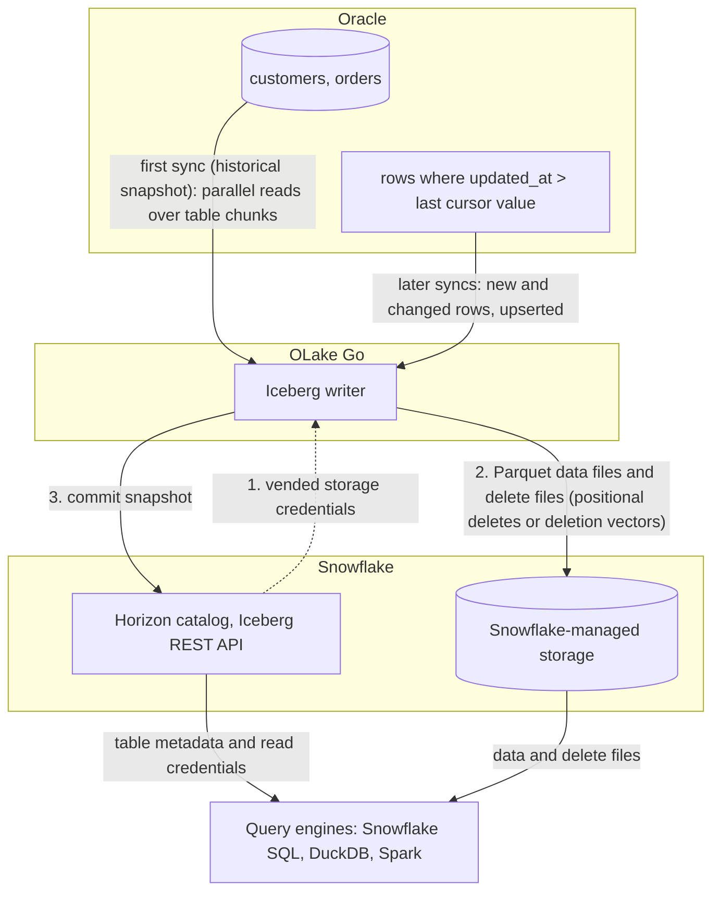

import * as I from '@site/src/components/integrations';

Oracle to Snowflake usually means GoldenGate, a Kafka pipeline, or a nightly export. This guide takes a fourth route. OLake Go reads the Oracle tables over a plain Java Database Connectivity (JDBC) connection, writes them once as Apache Iceberg tables into a catalog Snowflake reads, and keeps them fresh on a cursor column.

With Snowflake's own Horizon catalog, the default on this page, the files sit on Snowflake-managed storage. Nothing else is in the path: no GoldenGate, no Kafka, no Spark. With AWS Glue, the files sit in your S3 bucket and Snowflake reads them through a catalog integration.

<I.IntegrationByline />

<TLDR title='Key takeaways'>

- OLake Go replicates Oracle into Snowflake as Iceberg tables: a full historical snapshot first, then incremental syncs on a cursor column such as `updated_at`, with no GoldenGate or Kafka in between. The Oracle connector has no log-based change data capture (CDC), so the cursor is what carries changes.
- Through the Horizon catalog the tables land as Snowflake-managed Iceberg tables. You query them in Snowsight right away, with no `CREATE ICEBERG TABLE`, no external volume and no refresh.
- The same tables, written once by OLake Go, are also queryable from DuckDB and Spark through the same catalog. In the run on this page all three engines returned identical rows.

</TLDR>

**The short answer.** To replicate Oracle to Snowflake without redo-log access, run OLake Go with a read-only Oracle user as the source and the Snowflake Horizon catalog as the Iceberg destination. The first sync copies each table in full (the historical snapshot); every later sync fetches the rows whose cursor column moved and upserts them. Snowflake, DuckDB and Spark then query the same Iceberg tables, with no second copy.

## How Oracle data reaches Snowflake here



Two things happen in order, and OLake Go does both on its own. The first sync reads each table in parallel chunks and writes Parquet data files, then records the highest cursor value it saw: that is the historical load. Every later sync selects rows above that value and writes them as new data files.

A delete file retires the old version of each updated row. There is no separate backfill job.

Each sync ends with one commit to Horizon. OLake Go asks Horizon for short-lived storage credentials, uploads the data and delete files, then posts the new snapshot to the catalog. Snowflake sees it the moment the commit lands; DuckDB and Spark see it on their next catalog load.

One thing to keep an eye on: the cursor is the whole contract. A row that changes without its `updated_at` moving is never picked up.

A deleted row leaves no cursor value behind, so it stays in the Iceberg table. Set the column from a trigger or in every write path, and soft-delete if deletes matter.

## What you need

- **Oracle Database 11g or later** reachable over JDBC, with a read-only user and a cursor column on each table. The tables on this page ran on Oracle Database 23ai Free in Docker.
- **A Snowflake account** where you can run the one-time setup as `ACCOUNTADMIN`. Snowflake-managed storage means no cloud bucket or IAM role on your side.
- **OLake UI** from the [Docker Compose install](/docs/install/olake-ui/), with the OLake Go Oracle source on v0.11 or later. The run on this page used v1.1.0.
- **Docker**, and about 30 minutes.

## Step 1: Prepare Oracle for incremental sync

Most readers point OLake Go at tables they already have. If you want to follow along with the exact data from this page, create these two tables first:

<details>
<summary>The two sample tables used on this page</summary>

```sql title="Sample schema, in the SHOP schema of pluggable database FREEPDB1"
CREATE TABLE shop.customers (
  id NUMBER(10) GENERATED BY DEFAULT AS IDENTITY PRIMARY KEY,
  name VARCHAR2(100), email VARCHAR2(200), city VARCHAR2(100), tier VARCHAR2(20),
  created_at TIMESTAMP DEFAULT SYSTIMESTAMP,
  updated_at TIMESTAMP DEFAULT SYSTIMESTAMP);

CREATE TABLE shop.orders (
  id NUMBER(10) GENERATED BY DEFAULT AS IDENTITY PRIMARY KEY,
  customer_id NUMBER(10) REFERENCES shop.customers(id),
  product VARCHAR2(100), amount NUMBER(10,2), status VARCHAR2(20),
  created_at TIMESTAMP DEFAULT SYSTIMESTAMP,
  updated_at TIMESTAMP DEFAULT SYSTIMESTAMP);

-- Then insert whatever you like. This page started with 8 customers and 40 orders.
```

</details>

<I.Partial id="sources/oracle/prereqs" />

## Step 2: Set up the catalog in Snowflake

Snowflake reads Iceberg tables from two kinds of catalog. **Horizon** is Snowflake's own: OLake Go writes straight into it, the tables are Snowflake-managed, and they appear in Snowsight the moment a sync commits.

**AWS Glue** is a catalog outside Snowflake, so the files stay in your S3 bucket. Snowflake reaches them through a *catalog integration*: a read-only link to that external catalog, refreshed after each sync.

Horizon is the default on this page. Glue is the right pick when Athena, Redshift or Spark on Amazon Elastic MapReduce (EMR) will read the same tables. It keeps the files in your own bucket.

<I.CatalogStrip />

<I.CatalogTabs>
<TabItem value="horizon">

<I.Partial id="catalogs/horizon/setup" />

</TabItem>
<TabItem value="glue">

<I.Partial id="catalogs/glue/setup" />

</TabItem>
</I.CatalogTabs>

## Step 3: Connect Oracle to OLake Go

<I.Partial id="sources/oracle/connect">

Here is the source form from the run on this page. Oracle ran in another container, so the host is `host.docker.internal`. The connection type is **Service Name** (`FREEPDB1`) rather than a system identifier (SID), and the user is the one from step 1.

<Figure src='/img/docs/integrations/oracle-to-snowflake/olake-source-oracle.webp' alt='OLake UI Edit source form for Oracle on OLake Go v1.1.0 with host host.docker.internal, port 1521, connection type Service Name, service name FREEPDB1 and user olake' caption='The Oracle source in OLake UI: service name FREEPDB1 and the read-only user from step 1.' width='760px' />

</I.Partial>

## Step 4: Configure the Iceberg destination

<I.CatalogTabs>
<TabItem value="horizon">

<I.Partial id="catalogs/horizon/writer" />

</TabItem>
<TabItem value="glue">

<I.Partial id="catalogs/glue/writer" />

</TabItem>
</I.CatalogTabs>

## Step 5: Create the job and run the first sync

<I.Partial id="jobs/create" engines="Snowflake, plus DuckDB and Apache Spark if they will read the tables too" upsert="Positional Deletes" updateType="pos" image="olakego/source-oracle:latest" cliSyncMode="incremental" syncMode="Full Refresh + Incremental" cursor="updated_at">

Three target query engines were set on this job. That is the only format decision you make: OLake Go works out which Iceberg delete format all three can read and sets it on every stream. Because the Oracle connector has no change data capture (CDC) mode, each stream runs as **Full Refresh + Incremental** with `updated_at` as the cursor.

<Figure src='/img/docs/integrations/oracle-to-snowflake/olake-streams-incremental.webp' alt='OLake UI Streams Selection page with the SHOP schema, customers and orders selected, sync mode Full Refresh + Incremental, cursor field updated_at, ingestion mode Upsert and upsert type Positional Deletes' caption='Each stream: Full Refresh + Incremental on updated_at, Upsert, and the upsert type OLake Go resolved (Positional Deletes in this run).' />

<Figure src='/img/docs/integrations/oracle-to-snowflake/olake-job-history-two-syncs.webp' alt='OLake UI Job Logs and History for oracle_to_snowflake showing two completed syncs, the first in 22 seconds and the second in 17 seconds' caption='Job history: the 22 s historical snapshot, then the 17 s incremental sync.' />

</I.Partial>

On this page the first run copied 8 customers and 40 orders (48 records) and finished in **22 seconds**, container start included. OLake Go names the destination schema after the job and the source schema, lower-cased, so `oracle_to_snowflake` on schema `SHOP` produced `oracle_to_snowflake_shop`. The **Iceberg DB** field at the top of the Streams page changes it before the first sync.

## Step 6: Query the tables in Snowflake

<I.CatalogTabs>
<TabItem value="horizon">

<I.Partial id="engines/snowflake/query-horizon" schema="oracle_to_snowflake_shop" />

<Figure src='/img/docs/integrations/oracle-to-snowflake/snowsight-show-iceberg-tables.webp' alt='Snowsight SQL file running SHOW ICEBERG TABLES on the oracle_to_snowflake_shop schema and listing customers and orders with owner OLAKE_ROLE, external volume SNOWFLAKE_MANAGED, catalog SNOWFLAKE and table type MANAGED' caption='SHOW ICEBERG TABLES in Snowsight: both tables are Snowflake-managed, created by OLAKE_ROLE through Horizon.' />

<Figure src='/img/docs/integrations/oracle-to-snowflake/snowsight-customers-query.webp' alt='Snowsight query on OLAKE_DEMO.oracle_to_snowflake_shop.customers returning 10 rows with id, name, city and tier' caption='The customers table in Snowsight after the incremental sync: 10 rows on an X-Small warehouse.' />

</TabItem>
<TabItem value="glue">

<I.Partial id="engines/snowflake/query-glue" schema="oracle_to_snowflake_shop" />

</TabItem>
</I.CatalogTabs>

<I.Cta />

## Step 7: Change rows in Oracle and sync again

To see the incremental path work, the run on this page made 12 changes in Oracle after the first sync. Every update also sets `updated_at`, which is what the cursor sees:

```sql title="Changes made in Oracle between the two syncs"
INSERT INTO customers (name, email, city, tier) VALUES ('Maya Patel', 'maya@example.com', 'Pune', 'silver');
INSERT INTO customers (name, email, city, tier) VALUES ('Lucas Silva', 'lucas@example.com', 'São Paulo', 'bronze');
INSERT INTO orders (customer_id, product, amount, status) VALUES (9, 'Laptop', 1299.00, 'placed');
INSERT INTO orders (customer_id, product, amount, status) VALUES (9, 'Mouse', 25.50, 'placed');
INSERT INTO orders (customer_id, product, amount, status) VALUES (10, 'Monitor', 349.99, 'placed');
INSERT INTO orders (customer_id, product, amount, status) VALUES (3, 'Keyboard', 89.00, 'placed');
INSERT INTO orders (customer_id, product, amount, status) VALUES (7, 'Webcam', 79.90, 'placed');
UPDATE customers SET tier = 'gold',      updated_at = SYSTIMESTAMP WHERE name = 'Liam Carter';
UPDATE customers SET city = 'Abu Dhabi', updated_at = SYSTIMESTAMP WHERE name = 'Zara Ali';
UPDATE orders    SET status = 'delivered', updated_at = SYSTIMESTAMP WHERE id IN (1, 4, 7);
COMMIT;
```

The second sync fetched **12 rows (598 bytes)** above the saved cursor and finished in **17 seconds** end to end. For `customers` that meant one new data file with 4 rows: 2 inserts plus the new versions of 2 updated rows.

One small delete file retires the 2 old versions. OLake Go's commit report in the sync log shows it directly: `addedDataFiles=1`, `addedRecords=4`, `addedPositionalDeleteFiles=1`, `addedPositionalDeletes=2`, and `orders` the same shape with 8 rows and 3 deletes.

<Figure src='/img/docs/integrations/oracle-to-snowflake/olake-sync-log-positional-delete-commit.webp' alt='OLake UI sync log filtered to the Iceberg commit reports for customers and orders after the incremental sync, showing addedDataFiles 1, addedPositionalDeleteFiles 1, addedRecords 4 and 8, totalEqualityDeletes 0' caption='The incremental sync in the OLake UI log: one data file and one positional delete file per table, zero equality deletes.' />

Snowflake shows the result with no refresh. Liam Carter is `gold`, Zara Ali moved to Abu Dhabi, and the two new customers are there. In incremental mode OLake Go cannot tell an insert from an update, so every row the second sync brought carries `_op_type = u`; the snapshot rows keep `r`:

<Figure src='/img/docs/integrations/oracle-to-snowflake/snowsight-customers-after-incremental.webp' alt='Snowsight query on customers after the incremental sync showing 10 rows with _op_type r for the eight snapshot rows and u for Liam Carter, Zara Ali, Maya Patel and Lucas Silva' caption='Snowsight after the incremental sync: the four rows the cursor picked up carry u, the untouched snapshot rows r.' />

**Schema changes.** When a column is added in Oracle, OLake Go adds it to the Iceberg table on the next sync, and Snowflake shows it. Widening changes are applied; narrowing or incompatible type changes fail the sync rather than corrupt the table. Full rules are on the [schema evolution page](/docs/features/schema/).

## Query the same tables from DuckDB and Spark

This is the point of writing Iceberg instead of loading Snowflake tables. Nothing is exported, copied or refreshed: both engines read the files OLake Go wrote, through the same Horizon endpoint, with credentials vended by Snowflake.

<Tabs groupId="engine" queryString="engine">
<TabItem value="duckdb" label="DuckDB" default>

<I.Partial id="engines/duckdb/connect-horizon" schema="oracle_to_snowflake_shop" />

<Figure src='/img/docs/integrations/oracle-to-snowflake/duckdb-horizon-customers.webp' alt='DuckDB 1.5.5 shell querying horizon.oracle_to_snowflake_shop.customers and returning the same 10 rows as Snowflake' caption='DuckDB 1.5.5 reading the Snowflake-managed table through Horizon: the same 10 rows.' />

</TabItem>
<TabItem value="spark" label="Apache Spark">

<I.Partial id="engines/spark/connect-horizon" schema="oracle_to_snowflake_shop" />

Spark 3.5.6 with Iceberg 1.10.0 returned the same 10 customers and the same `orders` roll-up as Snowflake and DuckDB in the run on this page.

</TabItem>
</Tabs>

An `orders` roll-up matched Oracle to the cent in all three engines. 16 delivered orders for 8659.68, 18 placed for 10522.26, 11 shipped for 6397.25.

## Data types: Oracle to Iceberg to Snowflake

OLake Go maps Oracle types to Iceberg types, and Snowflake maps Iceberg types to its own. Numbers are the group to watch.

| Oracle | Iceberg (written by OLake Go) | Snowflake shows | Notes |
| --- | --- | --- | --- |
| `NUMBER(n,0)`, n up to 9 | `int` | `NUMBER(10,0)` | |
| `NUMBER(n,0)`, n above 9 | `long` | `NUMBER(19,0)` | |
| `NUMBER(n,m)` with a scale, `FLOAT`, `BINARY_DOUBLE` | `double` | `FLOAT` | OLake Go stores decimals as doubles. The `orders.amount` sums on this page matched Oracle to the cent in every engine; round at query time when you need exact decimal arithmetic. |
| `BINARY_FLOAT` | `float` | `FLOAT` | |
| `DATE`, `TIMESTAMP`, `TIMESTAMP WITH TIME ZONE`, `TIMESTAMP WITH LOCAL TIME ZONE` | `timestamptz` (UTC) | `TIMESTAMP_LTZ(6)` | Oracle `DATE` carries a time; it arrives as a UTC timestamp. |
| `VARCHAR2`, `NVARCHAR2`, `CHAR`, `CLOB`, `NCLOB`, `LONG` | `string` | `VARCHAR` | |
| `RAW`, `LONG RAW`, `BLOB`, `BFILE`, `INTERVAL` types | `string` | `VARCHAR` | Binary values arrive as text; keep large binaries out of the sync. |

Oracle types in the table come from the [Oracle connector reference](/docs/connectors/oracle/#data-type-mapping); the Snowflake side from Snowflake's [Iceberg data types](https://docs.snowflake.com/en/user-guide/tables-iceberg-data-types) page (checked 2026-10-14).

## Cost and maintenance

- **Storage** is Snowflake's with `SNOWFLAKE_MANAGED`: you pay Snowflake storage rates for the Parquet and delete files. Point the database at your own external volume to keep the files in your bucket instead.
- **Compute.** OLake Go runs wherever you run Docker; it does not use a Snowflake warehouse to write. Snowflake compute is spent only when you query.
- **Oracle load.** Each incremental sync is one indexed range scan per table on the cursor column; index `updated_at` so the scan stays cheap as the table grows.
- **Maintenance.** Snowflake expires old snapshots and compacts manifests on Snowflake-managed tables at no cost. Automatic data-file compaction is bundled only when Snowflake alone writes the table ([Snowflake-managed Iceberg table maintenance](https://docs.snowflake.com/en/user-guide/tables-iceberg-manage)). A table that gets a new small file every run will want compaction from the writer side; [OLake Fusion](/docs/fusion/getting-started/overview/) does this for the catalogs OLake Go writes to, and Spark's `rewrite_data_files` works through the same Horizon endpoint.
- **Token rotation.** The programmatic access token expires (30 days in the setup above, 365 at most). Put the renewal on a calendar; an expired token fails the next sync at the catalog handshake, before any data moves.

## Troubleshooting

### 1. The source test fails to connect

```text
ORA-12514: Cannot connect to database. Service FREEPDB1 is not registered with the listener
```

The service name is wrong or the listener has not finished registering it. Run `lsnrctl status` on the server, or connect with the SID instead. On a fresh container the service appears a minute or two after startup.

### 2. The source test fails with ORA-01017 although sqlplus logs in

```text
failed to ping database: ORA-01017: invalid credential or not authorized; logon denied
```

OLake Go quotes the username when it connects, so Oracle compares it case-sensitively. A user created as `CREATE USER olake` is stored as `OLAKE`; enter it in upper case. The run on this page hit this on its first attempt with `olake` in lower case.

### 3. Discovery sees no tables

The OLake Go user can log in but has no `SELECT` on the tables, or the tables live in another schema. Grant `SELECT` per table (step 1) and check `all_tables` as that user.

### 4. Updated rows are missing after an incremental sync

The update did not move the cursor column. OLake Go only fetches rows whose cursor value is above the last one it saw, so an `UPDATE` that leaves `updated_at` untouched is invisible. Set the column in every write path, or add a trigger that sets it on `UPDATE`.

### 5. Snowflake cannot find the table

```text
SQL compilation error:
Object 'OLAKE_DEMO.ORACLE_TO_SNOWFLAKE_SHOP.CUSTOMERS' does not exist or not authorized.
```

Snowflake upper-cased an unquoted identifier. OLake Go creates the schema and tables with lowercase names, so quote them: `OLAKE_DEMO."oracle_to_snowflake_shop"."customers"`.

### 6. The destination test fails at the catalog handshake

OLake Go's destination test exchanges the token at `/v1/oauth/tokens` before anything else. Three causes cover nearly every failure: a service user without a network or authentication policy, a `scope` that does not match the token's `ROLE_RESTRICTION`, or an expired token. Run the `curl` exchange from the catalog setup; it returns the same error Snowflake gives OLake Go.

<details>
<summary>How this compares with other ways to move Oracle data to Snowflake</summary>

| Method | Freshness | Updates and deletes | Where the data lands | What you run |
| --- | --- | --- | --- | --- |
| [Oracle GoldenGate](https://docs.oracle.com/en/middleware/goldengate/core/23/) with the Snowflake handler | Seconds, from the redo log | Yes | Native Snowflake tables | GoldenGate (licensed), its Snowflake handler and staging |
| Debezium's Oracle connector, Kafka and the Snowflake Kafka connector | Seconds, from LogMiner | Yes, with the connector's tombstone handling | Kafka topics, then Snowflake tables | Kafka, Kafka Connect, Debezium and a schema registry |
| Managed ELT (Fivetran, Estuary, Airbyte Cloud) | Minutes, by plan | Yes on plans with log-based Oracle capture | Snowflake tables, a second copy you pay to move and store | Nothing; priced per row, per GB or per connector |
| Manual export (Data Pump or `SQL*Plus` spool to CSV, then `COPY INTO`) | Hours to daily | No; full reloads only | Files you control | A script and a scheduler |
| **OLake Go to Iceberg on Horizon (this guide)** | Incremental on a schedule down to one minute | Inserts and updates that move the cursor; deletes need a soft-delete column | Apache Iceberg tables that Snowflake, DuckDB, Spark and Trino all read | One Docker Compose stack, open source; Snowflake storage plus your own compute |

GoldenGate is the choice when you need log-based capture with hard deletes and already hold the license. Writing Iceberg once avoids paying to move and store a second copy as soon as another engine needs the same rows, or you want to own the files.

</details>

## When not to use this

- **You need hard deletes replicated.** Incremental sync cannot see a deleted row. Soft-delete in Oracle, or use a log-based tool.
- **Tables have no cursor column and cannot get one.** Without a monotonically increasing column, only Full Refresh works.
- **Your Snowflake account is on Azure and DuckDB is a reader.** DuckDB attaches REST catalogs backed by S3, S3 Tables and Google Cloud Storage only, so pick Spark or Trino as the second engine there.

## FAQs

<I.IntegrationFaq />

<I.HowWeTested />

## Related guides

<I.RelatedIntegrations />

Deeper reading on this site:

- [Generic Oracle setup for OLake Go](/docs/connectors/oracle/setup/generic/)
- [Equality vs positional deletes vs deletion vectors](/blog/iceberg-delete-formats-cdc-equality-vs-positional-vs-deletion-vectors/)
- [Which engines read which delete formats](/blog/iceberg-delete-formats-interoperability-olake-go/)
- [OLake Go ingestion benchmarks](/docs/benchmarks/ingestion/)

<I.IntegrationJsonLd />

<I.Cta title='Start with your own Oracle' body='The quickstart runs OLake UI with Docker Compose. Create the source, the Horizon destination and the job as above, and the first sync lands your tables in Snowflake.' />
