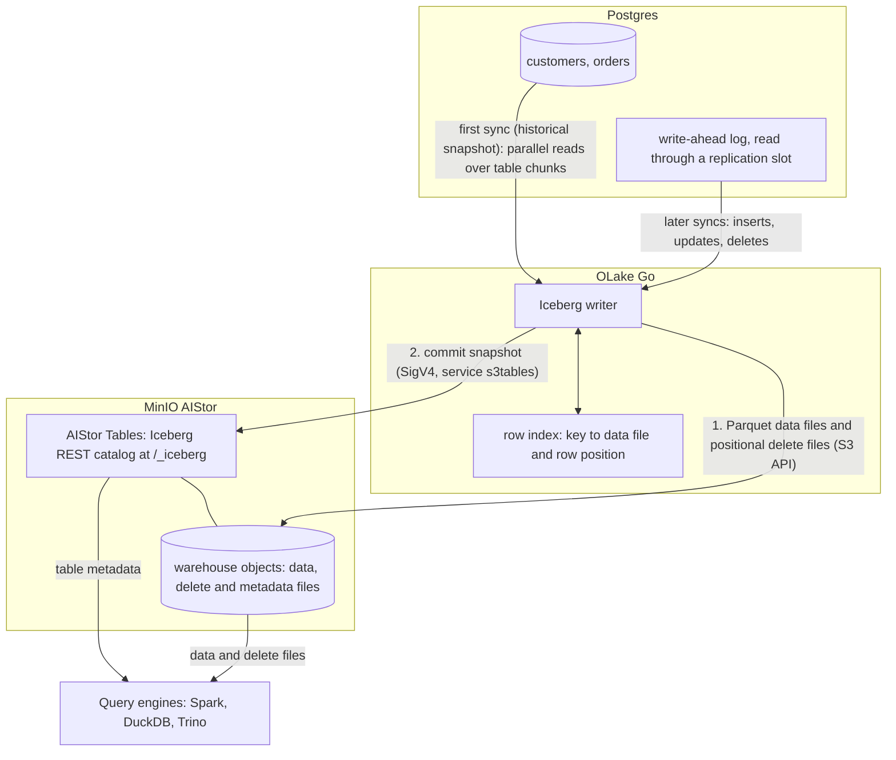

import * as I from '@site/src/components/integrations';

Postgres into MinIO as Iceberg usually means two systems next to the object store: a catalog such as Polaris or a Hive Metastore, and a pipeline such as Debezium and Kafka. MinIO AIStor removes the first one. Its AIStor Tables feature serves the Iceberg REST (Representational State Transfer) catalog from the object store itself, and OLake Go removes the second by reading the Postgres write-ahead log (WAL) directly.

In the run on this page, OLake Go wrote both tables into an AIStor Tables warehouse. Apache Spark, DuckDB and Trino read them through the same catalog endpoint and returned the same rows.

<I.IntegrationByline />

<TLDR title='Key takeaways'>

- OLake Go replicates Postgres into Iceberg tables in MinIO AIStor: a full historical snapshot first, then change data capture (CDC) from the WAL.
- The catalog lives inside AIStor at `/_iceberg`, so there is no catalog server, metastore or database to run next to the object store.
- Spark, DuckDB and Trino read the same tables with Signature Version 4 (SigV4) signing, and returned identical rows and totals in the run on this page.

</TLDR>

**The short answer.** To replicate Postgres to MinIO AIStor with change data capture (CDC), run OLake Go with a Postgres replication slot as the source and AIStor Tables as a Generic REST catalog with SigV4 signing. The first sync copies each table in full; every later sync replays inserts, updates and deletes from the WAL.

Spark, DuckDB and Trino then query the tables in the AIStor warehouse.

## How Postgres to MinIO AIStor CDC works



Two things happen in order, and OLake Go does both on its own. The first sync records the current WAL position through the replication slot, then reads each table in parallel chunks and writes Parquet data files. Every later sync opens the slot at the saved position and replays the inserts, updates and deletes since.

OLake Go talks to AIStor twice on every sync, on the same port. It uploads the files through the S3 API, then commits the new snapshot through the catalog at `/_iceberg`, with both requests signed by the same access key.

An update needs the old version of the row retired. With positional deletes, OLake Go keeps an index of where each primary key sits (data file and row number) and writes a small delete file that points at those positions. Readers skip the retired rows without comparing keys.

One thing to keep an eye on: the replication slot pins WAL on the Postgres server until OLake Go has read it. A job that is paused for days makes the WAL grow by everything written since. Keep the job on a schedule, and alert on `pg_replication_slots` lag if disk is tight.

## What you need

- **Postgres 12 or later** with `wal_level = logical` and a user that can read the WAL. The tables on this page ran on Postgres 16. Hosted Postgres on Amazon Relational Database Service (RDS), Aurora, Google Cloud SQL, Azure, Neon or Supabase works the same way; step 1 links the setup guides.
- **MinIO AIStor with Tables**, reachable from OLake Go and from your query engines, and a license file. The run on this page used AIStor `RELEASE.2026-09-19T17-05-25Z`, one node in Docker, on the free tier license.
- **At least one engine that signs Iceberg REST requests with SigV4.** This page shows Apache Spark 3.5.6 with Iceberg 1.10.0, DuckDB 1.5.5 and Trino 484.
- **OLake UI** from the [Docker Compose install](/docs/install/olake-ui/). The run on this page used OLake Go v1.1.1 for the destination.
- **Docker**, and about 40 minutes.

## Step 1: Prepare Postgres for CDC

Most readers point OLake Go at tables they already have. If you want to follow along with the exact data from this page, create these two tables first:

<details>
<summary>The two sample tables used on this page</summary>

```sql title="Sample schema"
CREATE TABLE customers (
  id SERIAL PRIMARY KEY,
  name VARCHAR(100), email VARCHAR(200), city VARCHAR(100), tier VARCHAR(20),
  created_at TIMESTAMPTZ DEFAULT NOW(),
  updated_at TIMESTAMPTZ DEFAULT NOW());

CREATE TABLE orders (
  id SERIAL PRIMARY KEY,
  customer_id INT REFERENCES customers(id), product VARCHAR(100), amount NUMERIC(10,2), status VARCHAR(20),
  created_at TIMESTAMPTZ DEFAULT NOW(),
  updated_at TIMESTAMPTZ DEFAULT NOW());

-- Then insert whatever you like. This page started with 8 customers and 40 orders.
```

</details>

<I.Partial id="sources/postgres/prereqs" tables="customers, orders" />

## Step 2: Set up AIStor Tables

An Iceberg table is a set of files plus a catalog entry that says which metadata file is current. In **MinIO AIStor**, both live in the object store: AIStor Tables holds the entries in a *warehouse* and keeps the files next to them. OLake Go writes through the catalog, and every engine on this page reads through it.

The [AIStor Tables catalog page](/docs/integrations/catalogs/aistor/) lists the other engines that read it. If you run the open source MinIO server instead, the [Postgres to Apache Iceberg guide](/docs/integrations/postgres-to-iceberg/) pairs it with a Polaris catalog.

<I.CatalogStrip />

<I.CatalogTabs>
<TabItem value="aistor">

<I.Partial id="catalogs/aistor/setup" />

{/* TODO-AISTOR-CONSOLE-SHOT */}

</TabItem>
</I.CatalogTabs>

## Step 3: Connect Postgres to OLake Go

<I.Partial id="sources/postgres/connect">

Here is the source form from the run on this page. Postgres ran in another container, so the host is `host.docker.internal`; the user, slot and publication are the ones from step 1.

<Figure src='/img/docs/integrations/postgres-to-aistor/olake-source-postgres-cdc.webp' alt='OLake UI Edit source form for Postgres with Enable CDC on, replication slot olake_slot, publication olake_pub, host host.docker.internal, database shop and user olake' caption='The Postgres source in OLake UI: Enable CDC on, with the slot, publication and replication user from step 1.' width='760px' />

**Set up source** runs the connection test and the CDC checks (`wal_level`, the slot, the publication) before anything is saved. When one fails, the dialog names the setting and its recommended value.

</I.Partial>

## Step 4: Configure the AIStor destination

<I.CatalogTabs>
<TabItem value="aistor">

<I.Partial id="catalogs/aistor/writer">

Here is the destination form from the run on this page. AIStor ran in another container with its S3 port mapped to 9200 on the host, so both addresses use `host.docker.internal:9200`; the keys are masked.

<Figure src='/img/docs/integrations/postgres-to-aistor/olake-destination-aistor.webp' alt='OLake UI Edit destination form for Apache Iceberg with catalog type Generic REST, sigv4 auth, REST catalog URI ending in /_iceberg, S3 path olake, signing name s3tables and Signature V4 on' caption='The AIStor destination in OLake UI: Generic REST with SigV4, the warehouse name as S3 Path, and s3tables as the signing name.' width='760px' />

</I.Partial>

</TabItem>
</I.CatalogTabs>

## Step 5: Create the job and run the first sync

<I.Partial id="jobs/create" engines="Apache Spark, DuckDB and Trino, or whichever engines will read the tables" upsert="Positional Deletes" updateType="pos">

Three target query engines were set on this job: Apache Spark, DuckDB and Trino. All three read every Iceberg delete format, and the run on this page used positional deletes on Iceberg format version 2 for every stream.

<Figure src='/img/docs/integrations/postgres-to-aistor/olake-streams-positional-deletes.webp' alt='OLake UI Streams Selection page for postgres_to_aistor with customers and orders selected, Full Refresh + CDC, Upsert and Positional Deletes on Iceberg format version V2' caption='Each stream: Full Refresh + CDC, Upsert, and Positional Deletes on Iceberg v2. The Iceberg DB name at the top is editable.' />

<Figure src='/img/docs/integrations/postgres-to-aistor/olake-job-history-two-syncs.webp' alt='OLake UI Job Logs and History for postgres_to_aistor showing two completed syncs of 12 seconds each' caption='Job history: the 12 s historical snapshot, then the 12 s change-only sync.' />

</I.Partial>

On this page the first run copied 8 customers and 40 orders (48 records, 2.23 KB) and finished in **12 seconds**, container start included. OLake Go names the namespace after the job, the source database and the schema, so `postgres_to_aistor` on database `shop` produced `postgres_to_aistor_shop_public` in the `olake` warehouse.

## Step 6: Query the tables from DuckDB

DuckDB is the quickest way to check the result from a laptop: one S3 secret, one `ATTACH`, and the whole warehouse is visible.

<I.CatalogTabs>
<TabItem value="aistor">

<I.Partial id="engines/duckdb/connect-aistor" schema="postgres_to_aistor_shop_public" />

<Figure src='/img/docs/integrations/postgres-to-aistor/duckdb-aistor-customers.webp' alt='DuckDB 1.5.5 shell querying aistor.postgres_to_aistor_shop_public.customers and returning 10 rows with id, name, city and tier' caption='DuckDB 1.5.5 reading the customers table from AIStor Tables after the change sync: 10 rows, one per key.' />

</TabItem>
</I.CatalogTabs>

<I.Cta />

## Step 7: Change rows in Postgres and sync again

To see the change path work, the run on this page made 12 changes in Postgres after the first sync:

```sql title="Changes made in Postgres between the two syncs"
INSERT INTO customers (name, email, city, tier) VALUES
  ('Maya Patel', 'maya@example.com', 'Pune', 'silver'),
  ('Lucas Silva', 'lucas@example.com', 'São Paulo', 'bronze');
INSERT INTO orders (customer_id, product, amount, status) VALUES
  (9, 'Laptop', 1299.00, 'placed'), (9, 'Mouse', 25.50, 'placed'),
  (10, 'Monitor', 349.99, 'placed'), (3, 'Keyboard', 89.00, 'placed'), (7, 'Webcam', 79.90, 'placed');
UPDATE customers SET tier = 'gold', updated_at = NOW()      WHERE name = 'Liam Carter';
UPDATE customers SET city = 'Abu Dhabi', updated_at = NOW() WHERE name = 'Zara Ali';
UPDATE orders    SET status = 'delivered', updated_at = NOW() WHERE id IN (1, 4, 7);
```

The second sync read **12 records (594 bytes)** from the slot and finished in **12 seconds** end to end. For `customers` that meant one new data file with 4 rows: 2 inserts plus the new versions of 2 updated rows. One positional delete file retires the 2 old versions by file and row number.

OLake Go's commit report in the sync log shows it directly: `addedDataFiles=1`, `addedRecords=4`, `addedPositionalDeleteFiles=1`, `addedPositionalDeletes=2`, and no equality delete files. The `orders` table has the same shape with 8 rows and 3 deletes.

<Figure src='/img/docs/integrations/postgres-to-aistor/olake-sync-log-positional-delete-commit.webp' alt='OLake UI sync log filtered to the Iceberg commit report for aistor.postgres_to_aistor_shop_public.customers, showing addedDataFiles 1, addedPositionalDeleteFiles 1, addedRecords 4 and addedPositionalDeletes 2' caption='The change-only sync in the OLake UI log: one data file and one positional delete file per table, committed to AIStor Tables.' />

Every engine shows the result on its next query, with no refresh. Liam Carter is `gold`, Zara Ali moved to Abu Dhabi, and the two new customers are there. The `_op_type` column shows how each row arrived: `r` for the snapshot, `c` for the inserts and `u` for the updates.

**Schema changes.** When a column is added in Postgres, OLake Go adds it to the Iceberg table on the next sync, and readers see it the next time they load the table. Narrowing or incompatible type changes fail the sync rather than corrupt the table; full rules are on the [schema evolution page](/docs/features/schema/).

## Query the same tables from Trino and Spark

Nothing is exported or copied for a second engine. Trino and Spark read the files OLake Go wrote, through the same AIStor Tables endpoint.

<Tabs groupId="engine" queryString="engine">
<TabItem value="trino" label="Trino" default>

<I.Partial id="engines/trino/connect-aistor" schema="postgres_to_aistor_shop_public" />

<Figure src='/img/docs/integrations/postgres-to-aistor/trino-aistor-customers.webp' alt='Trino 484 CLI querying customers in the aistor catalog and returning the same 10 rows as DuckDB' caption='Trino 484 reading the same table from AIStor Tables: the same 10 rows.' />

</TabItem>
<TabItem value="spark" label="Apache Spark">

<I.Partial id="engines/spark/connect-aistor" schema="postgres_to_aistor_shop_public" />

</TabItem>
</Tabs>

All three engines agreed on the counts and the money: 10 customers, 45 orders and 25579.19 in total. Spark 3.5.6, DuckDB 1.5.5 and Trino 484 each returned those numbers from the same tables.

## Data types: Postgres to Iceberg on AIStor

OLake Go maps Postgres types to Iceberg types; AIStor stores the files and does not change them. Most columns pass through unchanged, and three groups are worth knowing about.

| Postgres | Iceberg (written by OLake Go) | Notes |
| --- | --- | --- |
| `integer`, `serial` | `int` | |
| `bigint`, `bigserial` | `long` | |
| `numeric(p,s)`, `real` | `double` | OLake Go stores decimals as doubles. The `orders.amount` totals on this page matched Postgres to the cent; round at query time when you need exact decimal arithmetic. |
| `timestamptz`, `timestamp` | `timestamptz` (UTC) | `timestamp` has no zone in Postgres; it is read as UTC. |
| `varchar`, `text`, `uuid`, `json`, `jsonb` | `string` | Parse JSON at query time. |
| `boolean` | `boolean` | |
| `bytea` | `binary` | |

Postgres types in the table come from the [Postgres connector reference](/docs/connectors/postgres/#data-type-mapping). OLake Go adds `_cdc_lsn` on Postgres tables, the WAL position each change came from.

## Cost and maintenance

- **License and storage.** AIStor needs a license file. The free tier covers one compute resource; larger clusters need a paid AIStor license from MinIO. The files sit on your own drives or servers.
- **Compute.** OLake Go runs wherever you run Docker. Each engine spends compute only when it queries, and none of them keeps its own copy.
- **Maintenance.** OLake Go does not compact the tables. A CDC table that gets a new small file and delete file per sync wants compaction; Spark's `rewrite_data_files` works through the same AIStor Tables endpoint.
- **WAL disk.** The replication slot keeps WAL until OLake Go reads it. A job paused for a weekend on a busy server can hold tens of gigabytes. Drop the slot if you retire a job.
- **Key rotation.** The AIStor access key signs both the catalog and the file requests. Rotate it in AIStor and in the OLake Go destination together; an old key fails the next sync at the first signed request, before any data moves.

## Troubleshooting

### 1. The CLI destination test fails before it reaches AIStor

```text
invalid destination type has been passed []
```

`destination.json` holds only the writer settings. OLake Go expects them wrapped as `{"type": "ICEBERG", "writer": {...}}`, as in the CLI tab of step 4. The run on this page hit this when it first sent the bare writer block.

### 2. Catalog requests are rejected while file writes work

The signing settings are incomplete. AIStor Tables only accepts catalog requests signed under the `s3tables` service, so check that **REST Enable Signature V4** is on, **REST Signing Name** is `s3tables` and **REST Signing Region** is not empty. The S3 file path uses the same keys but a different service, which is why file access can work while the catalog does not.

### 3. The warehouse is not found

**S3 Path** holds the warehouse name, such as `olake`, not an `s3://` URL: MinIO's docs say the warehouse is the plain name, never prefixed with `s3://` or `s3a://`. Run `mc table warehouse list` to see the exact name.

### 4. DuckDB or Trino sees the catalog but not the tables

Each engine signs the catalog requests itself. DuckDB needs `SIGV4_SERVICE 's3tables'` on the `ATTACH`; Trino 477 and later need `iceberg.rest-catalog.security=SIGV4` and `signing-name=s3tables`, and Trino 476 and earlier use `iceberg.rest-catalog.sigv4-enabled=true` instead.

<details>
<summary>How this compares with other ways to move Postgres data to Iceberg on MinIO</summary>

| Method | Catalog | Updates and deletes | What you run |
| --- | --- | --- | --- |
| [Debezium](https://debezium.io/documentation/reference/stable/connectors/postgresql.html), Kafka and Kafka Connect with an Iceberg sink | A separate REST or Hive catalog | Appended as change events, with a separate merge job for the current state | Debezium, Kafka, Kafka Connect and a catalog server |
| [Flink CDC](https://nightlies.apache.org/flink/flink-cdc-docs-stable/) with the Iceberg Flink sink | A separate catalog, or AIStor Tables through REST | Upserts through equality deletes on tables with a primary key | A Flink cluster with checkpoint storage |
| Open source MinIO with Polaris and OLake Go | Apache Polaris next to MinIO | Upserts through positional deletes, equality deletes or deletion vectors | MinIO, Polaris and OLake Go; see the [Postgres to Iceberg guide](/docs/integrations/postgres-to-iceberg/) |
| **OLake Go to MinIO AIStor (this guide)** | AIStor Tables, inside the object store | Upserts through positional deletes, equality deletes or deletion vectors, matched to the target engines | AIStor and one Docker Compose stack for OLake |

Debezium and Kafka make sense when Kafka already carries the change events for other consumers. Flink wins when you need joins, enrichment or second-level latency on the way in.

Open source MinIO with Polaris avoids the AIStor license at the cost of one more service to run. AIStor keeps the catalog, the files and the access keys in one system.

</details>

## When not to use this

- **You need sub-minute freshness.** OLake Go runs on a schedule, down to one minute between syncs. A streaming pipeline is the better fit for second-level latency.
- **You run the open source MinIO server.** AIStor Tables is part of the licensed AIStor product. Pair open source MinIO with Polaris or Lakekeeper instead.
- **Tables have no primary key.** Inserts replicate; updates and deletes cannot be matched to a row and are not applied. Add a primary key or set `REPLICA IDENTITY FULL` first.

## FAQs

<I.IntegrationFaq />

<I.HowWeTested />

## Related guides

<I.RelatedIntegrations />

Deeper reading on this site:

- [Postgres to Apache Iceberg on Polaris and open source MinIO](/docs/integrations/postgres-to-iceberg/)
- [AIStor Tables: catalog page](/docs/integrations/catalogs/aistor/)
- [Equality vs positional deletes vs deletion vectors](/blog/iceberg-delete-formats-cdc-equality-vs-positional-vs-deletion-vectors/)
- [OLake Go ingestion benchmarks](/docs/benchmarks/ingestion/)

<I.IntegrationJsonLd />

<I.Cta title='Start with your own Postgres' body='The quickstart runs OLake UI with Docker Compose. Create the source, the AIStor destination and the job as above, and the first sync lands your tables as Iceberg in AIStor.' />
