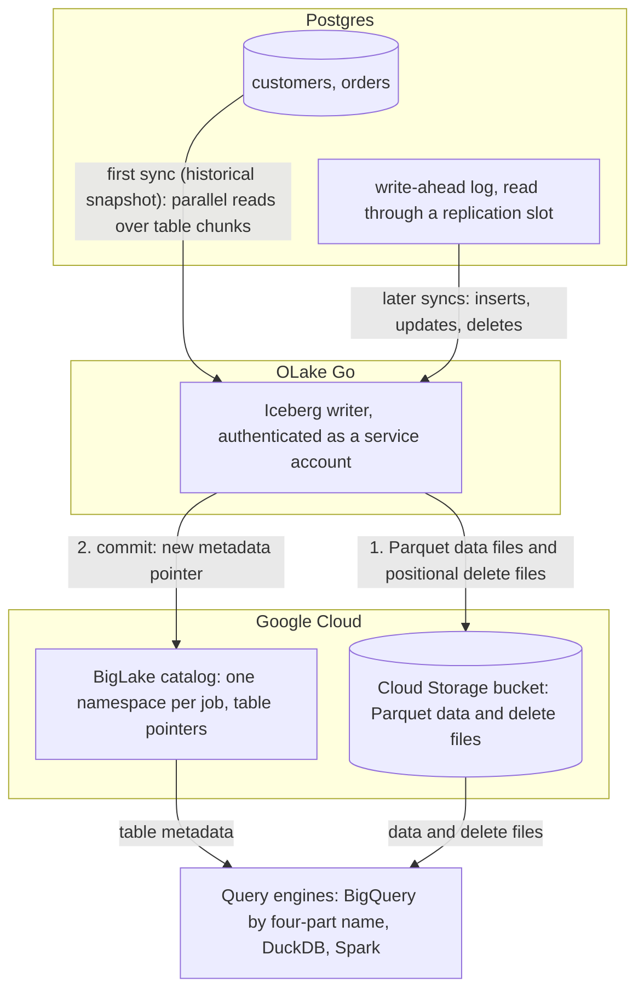

import * as I from '@site/src/components/integrations';

Postgres to BigQuery usually means a Datastream stream, a Debezium connector into Kafka, or a nightly export and `bq load`, and tables that only BigQuery can read. This guide takes a different route.

OLake Go reads the Postgres write-ahead log (WAL) and commits the changes as Apache Iceberg tables into a BigLake catalog, Google Cloud's Iceberg representational state transfer (REST) catalog. The files stay in your own Cloud Storage bucket. BigQuery queries the tables through the catalog with a four-part name, with no dataset to create and no external table to declare.

Nothing else is in the path: no Datastream, no Kafka, no load job. DuckDB and Spark read the same tables through the same catalog.

<I.IntegrationByline />

<TLDR title='Key takeaways'>

- OLake Go replicates Postgres into Iceberg tables in a BigLake catalog: a full historical snapshot first, then change data capture (CDC) from the WAL, with no Datastream or Kafka in between.
- BigQuery reads the catalog as a data source. Every change a sync commits is visible on the next `SELECT`, with no refresh and no load job.
- The same tables, written once by OLake Go, are also queryable from DuckDB and Spark. In the run on this page all three engines returned identical rows.

</TLDR>

**The short answer.** To replicate Postgres to BigQuery with change data capture (CDC), run OLake Go with a Postgres replication slot as the source. Point it at a BigLake catalog with a Cloud Storage bucket as the Iceberg destination, and pick BigQuery as the target query engine.

The first sync copies each table in full (the historical snapshot); every later sync replays inserts, updates and deletes from the WAL. BigQuery, DuckDB and Spark then query the same Iceberg tables, with no second copy.

## How Postgres CDC reaches BigQuery here



Two things happen in order, and OLake Go does both on its own. The first sync records the current WAL position through the replication slot. Then it reads each table in parallel chunks and writes Parquet data files: that is the historical load.

Every later sync opens the slot at the saved position and replays the inserts, updates and deletes since. Nothing written during the snapshot is lost, and there is no separate backfill job.

Each sync ends with one commit to BigLake. OLake Go uploads the data and delete files to the bucket with the service account's own credentials, then updates the table's metadata pointer in the catalog. BigQuery, DuckDB and Spark see the new snapshot on their next query; none of them keeps a copy.

One thing to keep an eye on: the replication slot pins WAL on the Postgres server until OLake Go has read it. A job that is paused for days makes the WAL grow by everything written since. Keep the job running on a schedule, and alert on `pg_replication_slots` lag if disk is tight.

## What you need

- **Postgres 12 or later** with `wal_level = logical` and a user that can read the WAL. The tables on this page ran on Postgres 16. Hosted Postgres on Cloud SQL, AlloyDB, Amazon Relational Database Service (RDS), Aurora, Azure, Neon or Supabase works the same way; step 1 links the setup guides.
- **A Google Cloud project** with the BigLake API enabled, a Cloud Storage bucket for the files, and a service account for OLake Go with the BigLake Editor role on the project and Storage Object User on the bucket. The run on this page used a bucket in `us-central1`.
- **BigQuery** in the same project. Queries run in the bucket's region, and the account running them needs the BigQuery Job User role plus read access to the catalog.
- **OLake UI** from the [Docker Compose install](/docs/install/olake-ui/). The run on this page used OLake Go v1.1.0.
- **Docker**, and about 30 minutes.

## Step 1: Prepare Postgres for CDC

Most readers point OLake Go at tables they already have. If you want to follow along with the exact data from this page, create these two tables first:

<details>
<summary>The two sample tables used on this page</summary>

```sql title="Sample schema"
CREATE TABLE customers (
  id SERIAL PRIMARY KEY,
  name VARCHAR(100), email VARCHAR(200), city VARCHAR(100), tier VARCHAR(20),
  created_at TIMESTAMPTZ DEFAULT NOW(),
  updated_at TIMESTAMPTZ DEFAULT NOW());

CREATE TABLE orders (
  id SERIAL PRIMARY KEY,
  customer_id INT REFERENCES customers(id), product VARCHAR(100), amount NUMERIC(10,2), status VARCHAR(20),
  created_at TIMESTAMPTZ DEFAULT NOW(),
  updated_at TIMESTAMPTZ DEFAULT NOW());

-- Then insert whatever you like. This page started with 8 customers and 40 orders.
```

</details>

<I.Partial id="sources/postgres/prereqs" tables="customers, orders" />

## Step 2: Set up the BigLake catalog

BigQuery reads Iceberg tables through a catalog. **BigLake** is the one this page uses: it is Google Cloud's Iceberg REST catalog, OLake Go creates a namespace per job in it, and the files sit in your Cloud Storage bucket.

BigQuery, DuckDB and Spark all read from the same catalog. BigQuery treats it as a data source in the project, so a table OLake Go commits is queryable on the next statement.

<I.CatalogStrip />

<I.CatalogTabs>
<TabItem value="biglake">

<I.Partial id="catalogs/biglake/setup" />

<Figure src='/img/docs/integrations/postgres-to-bigquery/gcp-service-account-key-json.webp' alt='Google Cloud console Create private key dialog for the OLake service account with the JSON key type selected' caption='The JSON key for the service account. The console downloads it once; its contents go into the OLake Go destination form.' />

</TabItem>
</I.CatalogTabs>

## Step 3: Connect Postgres to OLake Go

<I.Partial id="sources/postgres/connect">

Here is the source form from the run on this page. Postgres ran in another container, so the host is `host.docker.internal`; the user, slot and publication are the ones from step 1.

<Figure src='/img/docs/integrations/postgres-to-bigquery/olake-source-postgres-cdc.webp' alt='OLake UI Edit source form for Postgres on OLake Go v1.1.0 with Enable CDC on, replication slot olake_slot, publication olake_pub, host host.docker.internal, database shop, user olake and SSL disabled' caption='The Postgres source in OLake UI: Enable CDC on, with the slot, publication and replication user from step 1.' width='760px' />

**Set up source** runs the connection test and the CDC checks (`wal_level`, the slot, the publication) before anything is saved. When one fails, the dialog names the setting and its recommended value.

</I.Partial>

## Step 4: Configure the Iceberg destination

<I.CatalogTabs>
<TabItem value="biglake">

<I.Partial id="catalogs/biglake/writer">

Here is the destination form from the run on this page. It holds the BigLake endpoint, the bucket as the catalog path, the service account JSON and the project ID.

<Figure src='/img/docs/integrations/postgres-to-bigquery/olake-destination-biglake.webp' alt='OLake UI Edit destination form for Apache Iceberg with catalog type Big Lake, REST catalog URI https://biglake.googleapis.com/iceberg/v1/restcatalog, BigLake catalog path gs://olake-x2y-lab-bq, authentication type GCP and the project ID oauth-361809' caption='The BigLake destination in OLake UI: the endpoint, the bucket as catalog path, GCP authentication and the project ID.' width='760px' />

</I.Partial>

</TabItem>
</I.CatalogTabs>

## Step 5: Create the job and run the first sync

This job lists **BigQuery**, **Spark** and **DuckDB** as target query engines. OLake Go then offers only the delete formats all three read, and the run on this page picked **Positional Deletes** from that list.

<I.Partial id="jobs/create" engines="Google BigQuery, Apache Spark and DuckDB" upsert="Positional Deletes" updateType="pos">

OLake Go offers every delete format BigQuery, Spark and DuckDB all read: equality and positional deletes. Deletion vectors are not in the list because BigQuery reads them only in preview.

<Figure src='/img/docs/integrations/postgres-to-bigquery/olake-streams-positional-deletes.webp' alt='OLake UI Streams Selection page with the public schema, customers and orders selected, sync mode Full Refresh + CDC, ingestion mode Upsert and upsert type Positional Deletes on Iceberg format version V2' caption='Each stream: Full Refresh + CDC, Upsert, and Positional Deletes as the upsert type. The Iceberg DB name at the top is editable.' />

<Figure src='/img/docs/integrations/postgres-to-bigquery/olake-job-history-two-syncs.webp' alt='OLake UI Job Logs and History for postgres_to_bigquery showing two completed syncs, the first in 35 seconds and the second in 58 seconds' caption='Job history: the 35 s historical snapshot, then the 58 s change-only sync.' />

</I.Partial>

On this page the first run copied 8 customers and 40 orders (48 records, 2.23 KB) and finished in **35 seconds**, container start included. OLake Go names the BigLake namespace after the job, the source database and the schema, so `postgres_to_bigquery` on database `shop` produced `postgres_to_bigquery_shop_public`. The **Iceberg DB** field at the top of the Streams page changes it before the first sync.

## Step 6: Query the tables in BigQuery

<I.CatalogTabs>
<TabItem value="biglake">

<I.Partial id="engines/bigquery/query-biglake" schema="postgres_to_bigquery_shop_public" />

<Figure src='/img/docs/integrations/postgres-to-bigquery/bigquery-biglake-customers.webp' alt='BigQuery SQL editor in the Google Cloud console running the customers query on the olake-x2y-lab-bq catalog and returning 10 rows with id, name, city and tier' caption='BigQuery reading the customers table through the BigLake catalog after the change sync: 10 rows, one per key.' />

</TabItem>
</I.CatalogTabs>

<I.Cta />

## Step 7: Change rows in Postgres and sync again

To see the change path work, the run on this page made 12 changes in Postgres after the first sync:

```sql title="Changes made in Postgres between the two syncs"
INSERT INTO customers (name, email, city, tier) VALUES
  ('Maya Patel', 'maya@example.com', 'Pune', 'silver'),
  ('Lucas Silva', 'lucas@example.com', 'São Paulo', 'bronze');
INSERT INTO orders (customer_id, product, amount, status) VALUES
  (9, 'Laptop', 1299.00, 'placed'), (9, 'Mouse', 25.50, 'placed'),
  (10, 'Monitor', 349.99, 'placed'), (3, 'Keyboard', 89.00, 'placed'), (7, 'Webcam', 79.90, 'placed');
UPDATE customers SET tier = 'gold', updated_at = NOW()      WHERE name = 'Liam Carter';
UPDATE customers SET city = 'Abu Dhabi', updated_at = NOW() WHERE name = 'Zara Ali';
UPDATE orders    SET status = 'delivered', updated_at = NOW() WHERE id IN (1, 4, 7);
```

The second sync read **12 records (594 bytes)** from the slot and finished in **58 seconds** end to end, most of it the wait for the WAL reader to confirm the slot was idle. For `customers` that meant one new data file with 4 rows: 2 inserts plus the new versions of 2 updated rows.

One small positional delete file retires the 2 old versions. OLake Go's commit report in the sync log shows it directly: `addedDataFiles=1`, `addedRecords=4`, `addedPositionalDeleteFiles=1`, `addedPositionalDeletes=2`. The `orders` table has the same shape with 8 rows and 3 deletes.

<Figure src='/img/docs/integrations/postgres-to-bigquery/olake-sync-log-positional-delete-commit.webp' alt='OLake UI sync log filtered to the Iceberg commit report, showing addedDataFiles 1, addedPositionalDeleteFiles 1, addedRecords and addedPositionalDeletes for the change sync' caption='The change-only sync in the OLake UI log: one data file and one positional delete file per table.' />

BigQuery shows the result on the next query, with no refresh and no `ALTER TABLE`. Liam Carter is `gold`, Zara Ali moved to Abu Dhabi, and the two new customers are there.

The two retired versions are gone, because BigQuery applies the positional deletes while reading. The `_op_type` column shows how each row arrived: `r` for the snapshot, `c` for the inserts and `u` for the updates.

**Schema changes.** When a column is added in Postgres, OLake Go adds it to the Iceberg table on the next sync and commits the new schema to BigLake in the same commit. BigQuery shows the column on the next query.

Widening changes (`int` to `bigint`, `real` to `double precision`) are applied. Narrowing or incompatible type changes fail the sync rather than corrupt the table. Full rules are on the [schema evolution page](/docs/features/schema/).

## Query the same tables from DuckDB and Spark

This is the point of writing Iceberg instead of loading BigQuery tables. Nothing is exported, copied or refreshed: both engines read the files OLake Go wrote, through the same BigLake catalog.

<Tabs groupId="engine" queryString="engine">
<TabItem value="duckdb" label="DuckDB" default>

<I.Partial id="engines/duckdb/connect-biglake" schema="postgres_to_bigquery_shop_public" />

<Figure src='/img/docs/integrations/postgres-to-bigquery/gcp-hmac-key-service-account.webp' alt='Google Cloud console Cloud Storage Interoperability settings with the Select a service account dialog, the OLake service account selected and the Create key button' caption='The key for DuckDB: Cloud Storage, Settings, Interoperability, then a key for the same service account OLake Go uses.' />

DuckDB 1.5.5 returned the same 10 customers and the same `orders` roll-up as BigQuery in the run on this page. It read the current metadata file of each table through the catalog and the data files through the hash-based message authentication code (HMAC) key.

</TabItem>
<TabItem value="spark" label="Apache Spark">

<I.Partial id="engines/spark/connect-biglake" schema="postgres_to_bigquery_shop_public" />

Spark 4.0.1 with Iceberg 1.10.0 returned the same rows in the run on this page, running on a laptop against the same catalog and bucket.

</TabItem>
</Tabs>

An `orders` roll-up matched Postgres to the cent in all three engines. It gave 16 delivered orders for 8659.68, 18 placed for 10522.26, 11 shipped for 6397.25.

## Data types: Postgres to Iceberg to BigQuery

OLake Go maps Postgres types to Iceberg types, and BigQuery maps Iceberg types to its own when it reads the catalog. Most columns pass through unchanged; three groups are worth knowing about.

| Postgres | Iceberg (written by OLake Go) | BigQuery shows | Notes |
| --- | --- | --- | --- |
| `integer`, `serial` | `int` | `INT64` | |
| `bigint`, `bigserial` | `long` | `INT64` | |
| `numeric(p,s)`, `real`, `double precision` | `double` | `FLOAT64` | OLake Go stores decimals as doubles. The `orders.amount` sums on this page matched Postgres to the cent in every engine; round at query time when you need exact decimal arithmetic. |
| `timestamptz`, `timestamp` | `timestamptz` (UTC) | `TIMESTAMP` | BigQuery shows the UTC instant; `timestamp` has no zone in Postgres and is read as UTC. |
| `varchar`, `text`, `uuid`, `json`, `jsonb` | `string` | `STRING` | Parse JSON with `PARSE_JSON` or `JSON_VALUE` in BigQuery. |
| `boolean` | `boolean` | `BOOL` | |
| `bytea` | `binary` | `BYTES` | |

Postgres types in the table come from the [Postgres connector reference](/docs/connectors/postgres/#data-type-mapping). The BigQuery side comes from the [BigQuery Iceberg tables page](https://docs.cloud.google.com/bigquery/docs/iceberg-external-tables) (checked 2026-10-30) and from the table schemas of this run. OLake Go adds `_cdc_lsn` on Postgres tables, the WAL position each change came from.

## Cost and maintenance

- **Storage** is your bucket: you pay Cloud Storage rates for the Parquet and delete files. The BigLake catalog itself has no per-table charge.
- **Compute.** OLake Go runs wherever you run Docker. BigQuery bills on-demand queries by bytes scanned, or by slot time on an edition; a query over the catalog reads the Parquet files in the bucket, so filter on the columns you need. DuckDB and Spark cost whatever machine they run on.
- **Maintenance.** A CDC table that gets a new small file and delete file per sync wants compaction, and BigLake keeps every snapshot OLake Go commits in the table's `metadata.json`. BigLake rejects a `metadata.json` above 1 MB, which a busy table reaches after a few thousand syncs. Expire old snapshots and compact on a schedule with [OLake Fusion](/docs/fusion/getting-started/overview/) or with Spark's `expire_snapshots` and `rewrite_data_files` procedures through the same catalog.
- **WAL disk.** The replication slot keeps WAL until OLake Go reads it. A job paused for a weekend on a busy server can hold tens of gigabytes. Drop the slot if you retire a job.
- **Key rotation.** The service account key is what OLake Go writes with. Rotate it on your schedule from the service account's **Keys** tab and paste the new JSON into the destination.

## Troubleshooting

### 1. The destination test fails on a catalog in vended-credentials mode

```text
failed to test destination: failed to create or get table: rpc error: code = Internal desc = Failed to process request: Malformed request: X-Iceberg-Access-Delegation header must be present and contain `vended-credentials` when credential mode is `CREDENTIAL_MODE_VENDED_CREDENTIALS`.
```

The catalog was created, or switched, with `--credential-mode=vended-credentials`, and OLake Go 1.1.0 does not send the header BigLake wants in that mode ([olake#1369](https://github.com/datazip-inc/olake/issues/1369)). Switch the catalog back with `gcloud beta biglake iceberg catalogs update <bucket> --credential-mode=end-user`, which is the default for a catalog OLake Go created itself. With the CLI, `"rest_access_delegation": "vended-credentials"` in `destination.json` makes the same test pass; the UI has no field for it yet.

### 2. BigQuery cannot find the dataset

```text
Not found: Dataset <project>:<bucket>.postgres_to_bigquery_shop_public was not found in location US
```

The query ran in a location other than the bucket's region. Set the query location to the bucket's region in the editor's **More**, **Query settings** panel, or pass `--location=<region>` to `bq`. Leaving the location unset lets BigQuery pick it from the table.

### 3. INFORMATION_SCHEMA rejects the four-part name

```text
Invalid project ID '<project>.<bucket>'. Project IDs must contain 6-63 lowercase letters, digits, or dashes.
```

`INFORMATION_SCHEMA` views take a dataset-qualified name and do not resolve catalog tables. Use `bq show --schema <project>:<bucket>.<namespace>.<table>` to list the columns and their types instead.

### 4. The next sync waits on the slot

If a sync hangs after the snapshot, another process holds the replication slot, or `wal_sender_timeout` cut the connection during a quiet period. Check `pg_stat_replication` for a second consumer of `olake_slot`, and set `wal_sender_timeout = 0` for the OLake Go user as the prerequisites block shows.

<details>
<summary>How this compares with other ways to move Postgres data to BigQuery</summary>

| Method | Freshness | Updates and deletes | Where the data lands | What you run |
| --- | --- | --- | --- | --- |
| [Datastream for BigQuery](https://docs.cloud.google.com/datastream/docs/overview) | Near real time, by Google's description | Yes | Native BigQuery datasets; BigQuery is the only reader | Nothing to run; a connection profile and a stream in the console |
| Debezium and Kafka with a BigQuery sink connector | Seconds | Yes, with the connector's upsert mode | Native BigQuery tables | Kafka, Kafka Connect, Debezium and the sink connector |
| Export and `bq load` on a schedule | Hours to daily | No; full reloads or your own merge | Native BigQuery tables | A script, a scheduler and a staging bucket |
| Managed ELT (Fivetran, Estuary, Airbyte Cloud) | Minutes, by plan | Varies by tool | BigQuery tables, a second copy you pay to move and store | Nothing; priced per row, per GB or per connector |
| **OLake Go to Iceberg on BigLake (this guide)** | CDC on a schedule down to one minute | Yes, as Iceberg row-level deletes | Apache Iceberg tables that BigQuery, Spark, DuckDB, Trino and Flink all read | One Docker Compose stack, open source; your bucket plus your own compute |

Datastream is the simpler choice when BigQuery is the only reader and a managed Google service is the preference. Writing Iceberg once avoids paying to move and store a second copy. That matters as soon as Spark, DuckDB or a notebook needs the same rows, or you want to own the files.

</details>

## When not to use this

- **Every query must hit native BigQuery speed.** A catalog table is read from Parquet in the bucket on every query. Keep the Iceberg tables as the source and load the hot slice into a native table on a schedule.
- **Tables have no primary key.** Inserts replicate; updates and deletes cannot be matched to a row and are not applied. Add a primary key or set `REPLICA IDENTITY FULL` first.
- **You want deletion vectors.** BigQuery reads them only in preview, with a cap of 100,000 deletion vector entries per query. Keep the job on positional deletes while BigQuery is a reader.

## FAQs

<I.IntegrationFaq />

<I.HowWeTested />

## Related guides

<I.RelatedIntegrations />

Deeper reading on this site:

- [Equality vs positional deletes vs deletion vectors](/blog/iceberg-delete-formats-cdc-equality-vs-positional-vs-deletion-vectors/)
- [Which engines read which delete formats](/blog/iceberg-delete-formats-interoperability-olake-go/)
- [OLake Go ingestion benchmarks](/docs/benchmarks/ingestion/)

<I.IntegrationJsonLd />

<I.Cta title='Start with your own Postgres' body='The quickstart runs OLake UI with Docker Compose. Create the source, the BigLake destination and the job as above, and the first sync lands your tables where BigQuery can read them.' />
