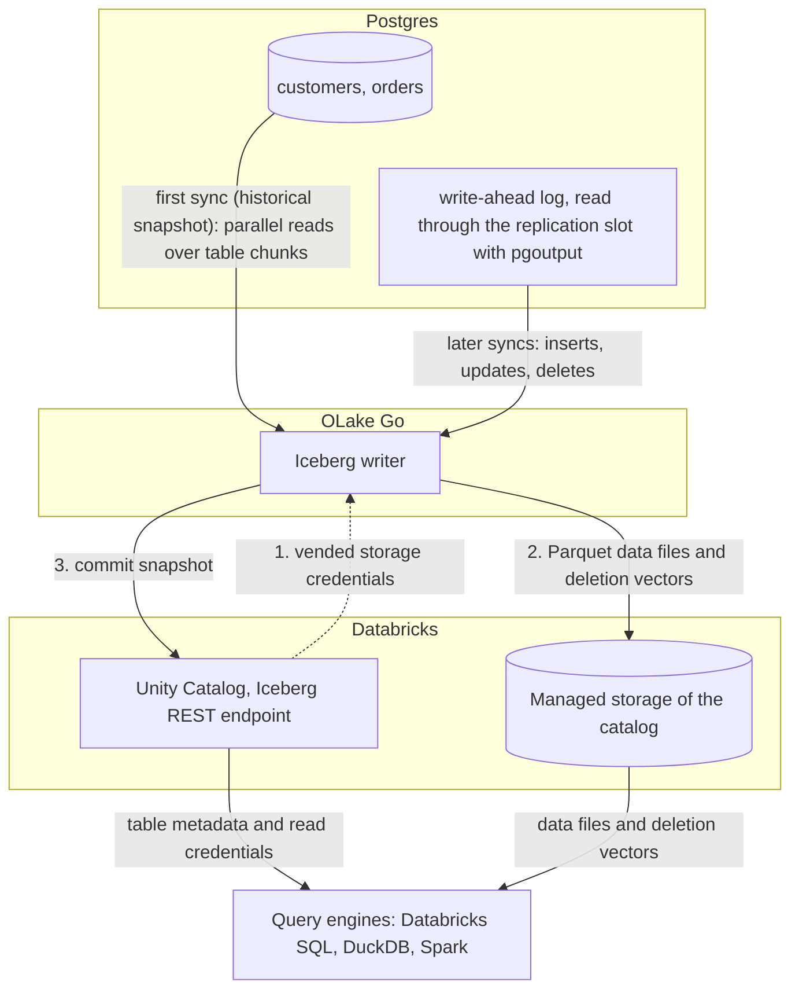

import * as I from '@site/src/components/integrations';

Postgres to Databricks usually means Lakeflow Connect, a Debezium and Kafka pipeline, or nightly exports picked up by Auto Loader. This guide takes a different route. OLake Go reads the Postgres write-ahead log through logical replication and commits the changes as Apache Iceberg tables into Unity Catalog.

The tables land as Unity Catalog managed Iceberg tables, with the files in the catalog's managed storage. Nothing else is in the path: no Kafka, no Spark job, no Databricks ingestion pipeline. DuckDB and Spark read the same tables through the same catalog.

<I.IntegrationByline />

<TLDR title='Key takeaways'>

- OLake Go replicates Postgres into Databricks as Iceberg tables: a full historical snapshot first, then change data capture (CDC) from the write-ahead log, with no Kafka or Spark in between.
- The tables are Unity Catalog managed Iceberg tables. You query them from the Databricks SQL editor or a notebook right away, with no external table and no refresh.
- The same tables, written once by OLake Go, are also queryable from DuckDB and Spark through Unity Catalog. In the run on this page all three engines returned identical rows.

</TLDR>

**The short answer.** To replicate Postgres to Databricks with change data capture (CDC), run OLake Go with Postgres logical replication as the source and Unity Catalog as the Iceberg destination, with Databricks as a target query engine. The first sync copies each table in full (the historical snapshot), and every later sync replays inserts, updates and deletes from the write-ahead log. Databricks, DuckDB and Spark then query the same Iceberg tables, with no second copy.

## How Postgres CDC reaches Databricks here



Two things happen in order, and OLake Go does both on its own. The first sync records the current write-ahead log (WAL) position, then reads each table in parallel chunks and writes Parquet data files: that is the historical load. Every later sync opens the replication slot at the saved position and replays the inserts, updates and deletes since.

Nothing made during the snapshot is lost, and there is no separate backfill job. An update or delete retires the old row with a deletion vector, a small bitmap per data file that marks the replaced positions.

Each sync ends with one commit to Unity Catalog. Databricks sees the new snapshot on its next query, and DuckDB and Spark see it on their next catalog load.

One thing to keep an eye on: the replication slot holds WAL on disk until OLake Go reads it. If the job is paused for a week, Postgres keeps a week of WAL. Set `max_slot_wal_keep_size` so a stalled slot is invalidated before the disk fills, and alert on `pg_replication_slots.wal_status`.

## What you need

- **Postgres 10 or later** with logical replication (`wal_level = logical`) and a user that can replicate. The tables on this page ran on Postgres 16. Hosted Postgres on Amazon Relational Database Service (RDS), Aurora, Azure or Cloud SQL works the same way; step 1 links each guide.
- **A Databricks workspace with Unity Catalog**, a catalog with managed storage, and an admin who can turn on external data access and grant `EXTERNAL USE SCHEMA`. The run on this page used a workspace on Google Cloud.
- **OLake UI** from the [Docker Compose install](/docs/install/olake-ui/). The run on this page used OLake Go v1.1.0.
- **Docker**, and about 30 minutes.

## Step 1: Prepare Postgres for CDC

Most readers point OLake Go at tables they already have. If you want to follow along with the exact data from this page, create these two tables first:

<details>
<summary>The two sample tables used on this page</summary>

```sql title="Sample schema"
CREATE TABLE customers (
  id SERIAL PRIMARY KEY, name TEXT, email TEXT, city TEXT, tier TEXT,
  created_at TIMESTAMPTZ DEFAULT now(), updated_at TIMESTAMPTZ DEFAULT now());

CREATE TABLE orders (
  id SERIAL PRIMARY KEY, customer_id INT REFERENCES customers(id), product TEXT,
  amount NUMERIC(10,2), status TEXT,
  created_at TIMESTAMPTZ DEFAULT now(), updated_at TIMESTAMPTZ DEFAULT now());

-- Then insert whatever you like. This page started with 8 customers and 40 orders.
```

</details>

<I.Partial id="sources/postgres/prereqs" tables="customers, orders" />

## Step 2: Set up Unity Catalog in Databricks

Databricks reads Iceberg tables through Unity Catalog, the catalog built into every Databricks workspace. OLake Go writes straight into it, so the tables become Unity Catalog managed Iceberg tables. They show up in Catalog Explorer and the SQL editor the moment a sync commits.

The files sit in the catalog's managed storage, which is backed by an external location in your own cloud account. DuckDB and Spark reach the same tables through the same Unity Catalog endpoint.

<I.CatalogStrip />

<I.CatalogTabs>
<TabItem value="unity">

<I.Partial id="catalogs/unity/setup" />

</TabItem>
</I.CatalogTabs>

## Step 3: Connect Postgres to OLake Go

<I.Partial id="sources/postgres/connect">

Here is the source form from the run on this page. Postgres ran in another container, so the host is `host.docker.internal`; the slot and publication are the ones from step 1.

<Figure src='/img/docs/integrations/postgres-to-databricks/olake-source-postgres-cdc.webp' alt='OLake UI Create source form for Postgres on OLake Go v1.1.0 with Enable CDC on, replication slot olake_slot, publication olake_pub and the connection details' caption='The Postgres source in OLake UI: Enable CDC on, with the slot and publication from step 1.' width='760px' />

**Set up source** runs the connection test and the four CDC checks before anything is saved:

<Figure src='/img/docs/integrations/postgres-to-databricks/olake-source-test-cdc-checks.webp' alt='OLake UI Testing Source Configuration dialog showing Test Connection successful, 4 of 4 required CDC prerequisite checks passed and 1 of 1 optional CDC setting passed' caption='The source test: connection, the four required CDC prerequisites and the optional setting all pass.' width='620px' />

</I.Partial>

## Step 4: Configure the Iceberg destination

<I.CatalogTabs>
<TabItem value="unity">

<I.Partial id="catalogs/unity/writer">

The run on this page wrote into a catalog called `datazip`, with a personal access token that expires after seven days. The snippets below use `lakehouse`; replace it with your catalog name.

</I.Partial>

</TabItem>
</I.CatalogTabs>

## Step 5: Create the job and run the first sync

<I.Partial id="jobs/create" engines="Databricks, plus DuckDB and Apache Spark if they will read the tables too" upsert="Deletion Vector" updateType="dv">

Three target query engines were set on this job, and Databricks narrows the delete formats to one: deletion vectors on Iceberg v3 tables. OLake Go sets that format on every stream, so there is nothing to pick.

<Figure src='/img/docs/integrations/postgres-to-databricks/olake-streams.webp' alt='OLake UI Streams Selection page with the shop database, customers and orders selected, sync mode Full Refresh + CDC, ingestion mode Upsert and upsert type Deletion Vector on Iceberg format version V3' caption='Each stream: Full Refresh + CDC, Upsert, and Deletion Vector on Iceberg v3, the format OLake Go resolved for Databricks.' />

<Figure src='/img/docs/integrations/postgres-to-databricks/olake-job-history-two-syncs.webp' alt='OLake UI Job Logs and History for postgres_to_databricks showing two completed syncs, the first in 37 seconds and the second in 28 seconds' caption='Job history: the 37 s historical snapshot, then the 28 s change-only sync.' />

</I.Partial>

On this page the first run copied 8 customers and 40 orders (48 records, 2.23 KB) and finished in **37 seconds**, container start included. OLake Go names the Unity Catalog schema after the job, the source database and the source schema, so `postgres_to_databricks` on database `shop` produced `postgres_to_databricks_shop_public`. The **Iceberg DB** field at the top of the Streams page changes it before the first sync.

## Step 6: Query the tables in Databricks

<I.CatalogTabs>
<TabItem value="unity">

<I.Partial id="engines/databricks/query-unity" schema="postgres_to_databricks_shop_public" key="id" amount="round(sum(amount), 2)" />

<Figure src='/img/docs/integrations/postgres-to-databricks/databricks-sql-editor-customers.webp' alt='Databricks SQL editor running SELECT on datazip.postgres_to_databricks_shop_public.customers on the 2X-Small SQL warehouse, returning 10 rows with id, name, city and tier' caption='The Postgres customers table in the Databricks SQL editor after both syncs: 10 rows, read through Unity Catalog.' />

Postgres tables carry one more OLake Go column, `_cdc_lsn`, which holds the WAL position each changed row came from.

</TabItem>
</I.CatalogTabs>

<I.Cta />

## Step 7: Change rows in Postgres and sync again

To see the change path work, the run on this page made 12 changes in Postgres after the first sync:

```sql title="Changes made in Postgres between the two syncs"
INSERT INTO customers (name, email, city, tier) VALUES
  ('Maya Patel', 'maya@example.com', 'Pune', 'silver'),
  ('Lucas Silva', 'lucas@example.com', 'São Paulo', 'bronze');
INSERT INTO orders (customer_id, product, amount, status) VALUES
  (9, 'Laptop', 1299.00, 'placed'), (9, 'Mouse', 25.50, 'placed'),
  (10, 'Monitor', 349.99, 'placed'), (3, 'Keyboard', 89.00, 'placed'), (7, 'Webcam', 79.90, 'placed');
UPDATE customers SET tier = 'gold',      updated_at = NOW() WHERE name = 'Liam Carter';
UPDATE customers SET city = 'Abu Dhabi', updated_at = NOW() WHERE name = 'Zara Ali';
UPDATE orders    SET status = 'delivered', updated_at = NOW() WHERE id IN (1, 4, 7);
```

The second sync read **12 records (594 bytes)** from the slot and finished in **28 seconds** end to end. For `customers` that meant one new data file with 4 rows: 2 inserts plus the new versions of 2 updated rows. One deletion vector retires the 2 old versions.

OLake Go's commit report in the sync log shows it directly: `addedDataFiles=1`, `addedRecords=4`, `addedDVs=1` and `addedPositionalDeletes=2`. The `orders` table has the same shape with 8 rows and 3 deleted positions, and the equality delete count stays at 0.

<Figure src='/img/docs/integrations/postgres-to-databricks/olake-sync-log-commit.webp' alt='OLake UI sync log filtered to the Iceberg commit reports for customers and orders after the change sync, showing addedDataFiles 1, addedDVs 1, addedRecords 4 and 8, and addedPositionalDeletes 2 and 3' caption='The change-only sync in the OLake UI log: one data file and one deletion vector per table, zero equality deletes.' />

Databricks shows the result on the next query, with no refresh. Liam Carter is `gold`, Zara Ali moved to Abu Dhabi, and the two new customers are there. The `_op_type` column marks how each row arrived: `r` for the snapshot rows, `c` for the inserts and `u` for the updates.

**Schema changes.** When a column is added in Postgres, OLake Go adds it to the Iceberg table on the next sync and commits the new schema to Unity Catalog. Widening changes (`int` to `bigint`, `float` to `double`) are applied; narrowing or incompatible type changes fail the sync rather than corrupt the table. Full rules are on the [schema evolution page](/docs/features/schema/).

## Query the same tables from DuckDB and Spark

Nothing is exported, copied or refreshed. Both engines read the files OLake Go wrote, through the same Unity Catalog endpoint, with storage credentials vended by Databricks.

<Tabs groupId="engine" queryString="engine">
<TabItem value="duckdb" label="DuckDB" default>

<I.Partial id="engines/duckdb/connect-unity" schema="postgres_to_databricks_shop_public" key="id" />

DuckDB 1.5.5 returned the same 10 customers and the same `orders` roll-up as Databricks in the run on this page.

</TabItem>
<TabItem value="spark" label="Apache Spark">

<I.Partial id="engines/spark/connect-unity" schema="postgres_to_databricks_shop_public" key="id" />

Spark 4.0.1 with Iceberg 1.10.0 returned the same 10 customers and the same `orders` roll-up as Databricks and DuckDB in the run on this page.

</TabItem>
</Tabs>

An `orders` roll-up matched Postgres to the cent in all three engines. It gave 16 delivered orders for 8659.68, 18 placed for 10522.26, 11 shipped for 6397.25.

## Data types: Postgres to Iceberg to Databricks

OLake Go maps Postgres types to Iceberg types, and Databricks maps Iceberg types to its own. Most columns pass through unchanged; decimals and timestamps are the ones to know.

| Postgres | Iceberg (written by OLake Go) | Databricks shows | Notes |
| --- | --- | --- | --- |
| `int`, `serial`, `smallint` | `int` | `INT` | The `id` and `customer_id` columns on this page arrived as `INT`. |
| `bigint`, `bigserial` | `long` | `BIGINT` | |
| `numeric`, `decimal`, `real`, `float4` | `double` | `DOUBLE` | The `orders.amount` sums on this page matched Postgres to the cent; round at query time when you need exact decimal arithmetic. |
| `double precision` | `double` | `DOUBLE` | |
| `boolean` | `boolean` | `BOOLEAN` | |
| `date`, `timestamp`, `timestamptz` | `timestamptz` (UTC) | `TIMESTAMP` | `date` gains a midnight UTC time. Timestamps without a zone are read as UTC. |
| `text`, `varchar`, `char` | `string` | `STRING` | |
| `json`, `jsonb`, `uuid`, `xml`, arrays, ranges, `inet` | `string` | `STRING` | Parse `jsonb` at query time, or flatten it before the sync with OLake Go's level-1 normalization. |

Postgres types in the table come from the [Postgres connector reference](/docs/connectors/postgres/#data-type-mapping); the Databricks side comes from `DESCRIBE` on the tables of this run.

## Cost and maintenance

- **Storage** is the cloud bucket behind the catalog's managed location. You pay your cloud's storage rates for the Parquet data files and deletion vectors.
- **Compute.** OLake Go runs wherever you run Docker and does not use a Databricks warehouse or cluster to write. Databricks compute is spent only when you query; the checks on this page ran on a 2X-Small serverless SQL warehouse.
- **Maintenance.** Unity Catalog runs snapshot expiration and file compaction on managed Iceberg tables when predictive optimization is on ([Databricks: Iceberg tables](https://docs.databricks.com/gcp/en/iceberg/) (checked Oct 2026)). Check that it is on for the catalog OLake Go writes to. Spark's `rewrite_data_files` also works through the same Unity Catalog endpoint.
- **Token rotation.** A personal access token expires on the date set when it was created, and an expired token fails the next sync at the first catalog call. Use a service principal with OAuth machine-to-machine credentials for production jobs.
- **WAL disk.** The replication slot keeps WAL until each sync reads it, so a job that runs every few minutes holds little. Pause the job for days and the slot holds days of WAL.

## Troubleshooting

### 1. Postgres rejects the replication connection

```text
FATAL: must be superuser or replication role to start walsender
```

The OLake Go user lacks the `REPLICATION` attribute. Run `ALTER ROLE olake WITH REPLICATION;`. On Amazon Relational Database Service (RDS) and Aurora grant the `rds_replication` role instead, because `REPLICATION` is reserved there.

### 2. Changes stop arriving after a long pause

The slot was invalidated because it passed `max_slot_wal_keep_size`, so the saved WAL position no longer exists. Check `wal_status` in `pg_replication_slots`; `lost` means the slot cannot resume. Drop and recreate the slot, then run the job again from a full refresh.

### 3. The destination test fails with a permission error

Three settings cover nearly every failure: **External data access** is off on the metastore, the principal lacks `EXTERNAL USE SCHEMA` on the catalog, or the catalog name in the destination is wrong. `ALL PRIVILEGES` does not include `EXTERNAL USE SCHEMA`, so a catalog owner still has to grant it explicitly. Run the grants from step 2 again for the principal that owns the token.

### 4. Databricks rejects a commit with "Can not create a Path from a null string"

```text
Can not create a Path from a null string [ErrorCode: 2015]
```

Unity Catalog returns this when a client commits equality delete files to a managed Iceberg table ([Databricks: access tables from Iceberg clients](https://docs.databricks.com/gcp/en/external-access/iceberg) (checked Oct 2026)). Set Databricks as a target query engine on the job, so OLake Go writes deletion vectors. Start any table that was written with another delete format again from a full refresh.

<details>
<summary>How this compares with other ways to move Postgres data to Databricks</summary>

| Method | Freshness | Updates and deletes | Where the data lands | What you run |
| --- | --- | --- | --- | --- |
| [Lakeflow Connect PostgreSQL connector](https://docs.databricks.com/gcp/en/ingestion/lakeflow-connect/) (checked Oct 2026) | CDC, run by Databricks | Yes, through CDC | Streaming tables governed by Unity Catalog | Nothing to host; runs on Databricks serverless compute |
| Debezium, Kafka and [Structured Streaming from Kafka](https://docs.databricks.com/gcp/en/connect/streaming/kafka) (checked Oct 2026) | Seconds | Yes, with your own merge logic | Kafka topics, then tables written by a Databricks streaming job | Kafka, Kafka Connect, Debezium and a running Databricks job |
| `COPY` to a bucket, then [COPY INTO](https://docs.databricks.com/gcp/en/ingestion/cloud-object-storage/copy-into/) or [Auto Loader](https://docs.databricks.com/gcp/en/ingestion/cloud-object-storage/auto-loader/) (checked Oct 2026) | Hours to daily | No; full reloads or your own merge | Tables written by a Databricks job | An export script, a bucket and a Databricks job |
| **OLake Go to Iceberg on Unity Catalog (this guide)** | CDC on a schedule down to one minute | Yes, as deletion vectors | Apache Iceberg tables that Databricks, DuckDB and Spark all read | One Docker Compose stack, open source; your storage plus your own compute |

Lakeflow Connect is the simpler choice when Databricks is the only reader and you want Databricks to run the pipeline. Writing Iceberg once avoids a second copy as soon as another engine needs the same rows.

</details>

## When not to use this

- **Tables have no primary key and cannot get `REPLICA IDENTITY FULL`.** Inserts replicate; updates and deletes do not.
- **Every query must run on Databricks-native tables.** OLake Go writes managed Iceberg tables. If a pipeline needs native Delta Lake features on these rows, load them into a Delta table downstream.

## FAQs

<I.IntegrationFaq />

<I.HowWeTested />

## Related guides

<I.RelatedIntegrations />

Deeper reading on this site:

- [Postgres CDC to Apache Iceberg without Spark](/blog/postgres-cdc-to-apache-iceberg-without-spark/)
- [Equality vs positional deletes vs deletion vectors](/blog/iceberg-delete-formats-cdc-equality-vs-positional-vs-deletion-vectors/)
- [Which engines read which delete formats](/blog/iceberg-delete-formats-interoperability-olake-go/)
- [OLake Go ingestion benchmarks](/docs/benchmarks/ingestion/)

<I.IntegrationJsonLd />

<I.Cta title='Start with your own Postgres' body='The quickstart runs OLake UI with Docker Compose. Create the source, the Unity Catalog destination and the job as above, and the first sync lands your tables in Databricks.' />
