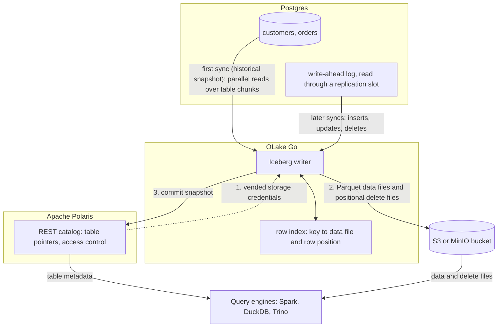

import * as I from '@site/src/components/integrations';

Postgres to Apache Iceberg usually means Debezium, Kafka and a sink connector, or a Flink job that someone has to keep running. This guide uses neither. OLake Go reads the Postgres write-ahead log (WAL) and commits the changes as Iceberg tables into an Apache Polaris catalog, with the files in your own bucket.

Polaris is an open source Iceberg REST (Representational State Transfer) catalog you run yourself. Apache Spark, DuckDB and Trino read the tables through that one endpoint, and in the run on this page all three returned the same rows.

<I.IntegrationByline />

<TLDR title='Key takeaways'>

- OLake Go replicates Postgres into Iceberg tables in Polaris: a full historical snapshot first, then change data capture (CDC) from the WAL, with no Kafka, Debezium or Spark job in between.
- Every sync is one Iceberg commit with Parquet data files and positional delete files, so updates land as row-level changes rather than duplicate rows.
- The same tables are open to any engine that reads an Iceberg REST catalog. Spark, DuckDB and Trino returned identical rows and totals in the run on this page.

</TLDR>

**The short answer.** To replicate Postgres to Apache Iceberg with change data capture (CDC), run OLake Go with a Postgres replication slot as the source and an Iceberg REST catalog such as Apache Polaris as the destination. The first sync copies each table in full; every later sync replays inserts, updates and deletes from the WAL. Spark, DuckDB and Trino then query the same tables.

## How Postgres CDC reaches Apache Iceberg here



Two things happen in order, and OLake Go does both on its own. The first sync records the current WAL position through the replication slot, then reads each table in parallel chunks and writes Parquet data files. Every later sync opens the slot at the saved position and replays the inserts, updates and deletes since.

An update needs the old version of the row retired. With positional deletes, OLake Go keeps an index of where each primary key sits (data file and row number) and writes a small delete file that points at those positions. Readers skip the retired rows without comparing keys, which is why every current Spark, DuckDB and Trino release reads this format.

One thing to keep an eye on: the replication slot pins WAL on the Postgres server until OLake Go has read it. A job that is paused for days makes the WAL grow by everything written since. Keep the job on a schedule, and alert on `pg_replication_slots` lag if disk is tight.

## What you need

- **Postgres 12 or later** with `wal_level = logical` and a user that can read the WAL. The tables on this page ran on Postgres 16. Hosted Postgres on Amazon Relational Database Service (RDS), Aurora, Google Cloud SQL, Azure, Neon or Supabase works the same way; step 1 links the setup guides.
- **An Apache Polaris server and a bucket**, both reachable from OLake Go and from your query engines. The run on this page used Polaris 1.8.0 and MinIO in Docker; on AWS, use an S3 bucket and an IAM role instead.
- **At least one engine that reads an Iceberg REST catalog.** This page shows Apache Spark 3.5.6 with Iceberg 1.10.0, DuckDB 1.5.5 and Trino 484.
- **OLake UI** from the [Docker Compose install](/docs/install/olake-ui/). The run on this page used OLake Go v1.1.0.
- **Docker**, and about 40 minutes.

## Step 1: Prepare Postgres for CDC

Most readers point OLake Go at tables they already have. If you want to follow along with the exact data from this page, create these two tables first:

<details>
<summary>The two sample tables used on this page</summary>

```sql title="Sample schema"
CREATE TABLE customers (
  id SERIAL PRIMARY KEY,
  name VARCHAR(100), email VARCHAR(200), city VARCHAR(100), tier VARCHAR(20),
  created_at TIMESTAMPTZ DEFAULT NOW(),
  updated_at TIMESTAMPTZ DEFAULT NOW());

CREATE TABLE orders (
  id SERIAL PRIMARY KEY,
  customer_id INT REFERENCES customers(id), product VARCHAR(100), amount NUMERIC(10,2), status VARCHAR(20),
  created_at TIMESTAMPTZ DEFAULT NOW(),
  updated_at TIMESTAMPTZ DEFAULT NOW());

-- Then insert whatever you like. This page started with 8 customers and 40 orders.
```

</details>

<I.Partial id="sources/postgres/prereqs" tables="customers, orders" />

## Step 2: Set up the Polaris catalog

An Iceberg table is a set of files plus a catalog entry that says which metadata file is current. **Apache Polaris** holds those entries and the permissions; the Parquet files sit in your own S3 or MinIO bucket. OLake Go writes through Polaris, and every engine on this page reads through it with the credentials Polaris hands out.

The [Polaris catalog page](/docs/integrations/catalogs/polaris/) lists the other engines that read it. If you already run AWS Glue, Lakekeeper or another catalog, the [Apache Iceberg overview](/docs/integrations/iceberg/) shows what changes.

<I.CatalogStrip />

<I.CatalogTabs>
<TabItem value="polaris">

<I.Partial id="catalogs/polaris/setup" />

</TabItem>
</I.CatalogTabs>

## Step 3: Connect Postgres to OLake Go

<I.Partial id="sources/postgres/connect">

Here is the source form from the run on this page. Postgres ran in another container, so the host is `host.docker.internal`; the user, slot and publication are the ones from step 1.

<Figure src='/img/docs/integrations/postgres-to-iceberg/olake-source-postgres-cdc.webp' alt='OLake UI Edit source form for Postgres on OLake Go v1.1.0 with Enable CDC on, replication slot olake_slot, publication olake_pub, host host.docker.internal, database shop and user olake' caption='The Postgres source in OLake UI: Enable CDC on, with the slot, publication and replication user from step 1.' width='760px' />

**Set up source** runs the connection test and the CDC checks (`wal_level`, the slot, the publication) before anything is saved. When one fails, the dialog names the setting and its recommended value.

</I.Partial>

## Step 4: Configure the Iceberg destination

<I.CatalogTabs>
<TabItem value="polaris">

<I.Partial id="catalogs/polaris/writer">

Here is the destination form from the run on this page. Polaris and MinIO ran in other containers, so both addresses use `host.docker.internal`; the credential is the `olake` principal from step 2.

<Figure src='/img/docs/integrations/postgres-to-iceberg/olake-destination-polaris.webp' alt='OLake UI Edit destination form for Apache Iceberg with catalog type Polaris, OAuth2 authentication, REST catalog URI on port 8181, catalog name olake and the MinIO S3 endpoint' caption='The Polaris destination in OLake UI: OAuth2 with the principal from step 2, and the MinIO endpoint for the files.' width='760px' />

</I.Partial>

</TabItem>
</I.CatalogTabs>

## Step 5: Create the job and run the first sync

<I.Partial id="jobs/create" engines="Apache Spark, DuckDB and Trino, or whichever engines will read the tables" upsert="Positional Deletes" updateType="pos">

Three target query engines were set on this job: Apache Spark, DuckDB and Trino. All three read every Iceberg delete format, and the run on this page used positional deletes on Iceberg format version 2 for every stream.

<Figure src='/img/docs/integrations/postgres-to-iceberg/olake-streams-positional-deletes.webp' alt='OLake UI Streams Selection page with customers and orders selected, Full Refresh + CDC, Upsert and Positional Deletes on Iceberg format version V2' caption='Each stream: Full Refresh + CDC, Upsert, and Positional Deletes on Iceberg v2. The Iceberg DB name at the top is editable.' />

<Figure src='/img/docs/integrations/postgres-to-iceberg/olake-job-history-two-syncs.webp' alt='OLake UI Job Logs and History for postgres_to_iceberg showing two completed syncs, the first in 15 seconds and the second in 13 seconds' caption='Job history: the 15 s historical snapshot, then the 13 s change-only sync.' />

</I.Partial>

On this page the first run copied 8 customers and 40 orders (48 records, 2.23 KB) and finished in **15 seconds**, container start included. OLake Go names the destination namespace after the job, the source database and the schema, so `postgres_to_iceberg` on database `shop` produced `postgres_to_iceberg_shop_public`. The **Iceberg DB** field at the top of the Streams page changes it before the first sync.

## Step 6: Query the tables from DuckDB

DuckDB is the quickest way to check the result from a laptop: one `ATTACH` and the whole catalog is visible.

<I.CatalogTabs>
<TabItem value="polaris">

<I.Partial id="engines/duckdb/connect-polaris" schema="postgres_to_iceberg_shop_public" />

<Figure src='/img/docs/integrations/postgres-to-iceberg/duckdb-polaris-customers.webp' alt='DuckDB 1.5.5 shell querying polaris.postgres_to_iceberg_shop_public.customers and returning 10 rows with id, name, city and tier' caption='DuckDB 1.5.5 reading the customers table through Polaris after the change sync: 10 rows, one per key.' />

</TabItem>
</I.CatalogTabs>

<I.Cta />

## Step 7: Change rows in Postgres and sync again

To see the change path work, the run on this page made 12 changes in Postgres after the first sync:

```sql title="Changes made in Postgres between the two syncs"
INSERT INTO customers (name, email, city, tier) VALUES
  ('Maya Patel', 'maya@example.com', 'Pune', 'silver'),
  ('Lucas Silva', 'lucas@example.com', 'São Paulo', 'bronze');
INSERT INTO orders (customer_id, product, amount, status) VALUES
  (9, 'Laptop', 1299.00, 'placed'), (9, 'Mouse', 25.50, 'placed'),
  (10, 'Monitor', 349.99, 'placed'), (3, 'Keyboard', 89.00, 'placed'), (7, 'Webcam', 79.90, 'placed');
UPDATE customers SET tier = 'gold', updated_at = NOW()      WHERE name = 'Liam Carter';
UPDATE customers SET city = 'Abu Dhabi', updated_at = NOW() WHERE name = 'Zara Ali';
UPDATE orders    SET status = 'delivered', updated_at = NOW() WHERE id IN (1, 4, 7);
```

The second sync read **12 records (594 bytes)** from the slot and finished in **13 seconds** end to end. For `customers` that meant one new data file with 4 rows: 2 inserts plus the new versions of 2 updated rows. One positional delete file retires the 2 old versions by file and row number.

OLake Go's commit report in the sync log shows it directly: `addedDataFiles=1`, `addedRecords=4`, `addedPositionalDeleteFiles=1`, `addedPositionalDeletes=2`, and no equality delete files. The `orders` table has the same shape with 8 rows and 3 deletes.

<Figure src='/img/docs/integrations/postgres-to-iceberg/olake-sync-log-positional-delete-commit.webp' alt='OLake UI sync log filtered to the Iceberg commit report for customers, showing addedDataFiles 1, addedPositionalDeleteFiles 1, addedRecords 4 and addedPositionalDeletes 2' caption='The change-only sync in the OLake UI log: one data file and one positional delete file per table.' />

Every engine shows the result on its next query, with no refresh. Liam Carter is `gold`, Zara Ali moved to Abu Dhabi, and the two new customers are there. The `_op_type` column shows how each row arrived: `r` for the snapshot, `c` for the inserts and `u` for the updates.

**Schema changes.** When a column is added in Postgres, OLake Go adds it to the Iceberg table on the next sync, and readers see it the next time they load the table. Widening changes (`int` to `bigint`, `real` to `double precision`) are applied. Narrowing or incompatible type changes fail the sync rather than corrupt the table; full rules are on the [schema evolution page](/docs/features/schema/).

## Query the same tables from Trino and Spark

Nothing is exported or copied for a second engine. Trino and Spark read the files OLake Go wrote, through the same Polaris endpoint.

<Tabs groupId="engine" queryString="engine">
<TabItem value="trino" label="Trino" default>

<I.Partial id="engines/trino/connect-polaris" schema="postgres_to_iceberg_shop_public" />

<Figure src='/img/docs/integrations/postgres-to-iceberg/trino-polaris-customers.webp' alt='Trino 484 CLI querying customers in the polaris catalog and returning the same 10 rows as DuckDB' caption='Trino 484 reading the same table through Polaris: the same 10 rows.' />

</TabItem>
<TabItem value="spark" label="Apache Spark">

<I.Partial id="engines/spark/connect-polaris" schema="postgres_to_iceberg_shop_public" />

</TabItem>
</Tabs>

All three engines agreed on the counts and the money: 10 customers, 45 orders and 25579.19 in total. The `orders` roll-up matched Postgres to the cent: 16 delivered orders for 8659.68, 18 placed for 10522.26, 11 shipped for 6397.25.

## Data types: Postgres to Iceberg

OLake Go maps Postgres types to Iceberg types. Most columns pass through unchanged; three groups are worth knowing about.

| Postgres | Iceberg (written by OLake Go) | Trino shows | Notes |
| --- | --- | --- | --- |
| `integer`, `serial` | `int` | `integer` | |
| `bigint`, `bigserial` | `long` | `bigint` | |
| `numeric(p,s)`, `real` | `double` | `double` | OLake Go stores decimals as doubles. The `orders.amount` sums on this page matched Postgres to the cent in every engine; round at query time when you need exact decimal arithmetic. |
| `timestamptz`, `timestamp` | `timestamptz` (UTC) | `timestamp(6) with time zone` | `timestamp` has no zone in Postgres; it is read as UTC. |
| `varchar`, `text`, `uuid`, `json`, `jsonb` | `string` | `varchar` | Parse JSON at query time. |
| `boolean` | `boolean` | `boolean` | |
| `bytea` | `binary` | `varbinary` | |

Postgres types in the table come from the [Postgres connector reference](/docs/connectors/postgres/#data-type-mapping); the Trino column comes from `DESCRIBE` on the tables of this run. OLake Go adds `_cdc_lsn` on Postgres tables, the WAL position each change came from.

## Cost and maintenance

- **Storage** is your bucket: you pay S3 or MinIO rates for the Parquet and delete files, and nothing to Polaris for holding pointers.
- **Compute.** OLake Go runs wherever you run Docker. Each engine spends compute only when it queries, and none of them keeps its own copy.
- **Maintenance.** Nothing compacts the tables for you. A CDC table that gets a new small file and delete file per sync wants compaction; [OLake Fusion](/docs/fusion/getting-started/overview/) does this for the catalogs OLake Go writes to, and Spark's `rewrite_data_files` works through the same Polaris endpoint.
- **WAL disk.** The replication slot keeps WAL until OLake Go reads it. A job paused for a weekend on a busy server can hold tens of gigabytes. Drop the slot if you retire a job.
- **Credential rotation.** Polaris principals do not expire by default. Rotate the `olake` principal's secret on your own schedule; a rotated secret fails the next sync at the token exchange, before any data moves.

## Troubleshooting

### 1. Polaris cannot create a table

```text
{"error":{"message":"host must not be null.","type":"NullPointerException","code":500}}
{"error":{"message":"java.net.URISyntaxException: Expected scheme-specific part at index 5: http:","type":"RuntimeException","code":500}}
```

The store hostname contains an underscore (`lab_minio`), which Java's Uniform Resource Identifier (URI) parser rejects. Rename the container or host with a hyphen and update `endpoint` and `endpointInternal` on the catalog.

### 2. Polaris refuses to vend credentials

```text
{"error":{"message":"Credential vending was requested for table probe.t1, but no credentials are available","type":"IllegalArgumentException","code":400}}
```

The catalog has `stsUnavailable: true` but Polaris was given no static keys to hand out. Either remove `stsUnavailable` (MinIO and S3 both expose a Security Token Service (STS) endpoint), or configure the keys on the Polaris server.

### 3. DuckDB cannot resolve the store address

```text
IO Error: Could not resolve hostname error for HTTP GET to 'http://host.docker.internal:9000/lakehouse/...'
```

DuckDB used the store address Polaris vends, which resolves inside Docker but not on the laptop. Add an S3 secret with the address DuckDB can reach and attach with `ACCESS_DELEGATION_MODE 'none'`, as in step 6.

### 4. The destination test fails at the token exchange

OLake Go's destination test exchanges the principal's credentials at `/api/catalog/v1/oauth/tokens` before anything else. Three causes cover nearly every failure: a wrong client id or secret, a principal without a role that carries `CATALOG_MANAGE_CONTENT` on the catalog, or a wrong `Polaris Catalog Name`. Run the token check from the catalog setup; it returns the same error Polaris gives OLake Go.

<details>
<summary>How this compares with other ways to move Postgres data to Apache Iceberg</summary>

| Method | Freshness | Updates and deletes | What you run |
| --- | --- | --- | --- |
| [Debezium](https://debezium.io/documentation/reference/stable/connectors/postgresql.html), Kafka and Kafka Connect with an Iceberg sink | Set by the sink commit interval | Appended as change events, with a separate merge job for the current state | Debezium, Kafka, Kafka Connect and usually a schema registry |
| [Flink CDC](https://nightlies.apache.org/flink/flink-cdc-docs-stable/) with the Iceberg Flink sink | Set by the checkpoint interval | Upserts through equality deletes on tables with a primary key | A Flink cluster with checkpoint storage |
| Managed ELT with an Iceberg destination | Minutes, by plan | Varies by tool | Nothing to run; priced per row, per GB or per connector |
| Periodic `COPY` export to Parquet, then a load job | Hours | Full reload or hand-written merge | A scheduler and your own scripts |
| **OLake Go to Iceberg on Polaris (this guide)** | CDC on a schedule down to one minute | Upserts through positional deletes, equality deletes or deletion vectors, matched to the target engines | One Docker Compose stack, open source; your bucket plus your own compute |

Debezium and Kafka make sense when Kafka already carries the change events for other consumers. Flink wins when you need joins, enrichment or second-level latency on the way in.

For copying Postgres tables into Iceberg with the least infrastructure, OLake Go is one job and one catalog; the trade-off is that freshness is a schedule, not a stream. The [Postgres CDC to Iceberg without Spark](/blog/postgres-cdc-to-apache-iceberg-without-spark/) post compares these routes in more depth.

</details>

## When not to use this

- **You need sub-minute freshness.** OLake Go runs on a schedule, down to one minute between syncs. A streaming pipeline is the better fit for second-level latency.
- **You need transformations on the way in.** OLake Go copies tables as they are, with row filters and partitioning. Joins and enrichment belong in a query engine after the data lands, or in a stream processor before it.
- **Tables have no primary key.** Inserts replicate; updates and deletes cannot be matched to a row and are not applied. Add a primary key or set `REPLICA IDENTITY FULL` first.

## FAQs

<I.IntegrationFaq />

<I.HowWeTested />

## Related guides

<I.RelatedIntegrations />

Deeper reading on this site:

- [Postgres to ClickHouse through the same Polaris catalog](/docs/integrations/postgres-to-clickhouse/)
- [How to set up Postgres to Apache Iceberg replication](/blog/how-to-set-up-postgres-apache-iceberg/)
- [Equality vs positional deletes vs deletion vectors](/blog/iceberg-delete-formats-cdc-equality-vs-positional-vs-deletion-vectors/)
- [OLake Go ingestion benchmarks](/docs/benchmarks/ingestion/)

<I.IntegrationJsonLd />

<I.Cta title='Start with your own Postgres' body='The quickstart runs OLake UI with Docker Compose. Create the source, the Polaris destination and the job as above, and the first sync lands your tables as Iceberg in your own bucket.' />
