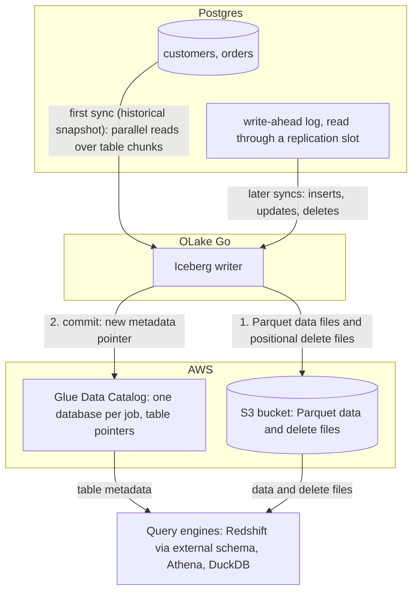

import * as I from '@site/src/components/integrations';

Postgres to Redshift usually means a Database Migration Service (DMS) task, an Aurora zero-ETL (extract, transform, load) integration, or a nightly `COPY`, and tables that only Redshift can read. This guide takes a different route. OLake Go reads the Postgres write-ahead log (WAL) and commits the changes as Apache Iceberg tables into the AWS Glue Data Catalog. The files stay in your own S3 bucket. Redshift maps that Glue database onto an external schema and queries the tables in place.

Nothing else is in the path: no DMS, no Kafka, no load job. Athena and DuckDB read the same tables through the same catalog.

<I.IntegrationByline />

<TLDR title='Key takeaways'>

- OLake Go replicates Postgres into Iceberg tables in the Glue Data Catalog: a full historical snapshot first, then change data capture (CDC) from the WAL, with no DMS or Kafka in between.
- Redshift reads the Glue database through one `CREATE EXTERNAL SCHEMA` statement, with no refresh. Every change a sync commits is visible on the next query, on Serverless and RA3 alike.
- The same tables, written once by OLake Go, are also queryable from Athena and DuckDB. In the run on this page all three engines returned identical rows.

</TLDR>

**The short answer.** To replicate Postgres to Redshift with change data capture (CDC), run OLake Go with a Postgres replication slot as the source. Point it at the AWS Glue Data Catalog as the Iceberg destination. Set the upsert type to Positional Deletes, the format Redshift reads. The first sync copies each table in full (the historical snapshot); every later sync replays inserts, updates and deletes from the WAL. Redshift, Athena and DuckDB then query the same Iceberg tables, with no second copy.

## How Postgres CDC reaches Redshift here



Two things happen in order, and OLake Go does both on its own. The first sync records the current WAL position through the replication slot. Then it reads each table in parallel chunks and writes Parquet data files: that is the historical load. Every later sync opens the slot at the saved position and replays the inserts, updates and deletes since. Nothing written during the snapshot is lost, and there is no separate backfill job.

Each sync ends with one commit to Glue. OLake Go uploads the data and delete files to the bucket, then updates the table's metadata pointer in the Glue database. Redshift, Athena and DuckDB see the new snapshot on their next query; none of them keeps a copy.

One thing to keep an eye on: the replication slot pins WAL on the Postgres server until OLake Go has read it. A job that is paused for days makes the WAL grow by everything written since. Keep the job running on a schedule, and alert on `pg_replication_slots` lag if disk is tight.

## What you need

- **Postgres 12 or later** with `wal_level = logical` and a user that can read the WAL. The tables on this page ran on Postgres 16. Hosted Postgres on Amazon Relational Database Service (RDS), Aurora, Google Cloud SQL, Azure, Neon or Supabase works the same way; step 1 links the setup guides.
- **An AWS account** with an S3 bucket for the files and an IAM user or role for OLake Go with Glue and S3 permissions. The run on this page used a bucket and a scoped IAM user in `ap-southeast-1`.
- **Amazon Redshift**, Serverless or an RA3 cluster, with an IAM role attached that can read Glue and the bucket. The run on this page used a Serverless workgroup at 8 RPU.
- **OLake UI** from the [Docker Compose install](/docs/install/olake-ui/). The run on this page used OLake Go v1.1.0.
- **Docker**, and about 40 minutes.

## Step 1: Prepare Postgres for CDC

Most readers point OLake Go at tables they already have. If you want to follow along with the exact data from this page, create these two tables first:

<details>
<summary>The two sample tables used on this page</summary>

```sql title="Sample schema"
CREATE TABLE customers (
  id SERIAL PRIMARY KEY,
  name VARCHAR(100), email VARCHAR(200), city VARCHAR(100), tier VARCHAR(20),
  created_at TIMESTAMPTZ DEFAULT NOW(),
  updated_at TIMESTAMPTZ DEFAULT NOW());

CREATE TABLE orders (
  id SERIAL PRIMARY KEY,
  customer_id INT REFERENCES customers(id), product VARCHAR(100), amount NUMERIC(10,2), status VARCHAR(20),
  created_at TIMESTAMPTZ DEFAULT NOW(),
  updated_at TIMESTAMPTZ DEFAULT NOW());

-- Then insert whatever you like. This page started with 8 customers and 40 orders.
```

</details>

<I.Partial id="sources/postgres/prereqs" tables="customers, orders" />

## Step 2: Set up the Glue catalog

Redshift reads Iceberg tables through a catalog. **AWS Glue Data Catalog** is the one this page uses: OLake Go creates a Glue database per job and registers each table there. The files sit in your S3 bucket. Redshift, Athena, Amazon Elastic MapReduce (EMR) and DuckDB all read from the same catalog. Redshift reaches it through an external schema, with the IAM role attached to the workgroup or cluster.

<I.CatalogStrip />

<I.CatalogTabs>
<TabItem value="glue">

<I.Partial id="catalogs/glue/setup" />

The run on this page gave OLake Go a scoped IAM user with this inline policy. Redshift got a role with `AmazonS3ReadOnlyAccess` and read access to Glue:

```json title="IAM policy for the OLake Go user (replace the bucket, region and account)"
{
  "Version": "2012-10-17",
  "Statement": [
    { "Effect": "Allow", "Action": ["s3:ListBucket", "s3:GetBucketLocation"], "Resource": "arn:aws:s3:::<bucket>" },
    { "Effect": "Allow", "Action": ["s3:GetObject", "s3:PutObject", "s3:DeleteObject", "s3:AbortMultipartUpload", "s3:ListMultipartUploadParts"], "Resource": "arn:aws:s3:::<bucket>/*" },
    { "Effect": "Allow",
      "Action": ["glue:GetDatabase", "glue:GetDatabases", "glue:CreateDatabase", "glue:GetTable", "glue:GetTables", "glue:CreateTable", "glue:UpdateTable", "glue:DeleteTable"],
      "Resource": ["arn:aws:glue:<region>:<account>:catalog", "arn:aws:glue:<region>:<account>:database/*", "arn:aws:glue:<region>:<account>:table/*/*"] }
  ]
}
```

</TabItem>
</I.CatalogTabs>

## Step 3: Connect Postgres to OLake Go

<I.Partial id="sources/postgres/connect">

Here is the source form from the run on this page. Postgres ran in another container, so the host is `host.docker.internal`; the user, slot and publication are the ones from step 1.

<Figure src='/img/docs/integrations/postgres-to-redshift/olake-source-postgres-cdc.webp' alt='OLake UI Edit source form for Postgres on OLake Go v1.1.0 with Enable CDC on, replication slot olake_slot, publication olake_pub, host host.docker.internal, database shop, user olake and SSL disabled' caption='The Postgres source in OLake UI: Enable CDC on, with the slot, publication and replication user from step 1.' width='760px' />

**Set up source** runs the connection test and the CDC checks (`wal_level`, the slot, the publication) before anything is saved. When one fails, the dialog names the setting and its recommended value.

</I.Partial>

## Step 4: Configure the Iceberg destination

<I.CatalogTabs>
<TabItem value="glue">

<I.Partial id="catalogs/glue/writer" />

Here is the destination form from the run on this page. It holds the bucket path OLake Go writes under, the region of the bucket and the Glue catalog, and the access key pair of the IAM user from step 2.

<Figure src='/img/docs/integrations/postgres-to-redshift/olake-destination-glue.webp' alt='OLake UI Edit destination form for Apache Iceberg with catalog type AWS Glue, S3 path s3://olake-x2y-lab-672919669757-apse1/lakehouse/, region ap-southeast-1 and an access key pair' caption='The Glue destination in OLake UI: the S3 path, the region and the keys of the scoped IAM user.' width='760px' />

</TabItem>
</I.CatalogTabs>

## Step 5: Create the job and run the first sync

Redshift is not in OLake Go's target engine picker yet. This job therefore lists **Athena** and **DuckDB** as target engines and sets the upsert type to **Positional Deletes** by hand. That is the format Redshift reads, and both listed engines read it too.

<I.Partial id="jobs/create" engines="AWS Athena and DuckDB (Redshift is not in the list yet; it reads what Athena reads)" upsert="Positional Deletes" updateType="pos">

OLake Go offers every delete format Athena and DuckDB both read. The run on this page picked **Positional Deletes** from that list because Redshift reads Iceberg v2 tables with positional deletes and nothing else.

<Figure src='/img/docs/integrations/postgres-to-redshift/olake-streams-positional-deletes.webp' alt='OLake UI Streams Selection page with the public schema, customers and orders selected, sync mode Full Refresh + CDC, ingestion mode Upsert and upsert type Positional Deletes on Iceberg format version V2' caption='Each stream: Full Refresh + CDC, Upsert, and Positional Deletes as the upsert type. The Iceberg DB name at the top is editable.' />

<Figure src='/img/docs/integrations/postgres-to-redshift/olake-job-history-two-syncs.webp' alt='OLake UI Job Logs and History for postgres_to_redshift showing two completed syncs, the first in 19 seconds and the second in 18 seconds' caption='Job history: the 19 s historical snapshot, then the 18 s change-only sync.' />

</I.Partial>

On this page the first run copied 8 customers and 40 orders (48 records, 2.23 KB) and finished in **19 seconds**, container start included. OLake Go names the Glue database after the job, the source database and the schema, so `postgres_to_redshift` on database `shop` produced `postgres_to_redshift_shop_public`. The **Iceberg DB** field at the top of the Streams page changes it before the first sync.

## Step 6: Query the tables in Redshift

<I.CatalogTabs>
<TabItem value="glue">

<I.Partial id="engines/redshift/query-glue" schema="postgres_to_redshift_shop_public" />

<Figure src='/img/docs/integrations/postgres-to-redshift/redshift-glue-customers.webp' alt='Redshift query editor v2 in the AWS console running the customers query on the Serverless workgroup and returning 10 rows with id, name, city and tier' caption='Redshift Serverless reading the customers table through the external schema after the change sync in query editor v2: 10 rows, one per key.' />

</TabItem>
</I.CatalogTabs>

<I.Cta />

## Step 7: Change rows in Postgres and sync again

To see the change path work, the run on this page made 12 changes in Postgres after the first sync:

```sql title="Changes made in Postgres between the two syncs"
INSERT INTO customers (name, email, city, tier) VALUES
  ('Maya Patel', 'maya@example.com', 'Pune', 'silver'),
  ('Lucas Silva', 'lucas@example.com', 'São Paulo', 'bronze');
INSERT INTO orders (customer_id, product, amount, status) VALUES
  (9, 'Laptop', 1299.00, 'placed'), (9, 'Mouse', 25.50, 'placed'),
  (10, 'Monitor', 349.99, 'placed'), (3, 'Keyboard', 89.00, 'placed'), (7, 'Webcam', 79.90, 'placed');
UPDATE customers SET tier = 'gold', updated_at = NOW()      WHERE name = 'Liam Carter';
UPDATE customers SET city = 'Abu Dhabi', updated_at = NOW() WHERE name = 'Zara Ali';
UPDATE orders    SET status = 'delivered', updated_at = NOW() WHERE id IN (1, 4, 7);
```

The second sync read **12 records (594 bytes)** from the slot and finished in **18 seconds** end to end. For `customers` that meant one new data file with 4 rows: 2 inserts plus the new versions of 2 updated rows. One small positional delete file retires the 2 old versions. OLake Go's commit report in the sync log shows it directly: `addedDataFiles=1`, `addedRecords=4`, `addedPositionalDeleteFiles=1`, `addedPositionalDeletes=2`. The `orders` table has the same shape with 8 rows and 3 deletes.

<Figure src='/img/docs/integrations/postgres-to-redshift/olake-sync-log-positional-delete-commit.webp' alt='OLake UI sync log filtered to the Iceberg commit report, showing addedDataFiles 1, addedPositionalDeleteFiles 1, addedRecords and addedPositionalDeletes for the change sync' caption='The change-only sync in the OLake UI log: one data file and one positional delete file per table.' />

Redshift shows the result on the next query, with no refresh and no `ALTER TABLE`. Liam Carter is `gold`, Zara Ali moved to Abu Dhabi, and the two new customers are there. The two retired versions are gone, because Redshift applies the positional deletes while reading. The `_op_type` column shows how each row arrived: `r` for the snapshot, `c` for the inserts and `u` for the updates.

**Schema changes.** When a column is added in Postgres, OLake Go adds it to the Iceberg table on the next sync. The Glue table definition is updated in the same commit. Redshift shows it on the next query of the external schema. Widening changes (`int` to `bigint`, `real` to `double precision`) are applied. Narrowing or incompatible type changes fail the sync rather than corrupt the table. Full rules are on the [schema evolution page](/docs/features/schema/).

## Query the same tables from Athena and DuckDB

This is the point of writing Iceberg instead of loading Redshift tables. Nothing is exported, copied or refreshed: both engines read the files OLake Go wrote, through the same Glue database.

<Tabs groupId="engine" queryString="engine">
<TabItem value="athena" label="Amazon Athena" default>

<I.Partial id="engines/athena/connect-glue" schema="postgres_to_redshift_shop_public" />

<Figure src='/img/docs/integrations/postgres-to-redshift/athena-glue-customers.webp' alt='Athena query editor in the AWS console running the customers query on the postgres_to_redshift_shop_public database and returning 10 rows' caption='Athena reading the same table through Glue: the same 10 rows.' />

</TabItem>
<TabItem value="duckdb" label="DuckDB">

<I.Partial id="engines/duckdb/connect-glue" schema="postgres_to_redshift_shop_public" />

DuckDB 1.5.5 returned the same 10 customers and the same `orders` roll-up as Redshift and Athena in the run on this page. It read the current metadata file of each table.

</TabItem>
</Tabs>

An `orders` roll-up matched Postgres to the cent in all three engines. It gave 16 delivered orders for 8659.68, 18 placed for 10522.26, 11 shipped for 6397.25.

## Data types: Postgres to Iceberg to Redshift

OLake Go maps Postgres types to Iceberg types, and Redshift maps Iceberg types to its own through the external schema. Most columns pass through unchanged; three groups are worth knowing about.

| Postgres | Iceberg (written by OLake Go) | Redshift shows | Notes |
| --- | --- | --- | --- |
| `integer`, `serial` | `int` | `INTEGER` | |
| `bigint`, `bigserial` | `long` | `BIGINT` | |
| `numeric(p,s)`, `real`, `double precision` | `double` | `DOUBLE PRECISION` | OLake Go stores decimals as doubles. The `orders.amount` sums on this page matched Postgres to the cent in every engine; round at query time when you need exact decimal arithmetic. |
| `timestamptz`, `timestamp` | `timestamptz` (UTC) | `TIMESTAMP` | Redshift shows the UTC instant without a zone; `timestamp` has no zone in Postgres and is read as UTC. |
| `varchar`, `text`, `uuid`, `json`, `jsonb` | `string` | `VARCHAR` | Parse JSON with `JSON_PARSE` in Redshift. |
| `boolean` | `boolean` | `BOOLEAN` | |
| `bytea` | `binary` | `VARBYTE` | |

Postgres types in the table come from the [Postgres connector reference](/docs/connectors/postgres/#data-type-mapping). The Redshift side comes from the [Redshift Iceberg page](https://docs.aws.amazon.com/redshift/latest/dg/querying-iceberg.html) (checked 2026-10-30) and from `svv_external_columns` on the tables of this run. OLake Go adds `_cdc_lsn` on Postgres tables, the WAL position each change came from.

## Cost and maintenance

- **Storage** is your bucket: you pay S3 rates for the Parquet and delete files, and nothing to Glue beyond its per-object pricing for the table entries.
- **Compute.** OLake Go runs wherever you run Docker. Redshift Serverless bills RPU-hours only while queries run; a query over the external schema scans the Parquet files in S3 through Redshift Spectrum, so filter on the columns you need. Athena bills per terabyte scanned.
- **Maintenance.** Glue has no built-in compaction for tables written by external engines. A CDC table that gets a new small file and delete file per sync wants compaction; [OLake Fusion](/docs/fusion/getting-started/overview/) does this for the catalogs OLake Go writes to, and Spark on EMR's `rewrite_data_files` works through the same Glue catalog.
- **WAL disk.** The replication slot keeps WAL until OLake Go reads it. A job paused for a weekend on a busy server can hold tens of gigabytes. Drop the slot if you retire a job.
- **Key rotation.** The IAM user's access key is what OLake Go writes with. Rotate it on your schedule, or run OLake Go on an instance with a role and leave the key fields empty.

## Troubleshooting

### 1. The destination test fails on a table OLake Go did not create

```text
User: arn:aws:iam::<account>:user/<olake user> is not authorized to perform: s3:GetObject on resource: "arn:aws:s3:::<another bucket>/.../test_olake.db/test_olake/metadata/00000-....metadata.json"
```

OLake Go's destination test opens a probe table called `test_olake.test_olake` in the Glue database `test_olake`. An earlier run in the same account and region may have left that table behind, pointing at a bucket your user cannot read. The test then fails before it writes anything. Delete the stale `test_olake.test_olake` table from Glue, or run OLake Go against a region whose Glue catalog does not have it. The run on this page hit this and moved to a clean region.

### 2. Redshift cannot see the external schema's tables

```text
ERROR: Database 'postgres_to_redshift_shop_public' does not exist in the Glue Data Catalog
```

The external schema was created before the first sync, or in a different region from the Glue database. OLake Go creates the Glue database on the first sync; create the external schema after it, in the workgroup's region.

### 3. Redshift returns no rows or old rows

The IAM role on the namespace or cluster cannot read the bucket, so Spectrum skips the data files. Check that the role has `s3:GetObject` on the bucket path and `glue:GetTable` on the database. Check too that `IAM_ROLE default` points at it (`DEFAULT_IAM_ROLE` in the namespace settings).

### 4. Athena asks for a query result location

```text
Before you run your first query, you need to set up a query result location in Amazon S3.
```

Athena writes every result set to S3. Create a workgroup with a result location in your bucket and pick it in the editor, instead of changing the shared `primary` workgroup. The run on this page used `s3://<bucket>/athena-results/`.

### 5. The next sync waits on the slot

If a sync hangs after the snapshot, another process holds the replication slot, or `wal_sender_timeout` cut the connection during a quiet period. Check `pg_stat_replication` for a second consumer of `olake_slot`, and set `wal_sender_timeout = 0` for the OLake Go user as the prerequisites block shows.

<details>
<summary>How this compares with other ways to move Postgres data to Redshift</summary>

| Method | Freshness | Updates and deletes | Where the data lands | What you run |
| --- | --- | --- | --- | --- |
| [Aurora PostgreSQL zero-ETL integration](https://docs.aws.amazon.com/redshift/latest/mgmt/zero-etl-using.html) | Seconds | Yes | Native Redshift tables; Redshift is the only reader | Nothing to run; Aurora PostgreSQL as the source |
| [AWS DMS to Redshift](https://docs.aws.amazon.com/dms/latest/userguide/CHAP_Target.Redshift.html) | CDC through logical replication | Yes | Native Redshift tables | A DMS replication instance and task, plus an S3 staging bucket |
| `COPY` from S3 exports on a schedule | Hours to daily | No; full reloads or your own merge | Native Redshift tables | A script, a scheduler and a staging bucket |
| Managed ELT (Fivetran, Estuary, Airbyte Cloud) | Minutes, by plan | Varies by tool | Redshift tables, a second copy you pay to move and store | Nothing; priced per row, per GB or per connector |
| **OLake Go to Iceberg on Glue (this guide)** | CDC on a schedule down to one minute | Yes, as Iceberg row-level deletes | Apache Iceberg tables that Redshift, Athena, EMR, Spark and DuckDB all read | One Docker Compose stack, open source; your bucket plus your own compute |

The zero-ETL integration is the simpler choice when the source is Aurora and Redshift is the only reader. Writing Iceberg once avoids paying to move and store a second copy. That matters as soon as Athena, EMR or a notebook needs the same rows, or you want to own the files.

</details>

## When not to use this

- **Every query must hit native Redshift speed.** Spectrum reads Parquet from S3 on every query. Keep the Iceberg tables as the source and load the hot slice into a native table on a schedule.
- **Tables have no primary key.** Inserts replicate; updates and deletes cannot be matched to a row and are not applied. Add a primary key or set `REPLICA IDENTITY FULL` first.
- **You want deletion vectors.** Redshift reads them only on Serverless above 4 RPU or RG-type clusters, and Athena cannot read Iceberg v3 at all. Keep the job on positional deletes while either is a reader.

## FAQs

<I.IntegrationFaq />

<I.HowWeTested />

## Related guides

<I.RelatedIntegrations />

Deeper reading on this site:

- [Postgres to Iceberg with AWS Glue](/blog/postgres-to-iceberg-using-glue/)
- [Equality vs positional deletes vs deletion vectors](/blog/iceberg-delete-formats-cdc-equality-vs-positional-vs-deletion-vectors/)
- [Which engines read which delete formats](/blog/iceberg-delete-formats-interoperability-olake-go/)
- [OLake Go ingestion benchmarks](/docs/benchmarks/ingestion/)

<I.IntegrationJsonLd />

<I.Cta title='Start with your own Postgres' body='The quickstart runs OLake UI with Docker Compose. Create the source, the Glue destination and the job as above, and the first sync lands your tables where Redshift can read them.' />
