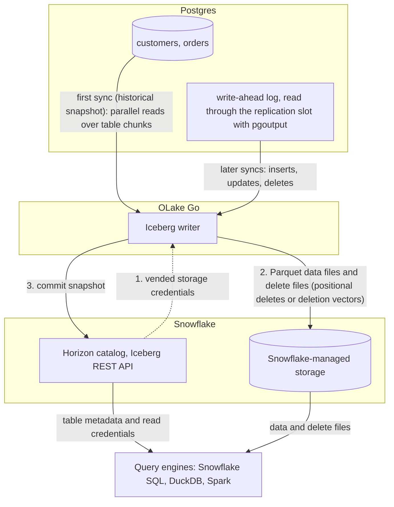

import * as I from '@site/src/components/integrations';

Postgres to Snowflake comes down to one choice. Copy the rows into tables Snowflake owns, or write them once as Apache Iceberg tables that Snowflake and every other engine can read. This guide does the second.

OLake Go captures Postgres changes with logical replication and commits them as Iceberg tables into a catalog Snowflake reads. With Snowflake's own Horizon catalog, the default on this page, the files sit on Snowflake-managed storage and nothing else is in the path: no Kafka, no Spark. With AWS Glue, the files sit in your S3 bucket and Snowflake reads them through a catalog integration.

<I.IntegrationByline />

<TLDR title='Key takeaways'>

- OLake Go replicates Postgres into Snowflake as Iceberg tables: a full historical snapshot first, then change data capture (CDC) from the write-ahead log, with no Kafka or Spark in between.
- Through the Horizon catalog the tables land as Snowflake-managed Iceberg tables. You query them in Snowsight right away, with no `CREATE ICEBERG TABLE`, no external volume and no refresh.
- The same tables, written once by OLake Go, are also queryable from DuckDB and Spark through the same catalog. In the run on this page all three engines returned identical rows.

</TLDR>

**The short answer.** To replicate Postgres to Snowflake with change data capture (CDC), run OLake Go with Postgres logical replication as the source and the Snowflake Horizon catalog as the Iceberg destination. The first sync copies each table in full (the historical snapshot); every later sync replays inserts, updates and deletes from the write-ahead log. Snowflake, DuckDB and Spark then query the same Iceberg tables, with no second copy.

## How Postgres CDC reaches Snowflake here



Two things happen in order, and OLake Go does both on its own. The first sync records the current write-ahead log (WAL) position, then reads each table in parallel chunks and writes Parquet data files: that is the historical load. Every later sync opens the replication slot at the saved position and replays the inserts, updates and deletes since. Nothing made during the snapshot is lost, and there is no separate backfill job.

Each sync ends with one commit to Horizon. OLake Go asks Horizon for short-lived storage credentials, uploads the data and delete files, then posts the new snapshot to the catalog. Snowflake sees it the moment the commit lands; DuckDB and Spark see it on their next catalog load.

One thing to keep an eye on: the replication slot holds WAL on disk until OLake Go reads it. If the job is paused for a week, Postgres keeps a week of WAL. Set `max_slot_wal_keep_size` so a stalled slot is invalidated before the disk fills, and alert on `pg_replication_slots.wal_status`.

## What you need

- **Postgres 10 or later** with logical replication (`wal_level = logical`) and a user that can replicate. The tables on this page ran on Postgres 16. Hosted Postgres on Amazon Relational Database Service (RDS), Aurora, Azure or Cloud SQL works the same way; step 1 links each guide.
- **A Snowflake account** where you can run the one-time setup as `ACCOUNTADMIN`. Snowflake-managed storage means no cloud bucket or IAM role on your side.
- **OLake UI** from the [Docker Compose install](/docs/install/olake-ui/), with the OLake Go Postgres source on v0.11 or later. The run on this page used v1.1.0.
- **Docker**, and about 30 minutes.

## Step 1: Prepare Postgres for CDC

Most readers point OLake Go at tables they already have. If you want to follow along with the exact data from this page, create these two tables first:

<details>
<summary>The two sample tables used on this page</summary>

```sql title="Sample schema"
CREATE TABLE customers (
  id SERIAL PRIMARY KEY, name TEXT, email TEXT, city TEXT, tier TEXT,
  created_at TIMESTAMPTZ DEFAULT now(), updated_at TIMESTAMPTZ DEFAULT now());

CREATE TABLE orders (
  id SERIAL PRIMARY KEY, customer_id INT REFERENCES customers(id), product TEXT,
  amount NUMERIC(10,2), status TEXT,
  created_at TIMESTAMPTZ DEFAULT now(), updated_at TIMESTAMPTZ DEFAULT now());

-- Then insert whatever you like. This page started with 8 customers and 40 orders.
```

</details>

<I.Partial id="sources/postgres/prereqs" tables="customers, orders" />

## Step 2: Set up the catalog in Snowflake

Snowflake reads Iceberg tables from two kinds of catalog. **Horizon** is Snowflake's own: OLake Go writes straight into it, the tables are Snowflake-managed, and they appear in Snowsight the moment a sync commits. **AWS Glue** is a catalog outside Snowflake, so the files stay in your S3 bucket. Snowflake reaches them through a *catalog integration*: a read-only link to that external catalog, refreshed after each sync.

Horizon is the default on this page. Glue is the right pick when Athena, Redshift or Spark on Amazon Elastic MapReduce (EMR) will read the same tables and you want the files in your own bucket.

<I.CatalogStrip />

<I.CatalogTabs>
<TabItem value="horizon">

<I.Partial id="catalogs/horizon/setup" />

</TabItem>
<TabItem value="glue">

<I.Partial id="catalogs/glue/setup" />

</TabItem>
</I.CatalogTabs>

## Step 3: Connect Postgres to OLake Go

<I.Partial id="sources/postgres/connect">

Here is the source form from the run on this page. Postgres ran in another container, so the host is `host.docker.internal`; the slot and publication are the ones from step 1.

<Figure src='/img/docs/integrations/postgres-to-snowflake/olake-source-postgres-cdc.webp' alt='OLake UI Create source form for Postgres on OLake Go v1.1.0 with Enable CDC on, replication slot olake_slot, publication olake_pub and the connection details' caption='The Postgres source in OLake UI: Enable CDC on, with the slot and publication from step 1.' width='760px' />

**Set up source** runs the connection test and the four CDC checks before anything is saved:

<Figure src='/img/docs/integrations/postgres-to-snowflake/olake-source-test-cdc-checks.webp' alt='OLake UI Testing Source Configuration dialog showing Test Connection successful, 4 of 4 required CDC prerequisite checks passed and 1 of 1 optional CDC setting passed' caption='The source test: connection, the four required CDC prerequisites and the optional setting all pass.' width='620px' />

</I.Partial>

## Step 4: Configure the Iceberg destination

<I.CatalogTabs>
<TabItem value="horizon">

<I.Partial id="catalogs/horizon/writer" />

</TabItem>
<TabItem value="glue">

<I.Partial id="catalogs/glue/writer" />

</TabItem>
</I.CatalogTabs>

## Step 5: Create the job and run the first sync

<I.Partial id="jobs/create" engines="Snowflake, plus DuckDB and Apache Spark if they will read the tables too" upsert="Positional Deletes" updateType="pos">

Three target query engines were set on this job. That is the only format decision you make: OLake Go works out which Iceberg delete format all three can read and sets it on every stream.

<Figure src='/img/docs/integrations/postgres-to-snowflake/olake-job-target-query-engines.webp' alt='OLake UI Create Job page with Postgres source, Apache Iceberg destination and target query engines Apache Spark, DuckDB and Snowflake' caption='Target query engines on the job: OLake Go resolves a delete format Spark, DuckDB and Snowflake can all read.' />

<Figure src='/img/docs/integrations/postgres-to-snowflake/olake-streams-positional-deletes.webp' alt='OLake UI Streams Selection page with customers and orders selected, sync mode Full Refresh + CDC, ingestion mode Upsert and upsert type Positional Deletes on Iceberg format version V2' caption='Each stream: Full Refresh + CDC, Upsert, and the upsert type OLake Go resolved for the three engines (Positional Deletes in this run). The Iceberg DB name at the top is editable.' />

<Figure src='/img/docs/integrations/postgres-to-snowflake/olake-job-history-two-syncs.webp' alt='OLake UI Job Logs and History for pg_to_snowflake showing two completed syncs, the first in 41 seconds and the second in 23 seconds' caption='Job history: the 41 s historical snapshot, then the 23 s change-only sync.' />

</I.Partial>

On this page the first run copied 8 customers and 40 orders and finished in **41 seconds**, container start included. OLake Go names the destination schema after the job, the source database and the source schema, so `pg_to_snowflake` on database `shop` produced `pg_to_snowflake_shop_public`. The **Iceberg DB** field at the top of the Streams page changes it before the first sync.

## Step 6: Query the tables in Snowflake

<I.CatalogTabs>
<TabItem value="horizon">

<I.Partial id="engines/snowflake/query-horizon" />

<Figure src='/img/docs/integrations/postgres-to-snowflake/snowsight-show-iceberg-tables.webp' alt='Snowsight SQL file running SHOW ICEBERG TABLES on the pg_to_snowflake_shop_public schema and listing customers and orders with owner OLAKE_ROLE, external volume SNOWFLAKE_MANAGED, catalog SNOWFLAKE and table type MANAGED' caption='SHOW ICEBERG TABLES in Snowsight: both tables are Snowflake-managed, created by OLAKE_ROLE through Horizon.' />

<Figure src='/img/docs/integrations/postgres-to-snowflake/snowsight-customers-query.webp' alt='Snowsight query on OLAKE_DEMO.pg_to_snowflake_shop_public.customers returning 10 rows with id, name, city and tier in 739 ms' caption='The customers table in Snowsight after the change sync: 10 rows in 739 ms on an X-Small warehouse.' />

</TabItem>
<TabItem value="glue">

<I.Partial id="engines/snowflake/query-glue" />

</TabItem>
</I.CatalogTabs>

<I.Cta />

## Step 7: Change rows in Postgres and sync again

To see the change path work, the run on this page made 12 changes in Postgres after the first sync:

```sql title="Changes made in Postgres between the two syncs"
INSERT INTO customers (name, email, city, tier) VALUES
  ('Maya Patel', 'maya@example.com', 'Pune', 'silver'),
  ('Lucas Silva', 'lucas@example.com', 'São Paulo', 'bronze');
INSERT INTO orders (customer_id, product, amount, status) VALUES
  (9, 'Laptop', 1299.00, 'placed'), (9, 'Mouse', 25.50, 'placed'),
  (10, 'Monitor', 349.99, 'placed'), (3, 'Keyboard', 89.00, 'placed'), (7, 'Webcam', 79.90, 'placed');
UPDATE customers SET tier = 'gold',      updated_at = now() WHERE name = 'Liam Carter';
UPDATE customers SET city = 'Abu Dhabi', updated_at = now() WHERE name = 'Zara Ali';
UPDATE orders    SET status = 'delivered', updated_at = now() WHERE id IN (2, 5, 8);
```

The second sync read **12 records (589 bytes)** from the slot and finished in **23 seconds** end to end. For `customers` that meant one new data file with 4 rows: 2 inserts plus the new versions of 2 updated rows. One small delete file retires the 2 old versions. OLake Go's commit report in the sync log shows it directly: `addedDataFiles=1`, `addedRecords=4`, `addedPositionalDeleteFiles=1`, `addedPositionalDeletes=2`, and the table commit itself took 0.64 seconds.

<Figure src='/img/docs/integrations/postgres-to-snowflake/olake-sync-log-positional-delete-commit.webp' alt='OLake UI sync log filtered to the Iceberg commit reports for orders and customers, showing addedDataFiles 1, addedPositionalDeleteFiles 1, addedRecords 8 and 4, totalEqualityDeletes 0' caption='The change-only sync in the OLake UI log: one data file and one positional delete file per table, zero equality deletes.' />

Snowflake shows the result with no refresh. Liam Carter is `gold`, Zara Ali moved to Abu Dhabi, and the two new customers are there. The `updated_at` column shows which rows the second sync touched:

<Figure src='/img/docs/integrations/postgres-to-snowflake/snowsight-customers-after-cdc.webp' alt='Snowsight query on customers after the CDC sync showing 10 rows with _op_type r for the snapshot rows, u for Liam Carter and Zara Ali, c for Maya Patel and Lucas Silva, and updated_at for the changed rows' caption='Snowsight after the change sync: the two updates (u), the two inserts (c) and the untouched snapshot rows (r), 10 rows in 260 ms.' />

**Schema changes.** When a column is added in Postgres, OLake Go adds it to the Iceberg table on the next sync, and Snowflake shows it. Widening changes (`int` to `bigint`, `float` to `double`) are applied; narrowing or incompatible type changes fail the sync rather than corrupt the table. Full rules are on the [schema evolution page](/docs/features/schema/).

## Query the same tables from DuckDB and Spark

This is the point of writing Iceberg instead of loading Snowflake tables. Nothing is exported, copied or refreshed: both engines read the files OLake Go wrote, through the same Horizon endpoint, with credentials vended by Snowflake.

<Tabs groupId="engine" queryString="engine">
<TabItem value="duckdb" label="DuckDB" default>

<I.Partial id="engines/duckdb/connect-horizon" />

<Figure src='/img/docs/integrations/postgres-to-snowflake/duckdb-horizon-customers.webp' alt='DuckDB 1.5.5 shell querying horizon.pg_to_snowflake_shop_public.customers and returning the same 10 rows as Snowflake' caption='DuckDB 1.5.5 reading the Snowflake-managed table through Horizon: the same 10 rows.' />

</TabItem>
<TabItem value="spark" label="Apache Spark">

<I.Partial id="engines/spark/connect-horizon" />

<Figure src='/img/docs/integrations/postgres-to-snowflake/spark-horizon-customers.webp' alt='PySpark shell querying horizon.pg_to_snowflake_shop_public.customers and returning the same 10 rows as Snowflake and DuckDB' caption='Spark 3.5.6 with Iceberg 1.10.0 reading the same table: identical rows.' />

</TabItem>
</Tabs>

An `orders` roll-up matched Postgres to the cent in all three engines: 13 delivered orders for 4787.08, 18 placed for 9172.63, 14 shipped for 7305.62.

## Data types: Postgres to Iceberg to Snowflake

OLake Go maps Postgres types to Iceberg types, and Snowflake maps Iceberg types to its own. Most columns pass through unchanged; three groups are worth knowing about.

| Postgres | Iceberg (written by OLake Go) | Snowflake shows | Notes |
| --- | --- | --- | --- |
| `int`, `serial`, `smallint` | `int` | `NUMBER(10,0)` | |
| `bigint`, `bigserial` | `long` | `NUMBER(19,0)` | |
| `numeric`, `decimal`, `real`, `float4` | `double` | `FLOAT` | OLake Go stores decimals as doubles. The `orders.amount` sums on this page matched Postgres to the cent in every engine; round at query time when you need exact decimal arithmetic. |
| `double precision` | `double` | `FLOAT` | |
| `boolean` | `boolean` | `BOOLEAN` | |
| `date`, `timestamp`, `timestamptz` | `timestamptz` (UTC) | `TIMESTAMP_LTZ(6)` | `date` gains a midnight UTC time. Timestamps without a zone are read as UTC, so set the session zone before comparing. |
| `text`, `varchar`, `char` | `string` | `VARCHAR` | |
| `json`, `jsonb`, `uuid`, `xml`, arrays, ranges, `inet` | `string` | `VARCHAR` | Parse `jsonb` with `PARSE_JSON()` in Snowflake, or flatten it before the sync with OLake Go's level-1 normalization. |

Postgres types in the table come from the [Postgres connector reference](/docs/connectors/postgres/#data-type-mapping); the Snowflake side from Snowflake's [Iceberg data types](https://docs.snowflake.com/en/user-guide/tables-iceberg-data-types) page (checked 2026-10-14).

## Cost and maintenance

- **Storage** is Snowflake's with `SNOWFLAKE_MANAGED`: you pay Snowflake storage rates for the Parquet and delete files. Point the database at your own external volume to keep the files in your bucket instead.
- **Compute.** OLake Go runs wherever you run Docker; it does not use a Snowflake warehouse to write. Snowflake compute is spent only when you query.
- **Maintenance.** Snowflake expires old snapshots and compacts manifests on Snowflake-managed tables at no cost. Automatic data-file compaction is bundled only when Snowflake alone writes the table ([Snowflake-managed Iceberg table maintenance](https://docs.snowflake.com/en/user-guide/tables-iceberg-manage)). A CDC table that gets a new small file every minute will want compaction from the writer side; [OLake Fusion](/docs/fusion/getting-started/overview/) does this for the catalogs OLake Go writes to, and Spark's `rewrite_data_files` works through the same Horizon endpoint.
- **Token rotation.** The programmatic access token expires (30 days in the setup above, 365 at most). Put the renewal on a calendar; an expired token fails the next sync at the catalog handshake, before any data moves.

## Troubleshooting

### 1. Postgres rejects the replication connection

```text
FATAL: must be superuser or replication role to start walsender
```

The OLake Go user lacks the `REPLICATION` attribute. Run `ALTER ROLE olake WITH REPLICATION;`. On Amazon Relational Database Service (RDS) and Aurora grant the `rds_replication` role instead, because `REPLICATION` is reserved there.

### 2. Snowflake cannot find the table

```text
SQL compilation error:
Object 'OLAKE_DEMO.PG_TO_SNOWFLAKE_SHOP_PUBLIC.CUSTOMERS' does not exist or not authorized.
```

Snowflake upper-cased an unquoted identifier. OLake Go creates the schema and tables with their lowercase Postgres names, so quote them: `OLAKE_DEMO."pg_to_snowflake_shop_public"."customers"`. It cuts both ways: if you create the database as `"olake_demo"` in quotes, OLake Go must be configured with `olake_demo`, not `OLAKE_DEMO`.

### 3. The destination test fails at the catalog handshake

OLake Go's destination test exchanges the token at `/v1/oauth/tokens` before anything else. Three causes account for nearly every failure, in order of likelihood:

1. **No network or authentication policy on the service user.** Snowflake issues a programmatic access token to a service user only under a network policy, unless an authentication policy with `NETWORK_POLICY_EVALUATION = ENFORCED_NOT_REQUIRED` waives it. The SQL in step 2 creates that policy; without it, the `ADD PROGRAMMATIC ACCESS TOKEN` line itself fails. Snowflake's [programmatic access token page](https://docs.snowflake.com/en/user-guide/programmatic-access-tokens) has the full rule.
2. **Wrong scope or role.** `scope` must be `session:role:<role>` and the role must match the token's `ROLE_RESTRICTION`.
3. **Expired token.** Tokens default to 15 days. Re-issue with `ALTER USER ... ADD PROGRAMMATIC ACCESS TOKEN` and update the destination.

Run the `curl` exchange from the catalog setup; it returns the same error Snowflake gives OLake Go, without the UI in between.

### 4. Snowflake shows stale rows on a table from an older job

A job created without a target query engine defaults to equality deletes, which Snowflake does not read. Edit the job's streams, set the target query engine to Snowflake, and OLake Go switches the upsert type to one Snowflake reads. On the next sync it rewrites the existing delete files into the new format.

<details>
<summary>How this compares with other ways to move Postgres to Snowflake</summary>

| Method | Freshness | Updates and deletes | Where the data lands | What you run |
| --- | --- | --- | --- | --- |
| [Snowflake Openflow connector for PostgreSQL](https://docs.snowflake.com/en/user-guide/data-integration/openflow/connectors/postgres/about) | CDC through logical replication | Yes, as soft deletes plus journal tables | Native Snowflake tables (an Iceberg target exists); Snowflake is the only reader | An Openflow deployment in Snowpark Container Services or your own AWS account, billed in Snowflake credits |
| Debezium, Kafka and the Snowflake Kafka connector | Seconds | Yes, with the connector's tombstone handling | Kafka topics, then Snowflake tables | Kafka, Kafka Connect, Debezium and a schema registry |
| Managed ELT (Fivetran, Estuary, Airbyte Cloud) | Minutes, by plan | Yes | Snowflake tables, a second copy you pay to move and store | Nothing; priced per row, per GB or per connector |
| Manual export (`COPY` to S3, `COPY INTO`) | Hours to daily | No; full reloads only | Files you control | A script and a scheduler |
| **OLake Go to Iceberg on Horizon (this guide)** | CDC on a schedule down to one minute | Yes, as Iceberg row-level deletes | Apache Iceberg tables that Snowflake, DuckDB, Spark and Trino all read | One Docker Compose stack, open source; Snowflake storage plus your own compute |

Openflow is the simpler choice when Snowflake is the only reader and you want Snowflake to run the pipeline. Writing Iceberg once avoids paying to move and store a second copy as soon as another engine needs the same rows, or you want to own the files.

</details>

## When not to use this

- **Your Snowflake account is on Azure and DuckDB is a reader.** DuckDB attaches REST catalogs backed by S3, S3 Tables and Google Cloud Storage only, so pick Spark or Trino as the second engine there.
- **Tables have no primary key and cannot get `REPLICA IDENTITY FULL`.** Inserts replicate; updates and deletes do not.

## FAQs

<I.IntegrationFaq />

<I.HowWeTested />

## Related guides

<I.RelatedIntegrations />

Deeper reading on this site:

- [Postgres CDC to Apache Iceberg without Spark](/blog/postgres-cdc-to-apache-iceberg-without-spark/)
- [Equality vs positional deletes vs deletion vectors](/blog/iceberg-delete-formats-cdc-equality-vs-positional-vs-deletion-vectors/)
- [Which engines read which delete formats](/blog/iceberg-delete-formats-interoperability-olake-go/)
- [Snowflake reading OLake Go tables through AWS Glue](/blog/olake-glue-snowflake/)
- [OLake Go ingestion benchmarks](/docs/benchmarks/ingestion/)

<I.IntegrationJsonLd />

<I.Cta title='Start with your own Postgres' body='The quickstart runs OLake UI with Docker Compose. Create the source, the Horizon destination and the job as above, and the first sync lands your tables in Snowflake.' />
