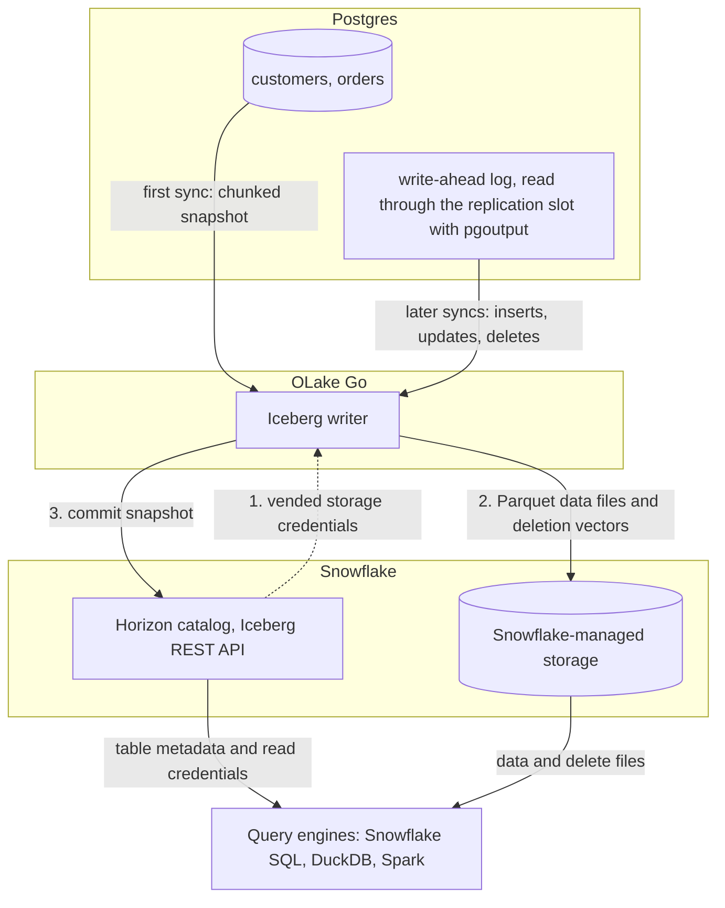

import * as I from '@site/src/components/integrations';

Postgres to Snowflake comes down to one choice. Copy the rows into tables Snowflake owns, or write them once as Apache Iceberg tables that Snowflake and every other engine can read. This guide does the second.

OLake Go captures Postgres changes with logical replication and commits them as Iceberg tables straight into Snowflake's Horizon catalog. Files sit on Snowflake-managed storage, and nothing else sits in the path: no Kafka, no Spark, no S3 bucket of your own.

<TLDR title='Key takeaways'>

- OLake Go writes into Snowflake's own catalog. Tables land as Snowflake-managed Iceberg tables; you query them in Snowsight with no `CREATE ICEBERG TABLE`, no external volume and no refresh.
- **Pick deletion vectors, never equality deletes.** Snowflake cannot read equality delete files. Set the job's target query engine to Snowflake and OLake Go hides the formats Snowflake cannot open.
- The same tables open from DuckDB and Spark through the same Horizon endpoint, and all three engines returned identical rows in the run on this page.
- **Watch `numeric` columns.** OLake Go maps Postgres `numeric` to Iceberg `double`, which Snowflake shows as `FLOAT`.
- A Snowflake service user needs a network policy, or an authentication policy that waives it, before its programmatic access token works; the SQL below sets the second.

</TLDR>

**The short answer.** To replicate Postgres to Snowflake with change data capture (CDC), run OLake Go with Postgres logical replication as the source and the Snowflake Horizon catalog as the Iceberg destination. One sync snapshots the tables; every later sync replays inserts, updates and deletes from the write-ahead log. Snowflake, DuckDB and Spark then query one copy of the data, in an open format.

## Five ways to move Postgres data to Snowflake

| Method | Freshness | Deletes and updates | Open format | What you run | Cost model | Where it falls short |
| --- | --- | --- | --- | --- | --- | --- |
| [Snowflake Openflow connector for PostgreSQL](https://docs.snowflake.com/en/user-guide/data-integration/openflow/connectors/postgres/about) | CDC through logical replication | Yes, as soft deletes plus journal tables | Native Snowflake tables (an Iceberg target exists) | An Openflow deployment in Snowpark Container Services or your own AWS account | Snowflake credits for the runtime | Single-node runtimes, password auth only, Snowflake is the only reader |
| Debezium, Kafka and the Snowflake Kafka connector | Seconds | Yes | Kafka topics, then Snowflake tables | Kafka, Kafka Connect, Debezium, schema registry | Your cluster plus Snowflake ingest | Four moving parts to run and upgrade; deletes need the connector's tombstone handling |
| Managed ELT (Fivetran, Estuary, Airbyte Cloud) | Minutes, by plan | Yes | Snowflake tables | Nothing | Per row, per GB or per connector | A second copy you pay to move and to store; the vendor owns the pipeline |
| Manual export (`COPY` to S3, `COPY INTO`) | Hours to daily | No; full reloads only | Files you control | A script and a scheduler | Snowflake compute for the loads | No updates or deletes, growing load windows, stale between runs |
| **OLake Go to Iceberg on Horizon (this guide)** | CDC on a schedule down to one minute | Yes, as Iceberg row-level deletes | Apache Iceberg tables Snowflake, DuckDB, Spark and Trino read | One Docker Compose stack, open source | Snowflake storage plus your compute | No transformations in flight; equality deletes unreadable by Snowflake, so the job must use positional deletes or deletion vectors; Horizon API calls become billable in the second half of 2026 |

The honest summary: Openflow is simpler when Snowflake is the only reader and you want Snowflake to run the pipeline. Writing Iceberg once is the cheaper design as soon as a second engine needs the same rows, or you want to own the files.

## How Postgres CDC reaches Snowflake here



Two things happen in order. The first sync reads each table in parallel chunks and writes Parquet data files. A replication slot pins the write-ahead log (WAL) position from before that snapshot started.

Every later sync opens the slot and reads the `pgoutput` stream from that position. Each insert, update or delete becomes a row in a new data file, plus a deletion vector that hides the old version.

Each sync ends with one commit to Horizon. OLake Go uploads the files with short-lived credentials that Horizon vends for Snowflake's storage, then posts the new snapshot to the catalog. Snowflake sees the snapshot the moment the commit lands; DuckDB and Spark see it on their next catalog load.

Three Postgres details decide whether this stays healthy:

- **The slot holds WAL until OLake Go reads it.** If the job is paused for a week, Postgres keeps a week of WAL on disk. Set `max_slot_wal_keep_size` so a stalled slot is invalidated before the disk fills, and alert on `pg_replication_slots.wal_status`.
- **Updates and deletes need a replica identity.** A primary key is enough unless the table has large text or JSON values: an `UPDATE` that leaves one unchanged writes `__olake_unavailable_value__` in its place, so give those tables `REPLICA IDENTITY FULL` too. Once a table without one is in the publication, Postgres rejects every `UPDATE` and `DELETE` on it until you run `ALTER TABLE ... REPLICA IDENTITY FULL`.
- **Long snapshots and `wal_sender_timeout`.** On big tables, the default 60-second sender timeout can drop the replication connection mid-snapshot. The setup guides below set it to `0`.

## What you need

- Postgres 10 or later with a user that can replicate (the tables on this page ran on Postgres 16). Hosted Postgres on Amazon Relational Database Service (RDS), Aurora, Azure or Cloud SQL works the same way; see the end of the page.
- A Snowflake account with `ACCOUNTADMIN` for the one-time setup. A 30-day trial works; Snowflake-managed storage means no cloud bucket or IAM role on your side.
- OLake UI 0.6 or later with OLake Go 0.11 or later (deletion vectors arrived in 0.11.0). The run on this page used OLake Go v0.11.2 from the [Docker Compose install](/docs/install/olake-ui/).
- Docker, and about 30 minutes.

## Step 1: Prepare Postgres for CDC

<I.Partial id="sources/postgres/prereqs" />

A two-table shop database stood in for production on this page. Its `orders.amount` column is `numeric(10,2)` on purpose: it shows up again in the data-type section.

```sql title="Sample schema used on this page"
CREATE TABLE customers (
  id SERIAL PRIMARY KEY, name TEXT, email TEXT, city TEXT, tier TEXT,
  created_at TIMESTAMPTZ DEFAULT now(), updated_at TIMESTAMPTZ DEFAULT now());

CREATE TABLE orders (
  id SERIAL PRIMARY KEY, customer_id INT REFERENCES customers(id), product TEXT,
  amount NUMERIC(10,2), status TEXT,
  created_at TIMESTAMPTZ DEFAULT now(), updated_at TIMESTAMPTZ DEFAULT now());

-- 8 customers and 40 orders, then the publication and slot from above
CREATE PUBLICATION olake_pub FOR TABLE customers, orders;
SELECT pg_create_logical_replication_slot('olake_slot', 'pgoutput');
```

## Step 2: Choose the catalog

The catalog decides who can read the tables and what you have to maintain. Snowflake reads Iceberg tables two ways: as **Snowflake-managed tables** it owns through the Horizon catalog, or as **externally managed tables** it reaches through a catalog integration.

Horizon is the right default here. The tables appear in Snowflake with no registration, Snowflake expires old snapshots for you, and the storage needs no IAM work. Glue is the right pick when Athena, Redshift or Spark on Amazon Elastic MapReduce (EMR) will read the same tables and you want the files in your own bucket.

<I.CatalogStrip />

Open the catalog you are using and run its one-time setup. Your choice is kept in the URL and on every other integration page on this site.

<I.CatalogTabs>
<TabItem value="horizon">

<I.Partial id="catalogs/horizon/setup" />

</TabItem>
<TabItem value="glue">

<I.Partial id="catalogs/glue/setup" />

</TabItem>
</I.CatalogTabs>

## Step 3: Connect Postgres to OLake Go

<I.Partial id="sources/postgres/connect" />

Here is the source form from the run on this page. Postgres ran in another container, so the host is `host.docker.internal`; the update method is **CDC**, with the slot and publication from step 1.

<Figure src='/img/docs/integrations/postgres-to-snowflake/olake-source-postgres-cdc.webp' alt='OLake UI Create source form for Postgres with update method CDC, replication slot olake_slot and publication olake_pub' caption='The Postgres source in OLake UI: CDC update method with the slot and publication from step 1.' width='760px' />

## Step 4: Configure the Iceberg destination

<I.CatalogTabs>
<TabItem value="horizon">

<I.Partial id="catalogs/horizon/writer" />

</TabItem>
<TabItem value="glue">

<I.Partial id="catalogs/glue/writer" />

</TabItem>
</I.CatalogTabs>

## Step 5: Create the job and run the first sync

<I.Partial id="jobs/create" engines="Snowflake, plus DuckDB and Apache Spark if they will read the tables too" upsert="Deletion Vector" updateType="dv" />

Three target query engines were set on this job, which is what made the Streams page offer only the formats all three read.

<Figure src='/img/docs/integrations/postgres-to-snowflake/olake-job-target-query-engines.webp' alt='OLake UI Create Job page with Postgres source, Apache Iceberg destination and target query engines Apache Spark, DuckDB and Snowflake' caption='Target query engines on the job: OLake Go intersects what Spark, DuckDB and Snowflake can read.' />

<Figure src='/img/docs/integrations/postgres-to-snowflake/olake-streams-deletion-vector.webp' alt='OLake UI Streams page with customers selected, sync mode Full Refresh + CDC, ingestion mode Upsert and upsert type Deletion Vector on Iceberg format version V3' caption='Each stream: Full Refresh + CDC, Upsert, Deletion Vector. The destination schema is named after the job, the source database and the source schema.' />

On this page the first run copied 8 customers and 40 orders and finished in **27 seconds**. OLake Go names the schema after the job, the source database and the source schema: `pg_to_snowflake_shop_public`.

<Figure src='/img/docs/integrations/postgres-to-snowflake/olake-job-history-two-syncs.webp' alt='OLake UI Job Logs and History for pg_to_snowflake showing a completed 27 second first sync and a second sync running' caption='Job history: the 27 s initial snapshot, then the change-only sync.' />

## Step 6: Query the tables in Snowflake

<I.CatalogTabs>
<TabItem value="horizon">

<I.Partial id="engines/snowflake/query-horizon" />

<Figure src='/img/docs/integrations/postgres-to-snowflake/snowsight-show-iceberg-tables.webp' alt='Snowsight result of SHOW ICEBERG TABLES listing customers and orders with catalog SNOWFLAKE, external volume SNOWFLAKE_MANAGED and table type MANAGED' caption='SHOW ICEBERG TABLES in Snowsight: both tables are Snowflake-managed, created by OLAKE_ROLE through Horizon.' />

<Figure src='/img/docs/integrations/postgres-to-snowflake/snowsight-customers-query.webp' alt='Snowsight query on OLAKE_DEMO.pg_to_snowflake_shop_public.customers returning 10 rows with id, name, city and tier in 527 ms' caption='The customers table in Snowsight after the change sync: 10 rows in 527 ms on an X-Small warehouse.' />

</TabItem>
<TabItem value="glue">

<I.Partial id="engines/snowflake/query-glue" />

</TabItem>
</I.CatalogTabs>

## Updates and deletes: what Snowflake can read

Every engine reads Iceberg data files. They differ on the delete files that hide old row versions. OLake Go offers three formats, and the job must use one every reader understands:

<I.DeleteFormatTable engines={['duckdb', 'spark']} />

With Snowflake, DuckDB and Spark as the readers, the common choice is deletion vectors (Iceberg v3) or positional deletes (v2). Deletion vectors are what this page uses: one small bitmap per touched data file, which keeps the delete-file count flat as changes accumulate. OLake Go needs a persistent index directory for either format; the UI's Docker Compose mounts one by default.

To test the change path, the run on this page made 12 changes in Postgres after the first sync:

```sql title="Changes made in Postgres between the two syncs"
INSERT INTO customers (name, email, city, tier) VALUES
  ('Maya Patel', 'maya@example.com', 'Pune', 'silver'),
  ('Lucas Silva', 'lucas@example.com', 'São Paulo', 'bronze');
INSERT INTO orders (customer_id, product, amount, status) VALUES
  (9, 'Laptop', 1299.00, 'placed'), (9, 'Mouse', 25.50, 'placed'),
  (10, 'Monitor', 349.99, 'placed'), (3, 'Keyboard', 89.00, 'placed'),
  (7, 'Webcam', 79.90, 'placed');
UPDATE customers SET tier = 'gold',      updated_at = now() WHERE name = 'Liam Carter';
UPDATE customers SET city = 'Abu Dhabi', updated_at = now() WHERE name = 'Zara Ali';
UPDATE orders    SET status = 'delivered', updated_at = now() WHERE id IN (2, 5, 8);
```

The second sync read **12 records (587 bytes)** from the slot and committed in **3.8 seconds**. For `customers` that meant one new data file with 4 rows: 2 inserts plus the new versions of 2 updated rows. One deletion vector hides the 2 old versions. OLake Go's commit report in the sync log shows it directly: `addedDataFiles=1`, `addedDVs=1`, `addedPositionalDeletes=2`, `totalEqualityDeletes=0`.

<Figure src='/img/docs/integrations/postgres-to-snowflake/olake-sync-log-deletion-vector-commit.webp' alt='OLake Go sync log showing the Iceberg commit report for customers with addedDataFiles 1, addedDVs 1, 12 records read in 587 bytes and total time 3808 ms' caption='The change-only sync in the OLake Go log: one data file, one deletion vector, 12 records read.' />

Snowflake applied the bitmap on read. Liam Carter is `gold`, Zara Ali moved to Abu Dhabi, and the two new customers are there. The `updated_at` column shows which rows the second sync touched:

<Figure src='/img/docs/integrations/postgres-to-snowflake/snowsight-customers-after-cdc.webp' alt='Snowsight table of customers after the CDC sync showing 10 rows, Liam Carter as gold, Zara Ali in Abu Dhabi, and updated_at timestamps for the changed rows' caption='Snowsight after the change sync: updates and inserts applied, 10 rows.' />

Spark's metadata tables confirm what landed. `customers.delete_files` lists one `PUFFIN` file with 2 records. `customers.snapshots` shows the second snapshot as an `overwrite` with `added-dvs = 1` and zero equality deletes.

**Schema changes.** When a column is added in Postgres, OLake Go adds it to the Iceberg table on the next sync, and Snowflake shows it. Widening changes (`int` to `bigint`, `float` to `double`) are applied; narrowing or incompatible type changes fail the sync rather than corrupt the table. Full rules are on the [schema evolution page](/docs/features/schema/).

## Data types: Postgres to Iceberg to Snowflake

OLake Go maps Postgres types to Iceberg types, and Snowflake maps Iceberg types to its own. Two hops, so two places where something can change.

| Postgres | Iceberg (written by OLake Go) | Snowflake shows | Watch for |
| --- | --- | --- | --- |
| `int`, `serial`, `smallint` | `int` | `NUMBER(10,0)` | |
| `bigint`, `bigserial` | `long` | `NUMBER(19,0)` | |
| `numeric`, `decimal`, `real`, `float4` | `double` | `FLOAT` | **Exact decimals become binary floats.** `amount` for the placed orders summed to `10234.24` in every engine on this page, but `0.1 + 0.2` style rounding applies. Round at query time, or keep money in integer cents in Postgres. |
| `double precision` | `double` | `FLOAT` | |
| `boolean` | `boolean` | `BOOLEAN` | |
| `date`, `timestamp`, `timestamptz` | `timestamptz` (UTC) | `TIMESTAMP_LTZ(6)` | `date` gains a midnight UTC time. Timestamps without a zone are read as UTC, so set the session zone before comparing. |
| `text`, `varchar`, `char` | `string` | `VARCHAR` | |
| `json`, `jsonb`, `uuid`, `xml`, arrays, ranges, `inet` | `string` | `VARCHAR` | Parse `jsonb` with `PARSE_JSON()` in Snowflake. |

Postgres types in the table come from the [Postgres connector reference](/docs/connectors/postgres/#data-type-mapping); the Snowflake side from Snowflake's [Iceberg data types](https://docs.snowflake.com/en/user-guide/tables-iceberg-data-types) page (checked 2026-10-14).

## Cost and maintenance

- **Storage** is Snowflake's with `SNOWFLAKE_MANAGED`: you pay Snowflake storage rates for the Parquet and delete files. Point the database at your own external volume to keep the files in your bucket instead.
- **Compute.** OLake Go runs wherever you run Docker; it does not use a Snowflake warehouse to write. Snowflake compute is spent only when you query.
- **Horizon API calls** are billed at 0.5 credit per million calls as cloud services, with billing scheduled to start in the second half of 2026 (Snowflake's [Horizon REST API page](https://docs.snowflake.com/en/user-guide/tables-iceberg-access-using-external-query-engine-snowflake-horizon)).
- **Maintenance.** Snowflake expires old snapshots and compacts manifests on Snowflake-managed tables at no cost. Automatic data-file compaction, however, is bundled only when Snowflake alone writes the table ([Snowflake-managed Iceberg table maintenance](https://docs.snowflake.com/en/user-guide/tables-iceberg-manage)). A CDC table that gets a new small file every minute will need compaction from the writer side; [OLake Fusion](/docs/fusion/getting-started/overview/) does this for Iceberg catalogs OLake Go writes to, and Spark's `rewrite_data_files` works through the same Horizon endpoint.
- **Token rotation.** The programmatic access token expires (30 days in the setup above, 365 at most). Put the renewal on a calendar; an expired token fails the next sync at the catalog handshake, before any data moves.

## Troubleshooting

### 1. Postgres rejects the replication connection

```text
FATAL: must be superuser or replication role to start walsender
```

The OLake Go user lacks the `REPLICATION` attribute. Run `ALTER ROLE olake WITH REPLICATION;`. On Amazon Relational Database Service (RDS) and Aurora grant the `rds_replication` role instead, because `REPLICATION` is reserved there.

### 2. Snowflake cannot find the table

```text
SQL compilation error:
Object 'OLAKE_DEMO.PG_TO_SNOWFLAKE_SHOP_PUBLIC.CUSTOMERS' does not exist or not authorized.
```

Snowflake upper-cased an unquoted identifier. OLake Go creates the schema and tables with their lowercase Postgres names, so quote them: `OLAKE_DEMO."pg_to_snowflake_shop_public"."customers"`. It cuts both ways: if you create the database as `"olake_demo"` in quotes, OLake Go must be configured with `olake_demo`, not `OLAKE_DEMO`.

### 3. The destination test fails at the catalog handshake

OLake Go's destination test exchanges the token at `/v1/oauth/tokens` before anything else. Three causes account for nearly every failure, in order of likelihood:

1. **No authentication policy on the service user.** A `TYPE = SERVICE` user must be under a network policy before a token works, unless its authentication policy sets `NETWORK_POLICY_EVALUATION = ENFORCED_NOT_REQUIRED` (the SQL in step 2 does this). Snowflake's [programmatic access token page](https://docs.snowflake.com/en/user-guide/programmatic-access-tokens) has the full rule.
2. **Wrong scope or role.** `scope` must be `session:role:<role>` and the role must match the token's `ROLE_RESTRICTION`.
3. **Expired token.** Tokens default to 15 days. Re-issue with `ALTER USER ... ADD PROGRAMMATIC ACCESS TOKEN` and update the destination.

Run the `curl` exchange from the catalog setup; it returns the same error Snowflake gives OLake Go, without the UI in between.

### 4. Snowflake shows stale rows or fails on a table synced with equality deletes

```text
Malformed request: Creating a snapshot with equality delete files is not allowed for Horizon accounts
```

Horizon refuses equality delete files, so the sync fails and retries while Snowflake keeps the last good snapshot. The OLake UI does not offer **Equality Deletes** for a Horizon destination, but the OLake CLI defaults `update_type` to `eq`, so set it in `streams.json`.

To recover, switch the stream to **Positional Deletes** and sync again. **Deletion Vector** does not work here, because Horizon rejects upgrading an existing table from Iceberg v2 to v3. The reverse is refused too (OLake Go stops with "format-version 3, which forbids positional delete files"), so choose the format before the first sync.

## Read the same tables from DuckDB and Spark

This section is the point of writing Iceberg instead of loading Snowflake tables. Nothing is exported, copied or refreshed: both engines read the same files through the same Horizon endpoint, with credentials vended by Snowflake.

<Tabs groupId="engine" queryString="engine">
<TabItem value="duckdb" label="DuckDB" default>

<I.Partial id="engines/duckdb/connect-horizon" />

<Figure src='/img/docs/integrations/postgres-to-snowflake/duckdb-horizon-customers.webp' alt='DuckDB 1.5.5 shell querying horizon.pg_to_snowflake_shop_public.customers and returning the same 10 rows as Snowflake' caption='DuckDB 1.5.5 reading the Snowflake-managed table through Horizon: the same 10 rows.' />

</TabItem>
<TabItem value="spark" label="Apache Spark">

<I.Partial id="engines/spark/connect-horizon" />

<Figure src='/img/docs/integrations/postgres-to-snowflake/spark-horizon-customers.webp' alt='PySpark shell querying horizon.pg_to_snowflake_shop_public.customers and returning the same 10 rows as Snowflake and DuckDB' caption='Spark 3.5.6 with Iceberg 1.10.0 reading the same table: identical rows.' />

</TabItem>
</Tabs>

An `orders` roll-up matched to the cent across all three engines: 13 delivered orders for 6330.99, 18 placed for 10234.24, 14 shipped for 6964.89.

## Running on RDS, Aurora, Cloud SQL, Azure or Supabase

Everything above applies to hosted Postgres; only the `wal_level` step changes.

- **Amazon RDS and Aurora** use a parameter group with `rds.logical_replication = 1` and the `rds_replication` role: [RDS guide](/docs/connectors/postgres/setup/rds/), [Aurora guide](/docs/connectors/postgres/setup/aurora/).
- **Azure Database for PostgreSQL** sets `wal_level` as a server parameter: [Azure guide](/docs/connectors/postgres/setup/azure/).
- **Cloud SQL** enables the `cloudsql.logical_decoding` flag: [Cloud SQL guide](/docs/connectors/postgres/setup/gcp/).
- **Supabase** permits replication slots only on its direct connection, which is IPv6 by default. The [Postgres connector page](/docs/connectors/postgres/#2-connecting-to-supabase) covers the pooler and IPv4 options.
- **A host with no logical replication at all**: use Full Refresh + Incremental with an `updated_at` cursor instead of CDC.

## When not to use this

- **You need transformations before the data lands.** OLake Go is extract and load only. Use Openflow or a managed ELT tool with built-in transforms, or land the raw tables and transform in Snowflake with dbt.
- **You need sub-second latency.** Each OLake Go sync is a batch of changes committed as one snapshot. Snowpipe Streaming or a Kafka path is built for that.
- **Your Snowflake account is on Azure and DuckDB is a reader.** DuckDB attaches REST catalogs backed by S3, S3 Tables and Google Cloud Storage only, so pick Spark or Trino as the second engine there.
- **Tables have no primary key and cannot get `REPLICA IDENTITY FULL`.** Inserts replicate; Postgres rejects updates and deletes on them once they are in the publication.
- **The source is Oracle, DB2 or S3.** Those OLake Go connectors have full refresh and incremental modes but no log-based CDC today.

## FAQs

<I.IntegrationFaq />

<I.HowWeTested />

## Related guides

<I.RelatedIntegrations />

Deeper reading on this site:

- [Postgres CDC to Apache Iceberg without Spark](/blog/postgres-cdc-to-apache-iceberg-without-spark/)
- [Equality vs positional deletes vs deletion vectors](/blog/iceberg-delete-formats-cdc-equality-vs-positional-vs-deletion-vectors/)
- [Which engines read which delete formats](/blog/iceberg-delete-formats-interoperability-olake-go/)
- [Snowflake reading OLake Go tables through AWS Glue](/blog/olake-glue-snowflake/)

<I.IntegrationJsonLd />

<BlogCTA />

<I.IntegrationByline />
