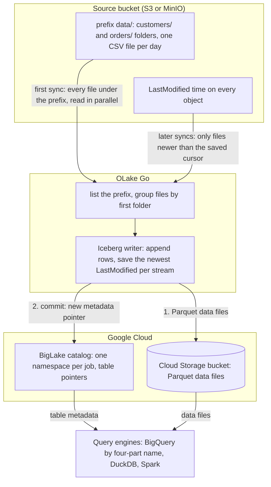

import * as I from '@site/src/components/integrations';

Files land in S3 every hour or every day: exports from an application, drops from a partner, logs from a job. S3 to BigQuery usually means a BigQuery Data Transfer Service job, a `bq load` script on a schedule, or an external table per folder.

This guide takes a different route. OLake Go reads the files itself and turns each folder into an Apache Iceberg table in a BigLake catalog, Google Cloud's Iceberg representational state transfer (REST) catalog. Every later run syncs only the files that are new.

BigQuery queries the tables through the catalog with a four-part name, with no dataset to create and no external table to declare. Nothing else is in the path: no transfer job, no load job, no table definition per folder. DuckDB and Spark read the same tables through the same catalog.

<I.IntegrationByline />

<TLDR title='Key takeaways'>

- OLake Go turns S3 folders into Iceberg tables in a BigLake catalog: the first sync reads every file under the prefix, and every later sync reads only files newer than the last run, by their modification time.
- BigQuery reads the catalog as a data source. Every file a sync commits is visible on the next `SELECT`, with no refresh and no load job.
- The same tables, written once by OLake Go, are also queryable from DuckDB and Spark. In the run on this page all three engines returned identical rows.

</TLDR>

**The short answer.** To load S3 files into BigQuery as Iceberg, run OLake Go with the bucket and prefix as the source and a BigLake catalog with a Cloud Storage bucket as the destination.

Put each stream in **Full Refresh + Incremental** mode with `_last_modified_time` as the cursor. The first sync reads every file; every later sync reads only the files added since. BigQuery, DuckDB and Spark then query the same Iceberg tables, with no second copy.

## How S3 files reach BigQuery here



Two things happen in order, and OLake Go does both on its own. The first sync lists everything under the prefix and makes one stream per first-level folder.

Then it reads every file in parallel: that is the historical load. At the end it saves the newest `LastModified` time it saw per stream.

Every later sync lists the prefix again and reads only the files whose `LastModified` time is newer than the saved cursor. On this page the second sync reported `Filtered 1 files to process out of 2 total` for each stream.

Rows are appended; a file never changes a row that an earlier file wrote. Each sync ends with one commit to BigLake, and BigQuery, DuckDB and Spark see the new snapshot on their next query.

One thing to keep an eye on: the cursor is the object's modification time, not anything inside the file. Uploading a corrected copy of yesterday's file gives it today's `LastModified` time.

The whole file is then read again, and every row in it is appended a second time. Add files, never rewrite them, and keep an `id` column in the data so a query can pick the latest version of a row.

## What you need

- **A source bucket, on S3 or an S3-compatible store**, with files in folders under one prefix: CSV, JSON, Parquet or XML, plain or gzip. Amazon S3, MinIO and LocalStack all work; the run on this page used MinIO in Docker with two CSV folders.
- **Read-only access** to the source bucket: `s3:ListBucket` and `s3:GetObject`, through a role on AWS or static keys on MinIO.
- **A Google Cloud project** with the BigLake API enabled, a Cloud Storage bucket for the Iceberg files, and a service account for OLake Go with the BigLake Editor role on the project and Storage Object User on the bucket. The run on this page used a bucket in `us-central1`.
- **BigQuery** in the same project. Queries run in the bucket's region, and the account running them needs the BigQuery Job User role plus read access to the catalog.
- **OLake UI** from the [Docker Compose install](/docs/install/olake-ui/) with the OLake Go S3 source. The run on this page used v1.1.0.
- **Docker**, and about 30 minutes.

## Step 1: Prepare the source bucket

Most readers point OLake Go at files they already have. If you want to follow along with the exact data from this page, upload two CSV files shaped like these first:

<details>
<summary>The two sample files used on this page</summary>

Each stream is a folder under `data/`, with one dated subfolder per upload. The header row names the columns, and `id` identifies the row so a later file can correct it.

```text title="data/customers/2026-10-30/customers.csv"
id,name,email,city,tier,created_at,updated_at
1,Aarav Mehta,aarav@example.com,Mumbai,gold,2026-10-30T03:34:34Z,2026-10-30T03:34:34Z
2,Priya Sharma,priya@example.com,Bengaluru,silver,2026-10-30T03:34:34Z,2026-10-30T03:34:34Z
```

```text title="data/orders/2026-10-30/orders.csv"
id,customer_id,product,amount,status,created_at,updated_at
1,2,Headphones,99.19,shipped,2026-10-30T03:34:34Z,2026-10-30T03:34:34Z
2,3,Monitor,178.38,delivered,2026-10-30T03:34:34Z,2026-10-30T03:34:34Z
```

```bash title="Upload with the AWS CLI (add --endpoint-url for MinIO)"
aws s3 sync ./stage s3://shop/data/
# Then add whatever you like. This page started with 8 customers and 40 orders.
```

</details>

<I.Partial id="sources/s3/prereqs" bucket="shop" prefix="data/" />

## Step 2: Set up the BigLake catalog

BigQuery reads Iceberg tables through a catalog. **BigLake** is the one this page uses: it is Google Cloud's Iceberg REST catalog, OLake Go creates a namespace per job in it, and the Iceberg files sit in your Cloud Storage bucket, separate from the source files.

BigQuery, DuckDB and Spark all read from the same catalog. BigQuery treats it as a data source in the project, so a table OLake Go commits is queryable on the next statement.

<I.CatalogStrip />

<I.CatalogTabs>
<TabItem value="biglake">

<I.Partial id="catalogs/biglake/setup" />

<Figure src='/img/docs/integrations/s3-to-bigquery/gcp-service-account-key-json.webp' alt='Google Cloud console Create private key dialog for the OLake service account with the JSON key type selected' caption='The JSON key for the service account. The console downloads it once; its contents go into the OLake Go destination form.' />

</TabItem>
</I.CatalogTabs>

## Step 3: Connect S3 to OLake Go

<I.Partial id="sources/s3/connect">

Here is the source form from the run on this page. MinIO ran in another container, so the custom endpoint is `http://host.docker.internal:9000`. The bucket is `shop`, the prefix `data/`, and the format CSV with a header row.

<Figure src='/img/docs/integrations/s3-to-bigquery/olake-source-s3-minio.webp' alt='OLake UI Edit source form for S3 on OLake Go v1.1.0 with the Enable CDC toggle marked not supported, bucket shop, region us-east-1, static keys, path prefix data/, custom endpoint http://host.docker.internal:9000, file format CSV with delimiter comma, header on and quote character double quote' caption='The S3 source in OLake UI: bucket, prefix, the MinIO endpoint, and the CSV options. The keys shown are MinIO defaults for a local test.' width='760px' />

**Set up source** calls `HeadBucket` before anything is saved, so a wrong key or bucket name fails here rather than on the first sync.

</I.Partial>

## Step 4: Configure the Iceberg destination

<I.CatalogTabs>
<TabItem value="biglake">

<I.Partial id="catalogs/biglake/writer">

Here is the destination form from the run on this page. It holds the BigLake endpoint, the Cloud Storage bucket as the catalog path, the service account JSON and the project ID.

<Figure src='/img/docs/integrations/s3-to-bigquery/olake-destination-biglake.webp' alt='OLake UI Edit destination form for Apache Iceberg with catalog type Big Lake, REST catalog URI https://biglake.googleapis.com/iceberg/v1/restcatalog, BigLake catalog path gs://olake-x2y-lab-bq, authentication type GCP and the project ID oauth-361809' caption='The BigLake destination in OLake UI: the endpoint, the bucket as catalog path, GCP authentication and the project ID.' width='760px' />

</I.Partial>

</TabItem>
</I.CatalogTabs>

## Step 5: Create the job and run the first sync

S3 streams differ from database streams in one way on the Streams page. The ingestion mode is **Append** and cannot be changed, because a file carries no key to match an earlier row by.

Set the sync mode to **Full Refresh + Incremental** and leave the cursor on `_last_modified_time`, which OLake Go adds to every stream. This job lists **BigQuery**, **Spark** and **DuckDB** as target query engines.

<I.Partial id="jobs/create" engines="Google BigQuery, Apache Spark and DuckDB" unit="folders" syncMode="Full Refresh + Incremental" cursor="_last_modified_time" image="olakego/source-s3:latest" cliSyncMode="incremental" namespace="s3" ingestion="Append">

With Append mode there are no delete files to agree on, so the target engines only record which engines read the tables. Every engine that reads Iceberg v2 reads an append-only table.

<Figure src='/img/docs/integrations/s3-to-bigquery/olake-streams-incremental-append.webp' alt='OLake UI Streams Selection page with the s3 namespace, customers and orders selected, sync mode Full Refresh + Incremental, cursor field _last_modified_time, ingestion mode Append with Upsert greyed out, normalization on' caption='Each folder: Full Refresh + Incremental on _last_modified_time, Append (Upsert is not offered for files). The Iceberg DB name at the top is editable.' />

<Figure src='/img/docs/integrations/s3-to-bigquery/olake-job-history-two-syncs.webp' alt='OLake UI Job Logs and History for s3_to_bigquery showing two completed syncs, the first in 28 seconds and the second in 23 seconds' caption='Job history: the 28 s first read of both folders, then the 23 s sync of the two new files.' />

</I.Partial>

On this page the first run read the 8 customer and 40 order rows (48 records, 2.61 KB). It finished in **28 seconds**, container start included. OLake Go names the BigLake namespace after the job, the bucket and the namespace.

The namespace for every S3 stream is `s3`, so `s3_to_bigquery` on bucket `shop` produced `s3_to_bigquery_shop_s3`. The **Iceberg DB** field at the top of the Streams page changes it before the first sync.

## Step 6: Query the tables in BigQuery

<I.CatalogTabs>
<TabItem value="biglake">

<I.Partial id="engines/bigquery/query-biglake" schema="s3_to_bigquery_shop_s3" />

Because files append, the query that most readers want is the latest version of each row. BigQuery has `QUALIFY`, so one clause does it, ordering by the file time OLake Go stored in `_last_modified_time`. The `id` column arrived as `FLOAT64` from the CSV, hence the cast:

```sql title="Latest row per id"
SELECT CAST(id AS INT64) AS id, name, city, tier
FROM `<project-id>.<bucket>.s3_to_bigquery_shop_s3.customers`
QUALIFY ROW_NUMBER() OVER (PARTITION BY id ORDER BY _last_modified_time DESC) = 1
ORDER BY id;
```

<Figure src='/img/docs/integrations/s3-to-bigquery/bigquery-biglake-customers.webp' alt='BigQuery SQL editor in the Google Cloud console running the latest-row-per-id customers query on the olake-x2y-lab-bq catalog and returning 10 rows with id, name, city and tier' caption='BigQuery reading the customers table through the BigLake catalog after the second sync: one row per id.' />

</TabItem>
</I.CatalogTabs>

<I.Cta />

## Step 7: Add files to the bucket and sync again

To see the incremental path work, the run on this page uploaded one more file per folder after the first sync. Each carries new rows and corrected copies of existing rows, the way a daily export does:

```text title="Files added between the two syncs"
data/customers/2026-10-30/customers-changes.csv   4 rows: ids 9 and 10 are new, ids 3 and 8 are corrections
data/orders/2026-10-30/orders-changes.csv         8 rows: ids 41 to 45 are new, ids 1, 4 and 7 now read "delivered"
```

The second sync listed both folders, skipped the two files it had already read, and read the two new ones. That was **12 records (686 bytes)** in **23 seconds** end to end. The sync log shows the filter per stream, with the cursor it compared against, and the commit report shows one new data file per table and no delete files: `addedDataFiles=1`, `addedRecords=4` for `customers`.

<Figure src='/img/docs/integrations/s3-to-bigquery/olake-sync-log-filtered-files.webp' alt='OLake UI sync log filtered to the lines Filtered 1 files to process out of 2 total, one line per stream' caption='The second sync in the OLake UI log: one new file per folder, the first file skipped by its modification time.' />

BigQuery shows the result with no refresh. The corrected rows exist twice.

`_op_type` tells them apart: `r` for the first full read, `u` for rows that arrived through an incremental sync. `_last_modified_time` carries the file time, which is what the `QUALIFY` clause above sorts on:

```text title="SELECT CAST(id AS INT64), name, city, tier, _op_type, _last_modified_time FROM ... WHERE id IN (3, 8, 9, 10) ORDER BY 1, 6"
id  name         city       tier    _op_type  _last_modified_time
3   Liam Carter  Austin     bronze  r         2026-10-30T06:20:05Z
3   Liam Carter  Austin     gold    u         2026-10-30T06:20:46Z
8   Zara Ali     Dubai      silver  r         2026-10-30T06:20:05Z
8   Zara Ali     Abu Dhabi  silver  u         2026-10-30T06:20:46Z
9   Maya Patel   Pune       silver  u         2026-10-30T06:20:46Z
10  Lucas Silva  São Paulo  bronze  u         2026-10-30T06:20:46Z
```

**Schema changes.** When a new column appears in a later file, OLake Go adds it to the Iceberg table on the next sync and commits the new schema to BigLake in the same commit.

BigQuery shows the column on the next query, with nulls for older rows. A column whose inferred type changes in an incompatible way fails the sync rather than corrupt the table. Full rules are on the [schema evolution page](/docs/features/schema/).

## Query the same tables from DuckDB and Spark

This is the point of writing Iceberg instead of loading BigQuery tables. Nothing is exported, copied or refreshed: both engines read the files OLake Go wrote, through the same BigLake catalog. DuckDB has `QUALIFY` too; Spark uses a `ROW_NUMBER()` subquery for the same result.

<Tabs groupId="engine" queryString="engine">
<TabItem value="duckdb" label="DuckDB" default>

<I.Partial id="engines/duckdb/connect-biglake" schema="s3_to_bigquery_shop_s3" />

<Figure src='/img/docs/integrations/s3-to-bigquery/gcp-hmac-key-service-account.webp' alt='Google Cloud console Cloud Storage Interoperability settings with the Select a service account dialog, the OLake service account selected and the Create key button' caption='The key for DuckDB: Cloud Storage, Settings, Interoperability, then a key for the same service account OLake Go uses.' />

DuckDB 1.5.5 returned the same 10 customers and the same `orders` roll-up as BigQuery in the run on this page, with `QUALIFY row_number() OVER (PARTITION BY id ORDER BY _last_modified_time DESC) = 1` on the scan. It read the current metadata file of each table through the catalog and the data files through the hash-based message authentication code (HMAC) key.

</TabItem>
<TabItem value="spark" label="Apache Spark">

<I.Partial id="engines/spark/connect-biglake" schema="s3_to_bigquery_shop_s3" />

Spark 4.0.1 with Iceberg 1.10.0 returned the same rows in the run on this page, with `ROW_NUMBER() OVER (PARTITION BY id ORDER BY _last_modified_time DESC)` in a subquery and `WHERE rn = 1`, running on a laptop against the same catalog and bucket.

</TabItem>
</Tabs>

An `orders` roll-up over the latest row per id matched the files in all three engines. It gave 16 delivered orders for 8659.68, 18 placed for 10522.26, 11 shipped for 6397.25.

## Data types: CSV to Iceberg to BigQuery

A CSV file has no types, so OLake Go infers them from a sample of rows at discover time and maps them to Iceberg types.

BigQuery then maps Iceberg types to its own when it reads the catalog. Parquet files skip the inference and keep their own types. This is what the CSV run on this page produced:

| In the CSV | Iceberg (written by OLake Go) | BigQuery shows | Notes |
| --- | --- | --- | --- |
| Whole numbers (`id`, `customer_id`) | `double` | `FLOAT64` | In this run the integer columns were inferred as floating point. Cast with `CAST(id AS INT64)` in queries, or use Parquet when the type matters. |
| Decimals (`amount`) | `double` | `FLOAT64` | The `orders.amount` sums on this page matched the files to the cent in every engine; round at query time when you need exact decimal arithmetic. |
| ISO 8601 timestamps (`created_at`) | `timestamptz` (UTC) | `TIMESTAMP` | Strings that parse as timestamps are stored as timestamps. |
| Other text | `string` | `STRING` | |
| `_last_modified_time` | `string` | `STRING` | The object's `LastModified` time in ISO 8601, so it sorts correctly as text. Added to every row by OLake Go. |

Types on the left come from the [S3 connector reference](/docs/connectors/s3/#data-type-mapping). The BigQuery side comes from the [BigQuery Iceberg tables page](https://docs.cloud.google.com/bigquery/docs/iceberg-external-tables) (checked 2026-10-30) and from the table schemas of this run. JSON files map integers to `bigint` and nested objects to JSON text; Parquet keeps `int`, `bigint`, `date` and `timestamp` as they are.

## Cost and maintenance

- **Storage** is your Cloud Storage bucket: you pay Cloud Storage rates for the Parquet files, on top of the source files in S3. The BigLake catalog itself has no per-table charge.
- **Compute.** OLake Go runs wherever you run Docker. BigQuery bills on-demand queries by bytes scanned, or by slot time on an edition; a query over the catalog reads the Parquet files in the bucket, so filter on the columns you need. DuckDB and Spark cost whatever machine they run on.
- **Egress.** Reading source files out of Amazon S3 into Google Cloud is cross-cloud traffic billed by AWS. Run OLake Go close to the source, and keep the prefix to the folders it needs.
- **Listing calls.** Every sync lists the whole source prefix to find new files. A prefix with hundreds of thousands of objects makes that the slowest part of the run; keep the prefix to the folders OLake Go needs, or move processed files out.
- **Maintenance.** A folder that gets a small file every few minutes wants compaction, and BigLake keeps every snapshot OLake Go commits in the table's `metadata.json`. BigLake rejects a `metadata.json` above 1 MB, which a busy table reaches after a few thousand syncs. Expire old snapshots and compact on a schedule with [OLake Fusion](/docs/fusion/getting-started/overview/) or with Spark's `expire_snapshots` and `rewrite_data_files` procedures through the same catalog.
- **Key rotation.** The service account key is what OLake Go writes with. Rotate it on your schedule from the service account's **Keys** tab and paste the new JSON into the destination.

## Troubleshooting

### 1. The source test is refused

```text
failed to access bucket shop: operation error S3: HeadBucket, https response error StatusCode: 403, api error Forbidden: Forbidden
```

The key pair cannot read the source bucket. On AWS, check that the policy from step 1 is attached to the user or role, and that the bucket policy does not deny it.

On MinIO, the access key or secret is wrong. A `StatusCode: 404` with `NotFound` instead means the bucket name is wrong or the endpoint points at another store.

### 2. Discovery finds nothing

```text
Discovered 0 files in 0 streams (after filtering)
Stream grouping enabled at level 1 (first folder after path_prefix)
FATAL no streams found in connector
```

Either the prefix holds no files, or the files sit directly under it with no folder to name the stream. Move them into a folder per table (`data/customers/...`), check that **Path Prefix** ends with `/`, and loosen **File Pattern** if you set one.

### 3. Rows appear twice after a sync

A file was rewritten in place, or a corrected copy was uploaded with the same rows. Its new `LastModified` time made OLake Go read it again, and Append mode added every row a second time. Keep the `QUALIFY` query from step 6 for reads, and change the upstream process to add files rather than replace them.

### 4. BigQuery refuses to partition the window by id

```text
Partitioning by expressions of type FLOAT64 is not allowed
```

In this run `id` was inferred as a double, and BigQuery does not allow a `FLOAT64` expression in `PARTITION BY`. Cast it in the window: `ROW_NUMBER() OVER (PARTITION BY CAST(id AS INT64) ORDER BY _last_modified_time DESC)`. The query in step 6 gets away without the cast because its `CAST(id AS INT64) AS id` alias is what the `QUALIFY` clause resolves.

### 5. The destination test fails on a catalog in vended-credentials mode

```text
failed to test destination: failed to create or get table: rpc error: code = Internal desc = Failed to process request: Malformed request: X-Iceberg-Access-Delegation header must be present and contain `vended-credentials` when credential mode is `CREDENTIAL_MODE_VENDED_CREDENTIALS`.
```

The catalog was created, or switched, with `--credential-mode=vended-credentials`, and OLake Go 1.1.0 does not send the header BigLake wants in that mode ([olake#1369](https://github.com/datazip-inc/olake/issues/1369)). Switch the catalog back with `gcloud beta biglake iceberg catalogs update <bucket> --credential-mode=end-user`, which is the default for a catalog OLake Go created itself. With the CLI, `"rest_access_delegation": "vended-credentials"` in `destination.json` makes the same test pass; the UI has no field for it yet.

### 6. BigQuery cannot find the dataset

```text
Not found: Dataset <project>:<bucket>.s3_to_bigquery_shop_s3 was not found in location US
```

The query ran in a location other than the bucket's region. Set the query location to the bucket's region in the editor's **More**, **Query settings** panel, or pass `--location=<region>` to `bq`. Leaving the location unset lets BigQuery pick it from the table.

<details>
<summary>How this compares with other ways to load S3 files into BigQuery</summary>

| Method | Freshness | Updates and deletes | Where the data lands | What you run |
| --- | --- | --- | --- | --- |
| [BigQuery Data Transfer Service for Amazon S3](https://docs.cloud.google.com/bigquery/docs/s3-transfer) | By schedule, 1 hour at the shortest, 24 hours by default | Appends (`WRITE_APPEND`) or overwrites (`WRITE_TRUNCATE`) a table; no merge | Native BigQuery tables; BigQuery is the only reader | A transfer configuration per table, with an AWS key pair stored in Google Cloud |
| [`bq load` from files staged in Cloud Storage](https://docs.cloud.google.com/bigquery/docs/batch-loading-data) on a schedule | By schedule | Appends or overwrites; no merge | Native BigQuery tables | A copy from S3 to Cloud Storage, a scheduler and a load command per table |
| [BigQuery Omni](https://docs.cloud.google.com/bigquery/docs/omni-introduction) BigLake tables over the files in S3 | Live, per query | No | Nothing is copied; BigQuery reads the CSV in place in AWS | An Omni connection and a BigLake table per folder, in an Omni region, on Enterprise edition or on-demand pricing |
| Managed ELT (Fivetran, Estuary, Airbyte Cloud) | Minutes, by plan | Varies by tool | BigQuery tables, a second copy you pay to move and store | Nothing; priced per row, per GB or per connector |
| **OLake Go to Iceberg on BigLake (this guide)** | On a schedule down to one minute | No; files are appended, with `_last_modified_time` for latest-row queries | Apache Iceberg tables that BigQuery, Spark, DuckDB, Trino and Flink all read | One Docker Compose stack, open source; your bucket plus your own compute |

The transfer service is the simpler choice when a daily load is fine and BigQuery is the only reader. Writing Iceberg once turns CSV into typed Parquet that Spark and DuckDB read without a second copy. It also keeps the pipeline the same when a database or Kafka source is added beside the files.

</details>

## When not to use this

- **Rows must be updated or deleted at write time.** Files have no key, so S3 streams only append. Use a database or Kafka source for that, or merge downstream into a native BigQuery table.
- **The files are rewritten in place.** Every rewrite is read again in full. Change the producer to add files, or accept duplicates and query the latest row per key.
- **The files are already Parquet in Google Cloud Storage and BigQuery is the only reader.** An external table reads those files in place; copying them into Iceberg buys nothing until another engine needs them or the schema starts to drift.
- **Files are not CSV, JSON, Parquet or XML.** Fixed-width, Excel and Avro files are not read.

## FAQs

<I.IntegrationFaq />

<I.HowWeTested />

## Related guides

<I.RelatedIntegrations />

Deeper reading on this site:

- [Equality vs positional deletes vs deletion vectors](/blog/iceberg-delete-formats-cdc-equality-vs-positional-vs-deletion-vectors/)
- [Which engines read which delete formats](/blog/iceberg-delete-formats-interoperability-olake-go/)
- [OLake Go ingestion benchmarks](/docs/benchmarks/ingestion/)

<I.IntegrationJsonLd />

<I.Cta title='Start with your own bucket' body='The quickstart runs OLake UI with Docker Compose. Create the S3 source, the BigLake destination and the job as above, and the first sync lands your folders where BigQuery can read them.' />
