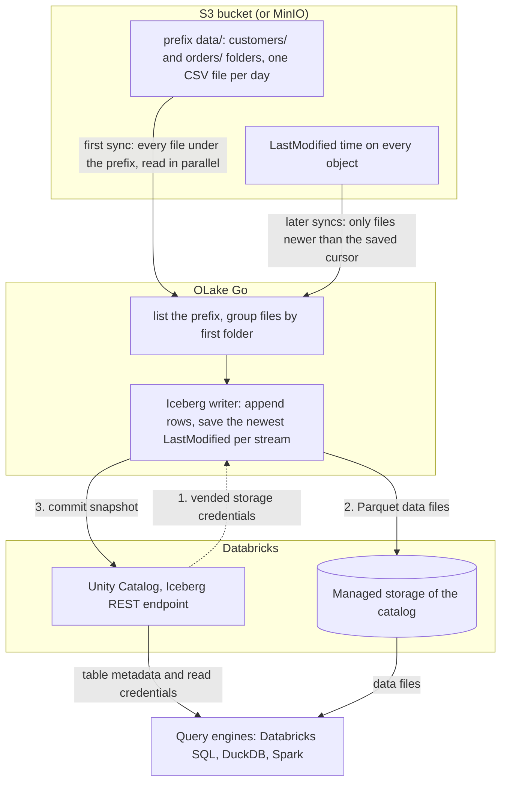

import * as I from '@site/src/components/integrations';

Files land in S3 every hour or every day: exports from an application, drops from a partner, logs from a job. S3 to Databricks usually means an Auto Loader job on a cluster, and tables written by that job. This guide takes a different route. OLake Go reads the files itself and turns each folder into an Apache Iceberg table in Unity Catalog. Every later run syncs only the files that are new.

The tables land as Unity Catalog managed Iceberg tables, with the files in your own cloud storage. Nothing else is in the path: no Databricks job, no cluster during the load. DuckDB and Spark read the same tables through the same catalog.

<I.IntegrationByline />

<TLDR title='Key takeaways'>

- OLake Go turns S3 folders into Databricks Iceberg tables: the first sync reads every file under the prefix, and every later sync reads only files newer than the last run, by their modification time.
- The tables are Unity Catalog managed Iceberg tables. You query them from the Databricks SQL editor or a notebook right away, with no external table and no refresh.
- The same tables, written once by OLake Go, are also queryable from DuckDB and Spark through Unity Catalog. In the run on this page all three engines returned identical rows.

</TLDR>

**The short answer.** To load S3 files into Databricks as Iceberg, run OLake Go with the bucket and prefix as the source and Unity Catalog as the destination. Put each stream in **Full Refresh + Incremental** mode with `_last_modified_time` as the cursor. The first sync reads every file; every later sync reads only the files added since. Databricks, DuckDB and Spark then query the same Iceberg tables, with no second copy.

## How S3 files reach Databricks here



The first sync lists everything under the prefix and makes one stream per first-level folder. Then it reads every file in parallel: that is the historical load. At the end it saves the newest `LastModified` time it saw per stream.

Every later sync lists the prefix again and reads only the files whose `LastModified` time is newer than the saved cursor. Rows are appended; a file never changes a row that an earlier file wrote. Each sync ends with one commit to Unity Catalog, which Databricks sees on its next query.

One thing to keep an eye on: the cursor is the object's modification time, not anything inside the file. Uploading a corrected copy of yesterday's file gives it today's `LastModified` time, and every row in it is appended a second time. Add files, never rewrite them, and keep an `id` column so a query can pick the latest version of a row.

## What you need

- **An S3 bucket, or an S3-compatible store**, with files in folders under one prefix: CSV, JSON, Parquet or XML, plain or gzip. Amazon S3, MinIO and LocalStack all work; the run on this page used MinIO in Docker with two CSV folders.
- **Read-only access** to the bucket: `s3:ListBucket` and `s3:GetObject`, through a role on AWS or static keys on MinIO.
- **A Databricks workspace with Unity Catalog**, a catalog with managed storage, and an admin who can turn on external data access and grant `EXTERNAL USE SCHEMA`. The run on this page used a workspace on Google Cloud.
- **OLake UI** from the [Docker Compose install](/docs/install/olake-ui/) with the OLake Go S3 source. The run on this page used v1.1.0.
- **Docker**, and about 30 minutes.

## Step 1: Prepare the S3 bucket

Most readers point OLake Go at files they already have. If you want to follow along with the exact data from this page, upload two CSV files shaped like these first:

<details>
<summary>The two sample files used on this page</summary>

Each stream is a folder under `data/`, with one dated subfolder per upload. The header row names the columns, and `id` identifies the row so a later file can correct it.

```text title="data/customers/2026-10-29/customers.csv"
id,name,email,city,tier,created_at,updated_at
1,Aarav Mehta,aarav@example.com,Mumbai,gold,2026-10-29T15:12:59Z,2026-10-29T15:12:59Z
2,Priya Sharma,priya@example.com,Bengaluru,silver,2026-10-29T15:12:59Z,2026-10-29T15:12:59Z
```

```text title="data/orders/2026-10-29/orders.csv"
id,customer_id,product,amount,status,created_at,updated_at
1,2,Headphones,99.19,shipped,2026-10-29T15:12:59Z,2026-10-29T15:12:59Z
2,3,Monitor,178.38,delivered,2026-10-29T15:12:59Z,2026-10-29T15:12:59Z
```

```bash title="Upload with the AWS CLI (add --endpoint-url for MinIO)"
aws s3 sync ./stage s3://shop/data/
# Then add whatever you like. This page started with 8 customers and 40 orders.
```

</details>

<I.Partial id="sources/s3/prereqs" bucket="shop" prefix="data/" />

## Step 2: Set up Unity Catalog in Databricks

Databricks reads Iceberg tables through Unity Catalog, the catalog built into every Databricks workspace. OLake Go writes straight into it, so the tables become Unity Catalog managed Iceberg tables. They show up in Catalog Explorer and the SQL editor the moment a sync commits.

The files sit in the catalog's managed storage, which is backed by an external location in your own cloud account. DuckDB and Spark reach the same tables through the same Unity Catalog endpoint.

<I.CatalogStrip />

<I.CatalogTabs>
<TabItem value="unity">

<I.Partial id="catalogs/unity/setup" />

</TabItem>
</I.CatalogTabs>

## Step 3: Connect S3 to OLake Go

<I.Partial id="sources/s3/connect">

Here is the source form from the run on this page. MinIO ran in another container, so the custom endpoint is `http://host.docker.internal:9000`. The bucket is `shop`, the prefix `data/`, and the format CSV with a header row.

<Figure src='/img/docs/integrations/s3-to-databricks/olake-source-s3-minio.webp' alt='OLake UI Edit source form for S3 on OLake Go v1.1.0 with the Enable CDC toggle marked not supported, bucket shop, region us-east-1, static keys, path prefix data/, custom endpoint http://host.docker.internal:9000, file format CSV with delimiter comma, header on and quote character double quote' caption='The S3 source in OLake UI: bucket, prefix, the MinIO endpoint, and the CSV options. The keys shown are MinIO defaults for a local test.' width='760px' />

**Set up source** calls `HeadBucket` before anything is saved, so a wrong key or bucket name fails here rather than on the first sync.

</I.Partial>

## Step 4: Configure the Iceberg destination

<I.CatalogTabs>
<TabItem value="unity">

<I.Partial id="catalogs/unity/writer">

The run on this page wrote into a catalog called `datazip`, with a personal access token that expires after seven days. The snippets below use `lakehouse`; replace it with your catalog name.

</I.Partial>

</TabItem>
</I.CatalogTabs>

## Step 5: Create the job and run the first sync

S3 streams differ from database streams in one way on the Streams page. The ingestion mode is **Append** and cannot be changed, because a file carries no key to match an earlier row by. Set the sync mode to **Full Refresh + Incremental** and leave the cursor on `_last_modified_time`, which OLake Go adds to every stream.

<I.Partial id="jobs/create" engines="Databricks, plus DuckDB and Apache Spark if they will read the tables too" unit="folders" syncMode="Full Refresh + Incremental" cursor="_last_modified_time" image="olakego/source-s3:latest" cliSyncMode="incremental" namespace="s3" ingestion="Append">

Three target query engines were set on this job. With Append mode there are no delete files to agree on, so the choice only records which engines read the tables.

<Figure src='/img/docs/integrations/s3-to-databricks/olake-streams.webp' alt='OLake UI Streams Selection page with the s3 namespace, customers and orders selected, sync mode Full Refresh + Incremental, cursor field _last_modified_time, ingestion mode Append with Upsert greyed out, normalization on' caption='Each folder: Full Refresh + Incremental on _last_modified_time, and Append. The Iceberg DB name at the top is editable.' />

<Figure src='/img/docs/integrations/s3-to-databricks/olake-job-history-two-syncs.webp' alt='OLake UI Job Logs and History for s3_to_databricks showing two completed syncs, the first in 23 seconds and the second in 17 seconds' caption='Job history: the 23 s first read of both folders, then the 17 s sync of the two new files.' />

</I.Partial>

On this page the first run read the 8 customer and 40 order rows (48 records, 2.61 KB). It finished in **23 seconds**, container start included. OLake Go names the Unity Catalog schema after the job, the bucket and the namespace, so `s3_to_databricks` on bucket `shop` produced `s3_to_databricks_shop_s3`.

## Step 6: Query the tables in Databricks

<I.CatalogTabs>
<TabItem value="unity">

<I.Partial id="engines/databricks/query-unity" schema="s3_to_databricks_shop_s3" idCol="id" />

<Figure src='/img/docs/integrations/s3-to-databricks/databricks-sql-editor-customers.webp' alt='Databricks SQL editor running a latest-row-per-id query on datazip.s3_to_databricks_shop_s3.customers on the 2X-Small SQL warehouse, returning 10 rows' caption='The same table in the Databricks SQL editor: the S3 rows are append-only, so the query keeps the latest row per id and returns the 10 current customers.' />

Files only append, so the queries above return every row from every file: 12 customer rows and 48 order rows after the second sync. The query that most readers want is the latest version of each row. `QUALIFY` does that in one statement, ordering by the file time OLake Go stored in `_last_modified_time`:

```sql title="Latest row per id"
SELECT CAST(id AS INT) AS id, name, city, tier
FROM lakehouse.s3_to_databricks_shop_s3.customers
QUALIFY ROW_NUMBER() OVER (PARTITION BY id ORDER BY _last_modified_time DESC) = 1
ORDER BY id;

SELECT status, count(*) AS n, round(sum(amount), 2) AS total
FROM (
  SELECT * FROM lakehouse.s3_to_databricks_shop_s3.orders
  QUALIFY ROW_NUMBER() OVER (PARTITION BY id ORDER BY _last_modified_time DESC) = 1
)
GROUP BY status ORDER BY status;
```

It returned 10 customers, and 45 orders worth 25579.19 in total, on the 2X-Small serverless warehouse.

</TabItem>
</I.CatalogTabs>

<I.Cta />

## Step 7: Add files to the bucket and sync again

To see the incremental path work, the run on this page uploaded one more file per folder after the first sync. Each carries new rows and corrected copies of existing rows, the way a daily export does:

```text title="Files added between the two syncs"
data/customers/2026-10-29/customers-changes.csv   4 rows: ids 9 and 10 are new, ids 3 and 8 are corrections
data/orders/2026-10-29/orders-changes.csv         8 rows: ids 41 to 45 are new, ids 1, 4 and 7 now read "delivered"
```

The second sync listed both folders, skipped the two files it had already read, and read the two new ones. That was **12 records (686 bytes)** in **17 seconds** end to end. OLake Go's commit report shows `operation=append` with one data file per table, 4 rows for `customers` and 8 for `orders`, and no delete files.

<Figure src='/img/docs/integrations/s3-to-databricks/olake-sync-log-commit.webp' alt='OLake UI sync log filtered to the Iceberg commit reports for customers and orders after the second sync, showing operation append, addedDataFiles 1, addedRecords 4 and 8, and totalDeleteFiles 0' caption='The second sync in the OLake UI log: one appended data file per table and no delete files.' />

Databricks shows the result on the next query, with no refresh. The corrected rows exist twice, and `_op_type` tells them apart: `r` for the 8 rows of the first full read, `u` for the 4 that arrived through the incremental sync. The latest-row query from step 6 returns Liam Carter as `gold` and Zara Ali in Abu Dhabi.

**Schema changes.** When a new column appears in a later file, OLake Go adds it to the Iceberg table on the next sync. Databricks shows it with nulls for older rows. A column whose inferred type changes in an incompatible way fails the sync rather than corrupt the table. Full rules are on the [schema evolution page](/docs/features/schema/).

## Query the same tables from DuckDB and Spark

Nothing is exported, copied or refreshed. Both engines read the files OLake Go wrote, through the same Unity Catalog endpoint, with storage credentials vended by Databricks. The same `QUALIFY` pattern works in DuckDB; Spark uses a `ROW_NUMBER()` subquery.

<Tabs groupId="engine" queryString="engine">
<TabItem value="duckdb" label="DuckDB" default>

<I.Partial id="engines/duckdb/connect-unity" schema="s3_to_databricks_shop_s3" idCol="id" />

DuckDB 1.5.5 returned the same 12 customer rows as Databricks, and the same 10 with `QUALIFY ROW_NUMBER() OVER (PARTITION BY id ORDER BY _last_modified_time DESC) = 1`.

</TabItem>
<TabItem value="spark" label="Apache Spark">

<I.Partial id="engines/spark/connect-unity" schema="s3_to_databricks_shop_s3" idCol="id" />

Spark 4.0.1 with Iceberg 1.10.0 returned the same 10 customers and the same `orders` roll-up as Databricks and DuckDB in the run on this page. It used `ROW_NUMBER() OVER (PARTITION BY id ORDER BY _last_modified_time DESC)` in a subquery.

</TabItem>
</Tabs>

An `orders` roll-up over the latest row per id matched the files in all three engines. It gave 16 delivered orders for 8659.68, 18 placed for 10522.26, 11 shipped for 6397.25.

## Data types: CSV to Iceberg to Databricks

A CSV file has no types, so OLake Go infers them from a sample of rows at discover time and maps them to Iceberg types. Databricks then maps Iceberg types to its own. Parquet files skip the inference and keep their own types.

| In the CSV | Iceberg (written by OLake Go) | Databricks shows | Notes |
| --- | --- | --- | --- |
| Whole numbers (`id`, `customer_id`) | `double` | `DOUBLE` | In this run the integer columns were inferred as floating point. Cast with `CAST(id AS INT)` in queries, or use Parquet when the type matters. |
| Decimals (`amount`) | `double` | `DOUBLE` | The `orders.amount` sums on this page matched the files to the cent in every engine; round at query time when you need exact decimal arithmetic. |
| ISO 8601 timestamps (`created_at`) | `timestamptz` (UTC) | `TIMESTAMP` | Strings that parse as timestamps are stored as timestamps. |
| Other text | `string` | `STRING` | |
| `_last_modified_time` | `string` | `STRING` | The object's `LastModified` time in ISO 8601, so it sorts correctly as text. Added to every row by OLake Go. |

Types on the left come from the [S3 connector reference](/docs/connectors/s3/#data-type-mapping); the Databricks side comes from `DESCRIBE` on the tables of this run. JSON files map integers to `bigint`; Parquet keeps `int`, `bigint`, `date` and `timestamp` as they are.

## Cost and maintenance

- **Storage** is your cloud bucket behind the catalog's managed location. You pay your cloud's storage rates for the Parquet data files and deletion vectors.
- **Compute.** OLake Go runs wherever you run Docker and does not use a Databricks warehouse or cluster to write. Databricks compute is spent only when you query; the checks on this page ran on a 2X-Small serverless SQL warehouse.
- **Maintenance.** Each sync adds a small data file, plus a deletion vector when rows change. Plan compaction from the writer side: [OLake Fusion](/docs/fusion/getting-started/overview/) does this for the catalogs OLake Go writes to, and Spark's `rewrite_data_files` works through the same Unity Catalog endpoint.
- **Token rotation.** A personal access token expires on the date set when it was created, and an expired token fails the next sync at the first catalog call. Use a service principal with OAuth machine-to-machine credentials for production jobs.
- **Listing calls.** Every sync lists the whole prefix to find new files. A prefix with hundreds of thousands of objects makes that the slowest part of the run; keep the prefix to the folders OLake Go needs, or move processed files out.

## Troubleshooting

### 1. The source test is refused

```text
failed to access bucket shop: operation error S3: HeadBucket, https response error StatusCode: 403, api error Forbidden: Forbidden
```

The key pair cannot read the bucket. On AWS, check that the policy from step 1 is attached to the user or role, and that the bucket policy does not deny it. On MinIO, the access key or secret is wrong. A `StatusCode: 404` with `NotFound` instead means the bucket name is wrong or the endpoint points at another store.

### 2. Discovery finds nothing

```text
Discovered 0 files in 0 streams (after filtering)
Stream grouping enabled at level 1 (first folder after path_prefix)
FATAL no streams found in connector
```

Either the prefix holds no files, or the files sit directly under it with no folder to name the stream. Move them into a folder per table (`data/customers/...`), check that **Path Prefix** ends with `/`, and loosen **File Pattern** if you set one.

### 3. Rows appear twice after a sync

A file was rewritten in place, or a corrected copy was uploaded with the same rows. Its new `LastModified` time made OLake Go read it again, and Append mode added every row a second time. Keep the latest-row query from step 6 for reads, and change the upstream process to add files rather than replace them.

### 4. The destination test fails with a permission error

Three settings cover nearly every failure. **External data access** may be off on the metastore, or the principal may lack `EXTERNAL USE SCHEMA` on the catalog. The third is a wrong catalog name in the destination. `ALL PRIVILEGES` does not include `EXTERNAL USE SCHEMA`, so a catalog owner still has to grant it explicitly. Run the grants from step 2 again for the principal that owns the token.

<details>
<summary>How this compares with other ways to load S3 files into Databricks</summary>

| Method | Freshness | Updates and deletes | Where the data lands | What you run |
| --- | --- | --- | --- | --- |
| [Auto Loader](https://docs.databricks.com/gcp/en/ingestion/cloud-object-storage/auto-loader/) (checked Oct 2026) | Minutes, or continuous while the stream runs | Appends new files; merge with your own code | Tables written by a Databricks job or pipeline | A Databricks job or pipeline running on Databricks compute |
| [Lakeflow Connect](https://docs.databricks.com/gcp/en/ingestion/lakeflow-connect/) | S3 is not among its managed file connectors, which list Google Drive and SharePoint (checked Oct 2026) | Not applicable | Not applicable | Not applicable |
| **OLake Go to Iceberg on Unity Catalog (this guide)** | On a schedule down to one minute | No; files are appended, with `_last_modified_time` for latest-row queries | Apache Iceberg tables that Databricks, DuckDB, Spark and Trino all read | One Docker Compose stack, open source; your storage plus your own compute |

Auto Loader is the simpler choice when Databricks is the only reader and a job on Databricks compute is fine. OLake Go keeps the load off Databricks compute, and it keeps the pipeline the same when a database or Kafka source is added beside the files.

</details>

## When not to use this

- **Rows must be updated or deleted at write time.** Files have no key, so S3 streams only append. Use a database or Kafka source for that, or merge downstream.
- **The files are rewritten in place.** Every rewrite is read again in full. Change the producer to add files, or accept duplicates and query the latest row per key.
- **Files are not CSV, JSON, Parquet or XML.** Fixed-width, Excel and Avro files are not read.

## FAQs

<I.IntegrationFaq />

<I.HowWeTested />

## Related guides

<I.RelatedIntegrations />

Deeper reading on this site:

- [S3 connector reference](/docs/connectors/s3/)
- [OLake Go ingestion benchmarks](/docs/benchmarks/ingestion/)

<I.IntegrationJsonLd />

<I.Cta title='Start with your own bucket' body='The quickstart runs OLake UI with Docker Compose. Create the S3 source, the Unity Catalog destination and the job as above, and the first sync lands your folders in Databricks.' />
