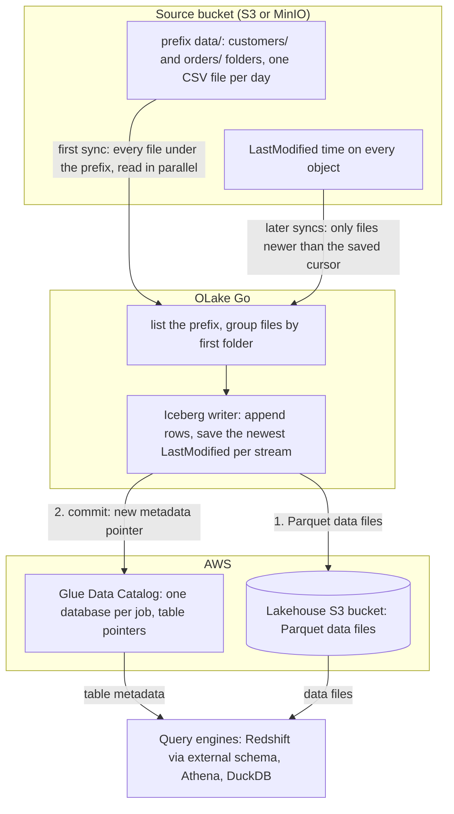

import * as I from '@site/src/components/integrations';

Files land in S3 every hour or every day: exports from an application, drops from a partner, logs from a job. S3 to Redshift usually means a `COPY` script on a schedule, a Spectrum external table per folder, or a managed loader. This guide takes a different route. OLake Go reads the files itself and turns each folder into an Apache Iceberg table in the AWS Glue Data Catalog. Every later run syncs only the files that are new.

Redshift maps the Glue database onto an external schema and queries the tables in place. Nothing else is in the path: no `COPY`, no manifest, no table definition per folder. Athena and DuckDB read the same tables through the same catalog.

<I.IntegrationByline />

<TLDR title='Key takeaways'>

- OLake Go turns S3 folders into Iceberg tables in the Glue Data Catalog: the first sync reads every file under the prefix, and every later sync reads only files newer than the last run, by their modification time.
- Redshift reads the Glue database through one `CREATE EXTERNAL SCHEMA` statement, with no refresh. Every file a sync commits is visible on the next query, on Serverless and RA3 alike.
- The same tables, written once by OLake Go, are also queryable from Athena and DuckDB. In the run on this page all three engines returned identical rows.

</TLDR>

**The short answer.** To load S3 files into Redshift as Iceberg, run OLake Go with the bucket and prefix as the source and the AWS Glue Data Catalog as the destination. Put each stream in **Full Refresh + Incremental** mode with `_last_modified_time` as the cursor. The first sync reads every file; every later sync reads only the files added since. Redshift, Athena and DuckDB then query the same Iceberg tables, with no second copy.

## How S3 files reach Redshift here



Two things happen in order, and OLake Go does both on its own. The first sync lists everything under the prefix and makes one stream per first-level folder. Then it reads every file in parallel: that is the historical load. At the end it saves the newest `LastModified` time it saw per stream.

Every later sync lists the prefix again and reads only the files whose `LastModified` time is newer than the saved cursor. On this page the second sync reported `Filtered 1 files to process out of 2 total` for each stream. Rows are appended; a file never changes a row that an earlier file wrote. Each sync ends with one commit to Glue, and Redshift, Athena and DuckDB see the new snapshot on their next query.

One thing to keep an eye on: the cursor is the object's modification time, not anything inside the file. Uploading a corrected copy of yesterday's file gives it today's `LastModified` time. The whole file is then read again, and every row in it is appended a second time. Add files, never rewrite them, and keep an `id` column in the data so a query can pick the latest version of a row.

## What you need

- **A source bucket, on S3 or an S3-compatible store**, with files in folders under one prefix: CSV, JSON, Parquet or XML, plain or gzip. Amazon S3, MinIO and LocalStack all work; the run on this page used MinIO in Docker with two CSV folders.
- **Read-only access** to the source bucket: `s3:ListBucket` and `s3:GetObject`, through a role on AWS or static keys on MinIO.
- **An AWS account** with an S3 bucket for the Iceberg files and an IAM user or role for OLake Go with Glue and S3 permissions. The run on this page used a bucket and a scoped IAM user in `ap-southeast-1`. On AWS the source files and the Iceberg files can share one bucket under different prefixes.
- **Amazon Redshift**, Serverless or an RA3 cluster, with an IAM role attached that can read Glue and the lakehouse bucket. The run on this page used a Serverless workgroup at 8 RPU.
- **OLake UI** from the [Docker Compose install](/docs/install/olake-ui/) with the OLake Go S3 source. The run on this page used v1.1.0.
- **Docker**, and about 30 minutes.

## Step 1: Prepare the source bucket

Most readers point OLake Go at files they already have. If you want to follow along with the exact data from this page, upload two CSV files shaped like these first:

<details>
<summary>The two sample files used on this page</summary>

Each stream is a folder under `data/`, with one dated subfolder per upload. The header row names the columns, and `id` identifies the row so a later file can correct it.

```text title="data/customers/2026-10-30/customers.csv"
id,name,email,city,tier,created_at,updated_at
1,Aarav Mehta,aarav@example.com,Mumbai,gold,2026-10-30T03:34:34Z,2026-10-30T03:34:34Z
2,Priya Sharma,priya@example.com,Bengaluru,silver,2026-10-30T03:34:34Z,2026-10-30T03:34:34Z
```

```text title="data/orders/2026-10-30/orders.csv"
id,customer_id,product,amount,status,created_at,updated_at
1,2,Headphones,99.19,shipped,2026-10-30T03:34:34Z,2026-10-30T03:34:34Z
2,3,Monitor,178.38,delivered,2026-10-30T03:34:34Z,2026-10-30T03:34:34Z
```

```bash title="Upload with the AWS CLI (add --endpoint-url for MinIO)"
aws s3 sync ./stage s3://shop/data/
# Then add whatever you like. This page started with 8 customers and 40 orders.
```

</details>

<I.Partial id="sources/s3/prereqs" bucket="shop" prefix="data/" />

## Step 2: Set up the Glue catalog

Redshift reads Iceberg tables through a catalog. **AWS Glue Data Catalog** is the one this page uses: OLake Go creates a Glue database per job and registers each table there. The Iceberg files sit in your lakehouse bucket. Redshift, Athena, Amazon Elastic MapReduce (EMR) and DuckDB all read from the same catalog. Redshift reaches it through an external schema, with the IAM role attached to the workgroup or cluster.

<I.CatalogStrip />

<I.CatalogTabs>
<TabItem value="glue">

<I.Partial id="catalogs/glue/setup" />

The run on this page gave OLake Go a scoped IAM user with this inline policy on the lakehouse bucket. Redshift got a role with `AmazonS3ReadOnlyAccess` and read access to Glue:

```json title="IAM policy for the OLake Go user (replace the bucket, region and account)"
{
  "Version": "2012-10-17",
  "Statement": [
    { "Effect": "Allow", "Action": ["s3:ListBucket", "s3:GetBucketLocation"], "Resource": "arn:aws:s3:::<bucket>" },
    { "Effect": "Allow", "Action": ["s3:GetObject", "s3:PutObject", "s3:DeleteObject", "s3:AbortMultipartUpload", "s3:ListMultipartUploadParts"], "Resource": "arn:aws:s3:::<bucket>/*" },
    { "Effect": "Allow",
      "Action": ["glue:GetDatabase", "glue:GetDatabases", "glue:CreateDatabase", "glue:GetTable", "glue:GetTables", "glue:CreateTable", "glue:UpdateTable", "glue:DeleteTable"],
      "Resource": ["arn:aws:glue:<region>:<account>:catalog", "arn:aws:glue:<region>:<account>:database/*", "arn:aws:glue:<region>:<account>:table/*/*"] }
  ]
}
```

</TabItem>
</I.CatalogTabs>

## Step 3: Connect S3 to OLake Go

<I.Partial id="sources/s3/connect">

Here is the source form from the run on this page. MinIO ran in another container, so the custom endpoint is `http://host.docker.internal:9000`. The bucket is `shop`, the prefix `data/`, and the format CSV with a header row.

<Figure src='/img/docs/integrations/s3-to-redshift/olake-source-s3-minio.webp' alt='OLake UI Edit source form for S3 on OLake Go v1.1.0 with the Enable CDC toggle marked not supported, bucket shop, region us-east-1, static keys, path prefix data/, custom endpoint http://host.docker.internal:9000, file format CSV with delimiter comma, header on and quote character double quote' caption='The S3 source in OLake UI: bucket, prefix, the MinIO endpoint, and the CSV options. The keys shown are MinIO defaults for a local test.' width='760px' />

**Set up source** calls `HeadBucket` before anything is saved, so a wrong key or bucket name fails here rather than on the first sync.

</I.Partial>

## Step 4: Configure the Iceberg destination

<I.CatalogTabs>
<TabItem value="glue">

<I.Partial id="catalogs/glue/writer" />

Here is the destination form from the run on this page. It holds the lakehouse bucket path OLake Go writes under, the region of the bucket and the Glue catalog, and the access key pair of the IAM user from step 2.

<Figure src='/img/docs/integrations/s3-to-redshift/olake-destination-glue.webp' alt='OLake UI Edit destination form for Apache Iceberg with catalog type AWS Glue, an S3 path under the lab bucket, region ap-southeast-1 and an access key pair' caption='The Glue destination in OLake UI: the S3 path, the region and the keys of the scoped IAM user.' width='760px' />

</TabItem>
</I.CatalogTabs>

## Step 5: Create the job and run the first sync

S3 streams differ from database streams in one way on the Streams page. The ingestion mode is **Append** and cannot be changed, because a file carries no key to match an earlier row by. Set the sync mode to **Full Refresh + Incremental** and leave the cursor on `_last_modified_time`, which OLake Go adds to every stream. Redshift is not in OLake Go's target engine picker yet, so this job lists **Athena** and **DuckDB**.

<I.Partial id="jobs/create" engines="AWS Athena and DuckDB (Redshift is not in the list yet; it reads what Athena reads)" unit="folders" syncMode="Full Refresh + Incremental" cursor="_last_modified_time" image="olakego/source-s3:latest" cliSyncMode="incremental" namespace="s3" ingestion="Append">

With Append mode there are no delete files to agree on, so the target engines only record which engines read the tables. Every engine that reads Iceberg v2 reads an append-only table, Redshift included.

<Figure src='/img/docs/integrations/s3-to-redshift/olake-streams-incremental-append.webp' alt='OLake UI Streams Selection page with the s3 namespace, customers and orders selected, sync mode Full Refresh + Incremental, cursor field _last_modified_time, ingestion mode Append with Upsert greyed out, normalization on' caption='Each folder: Full Refresh + Incremental on _last_modified_time, Append (Upsert is not offered for files). The Iceberg DB name at the top is editable.' />

<Figure src='/img/docs/integrations/s3-to-redshift/olake-job-history-two-syncs.webp' alt='OLake UI Job Logs and History for s3_to_redshift showing two completed syncs, the first in 11 seconds and the second in 10 seconds' caption='Job history: the 11 s first read of both folders, then the 10 s sync of the two new files.' />

</I.Partial>

On this page the first run read the 8 customer and 40 order rows (48 records, 2.61 KB). It finished in **11 seconds**, container start included. OLake Go names the Glue database after the job, the bucket and the namespace. The namespace for every S3 stream is `s3`, so `s3_to_redshift` on bucket `shop` produced `s3_to_redshift_shop_s3`. The **Iceberg DB** field at the top of the Streams page changes it before the first sync.

## Step 6: Query the tables in Redshift

<I.CatalogTabs>
<TabItem value="glue">

<I.Partial id="engines/redshift/query-glue" schema="s3_to_redshift_shop_s3" />

Because files append, the query that most readers want is the latest version of each row. Redshift has no `QUALIFY`, so a `ROW_NUMBER()` subquery does it, ordering by the file time OLake Go stored in `_last_modified_time`. The `id` column arrived as `DOUBLE PRECISION` from the CSV, hence the cast:

```sql title="Latest row per id"
SELECT id::INT AS id, name, city, tier
FROM (
  SELECT *, ROW_NUMBER() OVER (PARTITION BY id ORDER BY _last_modified_time DESC) AS rn
  FROM lakehouse.customers
)
WHERE rn = 1
ORDER BY id;
```

<Figure src='/img/docs/integrations/s3-to-redshift/redshift-glue-customers.webp' alt='Redshift query editor v2 in the AWS console running the latest-row-per-id customers query on the Serverless workgroup and returning 10 rows with id, name, city and tier' caption='Redshift Serverless reading the customers table through the external schema after the second sync in query editor v2: one row per id.' />

</TabItem>
</I.CatalogTabs>

<I.Cta />

## Step 7: Add files to the bucket and sync again

To see the incremental path work, the run on this page uploaded one more file per folder after the first sync. Each carries new rows and corrected copies of existing rows, the way a daily export does:

```text title="Files added between the two syncs"
data/customers/2026-10-30/customers-changes.csv   4 rows: ids 9 and 10 are new, ids 3 and 8 are corrections
data/orders/2026-10-30/orders-changes.csv         8 rows: ids 41 to 45 are new, ids 1, 4 and 7 now read "delivered"
```

The second sync listed both folders, skipped the two files it had already read, and read the two new ones. That was **12 records (686 bytes)** in **10 seconds** end to end. The sync log shows the filter per stream, with the cursor it compared against, and the commit report shows one new data file per table and no delete files: `addedDataFiles=1`, `addedRecords=4` for `customers`.

<Figure src='/img/docs/integrations/s3-to-redshift/olake-sync-log-filtered-files.webp' alt='OLake UI sync log filtered to the lines Filtered 1 files to process out of 2 total with the cursor 2026-10-29T22:04:34Z, one line per stream' caption='The second sync in the OLake UI log: one new file per folder, the first file skipped by its modification time.' />

Redshift shows the result with no refresh. The corrected rows exist twice. `_op_type` tells them apart: `r` for the first full read, `u` for rows that arrived through an incremental sync. `_last_modified_time` carries the file time, which is what the `ROW_NUMBER()` query above sorts on:

```text title="SELECT id::INT, name, city, tier, _op_type, _last_modified_time FROM lakehouse.customers WHERE id IN (3, 8, 9, 10) ORDER BY 1, 6"
id  name         city       tier    _op_type  _last_modified_time
3   Liam Carter  Austin     bronze  r         2026-10-29T22:04:34Z
3   Liam Carter  Austin     gold    u         2026-10-29T22:05:01Z
8   Zara Ali     Dubai      silver  r         2026-10-29T22:04:34Z
8   Zara Ali     Abu Dhabi  silver  u         2026-10-29T22:05:01Z
9   Maya Patel   Pune       silver  u         2026-10-29T22:05:01Z
10  Lucas Silva  São Paulo  bronze  u         2026-10-29T22:05:01Z
```

**Schema changes.** When a new column appears in a later file, OLake Go adds it to the Iceberg table on the next sync. The Glue table definition is updated in the same commit, and Redshift shows it on the next query, with nulls for older rows. A column whose inferred type changes in an incompatible way fails the sync rather than corrupt the table. Full rules are on the [schema evolution page](/docs/features/schema/).

## Query the same tables from Athena and DuckDB

This is the point of writing Iceberg instead of loading Redshift tables. Nothing is exported, copied or refreshed: both engines read the files OLake Go wrote, through the same Glue database. Athena uses the same `ROW_NUMBER()` subquery; DuckDB has `QUALIFY`.

<Tabs groupId="engine" queryString="engine">
<TabItem value="athena" label="Amazon Athena" default>

<I.Partial id="engines/athena/connect-glue" schema="s3_to_redshift_shop_s3" />

<Figure src='/img/docs/integrations/s3-to-redshift/athena-glue-customers.webp' alt='Athena query editor in the AWS console running the latest-row-per-id customers query on the s3_to_redshift_shop_s3 database and returning 10 rows' caption='Athena reading the same table through Glue with a ROW_NUMBER() subquery: the same 10 rows.' />

</TabItem>
<TabItem value="duckdb" label="DuckDB">

<I.Partial id="engines/duckdb/connect-glue" schema="s3_to_redshift_shop_s3" />

DuckDB 1.5.5 returned the same 10 customers and the same `orders` roll-up as Redshift and Athena in the run on this page, with `QUALIFY row_number() OVER (PARTITION BY id ORDER BY _last_modified_time DESC) = 1` on the scan. It read the current metadata file of each table.

</TabItem>
</Tabs>

An `orders` roll-up over the latest row per id matched the files in all three engines. It gave 16 delivered orders for 8659.68, 18 placed for 10522.26, 11 shipped for 6397.25.

## Data types: CSV to Iceberg to Redshift

A CSV file has no types, so OLake Go infers them from a sample of rows at discover time and maps them to Iceberg types. Redshift then maps Iceberg types to its own through the external schema. Parquet files skip the inference and keep their own types. This is what the CSV run on this page produced:

| In the CSV | Iceberg (written by OLake Go) | Redshift shows | Notes |
| --- | --- | --- | --- |
| Whole numbers (`id`, `customer_id`) | `double` | `DOUBLE PRECISION` | In this run the integer columns were inferred as floating point. Cast with `::INT` in queries, or use Parquet when the type matters. |
| Decimals (`amount`) | `double` | `DOUBLE PRECISION` | The `orders.amount` sums on this page matched the files to the cent in every engine; round at query time when you need exact decimal arithmetic. |
| ISO 8601 timestamps (`created_at`) | `timestamptz` (UTC) | `TIMESTAMP` | Strings that parse as timestamps are stored as timestamps, shown without a zone. |
| Other text | `string` | `VARCHAR` | |
| `_last_modified_time` | `string` | `VARCHAR` | The object's `LastModified` time in ISO 8601, so it sorts correctly as text. Added to every row by OLake Go. |

Types on the left come from the [S3 connector reference](/docs/connectors/s3/#data-type-mapping). The Redshift side comes from the [Redshift Iceberg page](https://docs.aws.amazon.com/redshift/latest/dg/querying-iceberg.html) (checked 2026-10-30) and from `svv_external_columns` on the tables of this run. JSON files map integers to `bigint` and nested objects to JSON text; Parquet keeps `int`, `bigint`, `date` and `timestamp` as they are.

## Cost and maintenance

- **Storage** is your lakehouse bucket: you pay S3 rates for the Parquet files, on top of the source files, and nothing to Glue beyond its per-object pricing for the table entries.
- **Compute.** OLake Go runs wherever you run Docker. Redshift Serverless bills RPU-hours only while queries run; a query over the external schema scans the Parquet files in S3 through Redshift Spectrum, so filter on the columns you need. Athena bills per terabyte scanned.
- **Listing calls.** Every sync lists the whole source prefix to find new files. A prefix with hundreds of thousands of objects makes that the slowest part of the run; keep the prefix to the folders OLake Go needs, or move processed files out.
- **Maintenance.** Glue has no built-in compaction for tables written by external engines. A folder that gets a small file every few minutes wants compaction; [OLake Fusion](/docs/fusion/getting-started/overview/) does this for the catalogs OLake Go writes to, and Spark on EMR's `rewrite_data_files` works through the same Glue catalog.
- **Key rotation.** The IAM user's access key is what OLake Go writes with. Rotate it on your schedule, or run OLake Go on an instance with a role and leave the key fields empty.

## Troubleshooting

### 1. The source test is refused

```text
failed to access bucket shop: operation error S3: HeadBucket, https response error StatusCode: 403, api error Forbidden: Forbidden
```

The key pair cannot read the source bucket. On AWS, check that the policy from step 1 is attached to the user or role, and that the bucket policy does not deny it. On MinIO, the access key or secret is wrong. A `StatusCode: 404` with `NotFound` instead means the bucket name is wrong or the endpoint points at another store.

### 2. Discovery finds nothing

```text
Discovered 0 files in 0 streams (after filtering)
Stream grouping enabled at level 1 (first folder after path_prefix)
FATAL no streams found in connector
```

Either the prefix holds no files, or the files sit directly under it with no folder to name the stream. Move them into a folder per table (`data/customers/...`), check that **Path Prefix** ends with `/`, and loosen **File Pattern** if you set one.

### 3. Rows appear twice after a sync

A file was rewritten in place, or a corrected copy was uploaded with the same rows. Its new `LastModified` time made OLake Go read it again, and Append mode added every row a second time. Keep the `ROW_NUMBER()` query from step 6 for reads, and change the upstream process to add files rather than replace them.

### 4. The destination test fails on a table OLake Go did not create

```text
User: arn:aws:iam::<account>:user/<olake user> is not authorized to perform: s3:GetObject on resource: "arn:aws:s3:::<another bucket>/.../test_olake.db/test_olake/metadata/00000-....metadata.json"
```

OLake Go's destination test opens a probe table called `test_olake.test_olake` in the Glue database `test_olake`. An earlier run in the same account and region may have left that table behind, pointing at a bucket your user cannot read. The test then fails before it writes anything. Delete the stale table from Glue, or run OLake Go against a region whose Glue catalog does not have it.

### 5. Redshift cannot see the external schema's tables

```text
ERROR: Database 's3_to_redshift_shop_s3' does not exist in the Glue Data Catalog
```

The external schema was created before the first sync, or in a different region from the Glue database. OLake Go creates the Glue database on the first sync; create the external schema after it, in the workgroup's region.

<details>
<summary>How this compares with other ways to load S3 files into Redshift</summary>

| Method | Freshness | Updates and deletes | Where the data lands | What you run |
| --- | --- | --- | --- | --- |
| [`COPY` from S3](https://docs.aws.amazon.com/redshift/latest/dg/r_COPY.html) on a schedule | By schedule | Inserts rows from files; no merge | Native Redshift tables | A scheduler, a manifest or prefix per load, and a running workgroup or cluster |
| [Redshift auto-copy](https://docs.aws.amazon.com/redshift/latest/dg/loading-data-copy-job.html) jobs | Minutes after each file arrives | Inserts rows from files; no merge | Native Redshift tables; Redshift is the only reader | A `COPY JOB` per table on a provisioned cluster or Serverless workgroup |
| [Redshift Spectrum external tables](https://docs.aws.amazon.com/redshift/latest/dg/c-spectrum-external-tables.html) over the files | Live, per query | No | Nothing is copied; Redshift reads the CSV in place | An external table definition per folder, and a Glue entry to keep in step with the columns |
| Managed ELT (Fivetran, Estuary, Airbyte Cloud) | Minutes, by plan | Varies by tool | Redshift tables, a second copy you pay to move and store | Nothing; priced per row, per GB or per connector |
| **OLake Go to Iceberg on Glue (this guide)** | On a schedule down to one minute | No; files are appended, with `_last_modified_time` for latest-row queries | Apache Iceberg tables that Redshift, Athena, EMR, Spark and DuckDB all read | One Docker Compose stack, open source; your bucket plus your own compute |

Auto-copy is the simpler choice when files should appear in Redshift within minutes and Redshift is the only reader. Writing Iceberg once turns CSV into typed Parquet that Athena, EMR and DuckDB read without a second copy. It also keeps the pipeline the same when a database or Kafka source is added beside the files.

</details>

## When not to use this

- **Rows must be updated or deleted at write time.** Files have no key, so S3 streams only append. Use a database or Kafka source for that, or merge downstream into a native Redshift table.
- **The files are rewritten in place.** Every rewrite is read again in full. Change the producer to add files, or accept duplicates and query the latest row per key.
- **The files are already Parquet and Redshift is the only reader.** A Spectrum external table reads those files in place; copying them into Iceberg buys nothing until another engine needs them or the schema starts to drift.
- **Files are not CSV, JSON, Parquet or XML.** Fixed-width, Excel and Avro files are not read.

## FAQs

<I.IntegrationFaq />

<I.HowWeTested />

## Related guides

<I.RelatedIntegrations />

Deeper reading on this site:

- [Equality vs positional deletes vs deletion vectors](/blog/iceberg-delete-formats-cdc-equality-vs-positional-vs-deletion-vectors/)
- [Which engines read which delete formats](/blog/iceberg-delete-formats-interoperability-olake-go/)
- [OLake Go ingestion benchmarks](/docs/benchmarks/ingestion/)

<I.IntegrationJsonLd />

<I.Cta title='Start with your own bucket' body='The quickstart runs OLake UI with Docker Compose. Create the S3 source, the Glue destination and the job as above, and the first sync lands your folders where Redshift can read them.' />
