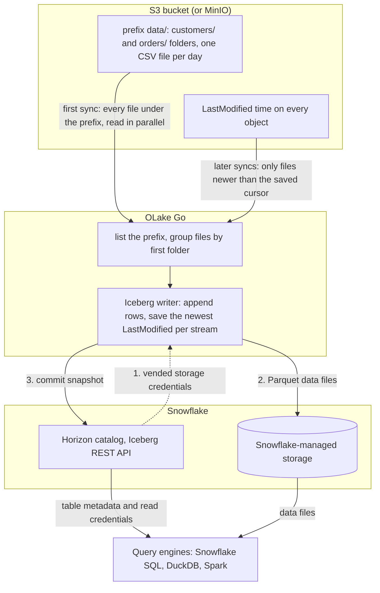

import * as I from '@site/src/components/integrations';

Files land in S3 every hour or every day: exports from an application, drops from a partner, logs from a job. S3 to Snowflake usually means a stage, a `COPY INTO` script or Snowpipe, and tables only Snowflake can read. This guide takes a different route. OLake Go reads the files itself and turns each folder into an Apache Iceberg table. Every later run syncs only the files that are new.

With Snowflake's own Horizon catalog, the default on this page, the tables sit on Snowflake-managed storage. They appear in Snowsight as soon as a sync commits. Nothing else is in the path: no stage, no pipe, no warehouse during the load. With AWS Glue, the Iceberg files sit in your own S3 bucket, next to the source files, and Snowflake reads them through a catalog integration.

<I.IntegrationByline />

<TLDR title='Key takeaways'>

- OLake Go turns S3 folders into Snowflake Iceberg tables: the first sync reads every file under the prefix, and every later sync reads only files newer than the last run, by their modification time.
- Through the Horizon catalog the tables land as Snowflake-managed Iceberg tables. You query them in Snowsight right away, with no stage, no `COPY INTO`, no external volume and no refresh.
- The same tables, written once by OLake Go, are also queryable from DuckDB and Spark through the same catalog. In the run on this page all three engines returned identical rows.

</TLDR>

**The short answer.** To load S3 files into Snowflake as Iceberg, run OLake Go with the bucket and prefix as the source. Point it at the Snowflake Horizon catalog as the destination. Put each stream in **Full Refresh + Incremental** mode with `_last_modified_time` as the cursor. The first sync reads every file; every later sync reads only the files added since. Snowflake, DuckDB and Spark then query the same Iceberg tables, with no second copy.

## How S3 files reach Snowflake here



Two things happen in order, and OLake Go does both on its own. The first sync lists everything under the prefix and makes one stream per first-level folder. Then it reads every file in parallel: that is the historical load. At the end it saves the newest `LastModified` time it saw per stream.

Every later sync lists the prefix again and reads only the files whose `LastModified` time is newer than the saved cursor. On this page the second sync reported `Filtered 1 files to process out of 2 total` for each stream. Rows are appended; a file never changes a row that an earlier file wrote.

One thing to keep an eye on: the cursor is the object's modification time, not anything inside the file. Uploading a corrected copy of yesterday's file gives it today's `LastModified` time. The whole file is then read again, and every row in it is appended a second time. Add files, never rewrite them, and keep an `id` column in the data so a query can pick the latest version of a row.

## What you need

- **An S3 bucket, or an S3-compatible store**, with files in folders under one prefix: CSV, JSON, Parquet or XML, plain or gzip. Amazon S3, MinIO and LocalStack all work; the run on this page used MinIO in Docker with two CSV folders.
- **Read-only access** to the bucket: `s3:ListBucket` and `s3:GetObject`, through a role on AWS or static keys on MinIO.
- **A Snowflake account** where you can run the one-time setup as `ACCOUNTADMIN`. Snowflake-managed storage means no cloud bucket or IAM role on your side for the destination.
- **OLake UI** from the [Docker Compose install](/docs/install/olake-ui/), with the OLake Go S3 source on v1.0 or later. The run on this page used v1.1.0.
- **Docker**, and about 30 minutes.

## Step 1: Prepare the S3 bucket

Most readers point OLake Go at files they already have. If you want to follow along with the exact data from this page, upload two CSV files shaped like these first:

<details>
<summary>The two sample files used on this page</summary>

Each stream is a folder under `data/`, with one dated subfolder per upload. The header row names the columns, and `id` identifies the row so a later file can correct it.

```text title="data/customers/2026-10-29/customers.csv"
id,name,email,city,tier,created_at,updated_at
1,Aarav Mehta,aarav@example.com,Mumbai,gold,2026-10-29T15:12:59Z,2026-10-29T15:12:59Z
2,Priya Sharma,priya@example.com,Bengaluru,silver,2026-10-29T15:12:59Z,2026-10-29T15:12:59Z
```

```text title="data/orders/2026-10-29/orders.csv"
id,customer_id,product,amount,status,created_at,updated_at
1,2,Headphones,99.19,shipped,2026-10-29T15:12:59Z,2026-10-29T15:12:59Z
2,3,Monitor,178.38,delivered,2026-10-29T15:12:59Z,2026-10-29T15:12:59Z
```

```bash title="Upload with the AWS CLI (add --endpoint-url for MinIO)"
aws s3 sync ./stage s3://shop/data/
# Then add whatever you like. This page started with 8 customers and 40 orders.
```

</details>

<I.Partial id="sources/s3/prereqs" bucket="shop" prefix="data/" />

## Step 2: Set up the catalog in Snowflake

Snowflake reads Iceberg tables from two kinds of catalog. **Horizon** is Snowflake's own: OLake Go writes straight into it, the tables are Snowflake-managed, and they appear in Snowsight the moment a sync commits. **AWS Glue** is a catalog outside Snowflake, so the Iceberg files stay in your S3 bucket. Snowflake reaches them through a *catalog integration*: a read-only link to that external catalog, refreshed after each sync.

Horizon is the default on this page. Glue is the right pick when the source files already live in S3 and you want the Iceberg tables beside them. Athena, Redshift and Spark on Amazon Elastic MapReduce (EMR) then read them as well.

<I.CatalogStrip />

<I.CatalogTabs>
<TabItem value="horizon">

<I.Partial id="catalogs/horizon/setup" />

</TabItem>
<TabItem value="glue">

<I.Partial id="catalogs/glue/setup" />

</TabItem>
</I.CatalogTabs>

## Step 3: Connect S3 to OLake Go

<I.Partial id="sources/s3/connect">

Here is the source form from the run on this page. MinIO ran in another container, so the custom endpoint is `http://host.docker.internal:9000`. The bucket is `shop`, the prefix `data/`, and the format CSV with a header row.

<Figure src='/img/docs/integrations/s3-to-snowflake/olake-source-s3-minio.webp' alt='OLake UI Edit source form for S3 on OLake Go v1.1.0 with the Enable CDC toggle marked not supported, bucket shop, region us-east-1, static keys, path prefix data/, custom endpoint http://host.docker.internal:9000, file format CSV with delimiter comma, header on and quote character double quote' caption='The S3 source in OLake UI: bucket, prefix, the MinIO endpoint, and the CSV options.' width='760px' />

**Set up source** calls `HeadBucket` before anything is saved, so a wrong key or bucket name fails here rather than on the first sync.

</I.Partial>

## Step 4: Configure the Iceberg destination

<I.CatalogTabs>
<TabItem value="horizon">

<I.Partial id="catalogs/horizon/writer" />

</TabItem>
<TabItem value="glue">

<I.Partial id="catalogs/glue/writer" />

</TabItem>
</I.CatalogTabs>

## Step 5: Create the job and run the first sync

S3 streams differ from database streams in one way on the Streams page. The ingestion mode is **Append** and cannot be changed, because a file carries no key to match an earlier row by. Set the sync mode to **Full Refresh + Incremental** and leave the cursor on `_last_modified_time`, which OLake Go adds to every stream.

<I.Partial id="jobs/create" engines="Snowflake, plus DuckDB and Apache Spark if they will read the tables too" unit="folders" syncMode="Full Refresh + Incremental" cursor="_last_modified_time" image="olakego/source-s3:latest" cliSyncMode="incremental" namespace="s3" ingestion="Append">

Three target query engines were set on this job. With Append mode there are no delete files to agree on, so the choice only records which engines read the tables.

<Figure src='/img/docs/integrations/s3-to-snowflake/olake-streams-incremental-append.webp' alt='OLake UI Streams Selection page with the s3 namespace, customers and orders selected, sync mode Full Refresh + Incremental, cursor field _last_modified_time, ingestion mode Append with Upsert greyed out, normalization on' caption='Each folder: Full Refresh + Incremental on _last_modified_time, Append (Upsert is not offered for files). The Iceberg DB name at the top is editable.' />

<Figure src='/img/docs/integrations/s3-to-snowflake/olake-job-history-two-syncs.webp' alt='OLake UI Job Logs and History for s3_to_snowflake showing two completed syncs, the first in 26 seconds and the second in 15 seconds' caption='Job history: the 26 s first read of both folders, then the 15 s sync of the two new files.' />

</I.Partial>

On this page the first run read the 8 customer and 40 order rows (48 records, 2.61 KB). It finished in **26 seconds**, container start included. OLake Go names the destination schema after the job, the bucket and the namespace. The namespace for every S3 stream is `s3`, so `s3_to_snowflake` on bucket `shop` produced `s3_to_snowflake_shop_s3`. The **Iceberg DB** field at the top of the Streams page changes it before the first sync.

## Step 6: Query the tables in Snowflake

<I.CatalogTabs>
<TabItem value="horizon">

<I.Partial id="engines/snowflake/query-horizon" schema="s3_to_snowflake_shop_s3" />

<Figure src='/img/docs/integrations/s3-to-snowflake/snowsight-show-iceberg-tables.webp' alt='Snowsight SQL file running SHOW ICEBERG TABLES on the s3_to_snowflake_shop_s3 schema and listing customers and orders with owner OLAKE_ROLE, external volume SNOWFLAKE_MANAGED, catalog SNOWFLAKE and table type MANAGED' caption='SHOW ICEBERG TABLES in Snowsight: both folders are now Snowflake-managed tables, created by OLAKE_ROLE through Horizon.' />

Because files append, the query that most readers want is the latest version of each row. `QUALIFY` does that in one statement, ordering by the file time OLake Go stored in `_last_modified_time`:

```sql title="Latest row per id"
SELECT "id"::INT AS id, "name", "city", "tier"
FROM OLAKE_DEMO."s3_to_snowflake_shop_s3"."customers"
QUALIFY ROW_NUMBER() OVER (PARTITION BY "id" ORDER BY "_last_modified_time" DESC) = 1
ORDER BY id;
```

<Figure src='/img/docs/integrations/s3-to-snowflake/snowsight-customers-latest-per-id.webp' alt='Snowsight query on OLAKE_DEMO.s3_to_snowflake_shop_s3.customers with QUALIFY ROW_NUMBER over id ordered by _last_modified_time returning 10 rows' caption='The customers table in Snowsight after the second sync, one row per id, on an X-Small warehouse.' />

</TabItem>
<TabItem value="glue">

<I.Partial id="engines/snowflake/query-glue" schema="s3_to_snowflake_shop_s3" />

</TabItem>
</I.CatalogTabs>

<I.Cta />

## Step 7: Add files to the bucket and sync again

To see the incremental path work, the run on this page uploaded one more file per folder after the first sync. Each carries new rows and corrected copies of existing rows, the way a daily export does:

```text title="Files added between the two syncs"
data/customers/2026-10-29/customers-changes.csv   4 rows: ids 9 and 10 are new, ids 3 and 8 are corrections
data/orders/2026-10-29/orders-changes.csv         8 rows: ids 41 to 45 are new, ids 1, 4 and 7 now read "delivered"
```

The second sync listed both folders, skipped the two files it had already read, and read the two new ones. That was **12 records (686 bytes)** in **15 seconds** end to end. The sync log shows the filter per stream, with the cursor it compared against:

<Figure src='/img/docs/integrations/s3-to-snowflake/olake-sync-log-filtered-files.webp' alt='OLake UI sync log filtered to the lines Filtered 1 files to process out of 2 total with the cursor 2026-10-29T15:43:01Z, one line per stream' caption='The second sync in the OLake UI log: one new file per folder, the first file skipped by its modification time.' />

Snowflake shows the result with no refresh. The corrected rows exist twice. `_op_type` tells them apart: `r` for the first full read, `u` for rows that arrived through an incremental sync. `_last_modified_time` carries the file time, which is what the `QUALIFY` query above sorts on.

<Figure src='/img/docs/integrations/s3-to-snowflake/snowsight-customers-both-versions.webp' alt='Snowsight query on customers for ids 3, 8, 9 and 10 returning 6 rows: two versions each for Liam Carter and Zara Ali with _op_type r and u, and one row each for Maya Patel and Lucas Silva' caption='Both versions of the corrected rows: Liam Carter bronze then gold, Zara Ali Dubai then Abu Dhabi, each tagged with the file time it came from.' />

**Schema changes.** When a new column appears in a later file, OLake Go adds it to the Iceberg table on the next sync. Snowflake shows it with nulls for older rows. A column whose inferred type changes in an incompatible way fails the sync rather than corrupt the table. Full rules are on the [schema evolution page](/docs/features/schema/).

## Query the same tables from DuckDB and Spark

This is the point of writing Iceberg instead of loading Snowflake tables. Nothing is exported, copied or refreshed: both engines read the files OLake Go wrote, through the same Horizon endpoint, with credentials vended by Snowflake. The same `QUALIFY` pattern works in DuckDB; Spark uses a `ROW_NUMBER()` subquery.

<Tabs groupId="engine" queryString="engine">
<TabItem value="duckdb" label="DuckDB" default>

<I.Partial id="engines/duckdb/connect-horizon" schema="s3_to_snowflake_shop_s3" />

<Figure src='/img/docs/integrations/s3-to-snowflake/duckdb-horizon-customers.webp' alt='DuckDB 1.5.5 shell querying horizon.s3_to_snowflake_shop_s3.customers with QUALIFY row_number over id and returning the same 10 rows as Snowflake' caption='DuckDB 1.5.5 reading the Snowflake-managed table through Horizon: the same 10 rows, latest version per id.' />

</TabItem>
<TabItem value="spark" label="Apache Spark">

<I.Partial id="engines/spark/connect-horizon" schema="s3_to_snowflake_shop_s3" />

Spark 3.5.6 with Iceberg 1.10.0 returned the same 10 customers and the same `orders` roll-up as Snowflake and DuckDB in the run on this page. It used `ROW_NUMBER() OVER (PARTITION BY id ORDER BY _last_modified_time DESC)` in a subquery.

</TabItem>
</Tabs>

An `orders` roll-up over the latest row per id matched the files in all three engines. It gave 16 delivered orders for 8659.68, 18 placed for 10522.26, 11 shipped for 6397.25.

## Data types: CSV to Iceberg to Snowflake

A CSV file has no types, so OLake Go infers them from a sample of rows at discover time and maps them to Iceberg types. Snowflake then maps Iceberg types to its own. Parquet files skip the inference and keep their own types. This is what the CSV run on this page produced:

| In the CSV | Iceberg (written by OLake Go) | Snowflake shows | Notes |
| --- | --- | --- | --- |
| Whole numbers (`id`, `customer_id`) | `double` | `FLOAT` | In this run the integer columns were inferred as floating point. Cast with `::INT` in queries, or use Parquet when the type matters. |
| Decimals (`amount`) | `double` | `FLOAT` | The `orders.amount` sums on this page matched the files to the cent in every engine; round at query time when you need exact decimal arithmetic. |
| ISO 8601 timestamps (`created_at`) | `timestamptz` (UTC) | `TIMESTAMP_LTZ(6)` | Strings that parse as timestamps are stored as timestamps; set the session zone before comparing. |
| Other text | `string` | `VARCHAR` | |
| `_last_modified_time` | `string` | `VARCHAR` | The object's `LastModified` time in ISO 8601, so it sorts correctly as text. Added to every row by OLake Go. |

Types on the left come from the [S3 connector reference](/docs/connectors/s3/#data-type-mapping); the Snowflake side from Snowflake's [Iceberg data types](https://docs.snowflake.com/en/user-guide/tables-iceberg-data-types) page (checked 2026-10-14). JSON files map integers to `bigint` and nested objects to JSON text; Parquet keeps `int`, `bigint`, `date` and `timestamp` as they are.

## Cost and maintenance

- **Storage** is Snowflake's with `SNOWFLAKE_MANAGED`: you pay Snowflake storage rates for the Iceberg data files, on top of the source files in your bucket. With Glue as the catalog, both sit in your bucket.
- **Compute.** OLake Go runs wherever you run Docker; it does not use a Snowflake warehouse to write. Snowflake compute is spent only when you query.
- **Listing calls.** Every sync lists the whole prefix to find new files. A prefix with hundreds of thousands of objects makes that the slowest part of the run; keep the prefix to the folders OLake Go needs, or move processed files out.
- **Maintenance.** Snowflake expires old snapshots and compacts manifests on Snowflake-managed tables at no cost. Automatic data-file compaction is bundled only when Snowflake alone writes the table ([Snowflake-managed Iceberg table maintenance](https://docs.snowflake.com/en/user-guide/tables-iceberg-manage)). A folder that gets a small file every few minutes wants compaction from the writer side; [OLake Fusion](/docs/fusion/getting-started/overview/) does this for the catalogs OLake Go writes to, and Spark's `rewrite_data_files` works through the same Horizon endpoint.
- **Token rotation.** The programmatic access token expires (30 days in the setup above, 365 at most). Put the renewal on a calendar; an expired token fails the next sync at the catalog handshake, before any file is read.

## Troubleshooting

### 1. The source test is refused

```text
failed to access bucket shop: operation error S3: HeadBucket, https response error StatusCode: 403, api error Forbidden: Forbidden
```

The key pair cannot read the bucket. On AWS, check that the policy from step 1 is attached to the user or role, and that the bucket policy does not deny it. On MinIO, the access key or secret is wrong. A `StatusCode: 404` with `NotFound` instead means the bucket name is wrong or the endpoint points at another store.

### 2. Discovery finds nothing

```text
Discovered 0 files in 0 streams (after filtering)
Stream grouping enabled at level 1 (first folder after path_prefix)
FATAL no streams found in connector
```

Either the prefix holds no files, or the files sit directly under it with no folder to name the stream. Move them into a folder per table (`data/customers/...`), check that **Path Prefix** ends with `/`, and loosen **File Pattern** if you set one.

### 3. Snowflake cannot find the table

```text
SQL compilation error:
Object 'OLAKE_DEMO.S3_TO_SNOWFLAKE_SHOP_S3.CUSTOMERS' does not exist or not authorized.
```

Snowflake upper-cased an unquoted identifier. OLake Go creates the schema and tables with their lowercase folder names, so quote them: `OLAKE_DEMO."s3_to_snowflake_shop_s3"."customers"`.

### 4. Rows appear twice after a sync

A file was rewritten in place, or a corrected copy was uploaded with the same rows. Its new `LastModified` time made OLake Go read it again, and Append mode added every row a second time. Keep the `QUALIFY ROW_NUMBER()` query from step 6 for reads, and change the upstream process to add files rather than replace them.

### 5. The destination test fails at the catalog handshake

OLake Go's destination test exchanges the token at `/v1/oauth/tokens` before anything else. Three causes cover nearly every failure: a service user without a network or authentication policy, a `scope` that does not match the token's `ROLE_RESTRICTION`, or an expired token. Run the `curl` exchange from the catalog setup; it returns the same error Snowflake gives OLake Go.

<details>
<summary>How this compares with other ways to load S3 files into Snowflake</summary>

| Method | Freshness | Updates and deletes | Where the data lands | What you run |
| --- | --- | --- | --- | --- |
| [Snowpipe](https://docs.snowflake.com/en/user-guide/data-load-snowpipe-intro) with auto-ingest from an external stage | Minutes after each file arrives | No; files are appended | Native Snowflake tables; Snowflake is the only reader | A stage, a pipe and an S3 event notification, billed in Snowpipe credits |
| [`COPY INTO`](https://docs.snowflake.com/en/sql-reference/sql/copy-into-table) on a schedule | By schedule | No; files are appended | Native Snowflake tables | A task or scheduler and a running warehouse |
| [Snowflake external tables](https://docs.snowflake.com/en/user-guide/tables-external-intro) over the files | On refresh | No | Nothing is copied; Snowflake reads the files in place | A stage and a refresh per new file |
| Managed ELT (Fivetran, Estuary, Airbyte Cloud) | Minutes, by plan | Varies by tool | Snowflake tables, a second copy you pay to move and store | Nothing; priced per row, per GB or per connector |
| **OLake Go to Iceberg on Horizon (this guide)** | On a schedule down to one minute | No; files are appended, with `_last_modified_time` for latest-row queries | Apache Iceberg tables that Snowflake, DuckDB, Spark and Trino all read | One Docker Compose stack, open source; Snowflake storage plus your own compute |

Snowpipe is the simpler choice when files should appear in Snowflake within minutes and Snowflake is the only reader. Writing Iceberg once avoids a second copy per engine as soon as DuckDB, Spark or Trino need the same rows. It also keeps the pipeline the same when a database or Kafka source is added beside the files.

</details>

## When not to use this

- **Rows must be updated or deleted at write time.** Files have no key, so S3 streams only append. Use a database or Kafka source for that, or merge downstream.
- **The files are rewritten in place.** Every rewrite is read again in full. Change the producer to add files, or accept duplicates and query the latest row per key.
- **The files are already Parquet and Snowflake is the only reader.** Snowflake can read those files in place through an external table; copying them into Iceberg buys nothing until another engine needs them.
- **Files are not CSV, JSON, Parquet or XML.** Fixed-width, Excel and Avro files are not read.

## FAQs

<I.IntegrationFaq />

<I.HowWeTested />

## Related guides

<I.RelatedIntegrations />

Deeper reading on this site:

- [S3 connector reference](/docs/connectors/s3/)
- [Equality vs positional deletes vs deletion vectors](/blog/iceberg-delete-formats-cdc-equality-vs-positional-vs-deletion-vectors/)
- [Which engines read which delete formats](/blog/iceberg-delete-formats-interoperability-olake-go/)
- [OLake Go ingestion benchmarks](/docs/benchmarks/ingestion/)

<I.IntegrationJsonLd />

<I.Cta title='Start with your own bucket' body='The quickstart runs OLake UI with Docker Compose. Create the S3 source, the Horizon destination and the job as above, and the first sync lands your folders in Snowflake.' />
