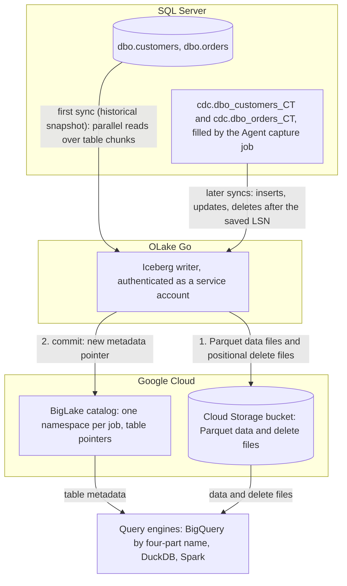

import * as I from '@site/src/components/integrations';

SQL Server to BigQuery usually means a Datastream stream, a Kafka pipeline, or a nightly `bcp` export and `bq load`. This guide takes a different route. SQL Server's own change data capture (CDC) feature fills change tables from the transaction log, and OLake Go commits those rows as Apache Iceberg tables into a BigLake catalog, with the files in your own Cloud Storage bucket.

BigLake is Google Cloud's Iceberg representational state transfer (REST) catalog. BigQuery queries the tables through it with a four-part name, with no dataset to create and no load job, and DuckDB and Spark read the same tables.

<I.IntegrationByline />

<TLDR title='Key takeaways'>

- OLake Go replicates SQL Server into Iceberg tables in a BigLake catalog: a full historical snapshot first, then CDC from the change tables SQL Server already maintains, with no Datastream or Kafka in between.
- BigQuery reads the catalog as a data source. Every change a sync commits is visible on the next `SELECT`, with no refresh.
- The same tables, written once by OLake Go, are also queryable from DuckDB and Spark. In the run on this page all three engines returned identical rows.

</TLDR>

**The short answer.** To replicate SQL Server to BigQuery with change data capture (CDC), enable CDC on the database and tables. Run OLake Go with a read-only login as the source and a BigLake catalog with a Cloud Storage bucket as the Iceberg destination, with BigQuery as a target query engine. The first sync copies each table in full (the historical snapshot); every later sync replays inserts, updates and deletes from the change tables.

## How SQL Server CDC reaches BigQuery here



Two things happen in order, and OLake Go does both on its own. The first sync records the current log sequence number (LSN), then reads each table in parallel chunks and writes Parquet data files. Every later sync reads the change tables from the saved LSN and replays the inserts, updates and deletes since.

Each sync ends with one commit to BigLake. OLake Go uploads the data and delete files with the service account's own credentials, then updates the table's metadata pointer in the catalog. BigQuery, DuckDB and Spark see the new snapshot on their next query; none of them keeps a copy.

One thing to keep an eye on: the change tables are SQL Server's replay window, and the Agent is what fills them. The cleanup job drops change rows older than three days by default, so a job paused longer than that needs a fresh snapshot. A stopped Agent means no new change rows at all, with no error on the SQL Server side.

## What you need

- **SQL Server 2016 SP1 or later** on Developer, Standard or Enterprise edition, with CDC available and the SQL Server Agent running. The tables on this page ran on SQL Server 2022 Developer in Docker. Cloud SQL for SQL Server works the same way; step 1 names its setup procedure.
- **A Google Cloud project** with the BigLake API enabled, a Cloud Storage bucket for the files, and a service account for OLake Go with the BigLake Editor role on the project and Storage Object User on the bucket. The run on this page used a bucket in `us-central1`.
- **BigQuery** in the same project. Queries run in the bucket's region, and the account running them needs the BigQuery Job User role plus read access to the catalog.
- **OLake UI** from the [Docker Compose install](/docs/install/olake-ui/) with the OLake Go MSSQL source. The run on this page used v1.1.0.

## Step 1: Prepare SQL Server for CDC

Most readers point OLake Go at tables they already have. If you want to follow along with the exact data from this page, create these two tables first:

<details>
<summary>The two sample tables used on this page</summary>

```sql title="Sample schema, database shop"
CREATE TABLE dbo.customers (
  id INT IDENTITY(1,1) PRIMARY KEY,
  name NVARCHAR(100), email NVARCHAR(200), city NVARCHAR(100), tier NVARCHAR(20),
  created_at DATETIME2 DEFAULT SYSUTCDATETIME(),
  updated_at DATETIME2 DEFAULT SYSUTCDATETIME());

CREATE TABLE dbo.orders (
  id INT IDENTITY(1,1) PRIMARY KEY,
  customer_id INT REFERENCES dbo.customers(id),
  product NVARCHAR(100), amount DECIMAL(10,2), status NVARCHAR(20),
  created_at DATETIME2 DEFAULT SYSUTCDATETIME(),
  updated_at DATETIME2 DEFAULT SYSUTCDATETIME());

-- Then insert whatever you like. This page started with 8 customers and 40 orders.
```

</details>

<I.Partial id="sources/mssql/prereqs" tables="customers, orders" />

## Step 2: Set up the BigLake catalog

BigQuery reads Iceberg tables through a catalog. **BigLake** is the one this page uses: Google Cloud's Iceberg REST catalog, with one namespace per job and the files in your Cloud Storage bucket.

DuckDB and Spark read from the same catalog. To BigQuery it is a data source in the project, so a table OLake Go commits is queryable on the next statement.

<I.CatalogStrip />

<I.CatalogTabs>
<TabItem value="biglake">

<I.Partial id="catalogs/biglake/setup" />

<Figure src='/img/docs/integrations/sql-server-to-bigquery/gcp-service-account-key-json.webp' alt='Google Cloud console Create private key dialog for the OLake service account with the JSON key type selected' caption='The JSON key for the service account. The console downloads it once; its contents go into the OLake Go destination form.' />

</TabItem>
</I.CatalogTabs>

## Step 3: Connect SQL Server to OLake Go

<I.Partial id="sources/mssql/connect">

Here is the source form from the run on this page. SQL Server ran in another container, so the host is `host.docker.internal`; the login is the one from step 1, with `VIEW DATABASE STATE` and `SELECT` on `dbo`, `cdc` and `msdb.dbo.cdc_jobs`.

<Figure src='/img/docs/integrations/sql-server-to-bigquery/olake-source-mssql-cdc.webp' alt='OLake UI Edit source form for MSSQL on OLake Go v1.1.0 with Enable CDC on, host host.docker.internal, port 1433, database shop, user olake and SSL disabled' caption='The SQL Server source in OLake UI: Enable CDC on, with the login from step 1.' width='760px' />

**Set up source** runs the connection test and the CDC checks before anything is saved: CDC on the database, a capture instance per table, a readable capture job. When one fails, the dialog names the setting and what to run.

</I.Partial>

## Step 4: Configure the Iceberg destination

<I.CatalogTabs>
<TabItem value="biglake">

<I.Partial id="catalogs/biglake/writer">

Here is the destination form from the run on this page. It holds the BigLake endpoint, the bucket as the catalog path, the service account JSON and the project ID.

<Figure src='/img/docs/integrations/sql-server-to-bigquery/olake-destination-biglake.webp' alt='OLake UI Edit destination form for Apache Iceberg with catalog type Big Lake, REST catalog URI https://biglake.googleapis.com/iceberg/v1/restcatalog, BigLake catalog path gs://olake-x2y-lab-bq, authentication type GCP and the project ID oauth-361809' caption='The BigLake destination in OLake UI: the endpoint, the bucket as catalog path, GCP authentication and the project ID.' width='760px' />

</I.Partial>

</TabItem>
</I.CatalogTabs>

## Step 5: Create the job and run the first sync

This job lists **BigQuery**, **Spark** and **DuckDB** as target query engines. OLake Go then offers only the delete formats all three read, and the run on this page used **Positional Deletes**.

<I.Partial id="jobs/create" engines="Google BigQuery, Apache Spark and DuckDB" upsert="Positional Deletes" updateType="pos" image="olakego/source-mssql:latest" namespace="dbo">

Leave `systranschemas` unticked; troubleshooting entry 2 explains why.

<Figure src='/img/docs/integrations/sql-server-to-bigquery/olake-streams-positional-deletes.webp' alt='OLake UI Streams Selection page with the dbo schema, customers and orders selected and systranschemas unticked, sync mode Full Refresh + CDC, ingestion mode Upsert and upsert type Positional Deletes on Iceberg format version V2' caption='Each stream: Full Refresh + CDC, Upsert, and Positional Deletes as the upsert type. The Iceberg DB name at the top is editable.' />

<Figure src='/img/docs/integrations/sql-server-to-bigquery/olake-job-history-two-syncs.webp' alt='OLake UI Job Logs and History for sql_server_to_bigquery showing two completed syncs, the first in 36 seconds and the second in 33 seconds' caption='Job history: the 36 s historical snapshot, then the 33 s change-only sync.' />

</I.Partial>

On this page the first run copied 8 customers and 40 orders (48 records, 3.05 KB) and finished in **36 seconds**, container start included. OLake Go names the BigLake namespace after the job, the source database and the schema, so `sql_server_to_bigquery` on database `shop` produced `sql_server_to_bigquery_shop_dbo`. The **Iceberg DB** field at the top of the Streams page changes it before the first sync.

## Step 6: Query the tables in BigQuery

<I.CatalogTabs>
<TabItem value="biglake">

<I.Partial id="engines/bigquery/query-biglake" schema="sql_server_to_bigquery_shop_dbo" />

<Figure src='/img/docs/integrations/sql-server-to-bigquery/bigquery-biglake-customers.webp' alt='BigQuery SQL editor in the Google Cloud console running the customers query on oauth-361809.olake-x2y-lab-bq.sql_server_to_bigquery_shop_dbo.customers and returning 10 rows with id, name, city and tier' caption='BigQuery reading the customers table through the BigLake catalog after the change sync: 10 rows, one per key.' />

</TabItem>
</I.CatalogTabs>

<I.Cta />

## Step 7: Change rows in SQL Server and sync again

To see the change path work, the run on this page made 12 changes in SQL Server after the first sync:

```sql title="Changes made in SQL Server between the two syncs"
INSERT INTO dbo.customers (name, email, city, tier) VALUES
  (N'Maya Patel', 'maya@example.com', N'Pune', 'silver'),
  (N'Lucas Silva', 'lucas@example.com', N'São Paulo', 'bronze');
INSERT INTO dbo.orders (customer_id, product, amount, status) VALUES
  (9, 'Laptop', 1299.00, 'placed'), (9, 'Mouse', 25.50, 'placed'),
  (10, 'Monitor', 349.99, 'placed'), (3, 'Keyboard', 89.00, 'placed'), (7, 'Webcam', 79.90, 'placed');
UPDATE dbo.customers SET tier = 'gold',       updated_at = SYSUTCDATETIME() WHERE name = N'Liam Carter';
UPDATE dbo.customers SET city = N'Abu Dhabi', updated_at = SYSUTCDATETIME() WHERE name = N'Zara Ali';
UPDATE dbo.orders    SET status = 'delivered', updated_at = SYSUTCDATETIME() WHERE id IN (1, 4, 7);
```

The second sync read **12 records (855 bytes)** from the change tables and finished in **33 seconds** end to end. For `customers` that meant one new data file with 4 rows: 2 inserts plus the new versions of 2 updated rows. One small positional delete file retires the 2 old versions, and `orders` has the same shape with 8 rows and 3 deletes.

<Figure src='/img/docs/integrations/sql-server-to-bigquery/olake-sync-log-positional-delete-commit.webp' alt='OLake UI sync log filtered to the Iceberg commit reports for customers and orders, showing addedDataFiles 1, addedPositionalDeleteFiles 1, addedRecords 4 and 8, and addedPositionalDeletes 2 and 3' caption='The change-only sync in the OLake UI log: one data file and one positional delete file per table.' />

BigQuery shows the result on the next query, with no refresh and no `ALTER TABLE`. Liam Carter is `gold`, Zara Ali moved to Abu Dhabi, and the two new customers are there. The `_op_type` column shows how each row arrived: `r` for the 6 untouched snapshot rows, `c` for the 2 inserts and `u` for the 2 updates.

**Schema changes.** A column added in SQL Server is not part of the existing capture instance. Create a new capture instance for the table, or let OLake Go do it with **Manage Capture Instance** on the source. OLake Go then adds the column to the Iceberg table on the next sync, and BigQuery shows it on the next query; full rules are on the [schema evolution page](/docs/features/schema/).

## Query the same tables from DuckDB and Spark

Nothing is exported, copied or refreshed: both engines read the files OLake Go wrote, through the same BigLake catalog.

<Tabs groupId="engine" queryString="engine">
<TabItem value="duckdb" label="DuckDB" default>

<I.Partial id="engines/duckdb/connect-biglake" schema="sql_server_to_bigquery_shop_dbo" />

<Figure src='/img/docs/integrations/sql-server-to-bigquery/gcp-hmac-key-service-account.webp' alt='Google Cloud console Cloud Storage Interoperability settings with the Select a service account dialog, the OLake service account selected and the Create key button' caption='The key for DuckDB: Cloud Storage, Settings, Interoperability, then a key for the same service account OLake Go uses.' />

DuckDB 1.5.5 returned the same 10 customers and the same `orders` roll-up as BigQuery in the run on this page. The data files came through the hash-based message authentication code (HMAC) key.

</TabItem>
<TabItem value="spark" label="Apache Spark">

<I.Partial id="engines/spark/connect-biglake" schema="sql_server_to_bigquery_shop_dbo" />

Spark 4.0.1 with Iceberg 1.10.0 returned the same rows in the run on this page, running on a laptop against the same catalog and bucket.

</TabItem>
</Tabs>

An `orders` roll-up matched SQL Server to the cent in all three engines. It gave 16 delivered orders for 8659.68, 18 placed for 10522.26, 11 shipped for 6397.25.

## Data types: SQL Server to Iceberg to BigQuery

OLake Go maps SQL Server types to Iceberg types, and BigQuery maps Iceberg types to its own when it reads the catalog. Integers and strings pass through; numbers with a scale and the date types are the groups to know about.

| SQL Server | Iceberg (written by OLake Go) | BigQuery shows | Notes |
| --- | --- | --- | --- |
| `tinyint`, `smallint`, `int` | `int` | `INT64` | The `IDENTITY` keys on this page arrived as `INT64`. |
| `bigint` | `long` | `INT64` | |
| `decimal`, `numeric`, `money`, `smallmoney`, `float` | `double` | `FLOAT64` | OLake Go stores decimals as doubles. The `orders.amount` sums on this page matched SQL Server to the cent in every engine; round at query time when you need exact decimal arithmetic. |
| `real` | `float` | `FLOAT64` | |
| `bit` | `boolean` | `BOOL` | |
| `date`, `smalldatetime`, `datetime`, `datetime2`, `datetimeoffset` | `timestamptz` (UTC) | `TIMESTAMP` | `datetime2` has no zone in SQL Server; it is read as UTC. `datetimeoffset` is converted to UTC. |
| `char`, `varchar`, `nchar`, `nvarchar`, `text`, `ntext`, `uniqueidentifier`, `xml`, `json`, `sql_variant` | `string` | `STRING` | A `uniqueidentifier` arrives as its 36-character text form. |
| `binary`, `varbinary`, `image`, `rowversion`, `geometry`, `geography`, `hierarchyid` | `string` | `STRING` | Binary and spatial values arrive as text; keep large binaries out of the sync. |

SQL Server types in the table come from the [SQL Server connector reference](/docs/connectors/mssql/#data-type-mapping). The BigQuery side comes from the [BigQuery Iceberg tables page](https://docs.cloud.google.com/bigquery/docs/iceberg-external-tables) (checked 2026-10-30) and from the table schemas of this run. OLake Go adds `_cdc_start_lsn` and `_cdc_seqval` on SQL Server tables, the log position each change came from.

## Cost and maintenance

- **Storage** is your bucket: you pay Cloud Storage rates for the Parquet and delete files. The BigLake catalog itself has no per-table charge.
- **Compute.** OLake Go runs wherever you run Docker. BigQuery bills on-demand queries by bytes scanned, or by slot time on an edition; a query over the catalog reads the Parquet files in the bucket.
- **Maintenance.** BigLake keeps every snapshot OLake Go commits in the table's `metadata.json` and rejects one above 1 MB, which a busy CDC table reaches after a few thousand syncs. Expire old snapshots and compact on a schedule with [OLake Fusion](/docs/fusion/getting-started/overview/) or with Spark's `expire_snapshots` and `rewrite_data_files` procedures through the same catalog.
- **Change table disk.** Every captured change is a row in the `cdc` schema until the cleanup job removes it. On a busy table three days of changes is real space in the database; shorten retention once the job runs reliably every hour.
- **Key rotation.** The service account key is what OLake Go writes with. Rotate it from the service account's **Keys** tab and paste the new JSON into the destination.

## Troubleshooting

### 1. The source test fails on the capture job

```text
required CDC prerequisites not met: cdc_capture_job ... no SELECT on msdb.dbo.cdc_jobs
```

OLake Go reads the capture job definition from `msdb` to pick a safe start position. Create a user for the login in `msdb` and grant `SELECT ON dbo.cdc_jobs`, as in step 1.

### 2. The first sync fails on a table you did not create

```text
failed to run change stream: failed in pre cdc run for driver[mssql]: CDC is not enabled for stream dbo.systranschemas
```

Enabling CDC or replication on a database adds `dbo.systranschemas` to it, and discovery lists it next to your tables. It has no capture instance, so a job that selects every stream fails before the snapshot. Untick it on the Streams page, along with any other table without a capture instance.

### 3. The source test passes but no changes arrive

Two causes. The common one is timing: the capture job copies log records into the change tables every few seconds, so a sync started right after a write can read nothing and the next sync picks the rows up.

The other cause is that the SQL Server Agent is not running, so the change tables never fill. `EXEC master.dbo.xp_servicecontrol 'QueryState', 'SQLServerAgent'` reports `Running.` when it is up.

### 4. The destination test fails on a catalog in vended-credentials mode

```text
failed to test destination: failed to create or get table: rpc error: code = Internal desc = Failed to process request: Malformed request: X-Iceberg-Access-Delegation header must be present and contain `vended-credentials` when credential mode is `CREDENTIAL_MODE_VENDED_CREDENTIALS`.
```

The catalog was created, or switched, with `--credential-mode=vended-credentials`, and OLake Go 1.1.0 does not send the header BigLake wants in that mode ([olake#1369](https://github.com/datazip-inc/olake/issues/1369)). Switch the catalog back with `gcloud beta biglake iceberg catalogs update <bucket> --credential-mode=end-user`, which is the default for a catalog OLake Go created itself. With the CLI, `"rest_access_delegation": "vended-credentials"` in `destination.json` makes the same test pass; the UI has no field for it yet.

### 5. BigQuery cannot find the dataset

```text
Not found: Dataset <project>:<bucket>.sql_server_to_bigquery_shop_dbo was not found in location US
```

The query ran in a location other than the bucket's region. Set the query location to the bucket's region in the editor's **More**, **Query settings** panel, or pass `--location=<region>` to `bq`.

<details>
<summary>How this compares with other ways to move SQL Server data to BigQuery</summary>

| Method | Freshness | Updates and deletes | Where the data lands | What you run |
| --- | --- | --- | --- | --- |
| [Datastream for SQL Server](https://docs.cloud.google.com/datastream/docs/sources-sqlserver) | Near real time, by Google's description; CDC from the change tables or the transaction log | Yes | Native BigQuery datasets; BigQuery is the only reader | Nothing to run; a connection profile and a stream in the console |
| Debezium, Kafka and a BigQuery sink connector | Seconds | Yes, with the sink's upsert settings | Kafka topics, then BigQuery tables | Kafka, Kafka Connect, the Debezium SQL Server connector and a sink |
| Export (`bcp` to CSV), then `bq load` | Hours to daily | No; full reloads only | Native BigQuery tables | A script, a scheduler and a staging bucket |
| **OLake Go to Iceberg on BigLake (this guide)** | CDC on a schedule down to one minute | Yes, as Iceberg row-level deletes | Apache Iceberg tables that BigQuery, Spark, DuckDB, Trino and Flink all read | One Docker Compose stack, open source; your bucket plus your own compute |

Datastream is the simpler choice when native BigQuery tables are the only goal. Writing Iceberg once avoids paying to move and store a second copy as soon as Spark, DuckDB or a notebook needs the same rows.

</details>

## When not to use this

- **Every query must hit native BigQuery speed.** A catalog table is read from Parquet in the bucket on every query. Keep the Iceberg tables as the source and load the hot slice into a native table on a schedule.
- **The edition has no CDC.** SQL Server Express and Web cannot enable change data capture. Full Refresh and Full Refresh + Incremental on an `updated_at` column still work there.
- **Tables have no primary key.** Inserts replicate; updates and deletes cannot be matched to a row and are not applied. Add a primary key or a unique index first.

## FAQs

<I.IntegrationFaq />

<I.HowWeTested />

## Related guides

<I.RelatedIntegrations />

Deeper reading on this site:

- [SQL Server connector reference](/docs/connectors/mssql/)
- [Equality vs positional deletes vs deletion vectors](/blog/iceberg-delete-formats-cdc-equality-vs-positional-vs-deletion-vectors/)
- [Which engines read which delete formats](/blog/iceberg-delete-formats-interoperability-olake-go/)
- [OLake Go ingestion benchmarks](/docs/benchmarks/ingestion/)

<I.IntegrationJsonLd />

<I.Cta title='Start with your own SQL Server' body='The quickstart runs OLake UI with Docker Compose. Create the source, the BigLake destination and the job as above, and the first sync lands your tables where BigQuery can read them.' />
