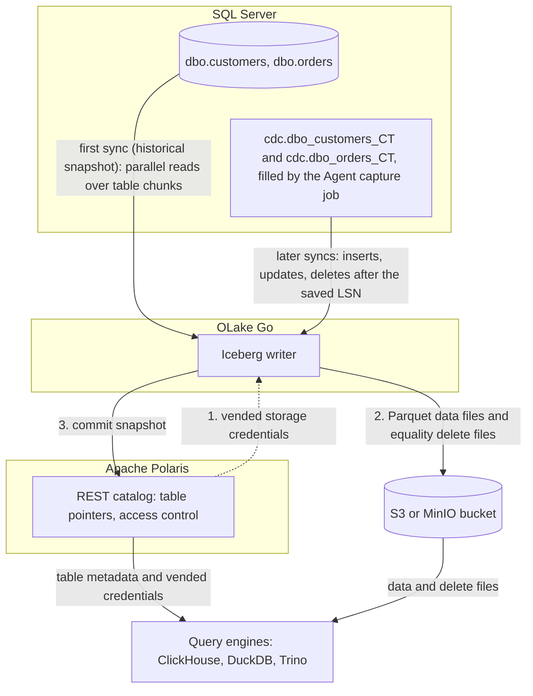

import * as I from '@site/src/components/integrations';

SQL Server to ClickHouse usually means Debezium through Kafka into the ClickHouse Kafka engine, a nightly `bcp` export, or a managed extract, load and transform (ELT) tool, and tables that only ClickHouse can read. This guide takes a different route.

SQL Server's own change data capture (CDC) feature fills change tables from the transaction log. OLake Go reads them and commits the rows as Apache Iceberg tables into an Apache Polaris catalog, and ClickHouse attaches that catalog as a database.

Polaris is an open source Iceberg REST (Representational State Transfer) catalog you run yourself, with the files in your own bucket. Nothing else is in the path: no Kafka, no Debezium, no ClickHouse Cloud. DuckDB and Trino read the same tables through the same endpoint.

<I.IntegrationByline />

<TLDR title='Key takeaways'>

- OLake Go replicates SQL Server into Iceberg tables in Polaris: a full historical snapshot first, then CDC from the change tables SQL Server already maintains, with no Kafka or Debezium in between.
- ClickHouse attaches the whole Polaris catalog as one database with `DataLakeCatalog`, reads the files with the credentials Polaris vends, and sees every change the moment a sync commits.
- The same tables, written once by OLake Go, are also queryable from DuckDB and Trino through the same catalog. In the run on this page all three engines returned identical rows.

</TLDR>

**The short answer.** To replicate SQL Server to ClickHouse with change data capture (CDC), enable CDC on the database and tables. Run OLake Go with a read-only login as the source and an Apache Polaris catalog as the Iceberg destination.

The first sync copies each table in full (the historical snapshot); every later sync replays inserts, updates and deletes from the change tables. ClickHouse, DuckDB and Trino then query the same Iceberg tables, with no second copy.

## How SQL Server CDC reaches ClickHouse here



Two things happen in order, and OLake Go does both on its own. The first sync records the current log sequence number (LSN). Then it reads each table in parallel chunks and writes Parquet data files: that is the historical load.

Every later sync reads the change tables from the saved LSN and replays the inserts, updates and deletes since. Nothing written during the snapshot is lost, and there is no separate backfill job.

Each sync ends with one commit to Polaris. OLake Go asks Polaris for short-lived storage credentials, uploads the data and delete files, then posts the new snapshot to the catalog. ClickHouse, DuckDB and Trino see it on their next query; none of them keeps a copy.

One thing to keep an eye on: the change tables are SQL Server's replay window, and the Agent is what fills them. The cleanup job drops change rows older than three days by default, so a job paused longer than that needs a fresh snapshot. A stopped Agent means no new change rows at all, with no error on the SQL Server side.

## What you need

- **SQL Server 2016 SP1 or later** on Developer, Standard or Enterprise edition, with CDC available and the SQL Server Agent running. The tables on this page ran on SQL Server 2022 Developer in Docker. Hosted SQL Server on Amazon Relational Database Service (RDS), Azure SQL Managed Instance or Cloud SQL works the same way; step 1 names each setup procedure.
- **An Apache Polaris server and a bucket**, both reachable from OLake Go and from ClickHouse. The run on this page used Polaris 1.8.0 and MinIO in Docker; on AWS, use an S3 bucket and an IAM role instead.
- **ClickHouse 26.1 or later**, where the `DataLakeCatalog` engine reads REST catalogs. The run on this page used the 26.8 LTS release in Docker.
- **OLake UI** from the [Docker Compose install](/docs/install/olake-ui/) with the OLake Go MSSQL source. The run on this page used v1.1.0.
- **Docker**, and about 40 minutes.

## Step 1: Prepare SQL Server for CDC

Most readers point OLake Go at tables they already have. If you want to follow along with the exact data from this page, create these two tables first:

<details>
<summary>The two sample tables used on this page</summary>

```sql title="Sample schema, database shop"
CREATE TABLE dbo.customers (
  id INT IDENTITY(1,1) PRIMARY KEY,
  name NVARCHAR(100), email NVARCHAR(200), city NVARCHAR(100), tier NVARCHAR(20),
  created_at DATETIME2 DEFAULT SYSUTCDATETIME(),
  updated_at DATETIME2 DEFAULT SYSUTCDATETIME());

CREATE TABLE dbo.orders (
  id INT IDENTITY(1,1) PRIMARY KEY,
  customer_id INT REFERENCES dbo.customers(id),
  product NVARCHAR(100), amount DECIMAL(10,2), status NVARCHAR(20),
  created_at DATETIME2 DEFAULT SYSUTCDATETIME(),
  updated_at DATETIME2 DEFAULT SYSUTCDATETIME());

-- Then insert whatever you like. This page started with 8 customers and 40 orders.
```

</details>

<I.Partial id="sources/mssql/prereqs" tables="customers, orders" />

## Step 2: Set up the Polaris catalog

ClickHouse reads Iceberg tables through a catalog. **Apache Polaris** is the one this page uses: an open source REST catalog that you run next to your bucket.

OLake Go writes into it, and ClickHouse, DuckDB and Trino read from it with the credentials Polaris hands out. The Iceberg files sit in your own S3 or MinIO bucket; Polaris holds only the pointers and the permissions.

<I.CatalogStrip />

<I.CatalogTabs>
<TabItem value="polaris">

<I.Partial id="catalogs/polaris/setup" />

</TabItem>
</I.CatalogTabs>

## Step 3: Connect SQL Server to OLake Go

<I.Partial id="sources/mssql/connect">

Here is the source form from the run on this page. SQL Server ran in another container, so the host is `host.docker.internal`; the login is the one from step 1, with `VIEW DATABASE STATE` and `SELECT` on `dbo`, `cdc` and `msdb.dbo.cdc_jobs`.

<Figure src='/img/docs/integrations/sql-server-to-clickhouse/olake-source-mssql-cdc.webp' alt='OLake UI Edit source form for MSSQL on OLake Go v1.1.0 with Enable CDC on, host host.docker.internal, port 1433, database shop, user olake and SSL disabled' caption='The SQL Server source in OLake UI: Enable CDC on, with the login from step 1.' width='760px' />

**Set up source** runs the connection test and the CDC checks before anything is saved: CDC on the database, a capture instance per table, a readable capture job. When one fails, the dialog names the setting and what to run.

</I.Partial>

## Step 4: Configure the Iceberg destination

<I.CatalogTabs>
<TabItem value="polaris">

<I.Partial id="catalogs/polaris/writer">

Here is the destination form from the run on this page. Polaris and MinIO ran in other containers, so both addresses use `host.docker.internal`; the credential is the `olake` principal from step 2.

<Figure src='/img/docs/integrations/sql-server-to-clickhouse/olake-destination-polaris.webp' alt='OLake UI Edit destination form for Apache Iceberg with catalog type Polaris, authentication type OAuth2, REST catalog URI http://host.docker.internal:8181/api/catalog, Polaris catalog name olake, S3 endpoint http://host.docker.internal:9000, REST scope PRINCIPAL_ROLE:ALL and region us-east-1' caption='The Polaris destination in OLake UI: OAuth2 with the principal from step 2, and the MinIO endpoint for the files.' width='760px' />

</I.Partial>

</TabItem>
</I.CatalogTabs>

## Step 5: Create the job and run the first sync

<I.Partial id="jobs/create" engines="ClickHouse, plus DuckDB and Trino if they will read the tables too" upsert="Equality Deletes" updateType="eq" image="olakego/source-mssql:latest" namespace="dbo">

Three target query engines were set on this job. That is the only format decision you make. OLake Go works out which Iceberg delete format all three can read and sets it on every stream.

With ClickHouse in the list it chose equality deletes, which need no index between runs. Leave `systranschemas` unticked; troubleshooting entry 2 explains why.

<Figure src='/img/docs/integrations/sql-server-to-clickhouse/olake-streams-equality-deletes.webp' alt='OLake UI Streams Selection page with the dbo schema, customers and orders selected and systranschemas unticked, sync mode Full Refresh + CDC, ingestion mode Upsert and upsert type Equality Deletes on Iceberg format version V2' caption='Each stream: Full Refresh + CDC, Upsert, and the upsert type OLake Go resolved (Equality Deletes in this run). The Iceberg DB name at the top is editable.' />

<Figure src='/img/docs/integrations/sql-server-to-clickhouse/olake-job-history-two-syncs.webp' alt='OLake UI Job Logs and History for sql_server_to_clickhouse showing two completed syncs, the first in 17 seconds and the second in 9 seconds' caption='Job history: the 17 s historical snapshot, then the 9 s change-only sync.' />

</I.Partial>

On this page the first run copied 8 customers and 40 orders (48 records, 3.05 KB) and finished in **17 seconds**, container start included. OLake Go names the destination namespace after the job, the source database and the schema, so `sql_server_to_clickhouse` on database `shop` produced `sql_server_to_clickhouse_shop_dbo`. The **Iceberg DB** field at the top of the Streams page changes it before the first sync.

## Step 6: Query the tables in ClickHouse

<I.CatalogTabs>
<TabItem value="polaris">

<I.Partial id="engines/clickhouse/query-polaris" schema="sql_server_to_clickhouse_shop_dbo" />

<Figure src='/img/docs/integrations/sql-server-to-clickhouse/clickhouse-polaris-customers.webp' alt='clickhouse-client querying polaris.sql_server_to_clickhouse_shop_dbo.customers through the DataLakeCatalog engine and returning 10 rows with id, name, city and tier' caption='ClickHouse 26.8 reading the customers table through Polaris after the change sync: 10 rows, one per key.' />

</TabItem>
</I.CatalogTabs>

<I.Cta />

## Step 7: Change rows in SQL Server and sync again

To see the change path work, the run on this page made 12 changes in SQL Server after the first sync:

```sql title="Changes made in SQL Server between the two syncs"
INSERT INTO dbo.customers (name, email, city, tier) VALUES
  (N'Maya Patel', 'maya@example.com', N'Pune', 'silver'),
  (N'Lucas Silva', 'lucas@example.com', N'São Paulo', 'bronze');
INSERT INTO dbo.orders (customer_id, product, amount, status) VALUES
  (9, 'Laptop', 1299.00, 'placed'), (9, 'Mouse', 25.50, 'placed'),
  (10, 'Monitor', 349.99, 'placed'), (3, 'Keyboard', 89.00, 'placed'), (7, 'Webcam', 79.90, 'placed');
UPDATE dbo.customers SET tier = 'gold',       updated_at = SYSUTCDATETIME() WHERE name = N'Liam Carter';
UPDATE dbo.customers SET city = N'Abu Dhabi', updated_at = SYSUTCDATETIME() WHERE name = N'Zara Ali';
UPDATE dbo.orders    SET status = 'delivered', updated_at = SYSUTCDATETIME() WHERE id IN (1, 4, 7);
```

The second sync read **12 records (855 bytes)** from the change tables and finished in **9 seconds** end to end. For `customers` that meant one new data file with 4 rows: 2 inserts plus the new versions of 2 updated rows. One small equality delete file carries a delete for each of the 4 keys it wrote, inserts included, because an equality delete costs nothing when no older row matches.

OLake Go's commit report in the sync log shows it directly: `addedDataFiles=1`, `addedRecords=4`, `addedEqualityDeleteFiles=1`, `addedEqualityDeletes=4`. The `orders` table has the same shape with 8 rows and 8 deletes.

<Figure src='/img/docs/integrations/sql-server-to-clickhouse/olake-sync-log-equality-delete-commit.webp' alt='OLake UI sync log filtered to the Iceberg commit reports for customers and orders, showing addedDataFiles 1, addedEqualityDeleteFiles 1, addedRecords 4 and 8, and addedEqualityDeletes 4 and 8' caption='The change-only sync in the OLake UI log: one data file and one equality delete file per table.' />

ClickHouse shows the result on the next query, with no refresh. Liam Carter is `gold`, Zara Ali moved to Abu Dhabi, and the two new customers are there. The two retired versions are gone, because ClickHouse applies the equality deletes while reading.

The `_op_type` column shows how each row arrived: `r` for the snapshot, `c` for the inserts and `u` for the updates. The Agent capture job runs every few seconds, so a change made right before a sync starts can land in the next one instead.

**Schema changes.** A column added in SQL Server is not part of the existing capture instance. Create a new capture instance for the table, or let OLake Go do it with **Manage Capture Instance** on the source. OLake Go then adds the column to the Iceberg table on the next sync, and ClickHouse shows it the next time the table is opened.

Narrowing or incompatible type changes fail the sync rather than corrupt the table. Full rules are on the [schema evolution page](/docs/features/schema/).

## Query the same tables from DuckDB and Trino

This is the point of writing Iceberg instead of loading ClickHouse tables. Nothing is exported, copied or refreshed: both engines read the files OLake Go wrote, through the same Polaris endpoint.

<Tabs groupId="engine" queryString="engine">
<TabItem value="duckdb" label="DuckDB" default>

<I.Partial id="engines/duckdb/connect-polaris" schema="sql_server_to_clickhouse_shop_dbo" />

<Figure src='/img/docs/integrations/sql-server-to-clickhouse/duckdb-polaris-customers.webp' alt='DuckDB 1.5.5 querying polaris.sql_server_to_clickhouse_shop_dbo.customers and returning the same 10 rows as ClickHouse' caption='DuckDB 1.5.5 reading the same table through Polaris: the same 10 rows.' />

</TabItem>
<TabItem value="trino" label="Trino">

<I.Partial id="engines/trino/connect-polaris" schema="sql_server_to_clickhouse_shop_dbo" />

<Figure src='/img/docs/integrations/sql-server-to-clickhouse/trino-polaris-customers.webp' alt='Trino 484 CLI querying customers in the polaris catalog and returning the same 10 rows as ClickHouse' caption='Trino 484 reading the same table through Polaris with vended credentials: the same 10 rows.' />

</TabItem>
</Tabs>

An `orders` roll-up matched SQL Server to the cent in all three engines. It gave 16 delivered orders for 8659.68, 18 placed for 10522.26, 11 shipped for 6397.25.

## Data types: SQL Server to Iceberg to ClickHouse

OLake Go maps SQL Server types to Iceberg types, and ClickHouse maps Iceberg types to its own. Integers and strings pass through; numbers with a scale and the date types are the groups to know about.

| SQL Server | Iceberg (written by OLake Go) | ClickHouse shows | Notes |
| --- | --- | --- | --- |
| `tinyint`, `smallint`, `int` | `int` | `Nullable(Int32)` | The `IDENTITY` keys on this page arrived as `Int32`. |
| `bigint` | `long` | `Nullable(Int64)` | |
| `decimal`, `numeric`, `money`, `smallmoney`, `float` | `double` | `Nullable(Float64)` | OLake Go stores decimals as doubles. The `orders.amount` sums on this page matched SQL Server to the cent in every engine; round at query time when you need exact decimal arithmetic. |
| `real` | `float` | `Nullable(Float32)` | |
| `bit` | `boolean` | `Nullable(Bool)` | |
| `date`, `smalldatetime`, `datetime`, `datetime2`, `datetimeoffset` | `timestamptz` (UTC) | `Nullable(DateTime64(6, 'UTC'))` | `datetime2` has no zone in SQL Server; it is read as UTC. `datetimeoffset` is converted to UTC. |
| `char`, `varchar`, `nchar`, `nvarchar`, `text`, `ntext`, `uniqueidentifier`, `xml`, `json`, `sql_variant` | `string` | `Nullable(String)` | A `uniqueidentifier` arrives as its 36-character text form. Parse `json` with `JSONExtract`. |
| `binary`, `varbinary`, `image`, `rowversion`, `geometry`, `geography`, `hierarchyid` | `string` | `Nullable(String)` | Binary and spatial values arrive as text; keep large binaries out of the sync. |

SQL Server types in the table come from the [SQL Server connector reference](/docs/connectors/mssql/#data-type-mapping). The ClickHouse side comes from the [ClickHouse Iceberg table engine page](https://clickhouse.com/docs/engines/table-engines/integrations/iceberg) (checked 2026-10-30) and from `DESCRIBE` on the tables of this run. OLake Go adds `_cdc_start_lsn` and `_cdc_seqval` on SQL Server tables, the log position each change came from.

## Cost and maintenance

- **Storage** is your bucket: you pay S3 or MinIO rates for the Parquet and delete files, and nothing to Polaris or ClickHouse for holding them.
- **Compute.** OLake Go runs wherever you run Docker. ClickHouse spends CPU only when you query; a `DataLakeCatalog` query reads Parquet over the network with no MergeTree index, so load a hot slice into a MergeTree table when a dashboard needs sub-second answers.
- **Maintenance.** Nothing compacts the tables for you. A CDC table that gets a new small file and delete file per sync wants compaction; [OLake Fusion](/docs/fusion/getting-started/overview/) does this for the catalogs OLake Go writes to, and Spark's `rewrite_data_files` works through the same Polaris endpoint.
- **Change table disk.** Every captured change is a row in the `cdc` schema until the cleanup job removes it. On a busy table three days of changes is real space in the database; shorten retention once the job runs reliably every hour.
- **Credential rotation.** Polaris principals do not expire by default. Rotate the `olake` principal's secret on your own schedule with the management API; a rotated secret fails the next sync at the token exchange, before any data moves.

## Troubleshooting

### 1. The source test fails on the capture job

```text
required CDC prerequisites not met: cdc_capture_job ... no SELECT on msdb.dbo.cdc_jobs
```

OLake Go reads the capture job definition from `msdb` to pick a safe start position. Create a user for the login in `msdb` and grant `SELECT ON dbo.cdc_jobs`, as in step 1. The run on this page hit this before the grant was added.

### 2. The first sync fails on a table you did not create

```text
failed to run change stream: failed in pre cdc run for driver[mssql]: CDC is not enabled for stream dbo.systranschemas
```

Enabling CDC or replication on a database adds `dbo.systranschemas` to it, and discovery lists it next to your tables. It has no capture instance, so a job that selects every stream fails before the snapshot. Untick it on the Streams page, along with any other table without a capture instance.

### 3. The source test passes but no changes arrive

Two causes. The common one is timing: the capture job copies log records into the change tables every few seconds, so a sync started right after a write can read nothing and the next sync picks the rows up. The other cause is that the SQL Server Agent is not running, so the change tables never fill.

In Docker the agent is off unless the container starts with `MSSQL_AGENT_ENABLED=true`. `EXEC master.dbo.xp_servicecontrol 'QueryState', 'SQLServerAgent'` reports `Running.` when it is up.

### 4. ClickHouse lists the tables but every query returns a 404

```text
Code: 499. DB::Exception: Failed to get object info for key olake/.../metadata/00003-....metadata.json in bucket lakehouse: No response body.. HTTP response code: 404
```

The object key is doubled. ClickHouse 26.8 and 26.10 join the table location onto the storage endpoint, then fail to strip it again when the endpoint has no trailing slash. Set the Polaris catalog's `endpoint` (and `storage_endpoint` in ClickHouse, if you use static keys) to a value ending in `/`, for example `http://minio:9000/`.

### 5. The destination test fails at the token exchange

OLake Go's destination test exchanges the principal's credentials at `/api/catalog/v1/oauth/tokens` before anything else. Three causes cover nearly every failure.

The client id or secret is wrong, the principal has no role that carries `CATALOG_MANAGE_CONTENT` on the catalog, or the `Polaris Catalog Name` is wrong. Run the token check from the catalog setup; it returns the same error Polaris gives OLake Go.

<details>
<summary>How this compares with other ways to move SQL Server data to ClickHouse</summary>

| Method | Freshness | Updates and deletes | Where the data lands | What you run |
| --- | --- | --- | --- | --- |
| Debezium, Kafka and the ClickHouse Kafka engine | Seconds | Yes, with your own merge logic | Kafka topics, then ClickHouse tables | Kafka, Kafka Connect, the Debezium SQL Server connector and a materialized view per table |
| [ClickHouse ODBC table function](https://clickhouse.com/docs/reference/functions/table-functions/odbc) against SQL Server | Live, per query | Reads the current row | Nothing is copied; every query hits SQL Server | An ODBC driver and DSN on every ClickHouse server |
| Export (`bcp` or SSIS to files), then `INSERT ... SELECT FROM s3(...)` | Hours to daily | No; full reloads only | Native ClickHouse tables | A script, a scheduler and a staging bucket |
| Managed ELT (Fivetran, Estuary, Airbyte Cloud) | Minutes, by plan | Varies by tool | ClickHouse tables, a second copy you pay to move and store | Nothing; priced per row, per GB or per connector |
| **OLake Go to Iceberg on Polaris (this guide)** | CDC on a schedule down to one minute | Yes, as Iceberg row-level deletes | Apache Iceberg tables that ClickHouse, DuckDB, Trino and Spark all read | One Docker Compose stack, open source; your bucket plus your own compute |

Debezium through Kafka is the simpler choice when you need seconds of latency into MergeTree and already run Kafka. Writing Iceberg once avoids paying to move and store a second copy. That matters as soon as another engine needs the same rows, or you want to own the files and the catalog.

</details>

## When not to use this

- **Every query must hit MergeTree speed.** A `DataLakeCatalog` query reads Parquet with no primary index. Keep the Iceberg tables as the source and load the hot slice into a MergeTree table on a schedule.
- **The edition has no CDC.** SQL Server Express and Web cannot enable change data capture, and Azure SQL Database needs the S3 tier or above. Full Refresh and Full Refresh + Incremental on an `updated_at` column still work there.
- **Tables have no primary key.** Inserts replicate; updates and deletes cannot be matched to a row and are not applied. Add a primary key or a unique index first.

## FAQs

<I.IntegrationFaq />

<I.HowWeTested />

## Related guides

<I.RelatedIntegrations />

Deeper reading on this site:

- [SQL Server connector reference](/docs/connectors/mssql/)
- [Equality vs positional deletes vs deletion vectors](/blog/iceberg-delete-formats-cdc-equality-vs-positional-vs-deletion-vectors/)
- [Which engines read which delete formats](/blog/iceberg-delete-formats-interoperability-olake-go/)
- [OLake Go ingestion benchmarks](/docs/benchmarks/ingestion/)

<I.IntegrationJsonLd />

<I.Cta title='Start with your own SQL Server' body='The quickstart runs OLake UI with Docker Compose. Create the source, the Polaris destination and the job as above, and the first sync lands your tables where ClickHouse can read them.' />
