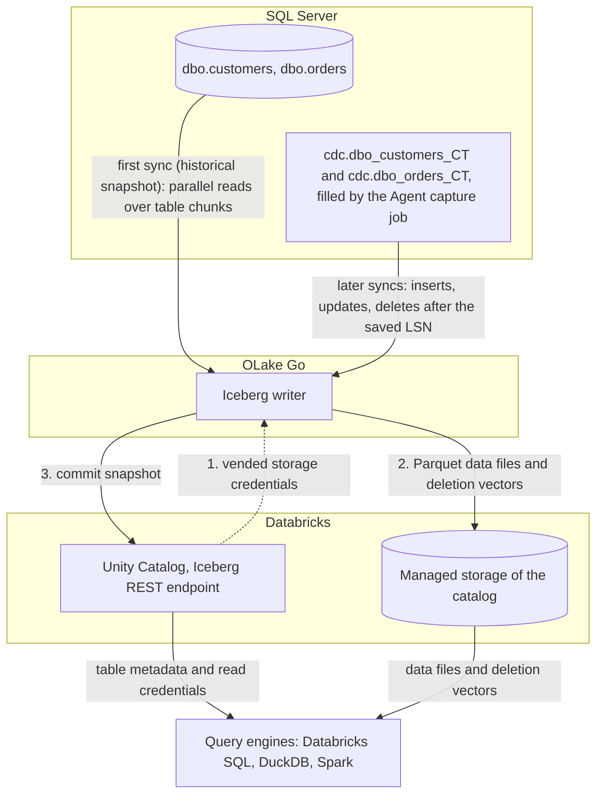

import * as I from '@site/src/components/integrations';

SQL Server to Databricks usually means the Lakeflow Connect SQL Server connector, a Kafka pipeline, or a nightly `bcp` export picked up by Auto Loader. This guide takes a different route. SQL Server's own change data capture (CDC) feature fills change tables from the transaction log, and OLake Go commits those rows as Apache Iceberg tables into Unity Catalog.

The tables land as Unity Catalog managed Iceberg tables, with the files in your own cloud storage. Nothing else is in the path: no Kafka, no Debezium, no Databricks ingestion pipeline. DuckDB and Spark read the same tables through the same catalog.

<I.IntegrationByline />

<TLDR title='Key takeaways'>

- OLake Go replicates SQL Server into Databricks as Iceberg tables: a full historical snapshot first, then CDC from the change tables SQL Server already maintains, with no Kafka or Debezium in between.
- The tables are Unity Catalog managed Iceberg tables. You query them from the Databricks SQL editor or a notebook right away, with no external table and no refresh.
- The same tables, written once by OLake Go, are also queryable from DuckDB and Spark through Unity Catalog. In the run on this page all three engines returned identical rows.

</TLDR>

**The short answer.** To replicate SQL Server to Databricks with change data capture (CDC), enable CDC on the database and tables. Run OLake Go with a read-only login as the source and Unity Catalog as the Iceberg destination, with Databricks as a target query engine.

The first sync copies each table in full; every later sync replays inserts, updates and deletes from the change tables with deletion vectors. Databricks, DuckDB and Spark then query the same Iceberg tables.

## How SQL Server CDC reaches Databricks here



The first sync records the current log sequence number (LSN), then reads each table in parallel chunks and writes Parquet data files: that is the historical load. Every later sync reads the change tables from the saved LSN and replays the inserts, updates and deletes since. A deletion vector, a small bitmap per data file, retires the old version of each changed row.

Each sync ends with one commit to Unity Catalog. Databricks sees the new snapshot on its next query, and DuckDB and Spark see it on their next catalog load.

The change tables are SQL Server's replay window, and the Agent is what fills them. The cleanup job drops change rows older than three days by default, so a job paused longer than that needs a fresh snapshot. A stopped Agent means no new change rows at all, with no error on the SQL Server side.

## What you need

- **SQL Server 2016 SP1 or later** on Developer, Standard or Enterprise edition, with CDC available and the SQL Server Agent running. The tables on this page ran on SQL Server 2022 Developer in Docker.
- **A Databricks workspace with Unity Catalog**, a catalog with managed storage, and an admin who can turn on external data access and grant `EXTERNAL USE SCHEMA`. The run on this page used a workspace on Google Cloud.
- **OLake UI** from the [Docker Compose install](/docs/install/olake-ui/) with the OLake Go MSSQL source. The run on this page used v1.1.0.
- **Docker**, and about 40 minutes.

## Step 1: Prepare SQL Server for CDC

Most readers point OLake Go at tables they already have. If you want to follow along with the exact data from this page, create these two tables first:

<details>
<summary>The two sample tables used on this page</summary>

```sql title="Sample schema, database shop"
CREATE TABLE dbo.customers (
  id INT IDENTITY(1,1) PRIMARY KEY,
  name NVARCHAR(100), email NVARCHAR(200), city NVARCHAR(100), tier NVARCHAR(20),
  created_at DATETIME2 DEFAULT SYSUTCDATETIME(),
  updated_at DATETIME2 DEFAULT SYSUTCDATETIME());

CREATE TABLE dbo.orders (
  id INT IDENTITY(1,1) PRIMARY KEY,
  customer_id INT REFERENCES dbo.customers(id),
  product NVARCHAR(100), amount DECIMAL(10,2), status NVARCHAR(20),
  created_at DATETIME2 DEFAULT SYSUTCDATETIME(),
  updated_at DATETIME2 DEFAULT SYSUTCDATETIME());

-- Then insert whatever you like. This page started with 8 customers and 40 orders.
```

</details>

<I.Partial id="sources/mssql/prereqs" tables="customers, orders" />

## Step 2: Set up Unity Catalog in Databricks

Databricks reads Iceberg tables through Unity Catalog, the catalog built into every Databricks workspace. OLake Go writes straight into it, so the tables become Unity Catalog managed Iceberg tables. They show up in Catalog Explorer and the SQL editor the moment a sync commits.

The files sit in the catalog's managed storage, which is backed by an external location in your own cloud account. DuckDB and Spark reach the same tables through the same Unity Catalog endpoint.

<I.CatalogStrip />

<I.CatalogTabs>
<TabItem value="unity">

<I.Partial id="catalogs/unity/setup" />

</TabItem>
</I.CatalogTabs>

## Step 3: Connect SQL Server to OLake Go

<I.Partial id="sources/mssql/connect">

Here is the source form from the run on this page. SQL Server ran in another container, so the host is `host.docker.internal`; the login is the one from step 1, with `VIEW DATABASE STATE` and `SELECT` on `dbo` and `cdc`.

<Figure src='/img/docs/integrations/sql-server-to-databricks/olake-source-mssql-cdc.webp' alt='OLake UI Edit source form for MSSQL on OLake Go v1.1.0 with Enable CDC on, host host.docker.internal, port 1433, database shop, user olake and SSL disabled' caption='The SQL Server source in OLake UI: Enable CDC on, with the login from step 1.' width='760px' />

**Set up source** runs the connection test and the CDC checks before anything is saved: CDC on the database, a capture instance per table, a readable capture job. When one fails, the dialog names the setting and what to run.

</I.Partial>

## Step 4: Configure the Iceberg destination

<I.CatalogTabs>
<TabItem value="unity">

<I.Partial id="catalogs/unity/writer">

The run on this page wrote into a catalog called `datazip`, with a personal access token that expires after seven days. The snippets below use `lakehouse`; replace it with your catalog name.

</I.Partial>

</TabItem>
</I.CatalogTabs>

## Step 5: Create the job and run the first sync

<I.Partial id="jobs/create" engines="Databricks, plus DuckDB and Apache Spark if they will read the tables too" upsert="Deletion Vector" updateType="dv" image="olakego/source-mssql:latest" namespace="dbo">

Three target query engines were set on this job, and Databricks narrows the delete formats to one: deletion vectors on Iceberg v3 tables. Leave `systranschemas` unticked; troubleshooting entry 2 explains why.

<Figure src='/img/docs/integrations/sql-server-to-databricks/olake-streams.webp' alt='OLake UI Streams Selection page with the dbo schema, customers and orders selected and systranschemas unticked, sync mode Full Refresh + CDC, ingestion mode Upsert and upsert type Deletion Vector on Iceberg format version V3' caption='Each stream: Full Refresh + CDC, Upsert, and Deletion Vector on Iceberg v3, the format OLake Go resolved for Databricks.' />

<Figure src='/img/docs/integrations/sql-server-to-databricks/olake-job-history-two-syncs.webp' alt='OLake UI Job Logs and History for sql_server_to_databricks showing two completed syncs, the first in 27 seconds and the second in 20 seconds' caption='Job history: the 27 s historical snapshot, then the 20 s change-only sync.' />

</I.Partial>

On this page the first run copied 8 customers and 40 orders (48 records, 3.05 KB) and finished in **27 seconds**, container start included. OLake Go names the Unity Catalog schema after the job, the source database and the schema, so `sql_server_to_databricks` on database `shop` produced `sql_server_to_databricks_shop_dbo`. The **Iceberg DB** field at the top of the Streams page changes it before the first sync.

## Step 6: Query the tables in Databricks

<I.CatalogTabs>
<TabItem value="unity">

<I.Partial id="engines/databricks/query-unity" schema="sql_server_to_databricks_shop_dbo" idCol="id" />

<Figure src='/img/docs/integrations/sql-server-to-databricks/databricks-sql-editor-customers.webp' alt='Databricks SQL editor running SELECT on datazip.sql_server_to_databricks_shop_dbo.customers on the 2X-Small SQL warehouse, returning 10 rows with id, name, city and tier' caption='The SQL Server customers table in the Databricks SQL editor after both syncs: 10 rows, read through Unity Catalog.' />

</TabItem>
</I.CatalogTabs>

<I.Cta />

## Step 7: Change rows in SQL Server and sync again

To see the change path work, the run on this page made 12 changes in SQL Server after the first sync:

```sql title="Changes made in SQL Server between the two syncs"
INSERT INTO dbo.customers (name, email, city, tier) VALUES
  (N'Maya Patel', 'maya@example.com', N'Pune', 'silver'),
  (N'Lucas Silva', 'lucas@example.com', N'São Paulo', 'bronze');
INSERT INTO dbo.orders (customer_id, product, amount, status) VALUES
  (9, 'Laptop', 1299.00, 'placed'), (9, 'Mouse', 25.50, 'placed'),
  (10, 'Monitor', 349.99, 'placed'), (3, 'Keyboard', 89.00, 'placed'), (7, 'Webcam', 79.90, 'placed');
UPDATE dbo.customers SET tier = 'gold',       updated_at = SYSUTCDATETIME() WHERE name = N'Liam Carter';
UPDATE dbo.customers SET city = N'Abu Dhabi', updated_at = SYSUTCDATETIME() WHERE name = N'Zara Ali';
UPDATE dbo.orders    SET status = 'delivered', updated_at = SYSUTCDATETIME() WHERE id IN (1, 4, 7);
```

The second sync read **12 records (855 bytes)** from the change tables and finished in **20 seconds** end to end. For `customers` that meant one new data file with 4 rows and one deletion vector marking the 2 old versions. OLake Go's commit report shows `addedDataFiles=1`, `addedRecords=4`, `addedDVs=1` and `addedPositionalDeletes=2`, and `orders` the same shape with 8 rows and 3 deleted positions.

<Figure src='/img/docs/integrations/sql-server-to-databricks/olake-sync-log-commit.webp' alt='OLake UI sync log filtered to the Iceberg commit reports for orders and customers after the change-only sync, showing addedDataFiles 1, addedDVs 1, addedRecords 8 and 4, and addedPositionalDeletes 3 and 2' caption='The change-only sync in the OLake UI log: one data file and one deletion vector per table.' />

Databricks shows the result on the next query, with no refresh. Liam Carter is `gold`, Zara Ali moved to Abu Dhabi, and the two new customers are there. The `_op_type` column shows how each row arrived: `r` for the 6 untouched snapshot rows, `c` for the 2 inserts and `u` for the 2 updates.

**Schema changes.** A column added in SQL Server is not part of the existing capture instance. Create a new capture instance for the table, or let OLake Go do it with **Manage Capture Instance** on the source.

OLake Go then adds the column to the Iceberg table on the next sync. Full rules are on the [schema evolution page](/docs/features/schema/).

## Query the same tables from DuckDB and Spark

Nothing is exported, copied or refreshed. Both engines read the files OLake Go wrote, through the same Unity Catalog endpoint, with storage credentials vended by Databricks.

<Tabs groupId="engine" queryString="engine">
<TabItem value="duckdb" label="DuckDB" default>

<I.Partial id="engines/duckdb/connect-unity" schema="sql_server_to_databricks_shop_dbo" idCol="id" />

DuckDB 1.5.5 returned the same 10 customers and the same `orders` roll-up as Databricks in the run on this page.

</TabItem>
<TabItem value="spark" label="Apache Spark">

<I.Partial id="engines/spark/connect-unity" schema="sql_server_to_databricks_shop_dbo" idCol="id" />

Spark 4.0.1 with Iceberg 1.10.0 returned the same 10 customers and the same `orders` roll-up as Databricks and DuckDB in the run on this page.

</TabItem>
</Tabs>

An `orders` roll-up matched SQL Server to the cent in all three engines. It gave 16 delivered orders for 8659.68, 18 placed for 10522.26, 11 shipped for 6397.25.

## Data types: SQL Server to Iceberg to Databricks

OLake Go maps SQL Server types to Iceberg types, and Databricks maps Iceberg types to its own. Numbers with a scale and the date types are the groups to know about.

| SQL Server | Iceberg (written by OLake Go) | Databricks shows | Notes |
| --- | --- | --- | --- |
| `tinyint`, `smallint`, `int` | `int` | `INT` | The `IDENTITY` keys on this page arrived as `INT`. |
| `bigint` | `long` | `BIGINT` | |
| `decimal`, `numeric`, `money`, `smallmoney`, `float` | `double` | `DOUBLE` | The `orders.amount` sums on this page matched SQL Server to the cent; round at query time when you need exact decimal arithmetic. |
| `real` | `float` | `FLOAT` | |
| `bit` | `boolean` | `BOOLEAN` | |
| `date`, `smalldatetime`, `datetime`, `datetime2`, `datetimeoffset` | `timestamptz` (UTC) | `TIMESTAMP` | `datetime2` has no zone in SQL Server; it is read as UTC. |
| `char`, `varchar`, `nchar`, `nvarchar`, `text`, `ntext`, `uniqueidentifier`, `xml`, `json`, `sql_variant` | `string` | `STRING` | A `uniqueidentifier` arrives as its 36-character text form. |
| `binary`, `varbinary`, `image`, `rowversion`, `geometry`, `geography`, `hierarchyid` | `string` | `STRING` | Binary and spatial values arrive as text; keep large binaries out of the sync. |

SQL Server types in the table come from the [SQL Server connector reference](/docs/connectors/mssql/#data-type-mapping); the Databricks side comes from `DESCRIBE` on the tables of this run. OLake Go adds `_cdc_start_lsn` and `_cdc_seqval` on SQL Server tables, the log position each change came from.

## Cost and maintenance

- **Storage** is your cloud bucket behind the catalog's managed location. You pay your cloud's storage rates for the Parquet data files and deletion vectors.
- **Compute.** OLake Go runs wherever you run Docker and does not use a Databricks warehouse or cluster to write. Databricks compute is spent only when you query; the checks on this page ran on a 2X-Small serverless SQL warehouse.
- **Maintenance.** Each sync adds a small data file, plus a deletion vector when rows change. Plan compaction from the writer side: [OLake Fusion](/docs/fusion/getting-started/overview/) does this for the catalogs OLake Go writes to, and Spark's `rewrite_data_files` works through the same Unity Catalog endpoint.
- **Token rotation.** A personal access token expires on the date set when it was created, and an expired token fails the next sync at the first catalog call. Use a service principal with OAuth machine-to-machine credentials for production jobs.
- **Change table disk.** Every captured change is a row in the `cdc` schema until the cleanup job removes it. Shorten retention once the job runs reliably every hour.

## Troubleshooting

### 1. The source test fails on the capture job

```text
required CDC prerequisites not met: cdc_capture_job ... no SELECT on msdb.dbo.cdc_jobs
```

OLake Go reads the capture job definition from `msdb` to pick a safe start position. Create a user for the login in `msdb` and grant `SELECT ON dbo.cdc_jobs`, as in step 1.

### 2. The first sync fails on a table you did not create

```text
failed to run change stream: failed in pre cdc run for driver[mssql]: CDC is not enabled for stream dbo.systranschemas
```

Enabling CDC or replication on a database adds `dbo.systranschemas` to it, and discovery lists it next to your tables. It has no capture instance, so a job that selects every stream fails before the snapshot. Untick it on the Streams page, along with any other table without a capture instance.

### 3. The source test passes but no changes arrive

Two causes. The common one is timing: the capture job copies log records into the change tables every few seconds, so a sync started right after a write can read nothing and the next sync picks the rows up.

The other cause is that the SQL Server Agent is not running, so the change tables never fill. `EXEC master.dbo.xp_servicecontrol 'QueryState', 'SQLServerAgent'` reports `Running.` when it is up.

### 4. The destination test fails with a permission error

Three settings cover nearly every failure. **External data access** may be off on the metastore, or the principal may lack `EXTERNAL USE SCHEMA` on the catalog. The third is a wrong catalog name in the destination.

`ALL PRIVILEGES` does not include `EXTERNAL USE SCHEMA`, so a catalog owner still has to grant it explicitly. Run the grants from step 2 again for the principal that owns the token.

### 5. Databricks rejects a commit with "Can not create a Path from a null string"

```text
Can not create a Path from a null string [ErrorCode: 2015]
```

Unity Catalog returns this when a client commits equality delete files to a managed Iceberg table, per [Databricks: access tables from Iceberg clients](https://docs.databricks.com/gcp/en/external-access/iceberg) (checked Oct 2026). Set Databricks as a target query engine on the job, so OLake Go writes deletion vectors, and start any table that was written with another delete format again from a full refresh.

<details>
<summary>How this compares with other ways to move SQL Server data to Databricks</summary>

| Method | Freshness | Updates and deletes | Where the data lands | What you run |
| --- | --- | --- | --- | --- |
| [Lakeflow Connect SQL Server connector](https://docs.databricks.com/gcp/en/ingestion/lakeflow-connect/) | Incremental, through SQL Server change tracking or CDC (checked Oct 2026) | Yes | Tables managed by a Databricks ingestion pipeline | A Lakeflow Connect pipeline, billed on Databricks compute |
| Debezium, Kafka and [Databricks Structured Streaming](https://docs.databricks.com/gcp/en/connect/streaming/kafka) (checked Oct 2026) | Seconds | Yes, with your own merge logic | Kafka topics, then tables written by a Databricks streaming job | Kafka, Kafka Connect, the Debezium SQL Server connector and a running Databricks job |
| Export (`bcp` to files), then [Auto Loader](https://docs.databricks.com/gcp/en/ingestion/cloud-object-storage/auto-loader/) (checked Oct 2026) | Hours to daily | No; full reloads or your own merge | Tables written by a Databricks pipeline | An export script, a bucket and a Databricks job |
| **OLake Go to Iceberg on Unity Catalog (this guide)** | CDC on a schedule down to one minute | Yes, as Iceberg deletion vectors | Apache Iceberg tables that Databricks, DuckDB, Spark and Trino all read | One Docker Compose stack, open source; your storage plus your own compute |

Lakeflow Connect is the simpler choice when Databricks is the only reader and managed ingestion is the goal. Writing Iceberg once avoids a second copy as soon as another engine needs the same rows, and keeps the ingestion off Databricks compute.

</details>

## When not to use this

- **The edition has no CDC.** SQL Server Express and Web cannot enable change data capture. Full Refresh and Full Refresh + Incremental on an `updated_at` column still work there.
- **Tables have no primary key.** Inserts replicate; updates and deletes cannot be matched to a row and are not applied. Add a primary key or a unique index first.
- **You want managed ingestion billed on Databricks.** Lakeflow Connect runs inside the workspace and needs no host of your own.

## FAQs

<I.IntegrationFaq />

<I.HowWeTested />

## Related guides

<I.RelatedIntegrations />

Deeper reading on this site:

- [SQL Server connector reference](/docs/connectors/mssql/)
- [Equality vs positional deletes vs deletion vectors](/blog/iceberg-delete-formats-cdc-equality-vs-positional-vs-deletion-vectors/)
- [Which engines read which delete formats](/blog/iceberg-delete-formats-interoperability-olake-go/)
- [OLake Go ingestion benchmarks](/docs/benchmarks/ingestion/)

<I.IntegrationJsonLd />

<I.Cta title='Start with your own SQL Server' body='The quickstart runs OLake UI with Docker Compose. Create the source, the Unity Catalog destination and the job as above, and the first sync lands your tables in Databricks.' />
