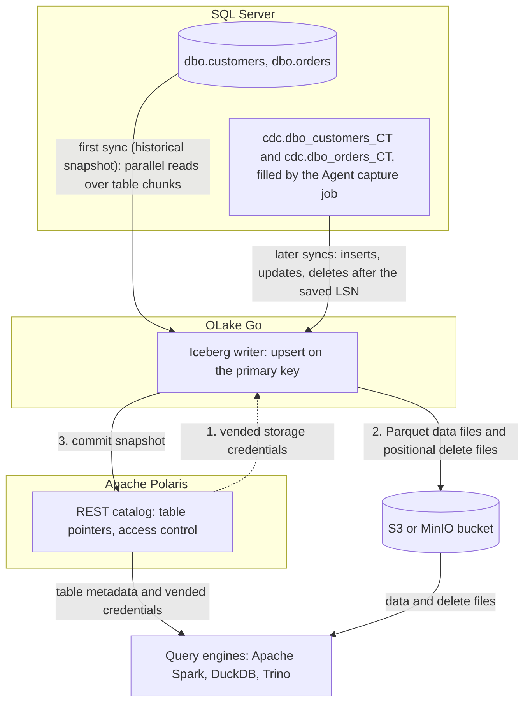

import * as I from '@site/src/components/integrations';

SQL Server to Apache Iceberg usually means Debezium through Kafka into an Iceberg sink connector, or a Spark job that re-reads whole tables over Java Database Connectivity (JDBC). This guide takes a shorter route. Change data capture (CDC), built into SQL Server, fills change tables from the transaction log, and OLake Go reads them and commits the rows as Iceberg tables into an Apache Polaris catalog.

Polaris is an open source Iceberg REST (Representational State Transfer) catalog you run yourself, with the files in your own bucket. Apache Spark, DuckDB and Trino all read the tables through that one endpoint. Nothing else is in the path: no Kafka, no Debezium, no cluster that runs all day.

<I.IntegrationByline />

<TLDR title='Key takeaways'>

- OLake Go replicates SQL Server into Iceberg tables in Polaris: a full historical snapshot first, then CDC from the change tables SQL Server already maintains, with no Kafka or Debezium in between.
- Updates land as Iceberg row-level deletes in a format every target engine reads, so each table holds one current row per primary key after every sync.
- Spark, DuckDB and Trino read the same tables through the same catalog, with no export and no second copy. In the run on this page all three returned identical rows.

</TLDR>

**The short answer.** To replicate SQL Server to Apache Iceberg with change data capture (CDC), enable CDC on the database and tables. Run OLake Go with a read-only login as the source and an Iceberg REST catalog such as Apache Polaris as the destination. The first sync copies each table in full; every later sync replays inserts, updates and deletes from the change tables. Spark, DuckDB and Trino query the result.

## How SQL Server CDC reaches Apache Iceberg here



Two things happen in order, and OLake Go does both on its own. The first sync records the current log sequence number (LSN), reads each table in parallel chunks and writes Parquet data files. Every later sync reads the change tables from the saved LSN and replays what changed since, so nothing written during the snapshot is lost.

Each sync ends with one commit to Polaris. OLake Go asks Polaris for short-lived storage credentials, uploads the data and delete files, then posts the new snapshot. Spark, DuckDB and Trino see it on their next query.

One thing to keep an eye on: the change tables are SQL Server's replay window, and the Agent is what fills them. The cleanup job drops change rows older than three days by default, so a job paused longer needs a fresh snapshot. A stopped Agent means no new change rows at all, with no error on the SQL Server side.

## What you need

- **SQL Server 2016 SP1 or later** on Developer, Standard or Enterprise edition, with CDC available and the SQL Server Agent running. The tables on this page ran on SQL Server 2022 Developer in Docker. Hosted SQL Server on Amazon Relational Database Service (RDS), Azure SQL Managed Instance or Cloud SQL works the same way; step 1 names each setup procedure.
- **An Apache Polaris server and a bucket**, both reachable from OLake Go and from the engines. The run on this page used Polaris 1.8.0 and MinIO in Docker; on AWS, use an S3 bucket and an IAM role instead.
- **At least one Iceberg reader.** The run on this page used Apache Spark 3.5.6 with Iceberg 1.10.0, DuckDB 1.5.5 and Trino 484.
- **OLake UI** from the [Docker Compose install](/docs/install/olake-ui/) with the OLake Go MSSQL source. The run on this page used v1.1.0.
- **Docker**, and about 40 minutes.

## Step 1: Prepare SQL Server for CDC

Most readers point OLake Go at tables they already have. If you want to follow along with the exact data from this page, create these two tables first:

<details>
<summary>The two sample tables used on this page</summary>

```sql title="Sample schema, database shop"
CREATE TABLE dbo.customers (
  id INT IDENTITY(1,1) PRIMARY KEY,
  name NVARCHAR(100), email NVARCHAR(200), city NVARCHAR(100), tier NVARCHAR(20),
  created_at DATETIME2 DEFAULT SYSUTCDATETIME(),
  updated_at DATETIME2 DEFAULT SYSUTCDATETIME());

CREATE TABLE dbo.orders (
  id INT IDENTITY(1,1) PRIMARY KEY,
  customer_id INT REFERENCES dbo.customers(id),
  product NVARCHAR(100), amount DECIMAL(10,2), status NVARCHAR(20),
  created_at DATETIME2 DEFAULT SYSUTCDATETIME(),
  updated_at DATETIME2 DEFAULT SYSUTCDATETIME());

-- Then insert whatever you like. This page started with 8 customers and 40 orders.
```

</details>

<I.Partial id="sources/mssql/prereqs" tables="customers, orders" />

## Step 2: Set up the Polaris catalog

An Iceberg table is a set of files plus a pointer to its current metadata, and the catalog holds that pointer. **Apache Polaris** is the catalog this page uses: OLake Go commits into it, and every reader asks it where the current snapshot is. The files sit in your own S3 or MinIO bucket; Polaris holds only the pointers and the permissions.

The [Polaris catalog page](/docs/integrations/catalogs/polaris/) lists which engines read it and how. Any Iceberg REST client with OAuth2 works, which covers Spark, DuckDB, Trino, ClickHouse, Flink and PyIceberg.

<I.CatalogStrip />

<I.CatalogTabs>
<TabItem value="polaris">

<I.Partial id="catalogs/polaris/setup" />

</TabItem>
</I.CatalogTabs>

## Step 3: Connect SQL Server to OLake Go

<I.Partial id="sources/mssql/connect">

Here is the source form from the run on this page. SQL Server ran in another container, so the host is `host.docker.internal`; the login is the one from step 1, with `VIEW DATABASE STATE` and `SELECT` on `dbo`, `cdc` and `msdb.dbo.cdc_jobs`.

<Figure src='/img/docs/integrations/sql-server-to-iceberg/olake-source-mssql-cdc.webp' alt='OLake UI Edit source form for MSSQL on OLake Go v1.1.0 with Enable CDC on, host host.docker.internal, port 1433, database shop, user olake and SSL disabled' caption='The SQL Server source in OLake UI: Enable CDC on, with the login from step 1.' width='760px' />

**Set up source** runs the connection test and the CDC checks before anything is saved: CDC on the database, a capture instance per table, a readable capture job. When one fails, the dialog names the setting and what to run.

</I.Partial>

## Step 4: Configure the Iceberg destination

<I.CatalogTabs>
<TabItem value="polaris">

<I.Partial id="catalogs/polaris/writer">

Here is the destination form from the run on this page. Polaris and MinIO ran in other containers, so both addresses use `host.docker.internal`; the credential is the `olake` principal from step 2.

<Figure src='/img/docs/integrations/sql-server-to-iceberg/olake-destination-polaris.webp' alt='OLake UI Edit destination form for Apache Iceberg with catalog type Polaris, OAuth2, REST catalog URI on port 8181, catalog name olake and the MinIO endpoint' caption='The Polaris destination in OLake UI: OAuth2 with the principal from step 2, and the MinIO endpoint for the files.' width='760px' />

</I.Partial>

</TabItem>
</I.CatalogTabs>

## Step 5: Create the job and run the first sync

<I.Partial id="jobs/create" engines="Apache Spark, DuckDB and Trino" upsert="Positional Deletes" updateType="pos" image="olakego/source-mssql:latest" namespace="dbo">

The target query engines on this job are Apache Spark, DuckDB and Trino. OLake Go offers only the delete formats all three read, which here is all three Iceberg formats. The run used **Positional Deletes** on Iceberg v2, readable by every current release of each engine. Leave `systranschemas` unticked; troubleshooting entry 2 explains why.

<Figure src='/img/docs/integrations/sql-server-to-iceberg/olake-streams-positional-deletes.webp' alt='OLake UI Streams Selection page with dbo customers and orders selected, systranschemas unticked, Full Refresh + CDC, Upsert and Positional Deletes on Iceberg V2' caption='Each stream: Full Refresh + CDC, Upsert, and Positional Deletes on Iceberg v2. The Iceberg DB name at the top is editable.' />

<Figure src='/img/docs/integrations/sql-server-to-iceberg/olake-job-history-two-syncs.webp' alt='OLake UI Job Logs and History for sql_server_to_iceberg showing two completed syncs, 44 seconds and then 24 seconds' caption='Job history: the 44 s historical snapshot, then the 24 s change-only sync.' />

</I.Partial>

On this page the first run copied 8 customers and 40 orders (48 records, 3.05 KB) and finished in **44 seconds**, container start included. OLake Go names the Iceberg namespace after the job, the source database and the schema, so `sql_server_to_iceberg` on database `shop` produced `sql_server_to_iceberg_shop_dbo`. The **Iceberg DB** field at the top of the Streams page changes it before the first sync.

## Step 6: Query the Iceberg tables

DuckDB is the quickest reader to try: one process, no server. It attaches the whole Polaris catalog and reads the tables in place.

<I.CatalogTabs>
<TabItem value="polaris">

<I.Partial id="engines/duckdb/query-polaris" schema="sql_server_to_iceberg_shop_dbo" />

<Figure src='/img/docs/integrations/sql-server-to-iceberg/duckdb-polaris-customers.webp' alt='DuckDB 1.5.5 querying polaris.sql_server_to_iceberg_shop_dbo.customers through the attached Polaris catalog and returning 10 rows' caption='DuckDB 1.5.5 reading the customers table through Polaris after the change sync: 10 rows, one per key.' />

</TabItem>
</I.CatalogTabs>

<I.Cta />

## Step 7: Change rows in SQL Server and sync again

To see the change path work, the run on this page made 12 changes in SQL Server after the first sync:

```sql title="Changes made in SQL Server between the two syncs"
INSERT INTO dbo.customers (name, email, city, tier) VALUES
  (N'Maya Patel', 'maya@example.com', N'Pune', 'silver'),
  (N'Lucas Silva', 'lucas@example.com', N'São Paulo', 'bronze');
INSERT INTO dbo.orders (customer_id, product, amount, status) VALUES
  (9, 'Laptop', 1299.00, 'placed'), (9, 'Mouse', 25.50, 'placed'),
  (10, 'Monitor', 349.99, 'placed'), (3, 'Keyboard', 89.00, 'placed'), (7, 'Webcam', 79.90, 'placed');
UPDATE dbo.customers SET tier = 'gold',       updated_at = SYSUTCDATETIME() WHERE name = N'Liam Carter';
UPDATE dbo.customers SET city = N'Abu Dhabi', updated_at = SYSUTCDATETIME() WHERE name = N'Zara Ali';
UPDATE dbo.orders    SET status = 'delivered', updated_at = SYSUTCDATETIME() WHERE id IN (1, 4, 7);
```

The second sync read **12 records (855 bytes)** from the change tables and finished in **24 seconds** end to end. For `orders` that meant one new data file with 8 rows: 5 inserts plus the new versions of 3 updated rows. One small positional delete file retires the 3 old versions by file and row position. OLake Go's commit report in the sync log shows it directly: `addedDataFiles=1`, `addedRecords=8`, `addedPositionalDeleteFiles=1`, `addedPositionalDeletes=3`, and no equality delete files.

<Figure src='/img/docs/integrations/sql-server-to-iceberg/olake-sync-log-positional-delete-commit.webp' alt='OLake UI sync log filtered to the Iceberg commit report for orders, showing addedDataFiles 1, addedPositionalDeleteFiles 1, addedRecords 8 and addedPositionalDeletes 3' caption='The change-only sync in the OLake UI log: one data file and one positional delete file for orders.' />

`customers` has the same shape with 4 rows and 2 deletes. Every reader shows the result on its next query: Liam Carter is `gold`, Zara Ali moved to Abu Dhabi, and the two new customers are there. The `_op_type` column shows how each row arrived: `r` for the snapshot, `c` for the inserts and `u` for the updates.

**Schema changes.** A column added in SQL Server is not part of the existing capture instance. Create a new capture instance for the table, or let OLake Go do it with **Manage Capture Instance** on the source. OLake Go then adds the column to the Iceberg table on the next sync; narrowing or incompatible type changes fail the sync rather than corrupt the table. Full rules are on the [schema evolution page](/docs/features/schema/).

## Query the same tables from Trino and Spark

This is the point of writing Iceberg. Nothing is exported, copied or refreshed: each engine reads the files OLake Go wrote, through the same Polaris endpoint.

<Tabs groupId="engine" queryString="engine">
<TabItem value="trino" label="Trino" default>

<I.Partial id="engines/trino/connect-polaris" schema="sql_server_to_iceberg_shop_dbo" />

<Figure src='/img/docs/integrations/sql-server-to-iceberg/trino-polaris-customers.webp' alt='Trino 484 CLI querying customers in the sql_server_to_iceberg_shop_dbo schema of the polaris catalog and returning 10 rows' caption='Trino 484 reading the same table through Polaris: the same 10 rows.' />

</TabItem>
<TabItem value="spark" label="Apache Spark">

<I.Partial id="engines/spark/connect-polaris" schema="sql_server_to_iceberg_shop_dbo" />

Spark 3.5.6 with Iceberg 1.10.0 returned the same 10 customers and 45 orders in the run on this page.

</TabItem>
</Tabs>

An `orders` roll-up matched SQL Server to the cent in all three engines: 45 orders for 25579.19 in total. By status it gave 16 delivered orders for 8659.68, 18 placed for 10522.26, 11 shipped for 6397.25.

## Data types: SQL Server to Apache Iceberg

OLake Go maps SQL Server types to Iceberg types itself; each engine then shows the Iceberg type in its own terms. Integers and strings pass through. Numbers with a scale and the date types are the groups to know about.

| SQL Server | Iceberg (written by OLake Go) | Notes |
| --- | --- | --- |
| `tinyint`, `smallint`, `int` | `int` | The `IDENTITY` keys on this page arrived as `int`. |
| `bigint` | `long` | |
| `decimal`, `numeric`, `money`, `smallmoney`, `float` | `double` | OLake Go stores decimals as doubles. The `orders.amount` sums on this page matched SQL Server to the cent in every engine; round at query time when you need exact decimal arithmetic. |
| `real` | `float` | |
| `bit` | `boolean` | |
| `date`, `smalldatetime`, `datetime`, `datetime2`, `datetimeoffset` | `timestamptz` (UTC) | `datetime2` has no zone in SQL Server; it is read as UTC. `datetimeoffset` is converted to UTC. |
| `char`, `varchar`, `nchar`, `nvarchar`, `text`, `ntext`, `uniqueidentifier`, `xml`, `json`, `sql_variant` | `string` | A `uniqueidentifier` arrives as its 36-character text form. |
| `binary`, `varbinary`, `image`, `rowversion`, `geometry`, `geography`, `hierarchyid` | `string` | Binary and spatial values arrive as text; keep large binaries out of the sync. |

SQL Server types in the table come from the [SQL Server connector reference](/docs/connectors/mssql/#data-type-mapping). OLake Go also adds `_cdc_start_lsn` and `_cdc_seqval` on SQL Server tables, the log position each change came from.

## Cost and maintenance

- **Storage** is your bucket: you pay S3 or MinIO rates for the Parquet and delete files, and nothing to Polaris for holding pointers.
- **Compute.** OLake Go runs wherever you run Docker, for the length of a sync; the change sync on this page took 24 seconds. Readers spend compute only when they query.
- **Maintenance.** Nothing compacts the tables for you. A CDC table that gets a new small file and delete file per sync wants compaction; [OLake Fusion](/docs/fusion/getting-started/overview/) does this for the catalogs OLake Go writes to, and Spark's `rewrite_data_files` works through the same Polaris endpoint.
- **Change table disk.** Every captured change is a row in the `cdc` schema until the cleanup job removes it. Shorten retention once the job runs reliably every hour.
- **Credential rotation.** Polaris principals do not expire by default. Rotate the `olake` principal's secret on your own schedule; a rotated secret fails the next sync at the token exchange, before any data moves.

## Troubleshooting

### 1. The source test fails on the capture job

```text
required CDC prerequisites not met: cdc_capture_job ... no SELECT on msdb.dbo.cdc_jobs
```

OLake Go reads the capture job definition from `msdb` to pick a safe start position. Create a user for the login in `msdb` and grant `SELECT ON dbo.cdc_jobs`, as in step 1.

### 2. The first sync fails on a table you did not create

```text
failed to run change stream: failed in pre cdc run for driver[mssql]: CDC is not enabled for stream dbo.systranschemas
```

Enabling CDC or replication on a database adds `dbo.systranschemas` to it, and discovery lists it next to your tables. It has no capture instance, so a job that selects every stream fails before the snapshot. Untick it on the Streams page, along with any other table without a capture instance.

### 3. Discovery fails right after SQL Server starts

```text
FATAL failed to connect to MSSQL: failed to ping database: EOF
```

The server accepted the connection before recovery finished. A fresh container needs until the log shows `Recovery is complete`; retry discovery then. On a long-running server, check that the port is the SQL Server listener and not a proxy that closes the connection.

### 4. A recreated job writes nothing on its first sync

```text
Table[<namespace>.customers]: stream index is already up to date at snapshot[...]
chunk min[1] and max[<nil>] already committed, skipping
```

A job deleted and created again with the same name writes into the same Iceberg namespace. OLake Go sees the chunks of the earlier snapshot as already committed and skips them, so the snapshot writes nothing. Drop the old tables from Polaris first, or give the new job a different **Iceberg DB** name.

### 5. The destination test fails at the token exchange

OLake Go's destination test exchanges the principal's credentials at `/api/catalog/v1/oauth/tokens` before anything else. Three causes cover nearly every failure: a wrong client id or secret, a principal with no role that carries `CATALOG_MANAGE_CONTENT` on the catalog, or a wrong `Polaris Catalog Name`. Run the token check from the catalog setup; it returns the same error Polaris gives OLake Go.

<details>
<summary>How this compares with other ways to move SQL Server data to Apache Iceberg</summary>

| Method | Freshness | Updates and deletes | Where the data lands | What you run |
| --- | --- | --- | --- | --- |
| [Debezium SQL Server connector](https://debezium.io/documentation/reference/stable/connectors/sqlserver.html), Kafka and the [Iceberg Kafka Connect sink](https://iceberg.apache.org/docs/latest/kafka-connect/) | Seconds to minutes | Yes, with the sink's upsert settings | Iceberg tables in your catalog | Kafka, Kafka Connect, the Debezium connector and the sink connector |
| Spark job over [JDBC](https://spark.apache.org/docs/latest/sql-data-sources-jdbc.html) | Hours to daily | Only with your own `MERGE` logic | Iceberg tables in your catalog | A Spark cluster, a scheduler and the merge code |
| Export (`bcp` or SSIS to files), then load with Spark | Hours to daily | No; full reloads only | Iceberg tables in your catalog | A script, a scheduler, a staging bucket and a Spark job |
| Managed ELT (Fivetran, Estuary, Airbyte Cloud) | Minutes, by plan | Varies by tool | Their managed destination, often a warehouse table | Nothing; priced per row, per GB or per connector |
| **OLake Go to Iceberg on Polaris (this guide)** | CDC on a schedule down to one minute | Yes, as Iceberg row-level deletes | Apache Iceberg tables in your bucket and your catalog | One Docker Compose stack, open source; your bucket plus your own compute |

Debezium through Kafka is the simpler choice when you already run Kafka and need seconds of latency. OLake Go is one container per sync with no broker in between, which matters when Kafka would exist only to carry this one pipeline.

</details>

## When not to use this

- **You need seconds of latency.** OLake Go syncs on a schedule, one minute at the shortest. Use a streaming pipeline for a continuous feed.
- **The edition has no CDC.** SQL Server Express and Web cannot enable change data capture. Full Refresh and Full Refresh + Incremental on an `updated_at` column still work there.
- **Tables have no primary key.** Inserts replicate; updates and deletes cannot be matched to a row and are not applied. Add a primary key or a unique index first.

## FAQs

<I.IntegrationFaq />

<I.HowWeTested />

## Related guides

<I.RelatedIntegrations />

Deeper reading on this site:

- [SQL Server connector reference](/docs/connectors/mssql/)
- [Apache Iceberg readers and delete formats](/docs/integrations/iceberg/)
- [SQL Server to ClickHouse on the same catalog](/docs/integrations/sql-server-to-clickhouse/)
- [Equality vs positional deletes vs deletion vectors](/blog/iceberg-delete-formats-cdc-equality-vs-positional-vs-deletion-vectors/)
- [OLake Go ingestion benchmarks](/docs/benchmarks/ingestion/)

<I.IntegrationJsonLd />

<I.Cta title='Start with your own SQL Server' body='The quickstart runs OLake UI with Docker Compose. Create the source, the Polaris destination and the job as above, and the first sync lands your tables as Iceberg in your own bucket.' />
