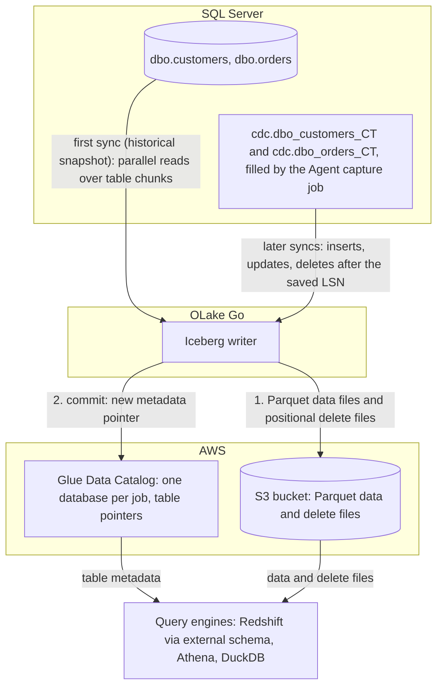

import * as I from '@site/src/components/integrations';

SQL Server to Redshift usually means an AWS Database Migration Service (DMS) task, a Kafka pipeline, or a nightly `bcp` export and `COPY`. This guide takes a different route. SQL Server's own change data capture (CDC) feature fills change tables from the transaction log. OLake Go reads them and commits the rows as Apache Iceberg tables into the AWS Glue Data Catalog, with the files in your own S3 bucket.

Redshift maps the Glue database onto an external schema and queries the tables in place. Nothing else is in the path: no DMS, no Kafka, no load job. Athena and DuckDB read the same tables through the same catalog.

<I.IntegrationByline />

<TLDR title='Key takeaways'>

- OLake Go replicates SQL Server into Iceberg tables in the Glue Data Catalog: a full historical snapshot first, then CDC from the change tables SQL Server already maintains, with no DMS or Kafka in between.
- Redshift reads the Glue database through one `CREATE EXTERNAL SCHEMA` statement, with no refresh. Every change a sync commits is visible on the next query, on Serverless and RA3 alike.
- The same tables, written once by OLake Go, are also queryable from Athena and DuckDB. In the run on this page all three engines returned identical rows.

</TLDR>

**The short answer.** To replicate SQL Server to Redshift with change data capture (CDC), enable CDC on the database and tables. Run OLake Go with a read-only login as the source and the AWS Glue Data Catalog as the Iceberg destination, with Positional Deletes as the upsert type, the format Redshift reads. The first sync copies each table in full (the historical snapshot); every later sync replays inserts, updates and deletes from the change tables. Redshift, Athena and DuckDB then query the same Iceberg tables, with no second copy.

## How SQL Server CDC reaches Redshift here



Two things happen in order, and OLake Go does both on its own. The first sync records the current log sequence number (LSN). Then it reads each table in parallel chunks and writes Parquet data files: that is the historical load. Every later sync reads the change tables from the saved LSN and replays the inserts, updates and deletes since.

Each sync ends with one commit to Glue. OLake Go uploads the data and delete files to the bucket, then updates the table's metadata pointer in the Glue database. Redshift, Athena and DuckDB see the new snapshot on their next query; none of them keeps a copy.

One thing to keep an eye on: the change tables are SQL Server's replay window, and the Agent is what fills them. The cleanup job drops change rows older than three days by default, so a job paused longer than that needs a fresh snapshot. A stopped Agent means no new change rows at all, with no error on the SQL Server side.

## What you need

- **SQL Server 2016 SP1 or later** on Developer, Standard or Enterprise edition, with CDC available and the SQL Server Agent running. The tables on this page ran on SQL Server 2022 Developer in Docker. Amazon RDS for SQL Server works the same way; step 1 names its setup procedure.
- **An AWS account** with an S3 bucket for the files and an IAM user or role for OLake Go with Glue and S3 permissions. The run on this page used a bucket and a scoped IAM user in `ap-southeast-1`.
- **Amazon Redshift**, Serverless or an RA3 cluster, with an IAM role attached that can read Glue and the bucket. The run on this page used a Serverless workgroup at 8 RPU.
- **OLake UI** from the [Docker Compose install](/docs/install/olake-ui/) with the OLake Go MSSQL source. The run on this page used v1.1.0.
- **Docker**, and about 40 minutes.

## Step 1: Prepare SQL Server for CDC

Most readers point OLake Go at tables they already have. If you want to follow along with the exact data from this page, create these two tables first:

<details>
<summary>The two sample tables used on this page</summary>

```sql title="Sample schema, database shop"
CREATE TABLE dbo.customers (
  id INT IDENTITY(1,1) PRIMARY KEY,
  name NVARCHAR(100), email NVARCHAR(200), city NVARCHAR(100), tier NVARCHAR(20),
  created_at DATETIME2 DEFAULT SYSUTCDATETIME(),
  updated_at DATETIME2 DEFAULT SYSUTCDATETIME());

CREATE TABLE dbo.orders (
  id INT IDENTITY(1,1) PRIMARY KEY,
  customer_id INT REFERENCES dbo.customers(id),
  product NVARCHAR(100), amount DECIMAL(10,2), status NVARCHAR(20),
  created_at DATETIME2 DEFAULT SYSUTCDATETIME(),
  updated_at DATETIME2 DEFAULT SYSUTCDATETIME());

-- Then insert whatever you like. This page started with 8 customers and 40 orders.
```

</details>

<I.Partial id="sources/mssql/prereqs" tables="customers, orders" />

## Step 2: Set up the Glue catalog

Redshift reads Iceberg tables through a catalog. **AWS Glue Data Catalog** is the one this page uses: OLake Go creates a Glue database per job and registers each table there. The files sit in your S3 bucket. Redshift, Athena, Amazon Elastic MapReduce (EMR) and DuckDB all read from the same catalog. Redshift reaches it through an external schema, with the IAM role attached to the workgroup or cluster.

<I.CatalogStrip />

<I.CatalogTabs>
<TabItem value="glue">

<I.Partial id="catalogs/glue/setup" />

The run on this page gave OLake Go a scoped IAM user with this inline policy. Redshift got a role with `AmazonS3ReadOnlyAccess` and read access to Glue:

```json title="IAM policy for the OLake Go user (replace the bucket, region and account)"
{
  "Version": "2012-10-17",
  "Statement": [
    { "Effect": "Allow", "Action": ["s3:ListBucket", "s3:GetBucketLocation"], "Resource": "arn:aws:s3:::<bucket>" },
    { "Effect": "Allow", "Action": ["s3:GetObject", "s3:PutObject", "s3:DeleteObject", "s3:AbortMultipartUpload", "s3:ListMultipartUploadParts"], "Resource": "arn:aws:s3:::<bucket>/*" },
    { "Effect": "Allow",
      "Action": ["glue:GetDatabase", "glue:GetDatabases", "glue:CreateDatabase", "glue:GetTable", "glue:GetTables", "glue:CreateTable", "glue:UpdateTable", "glue:DeleteTable"],
      "Resource": ["arn:aws:glue:<region>:<account>:catalog", "arn:aws:glue:<region>:<account>:database/*", "arn:aws:glue:<region>:<account>:table/*/*"] }
  ]
}
```

</TabItem>
</I.CatalogTabs>

## Step 3: Connect SQL Server to OLake Go

<I.Partial id="sources/mssql/connect">

Here is the source form from the run on this page. SQL Server ran in another container, so the host is `host.docker.internal`; the login is the one from step 1, with `VIEW DATABASE STATE` and `SELECT` on `dbo`, `cdc` and `msdb.dbo.cdc_jobs`.

<Figure src='/img/docs/integrations/sql-server-to-redshift/olake-source-mssql-cdc.webp' alt='OLake UI Edit source form for MSSQL on OLake Go v1.1.0 with Enable CDC on, host host.docker.internal, port 1433, database shop, user olake and SSL disabled' caption='The SQL Server source in OLake UI: Enable CDC on, with the login from step 1.' width='760px' />

**Set up source** runs the connection test and the CDC checks before anything is saved: CDC on the database, a capture instance per table, a readable capture job. When one fails, the dialog names the setting and what to run.

</I.Partial>

## Step 4: Configure the Iceberg destination

<I.CatalogTabs>
<TabItem value="glue">

<I.Partial id="catalogs/glue/writer" />

Here is the destination form from the run on this page. It holds the bucket path OLake Go writes under, the region of the bucket and the Glue catalog, and the access key pair of the IAM user from step 2.

<Figure src='/img/docs/integrations/sql-server-to-redshift/olake-destination-glue.webp' alt='OLake UI Edit destination form for Apache Iceberg with catalog type AWS Glue, an S3 path under the lab bucket, region ap-southeast-1 and an access key pair' caption='The Glue destination in OLake UI: the S3 path, the region and the keys of the scoped IAM user.' width='760px' />

</TabItem>
</I.CatalogTabs>

## Step 5: Create the job and run the first sync

Redshift is not in OLake Go's target engine picker yet. This job therefore lists **Athena** and **DuckDB** as target engines, with **Positional Deletes** as the upsert type. That is the format Redshift reads, and both listed engines read it too.

<I.Partial id="jobs/create" engines="AWS Athena and DuckDB (Redshift is not in the list yet; it reads what Athena reads)" upsert="Positional Deletes" updateType="pos" image="olakego/source-mssql:latest" namespace="dbo">

Leave `systranschemas` unticked; troubleshooting entry 2 explains why.

<Figure src='/img/docs/integrations/sql-server-to-redshift/olake-streams-positional-deletes.webp' alt='OLake UI Streams Selection page with the dbo schema, customers and orders selected and systranschemas unticked, sync mode Full Refresh + CDC, ingestion mode Upsert and upsert type Positional Deletes on Iceberg format version V2' caption='Each stream: Full Refresh + CDC, Upsert, and Positional Deletes as the upsert type. The Iceberg DB name at the top is editable.' />

<Figure src='/img/docs/integrations/sql-server-to-redshift/olake-job-history-two-syncs.webp' alt='OLake UI Job Logs and History for sql_server_to_redshift showing two completed syncs, the first in 18 seconds and the second in 13 seconds' caption='Job history: the 18 s historical snapshot, then the 13 s change-only sync.' />

</I.Partial>

On this page the first run copied 8 customers and 40 orders (48 records, 3.05 KB) and finished in **18 seconds**, container start included. OLake Go names the Glue database after the job, the source database and the schema, so `sql_server_to_redshift` on database `shop` produced `sql_server_to_redshift_shop_dbo`. The **Iceberg DB** field at the top of the Streams page changes it before the first sync.

## Step 6: Query the tables in Redshift

<I.CatalogTabs>
<TabItem value="glue">

<I.Partial id="engines/redshift/query-glue" schema="sql_server_to_redshift_shop_dbo" />

<Figure src='/img/docs/integrations/sql-server-to-redshift/redshift-glue-customers.webp' alt='Redshift query editor v2 in the AWS console running the customers query on the Serverless workgroup and returning 10 rows with id, name, city and tier' caption='Redshift Serverless reading the customers table through the external schema after the change sync in query editor v2: 10 rows, one per key.' />

</TabItem>
</I.CatalogTabs>

<I.Cta />

## Step 7: Change rows in SQL Server and sync again

To see the change path work, the run on this page made 12 changes in SQL Server after the first sync:

```sql title="Changes made in SQL Server between the two syncs"
INSERT INTO dbo.customers (name, email, city, tier) VALUES
  (N'Maya Patel', 'maya@example.com', N'Pune', 'silver'),
  (N'Lucas Silva', 'lucas@example.com', N'São Paulo', 'bronze');
INSERT INTO dbo.orders (customer_id, product, amount, status) VALUES
  (9, 'Laptop', 1299.00, 'placed'), (9, 'Mouse', 25.50, 'placed'),
  (10, 'Monitor', 349.99, 'placed'), (3, 'Keyboard', 89.00, 'placed'), (7, 'Webcam', 79.90, 'placed');
UPDATE dbo.customers SET tier = 'gold',       updated_at = SYSUTCDATETIME() WHERE name = N'Liam Carter';
UPDATE dbo.customers SET city = N'Abu Dhabi', updated_at = SYSUTCDATETIME() WHERE name = N'Zara Ali';
UPDATE dbo.orders    SET status = 'delivered', updated_at = SYSUTCDATETIME() WHERE id IN (1, 4, 7);
```

The second sync read **12 records (855 bytes)** from the change tables and finished in **13 seconds** end to end. For `customers` that meant one new data file with 4 rows: 2 inserts plus the new versions of 2 updated rows. One small positional delete file retires the 2 old versions. The commit report in the sync log shows `addedDataFiles=1`, `addedRecords=4`, `addedPositionalDeleteFiles=1`, `addedPositionalDeletes=2`, and `orders` the same shape with 8 rows and 3 deletes.

<Figure src='/img/docs/integrations/sql-server-to-redshift/olake-sync-log-positional-delete-commit.webp' alt='OLake UI sync log filtered to the Iceberg commit reports for customers and orders, showing addedDataFiles 1, addedPositionalDeleteFiles 1, addedRecords 4 and 8, and addedPositionalDeletes 2 and 3' caption='The change-only sync in the OLake UI log: one data file and one positional delete file per table.' />

Redshift shows the result on the next query, with no refresh and no `ALTER TABLE`. Liam Carter is `gold`, Zara Ali moved to Abu Dhabi, and the two new customers are there. The `_op_type` column shows how each row arrived: `r` for the 6 untouched snapshot rows, `c` for the 2 inserts and `u` for the 2 updates. The Agent capture job runs every few seconds, so a change made right before a sync starts can land in the next one instead.

**Schema changes.** A column added in SQL Server is not part of the existing capture instance. Create a new capture instance for the table, or let OLake Go do it with **Manage Capture Instance** on the source. OLake Go then adds the column to the Iceberg table and its Glue definition on the next sync, and Redshift shows it on the next query. Full rules are on the [schema evolution page](/docs/features/schema/).

## Query the same tables from Athena and DuckDB

Nothing is exported, copied or refreshed: both engines read the files OLake Go wrote, through the same Glue database.

<Tabs groupId="engine" queryString="engine">
<TabItem value="athena" label="Amazon Athena" default>

<I.Partial id="engines/athena/connect-glue" schema="sql_server_to_redshift_shop_dbo" />

<Figure src='/img/docs/integrations/sql-server-to-redshift/athena-glue-customers.webp' alt='Athena query editor in the AWS console showing the customers query on sql_server_to_redshift_shop_dbo.customers completed with 10 rows' caption='Athena reading the same table through Glue: the same 10 rows.' />

</TabItem>
<TabItem value="duckdb" label="DuckDB">

<I.Partial id="engines/duckdb/connect-glue" schema="sql_server_to_redshift_shop_dbo" />

DuckDB 1.5.5 returned the same 10 customers and the same `orders` roll-up as Redshift and Athena in the run on this page. It read the current metadata file of each table.

</TabItem>
</Tabs>

An `orders` roll-up matched SQL Server to the cent in all three engines. It gave 16 delivered orders for 8659.68, 18 placed for 10522.26, 11 shipped for 6397.25.

## Data types: SQL Server to Iceberg to Redshift

OLake Go maps SQL Server types to Iceberg types, and Redshift maps Iceberg types to its own through the external schema. Integers and strings pass through; numbers with a scale and the date types are the groups to know about.

| SQL Server | Iceberg (written by OLake Go) | Redshift shows | Notes |
| --- | --- | --- | --- |
| `tinyint`, `smallint`, `int` | `int` | `INTEGER` | The `IDENTITY` keys on this page arrived as `INTEGER`. |
| `bigint` | `long` | `BIGINT` | |
| `decimal`, `numeric`, `money`, `smallmoney`, `float` | `double` | `DOUBLE PRECISION` | OLake Go stores decimals as doubles. The `orders.amount` sums on this page matched SQL Server to the cent in every engine; round at query time when you need exact decimal arithmetic. |
| `real` | `float` | `REAL` | |
| `bit` | `boolean` | `BOOLEAN` | |
| `date`, `smalldatetime`, `datetime`, `datetime2`, `datetimeoffset` | `timestamptz` (UTC) | `TIMESTAMP` | `datetime2` has no zone in SQL Server; it is read as UTC and shown without a zone. |
| `char`, `varchar`, `nchar`, `nvarchar`, `text`, `ntext`, `uniqueidentifier`, `xml`, `json`, `sql_variant` | `string` | `VARCHAR` | A `uniqueidentifier` arrives as its 36-character text form. |
| `binary`, `varbinary`, `image`, `rowversion`, `geometry`, `geography`, `hierarchyid` | `string` | `VARCHAR` | Binary and spatial values arrive as text; keep large binaries out of the sync. |

SQL Server types in the table come from the [SQL Server connector reference](/docs/connectors/mssql/#data-type-mapping). The Redshift side comes from the [Redshift Iceberg page](https://docs.aws.amazon.com/redshift/latest/dg/querying-iceberg.html) (checked 2026-10-30) and from `svv_external_columns` on the tables of this run. OLake Go adds `_cdc_start_lsn` and `_cdc_seqval` on SQL Server tables, the log position each change came from.

## Cost and maintenance

- **Storage** is your bucket: you pay S3 rates for the Parquet and delete files, and nothing to Glue beyond its per-object pricing for the table entries.
- **Compute.** OLake Go runs wherever you run Docker. Redshift Serverless bills RPU-hours only while queries run; a query over the external schema scans the Parquet files in S3 through Redshift Spectrum, so filter on the columns you need. Athena bills per terabyte scanned.
- **Maintenance.** Glue has no built-in compaction for tables written by external engines. A CDC table that gets a new small file and delete file per sync wants compaction; [OLake Fusion](/docs/fusion/getting-started/overview/) does this for the catalogs OLake Go writes to, and Spark on EMR's `rewrite_data_files` works through the same Glue catalog.
- **Change table disk.** Every captured change is a row in the `cdc` schema until the cleanup job removes it. On a busy table three days of changes is real space in the database; shorten retention once the job runs reliably every hour.
- **Key rotation.** The IAM user's access key is what OLake Go writes with. Rotate it on your schedule, or run OLake Go on an instance with a role and leave the key fields empty.

## Troubleshooting

### 1. The source test fails on the capture job

```text
required CDC prerequisites not met: cdc_capture_job ... no SELECT on msdb.dbo.cdc_jobs
```

OLake Go reads the capture job definition from `msdb` to pick a safe start position. Create a user for the login in `msdb` and grant `SELECT ON dbo.cdc_jobs`, as in step 1.

### 2. The first sync fails on a table you did not create

```text
failed to run change stream: failed in pre cdc run for driver[mssql]: CDC is not enabled for stream dbo.systranschemas
```

Enabling CDC or replication on a database adds `dbo.systranschemas` to it, and discovery lists it next to your tables. It has no capture instance, so a job that selects every stream fails before the snapshot. Untick it on the Streams page, along with any other table without a capture instance.

### 3. The source test passes but no changes arrive

Two causes. The common one is timing: the capture job copies log records into the change tables every few seconds, so a sync started right after a write can read nothing and the next sync picks the rows up. The other cause is that the SQL Server Agent is not running, so the change tables never fill. `EXEC master.dbo.xp_servicecontrol 'QueryState', 'SQLServerAgent'` reports `Running.` when it is up.

### 4. The destination test fails on a table OLake Go did not create

```text
User: arn:aws:iam::<account>:user/<olake user> is not authorized to perform: s3:GetObject on resource: "arn:aws:s3:::<another bucket>/.../test_olake.db/test_olake/metadata/00000-....metadata.json"
```

OLake Go's destination test opens a probe table called `test_olake.test_olake` in the Glue database `test_olake`. An earlier run in the same account and region may have left that table behind, pointing at a bucket your user cannot read. Delete the stale table from Glue, or run OLake Go against a region whose Glue catalog does not have it.

### 5. Redshift cannot see the external schema's tables

```text
ERROR: Database 'sql_server_to_redshift_shop_dbo' does not exist in the Glue Data Catalog
```

The external schema was created before the first sync, or in a different region from the Glue database. OLake Go creates the Glue database on the first sync; create the external schema after it, in the workgroup's region.

<details>
<summary>How this compares with other ways to move SQL Server data to Redshift</summary>

| Method | Freshness | Updates and deletes | Where the data lands | What you run |
| --- | --- | --- | --- | --- |
| [AWS DMS to Redshift](https://docs.aws.amazon.com/dms/latest/userguide/CHAP_Target.Redshift.html) | CDC from SQL Server's log or its CDC tables | Yes | Native Redshift tables | A DMS replication instance and task, plus an S3 staging bucket |
| Debezium, Kafka and the Redshift sink connector | Seconds | Yes, with the sink's upsert settings | Kafka topics, then Redshift tables | Kafka, Kafka Connect, the Debezium SQL Server connector and a sink |
| Export (`bcp` to CSV), then `COPY` into Redshift | Hours to daily | No; full reloads only | Native Redshift tables | A script, a scheduler and a staging bucket |
| **OLake Go to Iceberg on Glue (this guide)** | CDC on a schedule down to one minute | Yes, as Iceberg row-level deletes | Apache Iceberg tables that Redshift, Athena, EMR, Spark and DuckDB all read | One Docker Compose stack, open source; your bucket plus your own compute |

DMS is the simpler choice when native Redshift tables are the only goal and you are already on AWS. Writing Iceberg once avoids paying to move and store a second copy. That matters as soon as Athena, EMR or a notebook needs the same rows, or you want to own the files.

</details>

## When not to use this

- **Every query must hit native Redshift speed.** Spectrum reads Parquet from S3 on every query. Keep the Iceberg tables as the source and load the hot slice into a native table on a schedule.
- **The edition has no CDC.** SQL Server Express and Web cannot enable change data capture. Full Refresh and Full Refresh + Incremental on an `updated_at` column still work there.
- **Tables have no primary key.** Inserts replicate; updates and deletes cannot be matched to a row and are not applied. Add a primary key or a unique index first.

## FAQs

<I.IntegrationFaq />

<I.HowWeTested />

## Related guides

<I.RelatedIntegrations />

Deeper reading on this site:

- [SQL Server connector reference](/docs/connectors/mssql/)
- [Equality vs positional deletes vs deletion vectors](/blog/iceberg-delete-formats-cdc-equality-vs-positional-vs-deletion-vectors/)
- [Which engines read which delete formats](/blog/iceberg-delete-formats-interoperability-olake-go/)
- [OLake Go ingestion benchmarks](/docs/benchmarks/ingestion/)

<I.IntegrationJsonLd />

<I.Cta title='Start with your own SQL Server' body='The quickstart runs OLake UI with Docker Compose. Create the source, the Glue destination and the job as above, and the first sync lands your tables where Redshift can read them.' />
