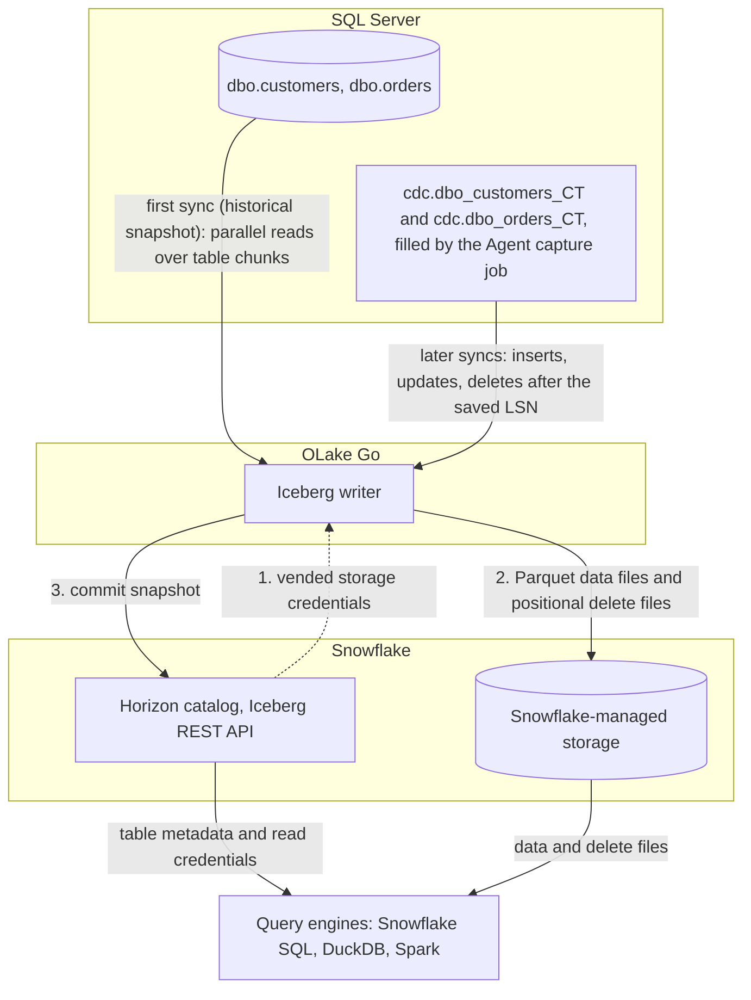

import * as I from '@site/src/components/integrations';

SQL Server to Snowflake comes down to one choice. Copy the rows into tables Snowflake owns, or write them once as Apache Iceberg tables that Snowflake and every other engine can read. This guide does the second.

SQL Server's own change data capture (CDC) feature fills change tables from the transaction log. OLake Go reads those change tables and commits the rows as Iceberg tables into a catalog Snowflake reads. With Snowflake's own Horizon catalog, the default on this page, the files sit on Snowflake-managed storage. Nothing else is in the path: no Openflow, no Kafka, no Debezium. With AWS Glue, the files sit in your S3 bucket and Snowflake reads them through a catalog integration.

<I.IntegrationByline />

<TLDR title='Key takeaways'>

- OLake Go replicates SQL Server into Snowflake as Iceberg tables: a full historical snapshot first, then CDC from the change tables SQL Server already maintains, with no Kafka or Debezium in between.
- Through the Horizon catalog the tables land as Snowflake-managed Iceberg tables. You query them in Snowsight right away, with no `CREATE ICEBERG TABLE`, no external volume and no refresh.
- The same tables, written once by OLake Go, are also queryable from DuckDB and Spark through the same catalog. In the run on this page all three engines returned identical rows.

</TLDR>

**The short answer.** To replicate SQL Server to Snowflake with change data capture (CDC), enable CDC on the database and tables. Run OLake Go with a read-only login as the source and the Snowflake Horizon catalog as the Iceberg destination. The first sync copies each table in full (the historical snapshot); every later sync replays inserts, updates and deletes from the change tables. Snowflake, DuckDB and Spark then query the same Iceberg tables, with no second copy.

## How SQL Server CDC reaches Snowflake here



Two things happen in order, and OLake Go does both on its own. The first sync records the current log sequence number (LSN). Then it reads each table in parallel chunks and writes Parquet data files: that is the historical load. Every later sync reads the change tables from the saved LSN and replays the inserts, updates and deletes since. Nothing written during the snapshot is lost, and there is no separate backfill job.

Each sync ends with one commit to Horizon. OLake Go asks Horizon for short-lived storage credentials, uploads the data and delete files, then posts the new snapshot to the catalog. Snowflake sees it the moment the commit lands; DuckDB and Spark see it on their next catalog load.

One thing to keep an eye on: the change tables are SQL Server's replay window, and the Agent is what fills them. The cleanup job drops change rows older than three days by default, so a job paused longer than that needs a fresh snapshot. A stopped Agent means no new change rows at all, with no error on the SQL Server side.

## What you need

- **SQL Server 2016 SP1 or later** on Developer, Standard or Enterprise edition, with CDC available and the SQL Server Agent running. The tables on this page ran on SQL Server 2022 Developer in Docker. Hosted SQL Server on Amazon Relational Database Service (RDS), Azure SQL Managed Instance or Cloud SQL works the same way; step 1 names each setup procedure.
- **A Snowflake account** where you can run the one-time setup as `ACCOUNTADMIN`. Snowflake-managed storage means no cloud bucket or IAM role on your side.
- **OLake UI** from the [Docker Compose install](/docs/install/olake-ui/) with the OLake Go MSSQL source. The run on this page used v1.1.0.
- **Docker**, and about 30 minutes.

## Step 1: Prepare SQL Server for CDC

Most readers point OLake Go at tables they already have. If you want to follow along with the exact data from this page, create these two tables first:

<details>
<summary>The two sample tables used on this page</summary>

```sql title="Sample schema, database shop"
CREATE TABLE dbo.customers (
  id INT IDENTITY(1,1) PRIMARY KEY,
  name NVARCHAR(100), email NVARCHAR(200), city NVARCHAR(100), tier NVARCHAR(20),
  created_at DATETIME2 DEFAULT SYSUTCDATETIME(),
  updated_at DATETIME2 DEFAULT SYSUTCDATETIME());

CREATE TABLE dbo.orders (
  id INT IDENTITY(1,1) PRIMARY KEY,
  customer_id INT REFERENCES dbo.customers(id),
  product NVARCHAR(100), amount DECIMAL(10,2), status NVARCHAR(20),
  created_at DATETIME2 DEFAULT SYSUTCDATETIME(),
  updated_at DATETIME2 DEFAULT SYSUTCDATETIME());

-- Then insert whatever you like. This page started with 8 customers and 40 orders.
```

</details>

<I.Partial id="sources/mssql/prereqs" tables="customers, orders" />

## Step 2: Set up the catalog in Snowflake

Snowflake reads Iceberg tables from two kinds of catalog. **Horizon** is Snowflake's own: OLake Go writes straight into it, the tables are Snowflake-managed, and they appear in Snowsight the moment a sync commits. **AWS Glue** is a catalog outside Snowflake, so the files stay in your S3 bucket. Snowflake reaches them through a *catalog integration*: a read-only link to that external catalog, refreshed after each sync.

Horizon is the default on this page. Glue is the right pick when Athena, Redshift or Spark on Amazon Elastic MapReduce (EMR) will read the same tables and you want the files in your own bucket.

<I.CatalogStrip />

<I.CatalogTabs>
<TabItem value="horizon">

<I.Partial id="catalogs/horizon/setup" />

</TabItem>
<TabItem value="glue">

<I.Partial id="catalogs/glue/setup" />

</TabItem>
</I.CatalogTabs>

## Step 3: Connect SQL Server to OLake Go

<I.Partial id="sources/mssql/connect">

Here is the source form from the run on this page. SQL Server ran in another container, so the host is `host.docker.internal`; the login is the one from step 1, with `VIEW DATABASE STATE` and `SELECT` on `dbo` and `cdc`.

<Figure src='/img/docs/integrations/sql-server-to-snowflake/olake-source-mssql-cdc.webp' alt='OLake UI Edit source form for MSSQL on OLake Go v1.1.0 with Enable CDC on, host host.docker.internal, port 1433, database shop, user olake and SSL disabled' caption='The SQL Server source in OLake UI: Enable CDC on, with the login from step 1.' width='760px' />

**Set up source** runs the connection test and the CDC checks before anything is saved: CDC on the database, a capture instance per table, a readable capture job. When one fails, the dialog names the setting and what to run.

</I.Partial>

## Step 4: Configure the Iceberg destination

<I.CatalogTabs>
<TabItem value="horizon">

<I.Partial id="catalogs/horizon/writer" />

</TabItem>
<TabItem value="glue">

<I.Partial id="catalogs/glue/writer" />

</TabItem>
</I.CatalogTabs>

## Step 5: Create the job and run the first sync

<I.Partial id="jobs/create" engines="Snowflake, plus DuckDB and Apache Spark if they will read the tables too" upsert="Positional Deletes" updateType="pos" image="olakego/source-mssql:latest" namespace="dbo">

Three target query engines were set on this job. That is the only format decision you make: OLake Go works out which Iceberg delete format all three can read and sets it on every stream.

<Figure src='/img/docs/integrations/sql-server-to-snowflake/olake-streams-positional-deletes.webp' alt='OLake UI Streams Selection page with the dbo schema, customers and orders selected, sync mode Full Refresh + CDC, ingestion mode Upsert and upsert type Positional Deletes on Iceberg format version V2' caption='Each stream: Full Refresh + CDC, Upsert, and the upsert type OLake Go resolved (Positional Deletes in this run). The Iceberg DB name at the top is editable.' />

<Figure src='/img/docs/integrations/sql-server-to-snowflake/olake-job-history-two-syncs.webp' alt='OLake UI Job Logs and History for sql_server_to_snowflake showing two completed syncs, the first in 37 seconds and the second in 18 seconds' caption='Job history: the 37 s historical snapshot, then the 18 s change-only sync.' />

</I.Partial>

On this page the first run copied 8 customers and 40 orders (48 records, 3.05 KB) and finished in **37 seconds**, container start included. OLake Go names the destination schema after the job, the source database and the schema, so `sql_server_to_snowflake` on database `shop` produced `sql_server_to_snowflake_shop_dbo`. The **Iceberg DB** field at the top of the Streams page changes it before the first sync.

## Step 6: Query the tables in Snowflake

<I.CatalogTabs>
<TabItem value="horizon">

<I.Partial id="engines/snowflake/query-horizon" schema="sql_server_to_snowflake_shop_dbo" />

<Figure src='/img/docs/integrations/sql-server-to-snowflake/snowsight-customers-query.webp' alt='Snowsight query on OLAKE_DEMO.sql_server_to_snowflake_shop_dbo.customers returning 10 rows with id, name, city and tier' caption='The customers table in Snowsight after the change sync: 10 rows on an X-Small warehouse.' />

</TabItem>
<TabItem value="glue">

<I.Partial id="engines/snowflake/query-glue" schema="sql_server_to_snowflake_shop_dbo" />

</TabItem>
</I.CatalogTabs>

<I.Cta />

## Step 7: Change rows in SQL Server and sync again

To see the change path work, the run on this page made 12 changes in SQL Server after the first sync:

```sql title="Changes made in SQL Server between the two syncs"
INSERT INTO dbo.customers (name, email, city, tier) VALUES
  (N'Maya Patel', 'maya@example.com', N'Pune', 'silver'),
  (N'Lucas Silva', 'lucas@example.com', N'São Paulo', 'bronze');
INSERT INTO dbo.orders (customer_id, product, amount, status) VALUES
  (9, 'Laptop', 1299.00, 'placed'), (9, 'Mouse', 25.50, 'placed'),
  (10, 'Monitor', 349.99, 'placed'), (3, 'Keyboard', 89.00, 'placed'), (7, 'Webcam', 79.90, 'placed');
UPDATE dbo.customers SET tier = 'gold',       updated_at = SYSUTCDATETIME() WHERE name = N'Liam Carter';
UPDATE dbo.customers SET city = N'Abu Dhabi', updated_at = SYSUTCDATETIME() WHERE name = N'Zara Ali';
UPDATE dbo.orders    SET status = 'delivered', updated_at = SYSUTCDATETIME() WHERE id IN (1, 4, 7);
```

The second sync read **12 records (855 bytes)** from the change tables and finished in **18 seconds** end to end. For `customers` that meant one new data file with 4 rows: 2 inserts plus the new versions of 2 updated rows. One small delete file retires the 2 old versions. OLake Go's commit report in the sync log shows it directly: `addedDataFiles=1`, `addedRecords=4`, `addedPositionalDeleteFiles=1`, `addedPositionalDeletes=2`, and `orders` the same shape with 8 rows and 3 deletes.

<Figure src='/img/docs/integrations/sql-server-to-snowflake/olake-sync-log-positional-delete-commit.webp' alt='OLake UI sync log filtered to the Iceberg commit report, showing addedDataFiles 1, addedPositionalDeleteFiles 1, addedRecords and addedPositionalDeletes for the change-only sync' caption='The change-only sync in the OLake UI log: one data file and one positional delete file per table.' />

Snowflake shows the result with no refresh. Liam Carter is `gold`, Zara Ali moved to Abu Dhabi, and the two new customers are there. The `_op_type` column shows how each row arrived: `r` for the snapshot, `c` for the inserts and `u` for the updates. The Agent capture job runs every few seconds, so a change made right before a sync starts can land in the next one instead.

**Schema changes.** A column added in SQL Server is not part of the existing capture instance. Create a new capture instance for the table, or let OLake Go do it with **Manage Capture Instance** on the source. OLake Go then adds the column to the Iceberg table on the next sync, and Snowflake shows it. Widening changes are applied; narrowing or incompatible type changes fail the sync rather than corrupt the table. Full rules are on the [schema evolution page](/docs/features/schema/).

## Query the same tables from DuckDB and Spark

This is the point of writing Iceberg instead of loading Snowflake tables. Nothing is exported, copied or refreshed: both engines read the files OLake Go wrote, through the same Horizon endpoint, with credentials vended by Snowflake.

<Tabs groupId="engine" queryString="engine">
<TabItem value="duckdb" label="DuckDB" default>

<I.Partial id="engines/duckdb/connect-horizon" schema="sql_server_to_snowflake_shop_dbo" />

DuckDB 1.5.5 returned the same 10 customers and the same `orders` roll-up as Snowflake in the run on this page. It read the current metadata file of each table through Horizon.

</TabItem>
<TabItem value="spark" label="Apache Spark">

<I.Partial id="engines/spark/connect-horizon" schema="sql_server_to_snowflake_shop_dbo" />

Spark 3.5.6 with Iceberg 1.10.0 returned the same 10 customers and the same `orders` roll-up as Snowflake and DuckDB in the run on this page.

</TabItem>
</Tabs>

An `orders` roll-up matched SQL Server to the cent in all three engines: 16 delivered orders for 8659.68, 18 placed for 10522.26, 11 shipped for 6397.25.

## Data types: SQL Server to Iceberg to Snowflake

OLake Go maps SQL Server types to Iceberg types, and Snowflake maps Iceberg types to its own. Integers and strings pass through; numbers with a scale and the date types are the groups to know about.

| SQL Server | Iceberg (written by OLake Go) | Snowflake shows | Notes |
| --- | --- | --- | --- |
| `tinyint`, `smallint`, `int` | `int` | `NUMBER(10,0)` | The `IDENTITY` keys on this page arrived as `NUMBER(10,0)`. |
| `bigint` | `long` | `NUMBER(19,0)` | |
| `decimal`, `numeric`, `money`, `smallmoney`, `float` | `double` | `FLOAT` | OLake Go stores decimals as doubles. The `orders.amount` sums on this page matched SQL Server to the cent in every engine; round at query time when you need exact decimal arithmetic. |
| `real` | `float` | `FLOAT` | |
| `bit` | `boolean` | `BOOLEAN` | |
| `date`, `smalldatetime`, `datetime`, `datetime2`, `datetimeoffset` | `timestamptz` (UTC) | `TIMESTAMP_LTZ(6)` | `datetime2` has no zone in SQL Server; it is read as UTC, so set the session zone before comparing. `datetimeoffset` is converted to UTC. |
| `char`, `varchar`, `nchar`, `nvarchar`, `text`, `ntext`, `uniqueidentifier`, `xml`, `json`, `sql_variant` | `string` | `VARCHAR` | A `uniqueidentifier` arrives as its 36-character text form. Parse `json` with `PARSE_JSON()`. |
| `binary`, `varbinary`, `image`, `rowversion`, `geometry`, `geography`, `hierarchyid` | `string` | `VARCHAR` | Binary and spatial values arrive as text; keep large binaries out of the sync. |

SQL Server types in the table come from the [SQL Server connector reference](/docs/connectors/mssql/#data-type-mapping). The Snowflake side comes from Snowflake's [Iceberg data types](https://docs.snowflake.com/en/user-guide/tables-iceberg-data-types) page (checked 2026-10-30) and from `DESCRIBE TABLE` on the tables of this run. OLake Go adds `_cdc_start_lsn` and `_cdc_seqval` on SQL Server tables, the log position each change came from.

## Cost and maintenance

- **Storage** is Snowflake's with `SNOWFLAKE_MANAGED`: you pay Snowflake storage rates for the Parquet and delete files. Point the database at your own external volume to keep the files in your bucket instead.
- **Compute.** OLake Go runs wherever you run Docker; it does not use a Snowflake warehouse to write. Snowflake compute is spent only when you query.
- **Maintenance.** Snowflake expires old snapshots and compacts manifests on Snowflake-managed tables at no cost. Automatic data-file compaction is bundled only when Snowflake alone writes the table ([Snowflake-managed Iceberg table maintenance](https://docs.snowflake.com/en/user-guide/tables-iceberg-manage)). A CDC table that gets a new small file every minute will want compaction from the writer side; [OLake Fusion](/docs/fusion/getting-started/overview/) does this for the catalogs OLake Go writes to, and Spark's `rewrite_data_files` works through the same Horizon endpoint.
- **Change table disk.** Every captured change is a row in the `cdc` schema until the cleanup job removes it. On a busy table three days of changes is real space in the database; watch `sys.dm_db_partition_stats` for the `cdc.*_CT` tables and shorten retention once the job runs reliably every hour.
- **Token rotation.** The programmatic access token expires (30 days in the setup above, 365 at most). Put the renewal on a calendar; an expired token fails the next sync at the catalog handshake, before any data moves.

## Troubleshooting

### 1. The source test fails to log in

```text
failed to connect to MSSQL: failed to ping database: mssql: login error: Login failed for user 'olake'.
```

The login does not exist on the server, or the password is wrong. `CREATE LOGIN` runs in `master`, `CREATE USER ... FOR LOGIN` runs in the database; both are needed. The run on this page hit this because the login batch had not run, and the fix was the two statements from step 1.

### 2. The first sync fails on a table you did not create

```text
failed to run change stream: failed in pre cdc run for driver[mssql]: CDC is not enabled for stream dbo.systranschemas
```

Enabling CDC or replication on a database adds `dbo.systranschemas` to it, and discovery lists it next to your tables. It has no capture instance, so a job that selects every stream fails before the snapshot. Untick it on the Streams page (or any other table without a capture instance), and keep the job to the tables from step 1. The run on this page hit this on its first attempt.

### 3. The source test passes but no changes arrive

Two causes. The common one is timing: the capture job copies log records into the change tables every few seconds, so a sync started right after a write can read nothing and the next sync picks the rows up. The run on this page saw exactly that on one attempt. The other cause is that the SQL Server Agent is not running, so the capture job never copies log records into the change tables. In Docker the agent is off unless the container starts with `MSSQL_AGENT_ENABLED=true`. On a VM, start the `SQLSERVERAGENT` service. `EXEC master.dbo.xp_servicecontrol 'QueryState', 'SQLServerAgent'` reports `Running.` when it is up. After that, `SELECT count(*) FROM cdc.dbo_customers_CT` starts growing a few seconds after the next insert.

### 4. The next sync cannot resume

The CDC cleanup job removed the change rows between the saved position and now, because the job was paused longer than the retention (three days by default). Run a fresh full snapshot and raise retention with `EXEC sys.sp_cdc_change_job @job_type = 'cleanup', @retention = 10080` (minutes, here seven days).

### 5. Snowflake cannot find the table

```text
SQL compilation error:
Object 'OLAKE_DEMO.SQL_SERVER_TO_SNOWFLAKE_SHOP_DBO.CUSTOMERS' does not exist or not authorized.
```

Snowflake upper-cased an unquoted identifier. OLake Go creates the schema and tables with their lowercase names, so quote them: `OLAKE_DEMO."sql_server_to_snowflake_shop_dbo"."customers"`.

### 6. The destination test fails at the catalog handshake

OLake Go's destination test exchanges the token at `/v1/oauth/tokens` before anything else. Three causes cover nearly every failure. The service user has no network or authentication policy, the `scope` does not match the token's `ROLE_RESTRICTION`, or the token expired. Run the `curl` exchange from the catalog setup; it returns the same error Snowflake gives OLake Go.

<details>
<summary>How this compares with other ways to move SQL Server data to Snowflake</summary>

| Method | Freshness | Updates and deletes | Where the data lands | What you run |
| --- | --- | --- | --- | --- |
| [Snowflake Openflow connector for SQL Server](https://docs.snowflake.com/en/user-guide/data-integration/openflow/connectors/sql-server/about) | CDC through SQL Server change tracking or CDC | Yes, as soft deletes plus journal tables | Native Snowflake tables; Snowflake is the only reader | An Openflow deployment in Snowpark Container Services or your own AWS account, billed in Snowflake credits |
| Debezium, Kafka and the Snowflake Kafka connector | Seconds | Yes, with the connector's tombstone handling | Kafka topics, then Snowflake tables | Kafka, Kafka Connect, the Debezium SQL Server connector and a schema registry |
| Managed ELT (Fivetran, Estuary, Airbyte Cloud) | Minutes, by plan | Yes | Snowflake tables, a second copy you pay to move and store | Nothing; priced per row, per GB or per connector |
| Manual export (`bcp` or SSIS to files, then `COPY INTO`) | Hours to daily | No; full reloads only | Files you control | A script and a scheduler |
| **OLake Go to Iceberg on Horizon (this guide)** | CDC on a schedule down to one minute | Yes, as Iceberg row-level deletes | Apache Iceberg tables that Snowflake, DuckDB, Spark and Trino all read | One Docker Compose stack, open source; Snowflake storage plus your own compute |

Openflow is the simpler choice when Snowflake is the only reader and you want Snowflake to run the pipeline. Writing Iceberg once avoids paying to move and store a second copy as soon as another engine needs the same rows, or you want to own the files.

</details>

## When not to use this

- **The edition has no CDC.** SQL Server Express and Web cannot enable change data capture, and Azure SQL Database needs the S3 tier or above. Full Refresh and Full Refresh + Incremental on an `updated_at` column still work there.
- **Your Snowflake account is on Azure and DuckDB is a reader.** DuckDB attaches REST catalogs backed by S3, S3 Tables and Google Cloud Storage only, so pick Spark or Trino as the second engine there.
- **Tables have no primary key.** Inserts replicate; updates and deletes cannot be matched to a row and are not applied. Add a primary key or a unique index first.

## FAQs

<I.IntegrationFaq />

<I.HowWeTested />

## Related guides

<I.RelatedIntegrations />

Deeper reading on this site:

- [SQL Server connector reference](/docs/connectors/mssql/)
- [Equality vs positional deletes vs deletion vectors](/blog/iceberg-delete-formats-cdc-equality-vs-positional-vs-deletion-vectors/)
- [Which engines read which delete formats](/blog/iceberg-delete-formats-interoperability-olake-go/)
- [OLake Go ingestion benchmarks](/docs/benchmarks/ingestion/)

<I.IntegrationJsonLd />

<I.Cta title='Start with your own SQL Server' body='The quickstart runs OLake UI with Docker Compose. Create the source, the Horizon destination and the job as above, and the first sync lands your tables in Snowflake.' />
